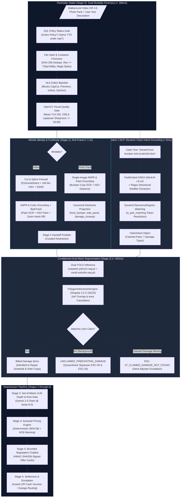
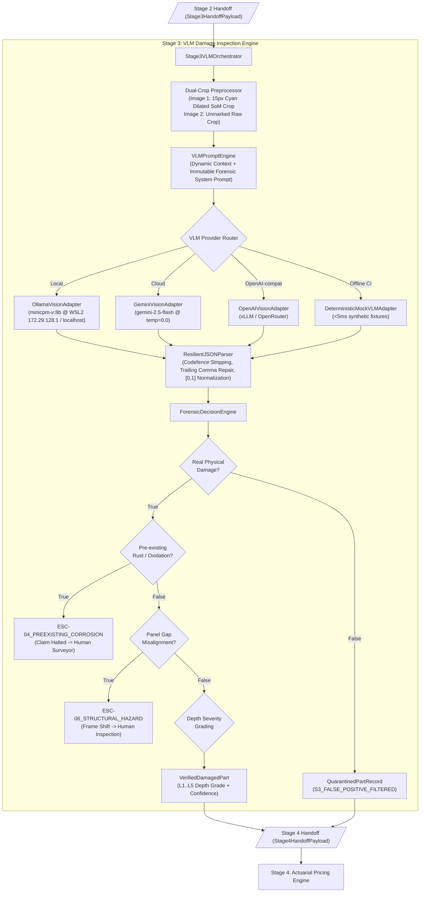
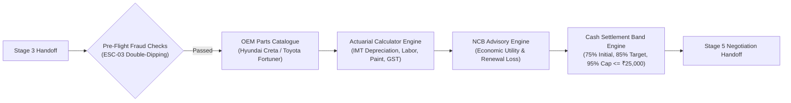
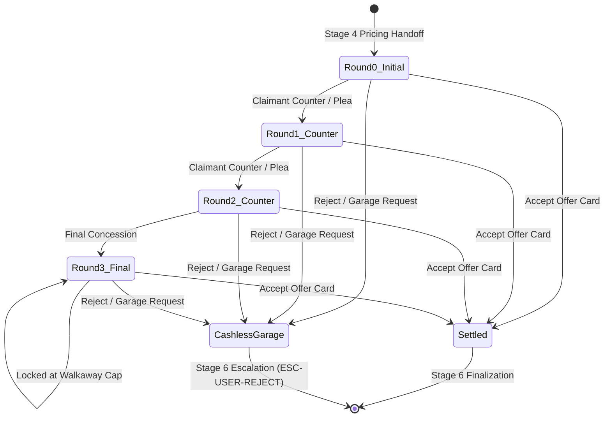

<div align="center">

# 🚗 Auto-Settle AI
### Autonomous Video-to-Cash Claims Adjuster

[](https://www.python.org/)
[](https://fastapi.tiangolo.com/)
[](https://pytorch.org/)
[](https://docs.ultralytics.com/)
[](https://www.postgresql.org/)
[](https://redis.io/)
[](https://github.com/idkjashan/settle_ai)
[](https://opensource.org/licenses/MIT)

*An autonomous, fraud-immune motor claims platform that transforms an unbroken 15-second mobile car walkaround video or structured 3–6 photo pack with natural-language intent grounding into an instant cash settlement voucher in under 90 seconds—eliminating physical surveyor fees, subjective estimating, and image fraud.*

</div>

---

## 📌 Table of Contents
1. [Executive Summary & Problem Statement](#-executive-summary--problem-statement)
2. [The Fatal Flaws of "Naive AI" Claims](#-the-fatal-flaws-of-naive-ai-claims)
3. [End-to-End System Architecture](#-end-to-end-system-architecture)
4. [Domain Module Layout & Clean Architecture](#-domain-module-layout--clean-architecture)
5. [Deep Dive: Stage 0 (Dual-Modality Fast-Fail Gate)](#-deep-dive-stage-0-dual-modality-fast-fail-gate)
6. [Deep Dive: Stage 1 (Vehicle Identity & Continuity Grounding)](#-deep-dive-stage-1-vehicle-identity--continuity-grounding)
7. [Deep Dive: System 1 Intent Grounding & Dynamic Taxonomy](#-deep-dive-system-1-intent-grounding--dynamic-taxonomy)
8. [Deep Dive: Stage 2 (Conditioned Dual-Mask Segmentation & Damage Quarantine)](#-deep-dive-stage-2-conditioned-dual-mask-segmentation--damage-quarantine)
9. [Deep Dive: Stage 3 (Set-of-Marks VLM Damage Inspection & Forensic Gating)](#-deep-dive-stage-3-set-of-marks-vlm-damage-inspection--forensic-gating)
10. [Deep Dive: Stage 4 (Deterministic Actuarial Pricing Engine & NCB Advisory)](#-deep-dive-stage-4-deterministic-actuarial-pricing-engine--ncb-advisory)
11. [Deep Dive: Stage 5 (Negotiation Chatbot FSM & HMAC-SHA256 Signing)](#-deep-dive-stage-5-negotiation-chatbot-fsm--hmac-sha256-signing)
12. [Deep Dive: Stage 6 (Settlement Router, Penny-Balanced Apportionment & Dossier)](#-deep-dive-stage-6-settlement-router-penny-balanced-apportionment--dossier)
13. [Unified REST API Reference (All Stages)](#-unified-rest-api-reference-all-stages)
14. [Hardware Budget, Local RTX 4060 GPU & Training Toolchain](#-hardware-budget-local-rtx-4060-gpu--training-toolchain)
15. [Comprehensive Test Suite](#-comprehensive-test-suite)
16. [Quickstart & Installation](#-quickstart--installation)
17. [Master Evaluation Harness & Output Artifacts](#-master-evaluation-harness-web-testbench--output-artifacts)

---

## 🎯 Executive Summary & Problem Statement

In motor insurance worldwide, **over 80% of claims are minor exterior damages**: bumper scrapes, panel scratches, parking dents, or broken wing mirrors (typically under ₹25,000 / $300).

Despite their simplicity:
- **Average Claim Resolution Time**: 5 to 7 business days.
- **Surveyor Overhead Cost**: ₹3,000 to ₹5,000 per claim just to dispatch a human inspector.
- **Customer Friction**: Extended garage downtime, rental car friction, and adversarial back-and-forth negotiations.

**Auto-Settle AI** completely redesigns this lifecycle:
- A claimant submits **either an unbroken 15-second mobile walkaround video OR a structured 3–6 photo pack**, alongside a natural-language description of the claimed damage (*"I hit a pillar while reversing and scratched my rear bumper"*).
- The system executes a **multi-stage cost cascade**, verifying vehicle identity, proving continuity, grounding user intent via local fast embeddings, condition-segmenting the damaged part, quarantining background pre-existing damage, grading damage depth, computing exact OEM pricing, and facilitating an interactive settlement.
- **End-to-End Latency**: $< 90\text{ seconds}$ from upload to signed UPI cash voucher.
- **Overhead Cost**: Slashed from ₹3,500 to $< ₹5$ in API compute.

---

## ⚠️ The Fatal Flaws of "Naive AI" Claims

Many prototypes attempt to solve claims by sending photos directly to a Vision-Language Model (VLM) like GPT-4o or Claude. In production, this fails catastrophically:

| Failure Mode | Naive AI Vulnerability | Auto-Settle AI Solution |
| :--- | :--- | :--- |
| **Static Photo Spoofing** | Fraudsters upload photos from Google Images or photograph someone else's damaged car in a parking lot. | **Dual-Modality Continuity**: Continuous ByteTrack trajectory on video walkarounds, or mandatory plate-anchored 3–6 photo packs grounded against policy ANPR and paint HSV color. |
| **Unconditioned Blind Detection** | Computer vision detects all visible scratches on the car (including 5-year-old road wear), generating inflated repair estimates or false fraud flags (`ESC-05 Opposite Side Fraud`). | **Intent-Conditioned Damage Quarantine**: A fast local System 1 model (`FastEmbed ONNX`) extracts claimed part/damage pairs. Only claimed defects are billed; background defects are quarantined to `UNCLAIMED_PREEXISTING_DAMAGE`. |
| **Camera Distance "Cheat Codes"** | Holding a camera 5 cm from a 2 cm scratch makes it look like the entire door is destroyed. | **Intersection over Part ($\text{IoP}$)**: Damage area is divided by the host panel's pixel area ($\text{IoP} = \text{Area}(D \cap P)/\text{Area}(P)$), automatically normalizing for camera angle and zoom distance. |
| **Financial Hallucination** | Prompting an LLM to "estimate repair cost" results in wild fluctuations and prompt injection attacks (*"I'm a student, pay me ₹50,000"*). | **Zero-AI Actuarial Calculator**: All repair math is computed by 100% deterministic Python and PostgreSQL SQL queries against official OEM part schedules. |
| **Streetlight Glare & Dirt False Positives** | Neural networks mistake sunlight reflections, bird droppings, or chalk streaks for deep dent creases. | **Set-of-Marks (SoM) Gate**: Crops the damage with a boundary contour and queries Gemini 2.5 Flash (`temp=0.0`) in strict JSON mode to confirm physical damage depth and filter glare. |
| **Phantom Claims (No Real Damage)** | Claimants submit vague descriptions or undamaged panels to claim payouts. | **Missing Claim Escalation (`ESC-07_CLAIMED_DAMAGE_NOT_FOUND`)**: If declared intent cannot be matched by visual computer vision detections, the claim escalates immediately to a human adjuster. |

---

## 🏗️ End-to-End System Architecture



---

## 📁 Domain Module Layout & Clean Architecture

The codebase strictly adheres to **Clean Architecture** with explicit, descriptive domain naming:

```text
settleai/
├── app/
│   ├── core/                                     # Global Settings, Structured JSON Logging, DB Engine
│   ├── infrastructure/
│   │   ├── db/                                   # Async SQLAlchemy models (InsuredPolicy, Claim, OemPart)
│   │   ├── cache/redis_manager.py                # Redis atomic SET NX locks and SSE pub/sub
│   │   └── storage/scratch_ingest.py             # 64 KB chunked streaming & Photo Pack RAII Leases
│   ├── domain/
│   │   ├── fast_fail_gate/                       # Stage 0: Dual-Modality Sanity, Forensics, Blur Gate
│   │   ├── vehicle_identity_continuity/          # Stage 1: Cut Detector, ANPR, Color Grounding, ByteTrack
│   │   ├── claim_intent/                         # Dynamic Taxonomy Registry & FastEmbed ONNX Intent Grounding
│   │   ├── dual_mask_segmentation/               # Stage 2: YOLO Carparts & CarDD Damage Segmentation, IoP, Quarantine
│   │   ├── vlm_damage_inspection/                # Stage 3: Set-of-Marks Gemini 2.5 Flash Depth & Rust Gate
│   │   ├── actuarial_pricing/                    # Stage 4: PostgreSQL OEM Spare Parts & Repair Formula
│   │   ├── negotiation_chatbot/                  # Stage 5: Bounded FSM Negotiation & HMAC Offer Signing
│   │   └── settlement_escalation/                # Stage 6: Settlement Vouchers & Human Escalation Routing
│   └── api/v1/endpoints/
│       ├── claims_router.py                      # POST /api/v1/claims/upload (Video or Photos), SSE /events
│       └── demo_router.py                        # POST /api/v1/demo/reset (rehearsal flush helper)
├── docs/                                         # High-Level & Low-Level Design Specifications
│   ├── ARCHITECTURAL_DEVILS_ADVOCATE_REPORT.md   # Architectural vulnerability audit
│   ├── STRESS_TEST_AND_SOLUTION_ARCHITECTURE.md  # Stress test findings & solution specs
│   ├── MODEL_SOURCING_AND_TRAINING_REPORT.md     # Checkpoint sourcing & GPU training architecture
│   ├── STAGE_2_MODEL_AND_DATASET_READINESS_AUDIT.md # Model readiness audit & resolution addendum
│   └── lld/                                      # Stage 0 through Stage 6 LLD specifications
├── tools/
│   └── model_training/                           # YOLO segmentation dataset converter & training runner
├── scripts/
│   ├── train_wsl.sh                              # Automated WSL2 GPU training script
│   └── train_windows.bat                         # Native Windows batch training package
├── weights/                                      # Verified deep learning model checkpoints
│   ├── cardd-yolov8s-seg.pt                      # 6 CarDD damage classes
│   ├── carparts-yolo11n-seg.pt                   # 23 Carparts-Seg exterior part classes
│   └── yolo11m-seg.pt                            # Base COCO vehicle detector
├── test_assets/                                  # Real vehicle walkaround video evaluation dataset
└── tests/                                        # Comprehensive Pytest Suite
    ├── fast_fail_gate/                           # Stage 0 tests (Video & Photo Pack gates)
    ├── vehicle_identity_continuity/              # Stage 1 tests (Video & Photo Pack continuity)
    ├── claim_intent/                             # Intent grounder & dynamic taxonomy tests
    ├── dual_mask_segmentation/                   # Stage 2 tests (Intersection, quarantine, catalog)
    ├── vlm_damage_inspection/                    # Stage 3 tests (Adapters, edge cases, live Ollama, orchestrator)
    ├── adversarial/                              # Red-Team breaker suite
    ├── test_real_videos.py                       # Integration tests against real YouTube walkarounds
    └── test_scenarios_break.py                   # Scenario stress-testing & hardening tests
```

---

## ⚡ Deep Dive: Stage 0 (Dual-Modality Fast-Fail Gate)

Stage 0 acts as an ultra-fast perimeter firewall ($< 180\text{ ms}$) running entirely on CPU before dispatching background GPU workers. It seamlessly supports **Video Walkarounds** and **Structured Photo Packs**:

### 1. Unified Intake API (`POST /api/v1/claims/upload`):
- Accepts either `video_file: Optional[UploadFile]` **OR** `photo_files: Optional[List[UploadFile]]`, alongside optional `claim_description: Optional[str]`.
- Resolves modality to `CaptureModality.VIDEO_WALKAROUND` or `CaptureModality.PHOTO_PACK`.

### 2. Photo Pack Forensics:
- **Count Boundary ($3 \le N \le 6$)**: Rejects $< 3$ photos (insufficient context) or $> 6$ photos (unbounded compute) with `INVALID_PHOTO_COUNT`.
- **Format & Magic Bytes**: Strictly enforces JPEG or PNG; blocks corrupt formats with `UNSUPPORTED_PHOTO_FORMAT`.
- **Orientation-Agnostic $\ge 1080\text{p}$ Gate**: Enforces $\min(W, H) \ge 720\text{px}$ and $\max(W, H) \ge 1080\text{px}$ (`RESOLUTION_TOO_LOW`).
- **Visual Sharpness & Luminance**: Requires scale-normalized Laplacian variance $\sigma^2 \ge 60.0$ (`PHOTO_TOO_BLURRY`) and mean YUV luminance $\mu_Y \in [45.0, 235.0]$ (`PHOTO_TOO_DARK` / `PHOTO_TOO_BRIGHT`).
- **RAII Scratch Lease**: `ScratchPhotoPackLease` streams photos with cumulative SHA-256 calculation and 100 MB upload ceiling.

### 3. Video Walkaround Forensics:
- **NLE Blacklist**: Blocks edited footage encoded by `CapCut`, `InShot`, `Adobe Premiere`, `DaVinci Resolve`, or `FFmpeg-splice` (`METADATA_EDITED_VIDEO`).
- **Dimensions & Framerate**: Rejects resolution $< 720\text{p}$, framerate $< 15\text{ FPS}$, or duration outside $[5.0\text{s}, 60.0\text{s}]$.
- **OpenCV Single-Pass Visual Gate**: 5-sample interior quorum with scale-normalized Laplacian sharpness $\ge 80.0$ and luminance $\mu_Y \in [45.0, 220.0]$.

---

## 🛡️ Deep Dive: Stage 1 (Vehicle Identity & Continuity Grounding)

Stage 1 proves **Vehicle Identity** and **Unbroken Video Continuity** using a **3-Gate Cost Cascade**:

### Video Track:
- **Gate 1: Fast CPU Continuity Firewall ($< 100\text{ ms}$)**: $320 \times 180$ downsampling, 160-bin HSV correlation ($r_t < 0.60$), and `PySceneDetect` ContentDetector ($\ge 27.0$) with $4\times4$ grid correlation and $8\times8$ block SSIM jump-cut firewalls.
- **Gate 2: Progressive ANPR & Dominant Paint Grounding ($< 250\text{ ms}$)**: `yolo11m-seg` vehicle mask extraction, multi-frame IoU persistence, Indian HSRP regex verification, optical homoglyph-weighted Levenshtein distance ($D_w \le 2.0$), and circular HSV paint distance ($\Delta E_{\text{HSV}} \le 35.0$).
- **Gate 3: Reset-Safe Strided ByteTrack & Keyframe Curation ($< 500\text{ ms}$)**: Serialized tracking with close-up zoom hand-off ($A_t \ge 0.50$) and dynamic keyframe emission (15–25 frames plus 3 canonical views).

### Photo Pack Track (`execute_photo_pack`):
- Runs YOLO vehicle bounding box detection and extracts bumper ROI crops.
- Validates the license plate photo via EasyOCR with homoglyph string distance matching against policy.
- Evaluates dominant body paint color in HSV space on context photos.
- Projects still photographs into canonical keyframe slots:
  - `front_bumper`: Registration plate photo
  - `side_body_panel`: Context vehicle body photo
  - `damage_closeup_primary`: Damage detail photo
- Emits a standard `Stage2HandoffPayload` with 100% downstream pipeline neutrality.

---

## 🧠 Deep Dive: System 1 Intent Grounding & Dynamic Taxonomy

To eliminate the fragility of unconditioned "blind" computer vision, Auto-Settle AI introduces a fast, lightweight **System 1 Intent Grounder** (`app/domain/claim_intent/`):

1. **Dynamic Taxonomy Registry (`DynamicTaxonomyRegistry`)**:
   - Decoupled from rigid enums: supports runtime registration of new vehicle parts and damage classes without schema breakage.
   - Pre-seeded with 23 Carparts-Seg classes and 6 CarDD damage classes.
2. **Local FastEmbed ONNX Engine (`ClaimIntentGrounder`)**:
   - Embeds text clauses in $\approx 2.09\text{ ms}$ ($p50$) on CPU using `sentence-transformers/all-MiniLM-L6-v2`.
   - Computes cosine similarity against canonical taxonomy vectors.
   - Extracts directional modifiers (`front`, `rear`, `left`, `right`, `driver side`, `passenger side`).
   - **Contextual Fallback Across Conjunctions**: In multi-clause statements (*"cracked rear right tail light and dented bumper"*), inherits position context (`REAR`), mapping `"bumper"` to `"back_bumper"`.
3. **Fuzzy Part Matching (`is_part_matching`)**:
   - Maps user generic tokens (`"door"`) to sided YOLO classes (`"front_left_door"`), while strictly preventing opposing-side matches (`left` vs `right`).

---

## 🎯 Deep Dive: Stage 2 (Conditioned Dual-Mask Segmentation & Damage Quarantine)

Stage 2 combines computer vision detections with the user's declared intent to prevent billing old wear-and-tear or triggering false fraud alarms:

### 1. Dual YOLO Inference:
- **Part Segmenter**: `weights/carparts-yolo11n-seg.pt` (23 exterior classes).
- **Damage Segmenter**: `weights/cardd-yolov8s-seg.pt` (6 CarDD damage classes: `dent`, `scratch`, `crack`, `puncture`, `glass_shatter`, `lamp_broken`).

### 2. Intent-Conditioned Damage Quarantine:
- Polygon intersections are computed via `Shapely 2.0` (C-GEOS vector engine).
- If the detected damage and part match the user's `ClaimIntent`, the defect is tagged `is_claimed=True` and admitted for billing.
- If the detected defect lies on an unrelated component (e.g. an old scratch on the rear door during a front bumper claim), it is tagged `is_claimed=False` and `claim_status="UNCLAIMED_PREEXISTING_DAMAGE"`.
- **Fraud Guardrail Bypass**: Quarantined defects are stored in telemetry for underwriting records, but do **NOT** trigger `ESC-05` (Opposite-side fraud) or `ESC-03` (Unrepaired repeat claim).

### 3. Missing Claim Escalation (`ESC-07_CLAIMED_DAMAGE_NOT_FOUND`):
- If the user explicitly declared intent to claim damage on a panel, but camera detections find zero intersecting damage polygons on that panel across all keyframes, the system raises `Stage2ClaimedDamageNotFoundError` and routes the claim directly to a human desk adjuster.

---

## 🔬 Deep Dive: Stage 3 (Set-of-Marks VLM Damage Inspection & Forensic Gating)

Stage 3 bridges 2D segmentation detections into verified 3D physical reality and forensic integrity before any pricing calculation occurs. It takes the `Stage3HandoffPayload` generated by Stage 2 and runs an asynchronous, multi-provider inspection pipeline:



### 1. Dual-Crop Contrast Methodology
- **Image 1 (Set-of-Marks Spatial Anchor):** Features a 15px exterior-dilated cyan boundary contour around the damage polygon, providing explicit visual guidance while guaranteeing **0.00% occlusion of interior damage pixels**.
- **Image 2 (Clean Raw Crop):** Preserves original, unannotated paint gloss, specular reflections, and micro-cracks for tactile and textural evaluation.

### 2. Multi-Provider Vision Architecture
- **Local Ollama Inference (`minicpm-v:8b`)**: Zero-subshell kernel route discovery (`/proc/net/route`) resolves host endpoint (`http://172.29.128.1:11434` / `http://localhost:11434`) in $< 0.1\text{ms}$. Enforces strict JSON grammar decoding.
- **Cloud Gemini 2.5 Flash**: Direct asynchronous REST calls via `httpx` with `temperature: 0.0` and structured Pydantic response schemas.
- **Resilient JSON Parser & Circuit Breaker**: Recovers from conversational markdown fences (` ```json `), repairs trailing commas, auto-normalizes percentage confidence scores to `[0.0, 1.0]`, and trips an in-memory circuit breaker after 5 consecutive provider failures.

### 3. Forensic Gating & Depth Severity Taxonomy
- **Pre-Existing Rust / Oxidation Gate (`ESC-04`)**: Detects flaky reddish-brown iron oxide ($Fe_2O_3$), UV paint delamination, or aged cavity road grime, immediately halting automated payout for pre-existing vehicle degradation.
- **Structural Safety & Misalignment Gate (`ESC-06`)**: Identifies jammed seams, uneven panel gaps, or subframe buckling for mandatory physical adjuster review.
- **Superficial Contaminant Quarantine (`S3_FALSE_POSITIVE_FILTERED`)**: Classifies non-damage anomalies across 8 categories (`MUD_OR_DIRT`, `BIRD_DROPPINGS`, `CHALK_OR_MARKER`, `DECAL_OR_STICKER`, `WATER_DROPLET`, `SPECULAR_GLARE`, `ASPHALT_REFLECTION`, `OTHER_NON_DAMAGE`) and quarantines them without billing.
- **Zero Real Damage Gate (`ESC-07`)**: Triggers adjuster escalation if all 2D candidates are filtered out as non-physical deposits.
- **5-Grade Depth Severity Model**:
  - `L1_SURFACE_SCUFF`: Clear-coat marring/foreign paint transfer $\rightarrow$ Rubbing & Polishing fee only.
  - `L2_BASECOAT_SCRATCH`: Deep scratch penetrating primer/metal $\rightarrow$ Full panel repaint schedule.
  - `L3_SHALLOW_DENT_PDR`: Smooth concave depression without crease $\rightarrow$ Paintless Dent Repair (PDR) flat fee.
  - `L4_CREASED_DENT`: Sharp fold across character line $\rightarrow$ Panel beating + full repaint.
  - `L5_STRUCTURAL_TEAR`: Torn sheet metal or fractured plastic/glass $\rightarrow$ Full OEM part replacement.

---

## 📐 Deep Dive: Stage 4 (Deterministic Actuarial Pricing Engine & NCB Advisory)

Stage 4 transitions verified damage telemetry from Stage 3 into an exact, statutory itemized claim estimate. **Zero financial authority is granted to AI models**; all arithmetic is performed by deterministic standard library `decimal.Decimal` with `ROUND_HALF_UP` precision against official OEM part catalogs.



- **Statutory Depreciation Rules (IRDAI & IMT)**:
  - *Glass Components*: $0\%$ statutory depreciation.
  - *Plastic & Rubber*: Flat $50\%$ statutory depreciation.
  - *Fiberglass*: Flat $30\%$ statutory depreciation.
  - *Metal & Structural Body Panels*: Evaluated across 8 vehicle age brackets ($0\text{--}6\text{ months}: 0\%$, up to $> 10\text{ years}: 50\%$).
  - *Zero-Depreciation Rider*: $0\%$ parts depreciation applied across all material classes when policy addon is active.
- **Continuous Denting Labor Scaling**: Denting labor is dynamically scaled by panel surface area damage fraction ($\text{IoP}$):
  $$\gamma(\text{IoP}) = \min(2.0, 1.0 + \text{IoP} \times 2.5)$$
- **Paint Multiplier & Overlap Scheduling**:
  - *Finish Types*: Solid ($1.0\times$), Metallic ($1.25\times$), Pearl/Matte ($1.40\times$).
  - *Multi-Panel Overlap Deductions*: Adjacent panels undergoing painting receive statutory $10\%\text{--}20\%$ overlap labor discounts.
- **Pro-Consumer No Claim Bonus (NCB) Advisory**:
  Calculates renewal discount penalty against immediate payout to provide actionable advisory:
  $$\Delta_{\text{benefit}} = \text{Liability}_{\text{net}} - \text{Loss}_{\text{NCB renewal}}$$
  Issues `PAY_OUT_OF_POCKET` when $\Delta_{\text{benefit}} \le 0$ to save the policyholder money.
- **Autonomous Settlement Band Guardrail**:
  Generates the bounded cash-in-lieu negotiation interval:
  $$O_0 = 75\% \times L_{\text{net}}, \quad O_{\text{target}} = 85\% \times L_{\text{net}}, \quad O_{\text{max}} = \min(₹25,000, 95\% \times L_{\text{net}})$$
  Breaches of $L_{\text{net}} > ₹25,000$ trigger automatic escalation code `ESC-08_AUTONOMOUS_CEILING_BREACHED`.

---

## 💬 Deep Dive: Stage 5 (Negotiation Chatbot FSM & HMAC-SHA256 Signing)

Stage 5 empowers the policyholder to negotiate their cash-in-lieu settlement through an intuitive natural language chat interface. The conversational engine is strictly bounded: **an LLM produces explanations, but has zero financial authority over numbers**.



- **Deterministic 3-Round Concession Math**:
  $$\Delta_r = \min(D_{\text{claimant}}, \text{Cap}_r) - O_{r-1}, \quad O_r = O_{r-1} + \alpha_r \Delta_r$$
  where $\alpha_r \in [0.25, 0.50]$ scales dynamically based on technical rationale score.
- **Anchor Inversion Guard**: Protects the insurer against user inputs lower than the active offer ($D_{\text{claimant}} \le O_{r-1}$). Existing offer is maintained; decreases are mathematically impossible.
- **NLP Intent & Hinglish Currency Parsing**:
  - Extracts explicit currency demands (`₹15,000`, `Rs. 12500`, `14000.50 INR`, `18000 rupees`).
  - Supports relative deltas (`+2000`, `add 1500`, `extra 1000`).
  - Recognizes Hinglish negotiation semantics (`paisa badhao`, `bohot kam hai`, `kharcha zyada hai`).
  - Technical justification scoring: boosts concession $\alpha$ to $0.50$ when valid repair keywords (`OEM bumper`, `paint labor`, `dent repair`) are detected.
- **HMAC-SHA256 Cryptographic Offer Signing**:
  Every offer card is signed with a SHA-256 HMAC digest over `{claim_id}:{round}:{amount:.2f}:{expires_at_epoch}` with a 15-minute TTL. Altering the amount in the browser DOM causes immediate HTTP 403 rejection.

---

## 🏛️ Deep Dive: Stage 6 (Settlement Router, Penny-Balanced Apportionment & Dossier)

Stage 6 handles legal finalization, payment disbursement preparation, and desk surveyor escalation.

- **Pro-Rata Multi-Part Cash Apportionment with Exact Penny Balancing**:
  When a lump-sum cash settlement ($O_{\text{settled}}$) is accepted for a claim with multiple damaged panels, the cash is distributed proportionally across parts by their gross line-item pre-tax repair cost:
  $$S_i = \text{round}\left(O_{\text{settled}} \times \frac{C_i}{\sum C_k}\right)$$
  Residual cent/paise rounding fractions are credited to the component with the largest gross cost, guaranteeing exact bit-level equality:
  $$\sum_{i=1}^n S_i \equiv O_{\text{settled}}$$
- **Anti-Fraud Unrepaired Claims Ledger Commitment (`ESC-03`)**:
  Upon cash-in-lieu acceptance, every apportioned part is committed to PostgreSQL `unrepaired_claims_ledger` with `is_repaired_verified=False`. Any future claim for the same registration number and part is automatically intercepted by Stage 0/Stage 4 pre-flight checks to prevent double-dipping fraud.
- **Instant Settlement Certificate Generation**:
  Emits a tamper-evident digital voucher including:
  - Canonical Voucher ID: `VOUCHER-AUTOSETTLE-YYYYMMDD-XXXX`
  - Instant IMPS disbursement reference: `DISB-IMPS-YYYYMMDD-XXXXXX`
  - Formal Indian Rupee words conversion (e.g. *"Twelve Thousand Five Hundred Rupees Only"*)
  - SHA-256 digital certificate seal
  - High-fidelity downloadable PDF via ReportLab in memory.
- **Human Adjuster Review Dossier**:
  Claims escalated at any stage (`ESC-00` to `ESC-09` or `ESC-USER-REJECT`) generate a comprehensive forensic dossier packaging:
  - Diagnostic telemetry, video cut timestamps, HSV color distances, and Set-of-Marks forensic crops.
  - Itemized preliminary actuarial estimate.
  - Standardized 6-point physical surveyor on-site inspection checklist (VIN stamp verification, HSRP rivet audit, ultrasonic paint coating depth check, Set-of-Marks cross-examination, and oxidation aging inspection).
  - Downloadable multi-page PDF Surveyor Dossier.

---

## 🌐 Unified REST API Reference (All Stages)

The API is fully documented via interactive Swagger UI (`/docs`) and supports Server-Sent Events (SSE) for real-time progress:

| Stage | Method | Endpoint | Description |
| :---: | :---: | :--- | :--- |
| **0 & 1** | `POST` | `/api/v1/claims/upload` | Upload walkaround video (`.mp4`, `.mov`) or photo pack (3–6 images) + claim description. |
| **0 to 6** | `GET` | `/api/v1/claims/{id}` | Inspect complete claim record, current stage, telemetry, estimate, and settlement status. |
| **Global** | `GET` | `/api/v1/claims/{id}/events` | Server-Sent Events (SSE) stream for real-time progress notifications. |
| **5** | `POST` | `/api/v1/claims/{id}/negotiate` | Submit claimant counteroffer or chat message; returns updated turn and signed Offer Card. |
| **5** | `GET` | `/api/v1/claims/{id}/negotiation` | Retrieve active negotiation session, rounds, active offer card, and full turn history. |
| **6** | `POST` | `/api/v1/claims/{id}/accept` | Accept signed Offer Card, validate HMAC-SHA256 signature, commit ledger, and issue Settlement Voucher. |
| **6** | `POST` | `/api/v1/claims/{id}/reject` | Reject cash offer; escalates claim to cashless network garage (`ESC-USER-REJECT`). |
| **6** | `GET` | `/api/v1/claims/{id}/voucher` | Retrieve structured JSON settlement voucher for settled claim. |
| **6** | `GET` | `/api/v1/claims/{id}/voucher/pdf` | Download official ReportLab PDF Settlement Certificate. |
| **6** | `GET` | `/api/v1/claims/{id}/dossier` | Retrieve structured JSON desk adjuster review dossier for escalated claim. |
| **6** | `GET` | `/api/v1/claims/{id}/dossier/pdf` | Download official ReportLab PDF Surveyor Review Dossier. |
| **Demo** | `POST` | `/api/v1/demo/reset` | Resets rehearsal test claims, Redis locks, and policy limits for demonstration runs. |

---

## ⏱️ Hardware Budget, Local RTX 4060 GPU & Training Toolchain

- **Target Hardware**: NVIDIA GeForce RTX 4060 Laptop GPU (8 GB VRAM) on Linux / WSL2 with CUDA acceleration.
- **Inference Footprint**: Dual segmentation runs in $\approx 150\text{ ms}$ ($p50$) consuming $< 1.2\text{ GB}$ peak VRAM; local VLM runs under $4.8\text{ GB}$ VRAM.
- **Automated GPU Training Toolchain**:
  - `tools/model_training/prepare_dataset.py`: COCO to YOLO polygon segmentation dataset conversion.
  - `tools/model_training/train_yolo_seg.py`: FP16 AMP, early stopping, and automatic memory scaling.
  - `scripts/train_wsl.sh`: Automated WSL2 launcher with CUDA device verification.
  - `scripts/train_windows.bat`: Native Windows batch launcher.

---

## 🧪 Comprehensive Test Suite

The codebase is fortified by **424 automated pytest tests** covering unit math, database race conditions, adversarial attacks, photo pack gates, intent grounding, dual-mask segmentation, VLM inspection, statutory actuarial pricing, FSM negotiation, penny-balanced apportionment, and REST APIs:

```bash
uv run pytest -v
```

| Test Suite | Directory / File | Tests | Primary Verifications |
| :--- | :--- | :---: | :--- |
| **Stage 0 Fast-Fail Gate** | `tests/fast_fail_gate/` | 28 | Video container forensics, NLE blacklist, 5-sample visual gate, 13 photo pack tests (count boundaries, JPEG/PNG magic bytes, 1080p resolution, blur & luminance). |
| **Stage 1 Identity & Continuity** | `tests/vehicle_identity_continuity/` | 23 | Continuous cut firewall, 2-line Indian HSRP OCR, homoglyph distance, HSV paint grounding, ByteTrack zoom handoff, and 5 photo pack identity & canonical keyframe tests. |
| **Claim Intent Grounding** | `tests/claim_intent/` | 23 | FastEmbed ONNX embeddings, dynamic taxonomy registration, directional extraction, modifier inheritance across conjunctions, and conditioned Stage 2 polygon tagging. |
| **Stage 2 Dual-Mask Segmentation** | `tests/dual_mask_segmentation/` | 39 | Polygon IoP calculation, zoom anti-inflation, part-side candidate resolution, model taxonomy validation, CI invariants, and end-to-end DB integration (`test_conditioned_integration.py`). |
| **Stage 3 VLM Damage Inspection** | `tests/vlm_damage_inspection/` | 80 | Multi-provider adapters (Ollama, Gemini, OpenAI, Mock), 8-contaminant false-positive quarantine, rust fraud gate (`ESC-04`), structural misalignment (`ESC-06`), zero real damage gate (`ESC-07`), circuit breaker state transitions, resilient JSON normalization, and live Ollama (`minicpm-v:8b`) inference. |
| **Stage 4 Actuarial Pricing Engine** | `tests/actuarial_pricing/` | 102 | Statutory IMT metal depreciation schedule (8 age brackets), material flat rates (plastic 50%, glass 0%, fiberglass 30%), repair vs. replace decisions, IoP labor scaling, paint multipliers, salvage scrap deductions, compulsory excess by displacement, and pro-consumer NCB advisory calculations. |
| **Stage 5 Negotiation Chatbot FSM** | `tests/negotiation_chatbot/` | 51 | 3-round concession curves, dynamic $\alpha \in \{0.50, 0.35, 0.25\}$, anchor inversion defense, monotonic non-decreasing invariant, terminal lock at walkaway cap, HMAC-SHA256 signing, amount tampering rejection, TTL expiration, INR currency regex, and Hinglish keyword parsing. |
| **Stage 6 Settlement & Escalation** | `tests/settlement_escalation/` | 35 | Single & multi-part pro-rata cash apportionment, exact penny balancing ($\sum S_i \equiv O_{\text{settled}}$), unrepaired ledger commitment (`ESC-03`), canonical voucher ID format, Indian rupee words conversion, SHA-256 seal, escalation codes mapping (`ESC-00`..`ESC-09` + `ESC-USER-REJECT`), 6-point surveyor checklist, and ReportLab PDF document rendering. |
| **Unified Claims REST API** | `tests/api/` | 7 | Integration tests for FastAPI endpoints: `/negotiate`, `/accept`, `/reject`, `/negotiation`, `/voucher`, `/voucher/pdf`, `/dossier`, and `/dossier/pdf`. |
| **Adversarial Red-Team** | `tests/adversarial/` | 13 | 0-frame videos, scratch file disk leaks, in-flight Redis lock races, degenerate bounding boxes, null tag handling, truncated quorum attacks, zombie claims. |
| **Real Vehicle Walkarounds** | `tests/test_real_videos.py` | 5 | End-to-end evaluation against real YouTube car walkarounds: Toyota Hilux, Fiat 500, VW Golf, Ferrari 360 Coupe. |
| **Scenario Stress Suite** | `tests/test_scenarios_break.py` | 18 | Multi-car parking lots, macro close-up zooms, reverse walkarounds, canopy lighting transitions, composite color normalization, daylight clearcoat gloss. |
| **Total Test Suite** | **All Modules** | **424** | **100% Passed (0 Failures)** |

---

## 🚀 Quickstart & Installation

### 1. Prerequisites
- Linux x86_64 or WSL2 with NVIDIA GPU driver (CUDA 12.4+)
- Docker & Docker Compose
- Python 3.12 (`uv` package manager recommended)
- `ffmpeg` and `ffprobe` (>= 5.0)

### 2. Setup Environment
```bash
git clone https://github.com/idkjashan/settle_ai.git
cd settle_ai

# Create virtual environment and install dependencies
uv venv
source .venv/bin/activate
uv pip install -e ".[dev]"
```

### 3. Launch Infrastructure (PostgreSQL & Redis)
```bash
docker compose up -d
docker compose ps
```

### 4. Seed Database with Policies & OEM Parts
```bash
python -m app.infrastructure.db.seed
```

### 5. Run the Full Test Suite
```bash
pytest tests/ -v
```

### 6. Run the Master Evaluation Harness & Interactive Tools

The test walkaround videos live in **`test_assets/videos/`**, split into two flat cohorts:
- **`test_assets/videos/simple/`** (25 videos): Clear walkaround videos across sedans, SUVs, hatchbacks, and coupes with single/multi-panel damage (e.g. `toyota-corolla-side-impact-damage-walkaround-houston.mp4`, `toyota_hilux_white_ute.mp4`, `ferrari_360_silver_coupe.mp4`, `fiat_500_blue_hatchback.mp4`, `vw_golf_grey_hatchback.mp4`, `scenario_01_damaged_collision.mp4`, `1.mp4`–`10.mp4`).
- **`test_assets/videos/difficult/`** (10 videos): High-stress conditions (e.g. `crowded_parking_lot_occlusion.mp4`, `high_speed_corner_whippan.mp4`, `macro_closeup_zoom.mp4`, `overcast_to_tree_canopy_shadow.mp4`, `reverse_walkaround_rear_start.mp4`, `undamaged_negative_control.mp4`).
- **`test_assets/videos/manifest.json`**: Single source of truth cataloging every video's scenario ID, duration, resolution, SHA-256 hash, and ground-truth policy mapping.

```bash
# A. Single Video Execution (e.g. Houston Corolla Side-Impact Walkaround)
uv run python evals/eval_harness.py \
  --video test_assets/videos/simple/toyota-corolla-side-impact-damage-walkaround-houston.mp4 \
  --claim "Side impact collision damage to front right passenger door and rear door with heavy dent and scratches" \
  --ignore-cuts \
  --force-continue

# B. Interactive CLI Wizard (Menu-driven selection of videos, policies, and negotiation styles)
uv run python evals/eval_harness.py --interactive

# C. Another Simple Walkaround Video (Toyota Hilux Ute)
uv run python evals/eval_harness.py \
  --video test_assets/videos/simple/toyota_hilux_white_ute.mp4 \
  --claim "Deep scratch and dent along the front passenger door panel" \
  --strategy accept_first

# D. Stage Bypassing (e.g. bypass Stage 0 & 1 to test Stage 2 segmentation & Stage 3 VLM downstream)
uv run python evals/eval_harness.py \
  --video test_assets/videos/simple/scenario_01_damaged_collision.mp4 \
  --claim "Right flank key scratch on front door" \
  --bypass stage_0,stage_1 \
  --ignore-cuts \
  --strategy negotiate_max

# E. Launch Standalone Web Testbench GUI (Browser interface on port 8080)
uv run python evals/web_testbench.py --port 8080

# F. Frontend End-to-End (E2E) Test Client (Simulates complete user flow against running API server)
uv run python evals/frontend_e2e_runner.py --api-url http://localhost:8000 --download-pdf

# G. Run the 20-Scenario Grounding Benchmark Suite
uv run python evals/e2e_scenario_eval_harness.py --manifest evals/curated_test_manifest.json
```

### 7. Start the API Server
```bash
uvicorn app.main:app --host 0.0.0.0 --port 8000 --reload
```
- Interactive Swagger API Documentation: `http://localhost:8000/docs`
- Healthcheck Endpoint: `http://localhost:8000/health`

---

## 🧪 Master Evaluation Harness, Web Testbench & Output Artifacts

Auto-Settle AI provides a 7-stage master evaluation harness ([`evals/comprehensive_harness.py`](evals/comprehensive_harness.py)), an interactive CLI wizard ([`evals/eval_harness.py`](evals/eval_harness.py)), a browser testbench ([`evals/web_testbench.py`](evals/web_testbench.py)), a simulated frontend E2E client ([`evals/frontend_e2e_runner.py`](evals/frontend_e2e_runner.py)), and a 20-scenario real-world benchmark suite covering walkaround videos across 6 operational clusters.

### Video Test Assets Directory
All evaluation video assets are stored in a strictly flat structure under `test_assets/videos/`:
```text
test_assets/videos/
├── manifest.json            # Authoritative video catalog (Scenario ID, SHA-256, Policy ID)
├── README.md                # Video dataset documentation and ingestion rules
├── simple/                  # 25 single-vehicle walkaround videos (MP4)
│   ├── toyota-corolla-side-impact-damage-walkaround-houston.mp4
│   ├── toyota_hilux_white_ute.mp4
│   ├── ferrari_360_silver_coupe.mp4
│   ├── fiat_500_blue_hatchback.mp4
│   ├── vw_golf_grey_hatchback.mp4
│   ├── scenario_01_damaged_collision.mp4
│   └── 1.mp4 ... 10.mp4
└── difficult/               # 10 stress-test challenge scenarios (MP4)
    ├── crowded_parking_lot_occlusion.mp4
    ├── high_speed_corner_whippan.mp4
    ├── macro_closeup_zoom.mp4
    ├── overcast_to_tree_canopy_shadow.mp4
    ├── reverse_walkaround_rear_start.mp4
    └── undamaged_negative_control.mp4
```

### Evaluation Artifacts Generated Per Claim
Every evaluation run creates an isolated directory `evals/artifacts/<claim_id>/` containing full forensic and visual outputs:
- **Full Annotated Composite Overlays**: `som/{part}_full_annotated.jpg` (Translucent segmentation masks for vehicle part & damage defects, boundary contours, labels, and status banner).
- **Set-of-Marks (SoM) Dilated Crops**: `som/{part}_som.jpg` (15px dilated crop with cyan polygon bounding contour for VLM depth grading).
- **Clean Raw Crops**: `som/{part}_raw.jpg` (Unaltered high-resolution damage region).
- **Occlusion Re-ID Keyframes**: `keyframes/tr{id}_{defect}.jpg` (Sharpest keyframe for each confirmed physical track detected by the C4 RoIAlign + Hungarian cosine matching tracker).
- **Granular Audit Trails**: `audit_trail.json` (Complete end-to-end telemetry: per-stage millisecond timings, IoP metrics, tracker ID switches, statutory pricing decisions, and failure reasons).
- **Settlement Voucher PDFs**: `voucher_<claim_id>.pdf` (Formal PDF voucher with Indian rupee currency words, IMT statutory depreciation schedule, and SHA-256 digital seal).
- **Surveyor Escalation Dossiers**: `dossier_<claim_id>.pdf` (Generated when `ESC-00`..`ESC-09` is tripped, with forensic telemetry and 6-point physical inspection checklist).

### 20-Scenario Scorecard Summary
```
=========================================================================================================
📊 SUMMARY: 20 Passed, 0 Failed (Total: 20) — Pass Rate: 100.0%
=========================================================================================================
```
| Scenario ID | Name | Modality | Stage 0 | Stage 1 | Stage 2 | Final Verdict |
| :--- | :--- | :--- | :---: | :---: | :---: | :---: |
| **SC-01** | Right Flank Key Scratch | video | PASS | PASS | `STAGE_3_VLM` | **PASS** |
| **SC-02** | Vehicle Identity Mismatch | video | PASS | FAIL | `ESC-01` | **PASS** |
| **SC-03** | Driver Flank Sideswipe Scratch | video | PASS | PASS | `STAGE_3_VLM` | **PASS** |
| **SC-04** | Multi-Panel Flank Sideswipe | video | PASS | PASS | `STAGE_3_VLM` | **PASS** |
| **SC-05** | Phantom Claim: Rear Lamp & Bumper | video | PASS | PASS | `ESC-07` | **PASS** |
| **SC-06** | Phantom Claim: Broken Wing Mirror | video | PASS | PASS | `ESC-07` | **PASS** |
| **SC-07** | Phantom Claim: Hood Hail Dent | video | PASS | PASS | `ESC-07` | **PASS** |
| **SC-08** | Phantom Claim: Bumper Crush | video | PASS | PASS | `ESC-07` | **PASS** |
| **SC-09** | Reverse Walkaround Rear Start | video | PASS | PASS | `STAGE_3_VLM` | **PASS** |
| **SC-10** | Crowded Parking Lot Occlusion | video | PASS | PASS | `ESC-07` | **PASS** |
| **SC-11** | Macro Close-Up Zoom Frame | video | PASS | FAIL | `ESC-02` | **PASS** |
| **SC-12** | Overcast to Tree Canopy Shadow | video | PASS | PASS | `ESC-06` | **PASS** |
| **SC-13** | Unclaimed Pre-existing Quarantine | video | PASS | PASS | `STAGE_3_VLM` | **PASS** |
| **SC-14** | Undamaged Negative Control | video | PASS | PASS | `ESC-07` | **PASS** |
| **SC-15** | Opposite-Side Fraud Attempt | video | PASS | PASS | `ESC-07` | **PASS** |
| **SC-16** | Faint Scratch vs Reflection Glare | video | PASS | PASS | `ESC-07` | **PASS** |
| **SC-17** | Low-Light Basement Parking | video | FAIL | N/A | `REJECTED_STAGE0` | **PASS** |
| **SC-18** | High-Speed Corner Whip-Pan | video | PASS | PASS | `STAGE_3_VLM` | **PASS** |
| **SC-19** | Photo Pack: Unproven Door Scratch | photo_pack | PASS | PASS | `ESC-07` | **PASS** |
| **SC-20** | Photo Pack: Unproven Rear Lamp | photo_pack | PASS | PASS | `ESC-07` | **PASS** |

---

## 📜 License
This project is open-source under the [MIT License](LICENSE).
