# 🚗 SettleAI

### Autonomous Video-to-Cash Motor Claims Adjuster

**SettleAI** is an autonomous motor claims platform that converts an unbroken 15-second smartphone walkaround video into a cryptographically signed UPI cash settlement in under 90 seconds. 

By combining perimeter video forensics, dual-mask segmentation, zero-LLM deterministic actuarial pricing, and an HMAC-sealed negotiation chatbot, SettleAI slashes physical surveyor overhead from ₹3,500 to under ₹5 per claim while eliminating subjective estimation and fraud leakages.

---

## 🏗️ System Architecture

```mermaid
flowchart TD
    subgraph S0["Stage 0: Fast-Fail Gate (< 250ms)"]
        IN[/"15s Smartphone Walkaround Video + Natural Language Claim Intent"/] --> FF1["Container & Metadata Forensics\n(SHA-256 Dedupe, Magic Bytes)"]
        FF1 --> FF2["Editor & Spoof Detection\n(CapCut, InShot, Premiere Rejection)"]
        FF2 --> FF3["Image Quality Assurance\n(Laplacian Blur >= 60, YUV Luminance [45, 235])"]
    end

    subgraph S1["Stage 1: Identity, Continuity & Intent Grounding"]
        FF3 --> V1["ANPR & Plate Verification\n(PaddleOCR + Homoglyph Matching)"]
        V1 --> V2["CIELAB Paint Distance Check\n(Delta E <= 18 vs Policy Ground Truth)"]
        V2 --> V3["ByteTrack Orbit Continuity\n(Vehicle Trajectory & 360-deg Re-ID)"]

        IN -.-> N1["System 1 Intent Grounding\n(FastEmbed ONNX MiniLM-L6-v2)"]
        N1 --> N2["Directional Modifier & Taxonomy Match\n(Target Billed Parts Resolution)"]
    end

    subgraph S2["Stage 2: Conditioned Dual-Mask Segmentation"]
        V3 --> S2A["Dual YOLO Inference\n(Carparts YOLO11n + CarDD YOLOv8s)"]
        N2 --> S2A
        S2A --> S2B["Shapely C-GEOS Geometry Engine\n(Intersection over Part IoP & Anti-Zoom Clamping)"]
        S2B --> S2C{"Claim Intent Match?"}
        S2C -- "Admitted Claim" --> D_BILLED["Billed Claim Defects"]
        S2C -- "Unrelated Wear" --> D_QUARANTINE["Quarantined Pre-Existing Wear\n(Suppresses False ESC-05 Alarms)"]
    end

    subgraph S3["Stage 3: SoM VLM Forensics"]
        D_BILLED --> SOM1["Set-of-Marks (SoM) Crop Generator\n(High-Res Numerical Bounding Badges)"]
        SOM1 --> SOM2["VLM Forensic Gate (Gemini 2.5 Flash)\n(L1-L5 Depth Grading, Rust Age ESC-04, Glare Rejection)"]
    end

    subgraph S4["Stage 4: Deterministic Actuarial OEM Pricing"]
        SOM2 --> OEM1["22 Canonical OEM Parts Catalog\n(Hyundai, Toyota, Tata OEM Master)"]
        OEM1 --> OEM2["IRDAI Tariff Depreciation Schedules\n(Rubber/Plastic 50%, Glass 0%, Metal 0-50%)"]
        OEM2 --> OEM3["NCB Protection Advisor & Salvage Math\n(Zero-LLM Deterministic Financial Math)"]
    end

    subgraph S5["Stage 5: Bounded FSM Negotiation & HMAC Signing"]
        OEM3 --> NEG1["Multi-Round Concession FSM\n(Rigid Hard-Ceiling Margin Guardrails)"]
        NEG1 --> NEG2["Cryptographic Offer Generator\n(HMAC-SHA256 Sealed Offer Cards)"]
    end

    subgraph S6["Stage 6: Settlement Router & Cash Disbursement"]
        NEG2 --> DECIDE{"Claim Disposition?"}
        DECIDE -- "Instant Cash Settlement" --> SETTLE["Instant UPI Cash Voucher\n(Settled Voucher, UPI Simulator & PDF Download)"]
        DECIDE -- "Escalation / Safety Gate" --> ESCALATE["Surveyor Adjuster Dossier\n(Full Forensic Audit PDF Package)"]
    end

    style S0 fill:#0f172a,stroke:#38bdf8,color:#f8fafc
    style S1 fill:#1e293b,stroke:#38bdf8,color:#f8fafc
    style S2 fill:#1e293b,stroke:#818cf8,color:#f8fafc
    style S3 fill:#1e293b,stroke:#a855f7,color:#f8fafc
    style S4 fill:#0f172a,stroke:#10b981,color:#f8fafc
    style S5 fill:#1e293b,stroke:#f59e0b,color:#f8fafc
    style S6 fill:#0f172a,stroke:#22c55e,color:#f8fafc
```



---

## ⚡ How to Run

### 1. Backend Setup
1. **Start Database & Cache**:
   ```bash
   docker compose up -d
   ```
   *Runs PostgreSQL 16 on port `5432` and Redis 7 on port `6379`.*

2. **Start FastAPI Application Server**:
   ```bash
   uv run uvicorn app.main:app --host 0.0.0.0 --port 8000 --reload
   ```
3. **Verify API & Health**:
   - Interactive Swagger API Docs: [http://localhost:8000/docs](http://localhost:8000/docs)
   - Healthcheck: [http://localhost:8000/health](http://localhost:8000/health)

### 2. Frontend Setup
1. **Start Next.js Application**:
   ```bash
   npm --prefix frontend run dev
   ```
   *(Or for production build: `npm --prefix frontend run build && npm --prefix frontend run start`)*
2. **Access Workstation**:
   - Live Dashboard: [http://localhost:3000](http://localhost:3000)

### 3. Seed Database (For Hackathon Judges & Evaluation)
You can seed or reset all insured policies, OEM catalogs, and demonstration scenarios using any of the following:
- **Direct 1-Click Link for Judges**: Open [http://localhost:8000/api/v1/demo/seed](http://localhost:8000/api/v1/demo/seed) (or [http://localhost:3000/api/v1/demo/seed](http://localhost:3000/api/v1/demo/seed)) in your browser or run:
  ```bash
  curl http://localhost:8000/api/v1/demo/seed
  ```
- **Clean Slate for Manual Video Uploads** (zero claim history): Open [http://localhost:8000/api/v1/demo/clean-slate](http://localhost:8000/api/v1/demo/clean-slate) or run:
  ```bash
  curl http://localhost:8000/api/v1/demo/clean-slate
  ```
- **CLI Seed Command**:
  ```bash
  uv run python -m app.infrastructure.db.seed
  ```
- **Web UI 1-Click Button**: Click the **"+"** icon in the topbar of [http://localhost:3000](http://localhost:3000).

---

## 🎬 Curated Test Assets & Demonstration Scenarios

Four authentic walkaround videos are pre-staged for immediate end-to-end evaluation:

| Video Asset | Vehicle & Policy | Scenario / Damage | Feature Demonstrated | Direct Claim Link |
| :--- | :--- | :--- | :--- | :--- |
| `car_002.mp4` | **Hyundai Creta 2023**<br>`POL-HAPPY-001` | Front bumper & headlamp impact scuff | **Stage 5 Interactive Negotiation Chatbot**: Multi-round counter-offers, bounded concession FSM & HMAC-SHA256 acceptance | [Open Claim 11111111](http://localhost:3000/claims/11111111-1111-4111-8111-111111111111) |
| `toyota-corolla-side-impact-damage-walkaround-houston.mp4` | **Toyota Corolla 2022**<br>`POL-TOYOTA-008` | Dual-door side-impact collision crease | **Multi-Panel Actuarial Pricing Breakdown**: Multi-part denting/painting schedule, depreciation & adjacent panel discount | [Open Claim 44444444](http://localhost:3000/claims/44444444-4444-4444-4444-444444444444) |
| `car_011.mp4` | **Tata Nexon Blue**<br>`POL-BLUE-011` | Shallow door ding (marked PDR) | **Stage 6 Instant Cash Settlement**: Cash-in-Lieu voucher, UPI instant disbursement simulation & PDF voucher download | [Open Claim 22222222](http://localhost:3000/claims/22222222-2222-4222-8222-222222222222) |
| `10.mp4` | **Toyota Camry XLE**<br>`POL-CAMRY-010` | Shattered laminated windshield & hood dent | **ESC-06 Safety-Critical Component Gate**: Structural glass damage escalation & Surveyor Adjuster Dossier PDF generation | [Open Claim 33333333](http://localhost:3000/claims/33333333-3333-4333-8333-333333333333) |

---

## 🧪 Automated Testing

Run the test suite to verify fast-fail heuristics and core API endpoints:

```bash
uv run pytest tests/api/ tests/fast_fail_gate/ -q
```
