<div align="center">

# 🚗 Auto-Settle AI
### Autonomous Video-to-Cash Claims Adjuster

[](https://www.python.org/)
[](https://fastapi.tiangolo.com/)
[](https://pytorch.org/)
[](https://docs.ultralytics.com/)
[](https://www.postgresql.org/)
[](https://redis.io/)
[](https://github.com/idkjashan/settle_ai)
[](https://opensource.org/licenses/MIT)

*An autonomous, fraud-immune insurance claims platform that transforms an unbroken 15-second mobile car walkaround video into an instant cash settlement voucher in under 90 seconds—eliminating physical surveyor fees, subjective estimating, and image fraud.*

</div>

---

## 📌 Table of Contents
1. [Executive Summary & Problem Statement](#-executive-summary--problem-statement)
2. [The Fatal Flaws of "Naive AI" Claims](#-the-fatal-flaws-of-naive-ai-claims)
3. [End-to-End System Architecture](#-end-to-end-system-architecture)
4. [Domain Module Layout & Clean Architecture](#-domain-module-layout--clean-architecture)
5. [Deep Dive: Stage 0 (Fast-Fail Gate)](#-deep-dive-stage-0-fast-fail-gate)
6. [Deep Dive: Stage 1 (Vehicle Identity & Continuity Grounding)](#-deep-dive-stage-1-vehicle-identity--continuity-grounding)
7. [Downstream Pipeline (Stages 2 through 6)](#-downstream-pipeline-stages-2-through-6)
8. [Actuarial Pricing & The Pro-Consumer NCB Warning](#-actuarial-pricing--the-pro-consumer-ncb-warning)
9. [Hardware Budget & Latency SLA](#-hardware-budget--latency-sla)
10. [Comprehensive Test Suite (69/69 Green)](#-comprehensive-test-suite-6969-green)
11. [Quickstart & Installation](#-quickstart--installation)

---

## 🎯 Executive Summary & Problem Statement

In motor insurance worldwide, **over 80% of claims are minor exterior damages**: bumper scrapes, panel scratches, parking dents, or broken wing mirrors (typically under ₹25,000 / $300).

Despite their simplicity:
- **Average Claim Resolution Time**: 5 to 7 business days.
- **Surveyor Overhead Cost**: ₹3,000 to ₹5,000 per claim just to dispatch a human inspector.
- **Customer Friction**: Extended garage downtime, rental car friction, and adversarial back-and-forth negotiations.

**Auto-Settle AI** completely redesigns this lifecycle:
- A claimant captures **one continuous 15-second mobile walkaround video** starting at the vehicle's registration plate and sweeping to the damaged panel.
- The system runs through a **7-Stage Cost Cascade**, verifying vehicle identity, proving zero-splice video continuity, segmenting the damaged part, grading damage depth, computing exact OEM pricing, and negotiating an instant cash settlement.
- **End-to-End Latency**: $< 90\text{ seconds}$ from video upload to signed UPI cash voucher.
- **Overhead Cost**: Slashed from ₹3,500 to $< ₹5$ in API compute.

---

## ⚠️ The Fatal Flaws of "Naive AI" Claims

Many prototypes attempt to solve claims by sending photos to a Vision-Language Model (VLM) like GPT-4o or Claude. In production, this fails catastrophically:

| Failure Mode | Naive AI Vulnerability | Auto-Settle AI Solution |
| :--- | :--- | :--- |
| **Static Photo Spoofing** | Fraudsters upload photos from Google Images or photograph someone else's damaged car in a parking lot. | **Unbroken Walkaround Requirement**: Stage 1 proves physical video continuity from the verified policy license plate to the damage site via continuous ByteTrack and scene cut firewalls. |
| **Camera Distance "Cheat Codes"** | Holding a camera 5 cm from a 2 cm scratch makes it look like the entire door is destroyed. | **Intersection over Part ($\text{IoP}$)**: Damage area is divided by the host panel's pixel area ($\text{IoP} = \text{Area}(D \cap P)/\text{Area}(P)$), automatically normalizing for camera angle and zoom distance. |
| **Financial Hallucination** | Prompting an LLM to "estimate repair cost" results in wild fluctuations and prompt injection attacks (*"I'm a student, pay me ₹50,000"*). | **Zero-AI Actuarial Calculator**: All repair math is computed by 100% deterministic Python and PostgreSQL SQL queries against official OEM part schedules. |
| **Streetlight Glare & Dirt False Positives** | Neural networks mistake sunlight reflections, bird droppings, or chalk streaks for deep dent creases. | **Set-of-Marks (SoM) VLM Gate**: Crops the damage with a boundary contour and queries Gemini 2.5 Flash (`temp=0.0`) in strict JSON mode to confirm physical damage depth and filter glare. |
| **Pre-Existing Damage Fraud** | Claimants submit old collision damage from months ago. | **Rust & Oxidation Detection**: The VLM gate inspects exposed metal ridges for iron oxide (brown rust), instantly rejecting pre-existing claims (`ESC-04`). |

---

## 🏗️ End-to-End System Architecture

```mermaid
flowchart TD
    subgraph S0["Fast-Fail Gate (Stage 0): Zero-GPU Sanity & Forensics (< 180ms)"]
        A0[/"User Uploads / Streams 15s Walkaround Video"/] --> A1["Policy Status Check\n(Active Policy? Claims YTD under cap?)"]
        A1 --> A2["File Hash & Container Check\n(SHA-256 Dedupe Lock, Res >= 720p, Dur 5-60s)"]
        A2 --> A3["NLE Editor Blacklist\n(Blocks CapCut, Premiere, InShot, DaVinci)"]
        A3 --> A4["OpenCV Visual Quality Gate\n(Mean YUV [45, 220] & Laplacian Sharpness >= 80)"]
    end

    subgraph S1["Vehicle Identity & Continuity (Stage 1): Anti-Fraud (< 1.2s)"]
        A4 --> B["Gate 1: Fast CPU Cut & Splice Firewall\n(PySceneDetect + 160-bin HSV Corr + SSIM + Freeze Check)"]
        B --> C["Gate 2: Progressive ANPR & Color Grounding\n(YOLO11m-seg + 2-Line HSRP Merge + Circular HSV Distance)"]
        C --> D["Gate 3: Reset-Safe Strided ByteTrack & Keyframe Curation\n(Foreground Latching + Zoom Hand-Off + N Keyframes)"]
    end

    subgraph S2["Dual-Mask Segmentation (Stage 2): Part & Damage Mapping (< 300ms)"]
        D --> E["Model A: Carparts-Seg\n(23 Exterior Body Classes)"]
        D --> F["Model B: Damage-Seg\n(6 Damage Mask Classes)"]
        E & F --> G["Intersection over Part (IoP) Math\n& Boundary Spillover Filter"]
    end

    subgraph S3["VLM Damage Inspection (Stage 3): Set-of-Marks Depth & Rust Gate"]
        G --> H["Set-of-Marks High-Res Crop\n(Boundary Contour Prompting)"]
        H --> I["Gemini 2.5 Flash (temperature=0.0)\n(Depth Grades L1-L5, Rust Check, Glare Filter)"]
    end

    subgraph S4["Actuarial Pricing Engine (Stage 4): Deterministic OEM Calculator"]
        I --> J[("PostgreSQL OEM Parts &\nLabour Schedule DB")]
        J --> K["Repair-vs-Replace Formula\n(OEM Part + R&R Labour + Full-Panel Paint Schedule)"]
        K --> L["Actuarial Cash Window [75% to 95%]\n+ Pro-Consumer NCB Protection Alert"]
    end

    subgraph S5["Negotiation Chatbot (Stage 5): Bounded FSM Negotiation"]
        L --> M["Lock Cash Window\n[Initial=75%, Target=85%, Max=95% Cap]"]
        M --> N["Interactive 3-Round Chatbot\n(HMAC-SHA256 Cryptographically Signed Offer Cards)"]
    end

    subgraph S6["Settlement & Escalation (Stage 6): Instant Payout or Garage Routing"]
        N -- "Accepted" --> O["Instant Cash Payout Voucher (UPI)\n+ Mark Part in Unrepaired Ledger"]
        N -- "Rejected / Escalated" --> P["Cashless Network Garage Booking\nor Human Adjuster Queue"]
    end

    style S0 fill:#0f172a,stroke:#94a3b8,color:#f8fafc
    style S1 fill:#1e293b,stroke:#38bdf8,color:#f8fafc
    style S2 fill:#1e293b,stroke:#818cf8,color:#f8fafc
    style S3 fill:#1e293b,stroke:#c084fc,color:#f8fafc
    style S4 fill:#1e293b,stroke:#34d399,color:#f8fafc
    style S5 fill:#1e293b,stroke:#fbbf24,color:#f8fafc
    style S6 fill:#1e293b,stroke:#f87171,color:#f8fafc
```



---

## 📁 Domain Module Layout & Clean Architecture

The codebase strictly adheres to **Clean Architecture** with explicit, descriptive domain naming:

```text
auto-settle-ai/
├── app/
│   ├── core/                                     # Global Settings, Structured JSON Logging, DB Engine
│   ├── infrastructure/
│   │   ├── db/                                   # Async SQLAlchemy models (InsuredPolicy, Claim, OemPart)
│   │   ├── cache/redis_manager.py                # Redis atomic SET NX locks and SSE pub/sub
│   │   └── storage/scratch_ingest.py             # 64 KB chunked streaming & SHA-256 calculation
│   ├── domain/
│   │   ├── fast_fail_gate/                       # Stage 0: Zero-GPU Sanity, Container Forensics, Blur Gate
│   │   ├── vehicle_identity_continuity/          # Stage 1: Cut Detector, ANPR, Color Grounding, ByteTrack
│   │   ├── dual_mask_segmentation/               # Stage 2: YOLO11m Carparts & Damage Segmentation, IoP
│   │   ├── vlm_damage_inspection/                # Stage 3: Set-of-Marks Gemini 2.5 Flash Depth & Rust Gate
│   │   ├── actuarial_pricing/                    # Stage 4: PostgreSQL OEM Spare Parts & Repair Formula
│   │   ├── negotiation_chatbot/                  # Stage 5: Bounded FSM Negotiation & HMAC Offer Signing
│   │   └── settlement_escalation/                # Stage 6: Settlement Vouchers & Human Escalation Routing
│   └── api/v1/endpoints/
│       ├── claims_router.py                      # POST /api/v1/claims/upload, SSE /claims/{id}/events
│       └── demo_router.py                        # POST /api/v1/demo/reset (rehearsal flush helper)
├── docs/                                         # High-Level & Low-Level Design Specifications
│   ├── auto_settle_ai_architecture_adversarial_plan.md
│   └── lld/
│       ├── LLD_STAGE_0_FAST_FAIL_GATE.md
│       └── LLD_STAGE_1_VEHICLE_IDENTITY_CONTINUITY.md
├── test_assets/                                  # Real vehicle walkaround video evaluation dataset
│   ├── real_videos/                              # 4 standardized real YouTube car walkarounds
│   ├── scenario_videos/                          # 5 scenario walkarounds (damaged, closeup, parking lot, etc.)
│   └── keyframes_for_stage2/                     # Extracted, distinct keyframes for Stage 2
└── tests/                                        # Comprehensive Pytest Suite (69 Tests)
    ├── fast_fail_gate/                           # Stage 0 tests (T0-01 to T0-21)
    ├── vehicle_identity_continuity/              # Stage 1 tests (T1-01 to T1-18)
    ├── adversarial/                              # Red-Team breaker suite (13 tests)
    ├── test_real_videos.py                       # Integration tests against real YouTube walkarounds
    └── test_scenarios_break.py                   # Scenario stress-testing & hardening tests
```

---

## ⚡ Deep Dive: Stage 0 (Fast-Fail Gate)

The **Fast-Fail Gate** acts as an ultra-fast perimeter firewall ($< 180\text{ ms}$) running entirely on CPU before dispatching background GPU workers.

### Key Capabilities:
1. **Tier-1 SQL Policy Gate**:
   - Queries `insured_policies` table via indexed async SQL.
   - Asserts `policy_status == 'ACTIVE'`, current timestamp is within the active date window, and claims count is under `max_cash_claims_per_year`.
2. **Atomic In-Flight Deduplication**:
   - Computes incremental SHA-256 during 64 KB chunked streaming.
   - Acquires `SET claim:lock:{sha256} {claim_id} NX EX 60` in Redis.
   - Enforces partial unique index `idx_claims_unique_active_video_sha256` in PostgreSQL.
   - **Post-Commit Lock Release**: Lock is held across the PostgreSQL claim record insertion, eliminating race conditions on simultaneous duplicate uploads.
3. **Tier-2A Container Forensics (`ffprobe`)**:
   - **NLE Blacklist**: Rejects videos encoded by `CapCut`, `InShot`, `Adobe Premiere`, `DaVinci Resolve`, or `FFmpeg-splice` (`METADATA_EDITED_VIDEO`).
   - **Dimensions & Framerate**: Rejects resolution $< 720\text{p}$, framerate $< 15\text{ FPS}$, or duration outside $[5.0\text{s}, 60.0\text{s}]$.
4. **Tier-2B Visual Quality Gate (OpenCV Single-Pass `grab()` Loop)**:
   - Samples 5 interior frames at timestamps $p \in \{0.10, 0.30, 0.50, 0.70, 0.90\}$.
   - **Luminance Guard**: Mean YUV luminance $\mu_Y \in [45.0, 220.0]$. Values $> 220.0$ are rejected with `VIDEO_TOO_BRIGHT` to prevent washed-out scratch frames.
   - **Scale-Normalized Laplacian Sharpness**: Normalizes resolution to 720p base and enforces variance $\sigma^2_{\nabla^2 I} \ge 80.0$.
   - **Mandatory 5-Sample Quorum**: Truncated containers declaring 15s but only containing 1–2 decodable frames are rejected with `CONTAINER_PARSE_FAILED`.

---

## 🛡️ Deep Dive: Stage 1 (Vehicle Identity & Continuity Grounding)

Stage 1 proves **Vehicle Identity** and **Unbroken Video Continuity** using a **3-Gate Cost Cascade**:

### Gate 1: Fast CPU Continuity & Splice Firewall ($< 100\text{ ms}$)
- Evaluates downsampled $320 \times 180$ frames (`cv2.INTER_AREA`).
- Computes 160-bin HSV histogram correlation ($r_t < 0.60$) and `PySceneDetect` `ContentDetector` ($\ge 27.0$).
- Detects subtle jump cuts and same-car splices using triggered $4\times4$ spatial grid HSV correlation ($r_{t,\text{p25}} < 0.52$) and $8\times8$ block SSIM ($< 0.68$).
- **Whip-Pan Tolerance**: Requires both HSV distance spike AND structural correlation/SSIM collapse before flagging a cut, preventing false cut rejections during fast corner turns.
- **FPS-Scaled Freeze Detection**: Replaces static frame counts with `max_frozen_allowed = max(15, int(fps * 0.75))` (750ms tolerance), preventing false positives on Optical Image Stabilization (OIS) pauses.

### Gate 2: Progressive ANPR & Dominant Paint Grounding ($< 250\text{ ms}$)
- **Vehicle ROI**: Extracts vehicle mask using `yolo11m-seg` ($\ge 6\%$ area ratio to accommodate wide exterior walkarounds).
- **Multi-Frame IoU Persistence**: Tracks bounding boxes across initial window frames ($\text{IoU} \ge 0.35$). Prioritizes persistent foreground candidates ($\ge 2$ hits, largest area) to lock onto the stationary claim vehicle and ignore background traffic.
- **Structural Plate Regex & Floor**: Enforces character floor $\ge 5$ characters and validates structural patterns (Indian HSRP `^[A-Z]{2}[0-9]{1,2}[A-Z]{0,3}[0-9]{4}$`, Indian BH, and generic alphanumeric `^(?=.*[A-Z])(?=.*[0-9])[A-Z0-9]{5,10}$`), filtering letter-only brand emblems ("TURBO", "HYUNDAI").
- **2-Line HSRP Merging**: Groups stacked rear plate text using vertical-proximity clustering before matching.
- **Homoglyph String Distance**: Uses optical homoglyph-weighted Levenshtein distance ($D_w \le 2.0$) against policy records with conditional Gemini 2.5 Flash VLM fallback on ambiguous crops.
- **Paint Color HSV Matching**: Evaluates paint-filtered circular HSV distance ($\Delta E_{\text{HSV}} \le 35.0$). Automatically normalizes multi-word underwriting names (e.g. `"Metallic Blue"` $\to$ `"BLUE"`) and expands black paint bounds ($S \le 45, V \le 100$) to tolerate glossy clearcoat reflections under open daylight.
- **Late-Track Discovery**: If filming starts at the rear (reverse walkaround), Gate 2 defers plate check; Gate 3 verifies the plate along the tracklet and retroactively validates paint color before claim approval.

### Gate 3: Reset-Safe Strided ByteTrack & Keyframe Curation ($< 500\text{ ms}$)
- **Semaphore Lock & State Reset**: Serialized under `asyncio.Semaphore(1)` with explicit `predictor.trackers[0].reset()` before Frame 0, preventing multi-tenant state bleed.
- **Scale-Aware Close-Up Zoom Hand-off**: When the camera moves in close to panel damage ($A_t \ge 0.50$), whole-car detector dropout is forgiven.
- **Adaptive Trajectory Quality Curation**: Replaces rigid timeline buckets ($t \le 0.33$) with dynamic frame density scaling:
  $$N = \max\left(8, \min\left(30, \text{int}(T \cdot \text{fps})\right)\right)$$
  Emits 15–25 high-resolution native frames (`keyframe_01.jpg` .. `keyframe_NN.jpg`) plus 3 strictly distinct canonical views (`front_bumper.jpg`, `side_body_panel.jpg`, `damage_closeup_primary.jpg`) separated by $\min |f_i - f_j| > 20$ frames with 0% duplicate hash separation.

---

## 🔍 Downstream Pipeline (Stages 2 through 6)

### Stage 2: Dual-Mask Part & Damage Segmentation
- Runs dual YOLO11m instance segmentation models across curated keyframes:
  - **`Carparts-Seg`**: Identifies 23 canonical exterior parts (`front_left_door`, `front_bumper`, `left_mirror`, etc.).
  - **`Damage-Seg`**: Identifies 6 damage types (`dent`, `scratch`, `tear`, `crack`, `hole`, `lamp_broken`).
- **Normalized Severity Formula**:
  $$\text{IoP}(D_i, P_j) = \frac{\text{Area}(D_i \cap P_j)}{\text{Area}(P_j)}$$
- **Boundary Spillover Filter**: Discards accidental overlaps where $< 5\%$ of the damage touches a neighboring panel.

### Stage 3: Set-of-Marks (SoM) VLM Inspection
- Takes the sharpest close-up damage crop, outlines the damage polygon with a high-contrast boundary contour, and queries **Gemini 2.5 Flash** (`temperature=0.0`) in strict JSON mode:
  ```json
  {
    "is_real_physical_damage": true,
    "false_positive_reason": "NONE",
    "depth_grade": "L4_CREASED_DENT",
    "has_rust_or_oxidation": false,
    "has_panel_gap_misalignment": false,
    "visual_reasoning_short": "Sharp inward sheet-metal crease on lower door skin with exposed grey primer; no orange rust."
  }
  ```
- **Depth Grades**:
  - `L1_SURFACE_SCUFF`: Clearcoat scuff $\to$ Rubbing & Polishing fee only.
  - `L2_BASECOAT_SCRATCH`: Deep scratch exposing primer $\to$ Putty + Full-Panel Repaint.
  - `L3_SHALLOW_DENT_PDR`: Smooth shallow dent $\to$ Paintless Dent Repair (PDR).
  - `L4_CREASED_DENT`: Deep dent or metal crease $\to$ Tinkering Labour + Full-Panel Repaint.
  - `L5_STRUCTURAL_TEAR_CRACK`: Cracked bumper or broken lamp $\to$ Full Part Replacement.

### Stage 4: Actuarial Pricing Engine
- 100% deterministic Python + PostgreSQL OEM spare part and labour schedule lookups:
  - **Replace**: If `is_repairable == False` OR `depth_grade == 'L5'` OR $\text{IoP} > 0.40$.
  - **Dent & Paint**: If `depth_grade` $\in \{\text{L2}, \text{L4}\}$ and $\text{IoP} \le 0.40$.
  - **Polish / PDR**: If `depth_grade` $\in \{\text{L1}, \text{L3}\}$ and $\text{IoP} < 0.10$.
- Applies policy deductible, depreciation schedules (Zero-Dep policy = 0%), and 18% GST.
- **Settlement Band**: Initial Offer = 75%, Target = 85%, Max Cap = 95% of garage cost (capped at ₹25,000 for autonomous approval).

### Stage 5: Bounded Negotiation Chatbot (Finite State Machine)
- Natural language chat UI limited to **maximum 3 negotiation rounds**.
- Payout amounts are strictly locked to the deterministic FSM range; prompt injections cannot alter financial limits.
- Every offer card is rendered from a backend **HMAC-SHA256 cryptographically signed payload**.

### Stage 6: Settlement & Escalation
- **Accept**: Emits instant UPI / IMPS cash payout voucher and logs repaired parts into the `unrepaired_claims` ledger to prevent double-claiming.
- **Reject / Escalate**: Routes to cashless network garage scheduling or human adjuster queue with a complete audit dossier.

---

## 💡 Actuarial Pricing & The Pro-Consumer NCB Warning

A standout feature is the **No Claim Bonus (NCB) Protection Alert**:
> In motor insurance, filing a small claim wipes out the customer's accrued renewal discount (NCB), often costing them more next year than the payout amount today.
>
> If a user's net claim is **₹1,800**, but their accrued NCB discount on next year's renewal is **₹4,200**, the calculator warns them:
> *"Heads up! Taking ₹1,800 today will reduce your renewal discount by ₹4,200 next year. We recommend paying ₹1,800 out-of-pocket to save ₹2,400 overall!"*

Judges and insurers value this because it reduces low-value claims volume while building genuine customer trust.

---

## ⏱️ Hardware Budget & Latency SLA

- **Target Hardware**: Single NVIDIA GeForce RTX 4060 Laptop GPU (8 GB VRAM) on Linux x86_64.
- **Stage 1 VRAM Ceiling**: $\le 1,536\text{ MB}$ ($1.5\text{ GB}$), leaving $> 6.0\text{ GB}$ free for Stage 2 dual segmentation.
- **End-to-End Latency Profile (15-second 1080p video)**:

| Pipeline Stage | Sub-Component | Device | $p_{50}$ Latency | $p_{95}$ Latency |
| :--- | :--- | :--- | :--- | :--- |
| **Stage 0** | Policy SQL + Container Forensics + OpenCV Visual Gate | CPU | $120\text{ ms}$ | $175\text{ ms}$ |
| **Stage 1: Gate 1** | Cut Detector (PySceneDetect + HSV + SSIM) | CPU | $58\text{ ms}$ | $95\text{ ms}$ |
| **Stage 1: Gate 2** | YOLO11m Vehicle Mask + 2-Line ANPR + HSV Paint | GPU / CPU | $185\text{ ms}$ | $305\text{ ms}$ |
| **Stage 1: Gate 3** | Strided ByteTrack + Keyframe Curation | GPU FP16 | $410\text{ ms}$ | $490\text{ ms}$ |
| **Stage 2** | Dual YOLO11m Segmentation (`Carparts` + `Damage`) | GPU FP16 | $150\text{ ms}$ | $225\text{ ms}$ |
| **Stage 3** | Set-of-Marks Gemini 2.5 Flash VLM API | Cloud API | $450\text{ ms}$ | $750\text{ ms}$ |
| **Stage 4 & 5** | Actuarial SQL Pricing & FSM Offer Generator | CPU / DB | $15\text{ ms}$ | $30\text{ ms}$ |
| **Total Pipeline** | **Video Upload to Signed Cash Offer** | **Hybrid** | **$\approx 1.4\text{s}$ AI Time** | **$< 2.2\text{s}$ AI Time** |

---

## 🧪 Comprehensive Test Suite (69/69 Green)

The codebase is fortified by **69 automated pytest tests** covering unit math, database race conditions, adversarial attacks, and real YouTube walkarounds:

```bash
======================== 69 passed in 111.94s (0:01:51) ========================
```

| Test Suite | File | Tests | Primary Verifications |
| :--- | :--- | :--- | :--- |
| **Stage 0 Integration** | `tests/fast_fail_gate/test_fast_fail_gates.py` | 15 | Policy status, duplicate SHA-256 rejection, CapCut/Premiere metadata, WebRTC duration fallback, 720p resolution, YUV luminance & blur gates. |
| **Stage 1 Unit & Pipeline** | `tests/vehicle_identity_continuity/` | 18 | 3-gate cost cascade, 2-line Indian HSRP merging, homoglyph distance, circular HSV paint distance, ByteTrack zoom handoff, keyframe scoring. |
| **Adversarial Red-Team** | `tests/adversarial/test_adversarial_break.py` | 13 | 0-frame videos, scratch file disk leaks, in-flight Redis lock races, degenerate bounding boxes, null tag handling, truncated quorum attacks, zombie claims. |
| **Real Vehicle Walkarounds** | `tests/test_real_videos.py` | 5 | End-to-end evaluation against real YouTube car walkarounds: Toyota Hilux, Fiat 500, VW Golf, Ferrari 360 Coupe. |
| **Scenario Stress Suite** | `tests/test_scenarios_break.py` | 18 | Multi-car parking lots, macro close-up zooms, reverse walkarounds, canopy lighting transitions, composite color normalization, daylight clearcoat gloss. |

---

## 🚀 Quickstart & Installation

### 1. Prerequisites
- Linux x86_64 or WSL2 with NVIDIA GPU driver
- Docker & Docker Compose
- Python 3.12 (`uv` package manager recommended)
- `ffmpeg` and `ffprobe` (>= 5.0)

### 2. Clone & Setup Environment
```bash
git clone https://github.com/idkjashan/settle_ai.git
cd settle_ai

# Create virtual environment and install dependencies
uv venv
source .venv/bin/activate
uv pip install -e ".[dev]"
```

### 3. Launch Infrastructure (PostgreSQL & Redis)
```bash
docker compose up -d

# Verify healthy status
docker compose ps
```

### 4. Seed Database with Policies & OEM Parts
```bash
# Runs idempotent schema creation and seeds policies & OEM parts
python -m app.infrastructure.db.seed
```

### 5. Run the Full Test Suite
```bash
pytest tests/ -v
```

### 6. Start the API Server
```bash
uvicorn app.main:app --host 0.0.0.0 --port 8000 --reload
```
- Interactive Swagger API Documentation: `http://localhost:8000/docs`
- Healthcheck Endpoint: `http://localhost:8000/health`

---

## 📜 License
This project is open-source under the [MIT License](LICENSE).
