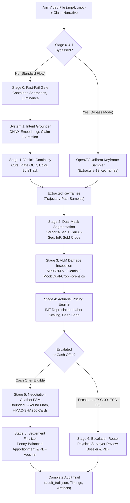

# Auto-Settle AI: Master Evaluation Harness & Testing Testbench Guide

## 1. Overview & Architecture

Auto-Settle AI provides an end-to-end evaluation harness and interactive testbench suite capable of processing any car walkaround video through all 7 stages of the autonomous claim pipeline. 

The master evaluation harness ([`evals/comprehensive_harness.py`](file:///home/jashan/settleai/evals/comprehensive_harness.py)) acts as the single source of truth for pipeline verification. It executes the complete lifecycle of a motor insurance claim:



---

## 2. Core Components of the Evaluation Suite

The evaluation suite consists of four complementary tools designed for developers, automated CI (Continuous Integration), and user-facing testing:

1. **Master Pipeline Orchestrator** ([`evals/comprehensive_harness.py`](file:///home/jashan/settleai/evals/comprehensive_harness.py)):
   - Coordinates all 7 stages programmatically.
   - Supports arbitrary stage bypassing (`stage_0`, `stage_1`, `stage_2`, etc.).
   - Contains an OpenCV-based fallback keyframe sampler for videos with scene cuts or bypassed tracking.
   - Emits a granular `AuditTrail` dataclass with execution timings, per-stage inputs/outputs, warnings, and file artifact paths.
   - Persists `audit_trail.json` atomically per claim.

2. **Interactive CLI Evaluation Harness** ([`evals/eval_harness.py`](file:///home/jashan/settleai/evals/eval_harness.py)):
   - Interactive terminal wizard with menu-driven video and policy selection.
   - Direct CLI parameter execution for automated scripts.
   - Rich terminal tables detailing stage timings, forensic telemetry, statutory line items, and negotiation turn cards.
   - Built-in interactive chat loop for Stage 5 negotiation testing.

3. **Standalone Web Testbench GUI** ([`evals/web_testbench.py`](file:///home/jashan/settleai/evals/web_testbench.py)):
   - Lightweight browser interface running on FastAPI and responsive HTML/CSS.
   - Interactive video dropdown, stage bypass checkboxes, and claim narrative fields.
   - Real-time pipeline visual timeline, Set-of-Marks (SoM) visual crop inspection gallery, actuarial pricing breakdowns, and direct one-click PDF certificate downloads.

4. **Frontend E2E Client Runner** ([`evals/frontend_e2e_runner.py`](file:///home/jashan/settleai/evals/frontend_e2e_runner.py)):
   - High-fidelity client that matches frontend web/mobile interactions against the FastAPI backend.
   - Simulates video multipart upload (`POST /claims/upload`), background status polling / SSE (Server-Sent Events), multi-turn negotiation counter-offers (`POST /claims/{id}/negotiate`), settlement acceptance (`POST /claims/{id}/accept`), and PDF voucher download (`GET /voucher/pdf`).

---

## 3. Stage Bypassing & Cut Tolerance Mechanics

Real-world test videos often contain cuts, multiple clips stitched together, or user camera glitches. Furthermore, developers frequently need to test downstream vision (Stage 2/3) or financial logic (Stage 4/5/6) without waiting for upstream optical flow or plate verification.

### How Stage Bypassing Works:
- **Bypass Flags**: Use `--bypass stage_0,stage_1` or pass `bypass_stages=["stage_0", "stage_1"]`.
- **OpenCV Fallback Keyframe Extraction**: When Stage 1 is bypassed, `comprehensive_harness.py` triggers `extract_uniform_keyframes_from_video()`. This decodes the video using OpenCV, samples 8 to 12 sharp frames across the duration, and saves canonical keyframe aliases (`front_bumper.jpg`, `side_body_panel.jpg`, `damage_closeup_primary.jpg`) in `/tmp/autosettle_keyframes/<claim_id>/`.
- **Cut Tolerance (`--ignore-cuts`)**: When `--ignore-cuts` is set, Stage 1 cut detection warnings are logged, but the pipeline does not abort with `ESC-02`.
- **Force Continue (`--force-continue`)**: If an upstream stage encounters a non-terminal failure or escalation (e.g. plate mismatch `ESC-01`), `--force-continue` allows downstream stages (e.g., Stage 2 segmentation) to execute for diagnostic purposes.

---

## 4. Running the Evaluation Tools

### A. Interactive CLI Wizard
To launch the interactive terminal wizard:
```bash
uv run python evals/eval_harness.py --interactive
```
The wizard guides you through:
1. Selecting any video from `test_assets/videos/` or entering a custom file path.
2. Selecting a policy ID (`POL-HAPPY-001`, `POL-ZERO-DEP-NEW`, `POL-NON-DEP-4YR`, etc.).
3. Entering a claim description (or using the pre-filled default).
4. Choosing stages to bypass (e.g., `stage_0`, `stage_1`).
5. Selecting a negotiation strategy (`accept_first`, `negotiate_max`, `reject`, `interactive`).

### B. Direct CLI Execution
Run any test video directly from the command line:

```bash
# Standard end-to-end evaluation with Toyota Hilux
uv run python evals/eval_harness.py \
  --video test_assets/videos/real_videos/toyota_hilux_white_ute.mp4 \
  --claim "Deep scratch and dent along the front passenger door panel" \
  --strategy accept_first

# Testing downstream Stage 2 and Stage 3 with Stage 0 & 1 bypassed (tolerating cuts)
uv run python evals/eval_harness.py \
  --video test_assets/videos/scenario_videos/scenario_01_damaged_collision.mp4 \
  --claim "Right flank key scratch on front door" \
  --bypass stage_0,stage_1 \
  --ignore-cuts \
  --strategy negotiate_max

# Interactive negotiation chat in the terminal
uv run python evals/eval_harness.py \
  --video test_assets/videos/real_videos/fiat_500_blue_hatchback.mp4 \
  --claim "Dent and scratch on driver door panel" \
  --bypass stage_0,stage_1 \
  --strategy interactive
```

### C. Standalone Web Testbench
Launch the web browser interface:
```bash
uv run python evals/web_testbench.py --port 8080
```
Open your browser at `http://localhost:8080` to:
- Select sample videos from a visual dropdown.
- Toggle stage bypass switches (`Bypass Stage 0`, `Bypass Stage 1`, `Ignore Cuts`).
- Click **"Run Full Claim Pipeline"** to trigger execution.
- View real-time stage progress cards, timing badges, and forensic decisions.
- Inspect Set-of-Marks (SoM) annotated crops and raw damage images side-by-side.
- Download the generated Settlement Voucher PDF or Surveyor Escalation Dossier PDF.

### D. Frontend End-to-End (E2E) Test Client
To simulate real frontend browser requests against the running FastAPI application:
```bash
# Start FastAPI backend (in terminal 1)
uv run uvicorn app.main:app --port 8000

# Run frontend E2E runner (in terminal 2)
uv run python evals/frontend_e2e_runner.py \
  --api-url http://localhost:8000 \
  --video test_assets/videos/real_videos/vw_golf_grey_hatchback.mp4 \
  --claim "Scratch on driver door and front fender" \
  --policy POL-HAPPY-001 \
  --download-pdf
```

---

## 5. Granular Audit Trail & Output Artifacts

Every execution of the master harness generates a detailed, structured audit log.

### A. Audit Trail Schema (`audit_trail.json`)
The output file [`evals/artifacts/audit_trails/<claim_id>_audit_trail.json`](file:///home/jashan/settleai/evals/artifacts/audit_trails/) contains:
- `claim_id`: Unique UUID4 identifier for the claim.
- `policy_id`: Policy context under evaluation.
- `video_path`: Path to the processed video asset.
- `claim_text`: Claimant damage description.
- `total_duration_ms`: Total execution latency in milliseconds.
- `final_stage`: The last stage reached by the claim.
- `final_status`: `SETTLED`, `ESCALATED`, or `FAILED`.
- `stage_audits`: Per-stage breakdown:
  - `stage_name`: e.g., `STAGE_0_FAST_FAIL`, `STAGE_2_SEGMENTATION`, `STAGE_4_ACTUARIAL_PRICING`.
  - `status`: `PASSED`, `BYPASSED`, `FAILED`, `ESCALATED`.
  - `duration_ms`: Sub-millisecond execution latency.
  - `telemetry`: Stage-specific measurements (luminance, SSIM, IoP, depreciation %, Net Insurer Liability).
  - `decisions`: Algorithmic decisions and statutory rule applications.
  - `warnings`: Non-fatal warnings (e.g., high specular glare, anchor inversion attempt).
  - `error`: Error payload or escalation code if triggered.
  - `artifacts`: List of generated image/document file paths.

### B. Visual Inspection Artifacts
- **Extracted Trajectory Keyframes**: `/tmp/autosettle_keyframes/<claim_id>/`
- **Set-of-Marks (SoM) Polygon Overlays**: [`evals/artifacts/som_output/<claim_id>/`](file:///home/jashan/settleai/evals/artifacts/som_output/)
  - `<part_key>_raw.jpg`: Pristine panel crop preserving paint finish and texture.
  - `<part_key>_som.jpg`: Padded crop with cyan exterior polygon contour (0% interior damage occlusion).
  - `<part_key>_mask.svg`: Normalized SVG vector boundary polygon.

### C. Legal & Financial Documents
- **Settlement Voucher Certificate**: [`evals/artifacts/vouchers/VOUCHER-<claim_id>.pdf`](file:///home/jashan/settleai/evals/artifacts/vouchers/) (Generated via ReportLab with Indian rupee amount words, IMT apportionment schedule, and SHA-256 digital security seal).
- **Surveyor Escalation Dossier**: [`evals/artifacts/dossiers/DOSSIER-<claim_id>.pdf`](file:///home/jashan/settleai/evals/artifacts/dossiers/) (Generated when an escalation code `ESC-00`..`ESC-09` is tripped, with forensic telemetry and a 6-point physical inspection checklist).

---

## 6. Automated Test Suite

The evaluation harness itself is continuously verified against unit and integration test suites:

```bash
# Run evaluation harness tests
uv run pytest tests/evals/ -v
```

### Verified Test Cases:
1. `test_uniform_keyframe_extraction`: Validates OpenCV keyframe extraction on real video files when Stage 1 is bypassed.
2. `test_harness_happy_path_settlement`: Verifies complete execution from Stage 0 through Stage 6 with auto-acceptance and PDF voucher generation.
3. `test_harness_bypass_stage0_and_stage1`: Proves that downstream stages (Stage 2 through Stage 6) operate reliably with synthetic keyframes when earlier stages are bypassed.
4. `test_harness_escalation_flow`: Verifies proper generation of Surveyor Review Dossier and PDF when an escalation code (`ESC-06` safety critical) is triggered.
5. `test_harness_interactive_negotiation_loop`: Verifies simulated multi-turn claimant counter-offers and FSM round transitions.
6. `test_audit_trail_serialization`: Ensures complete JSON schema compliance and disk persistence of `audit_trail.json`.
7. `test_web_testbench_endpoints`: Verifies the web GUI routes (`GET /`, `POST /api/testbench/run`, `GET /api/testbench/{id}/pdf`).
8. `test_frontend_e2e_runner_mock_api`: Validates the simulated browser flow against ASGI endpoints.
