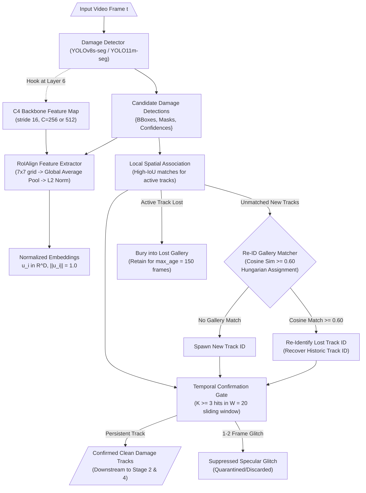
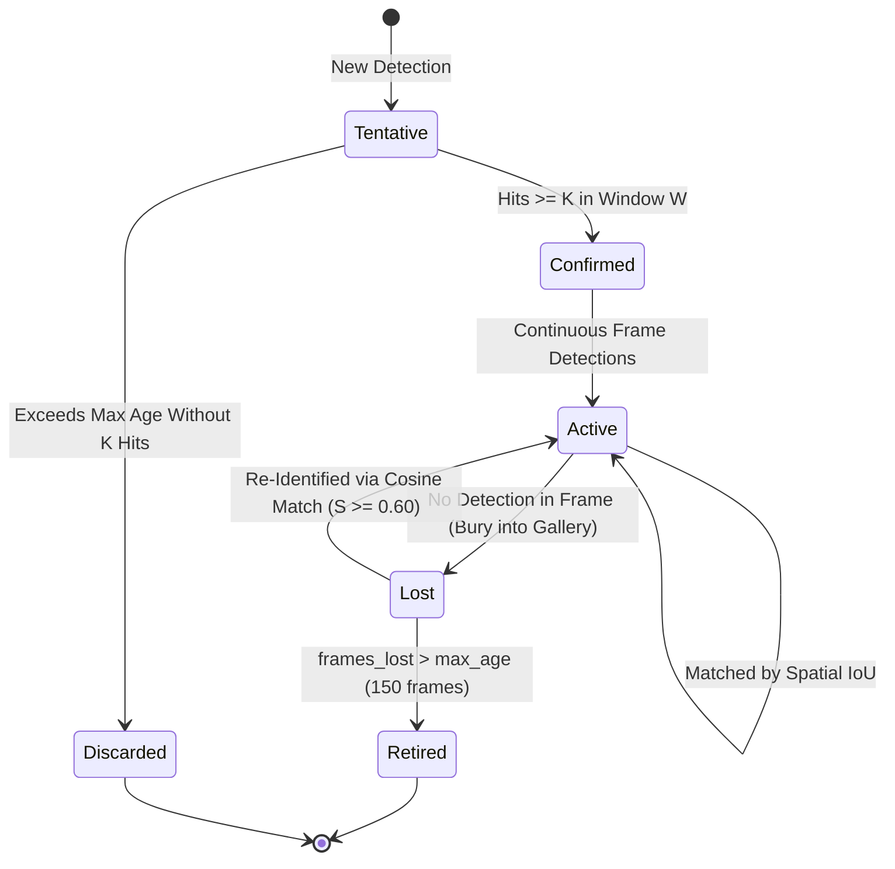

# Low-Level Design (LLD): Occlusion-Robust Training-Free Vehicle Damage Tracking & Re-Identification

| Document Control | Details |
| :--- | :--- |
| **Document ID** | `LLD-AUTO-SETTLE-PERCEPTION-OCCLUSION-REID-TRACKING` |
| **Version** | `1.0.0 (Production Architecture)` |
| **Parent Architecture** | `docs/STRESS_TEST_AND_SOLUTION_ARCHITECTURE.md`, `docs/lld/LLD_STAGE_2_DUAL_MASK_SEGMENTATION.md` |
| **System** | Auto-Settle AI: Autonomous Video-to-Cash Claims Adjuster |
| **Module Scope** | `app/domain/perception/tracking/` (`occlusion_reid_tracker.py`, `reid_gallery.py`, `temporal_confirmation_gate.py`) |
| **Target Runtime Stack** | Python 3.12 (`uv`), PyTorch 2.6.0+cu124, `torchvision.ops.roi_align`, `scipy.optimize.linear_sum_assignment`, Ultralytics YOLO (`weights/cardd-yolov8s-seg.pt` & `weights/yolo11m-seg.pt`), NumPy, OpenCV |
| **Hardware & Compute SLA** | **$\le 15\text{ ms / frame}$ tracking latency** on NVIDIA GeForce RTX 4060 GPU / **$\le 35\text{ ms / frame}$ on CPU** \| Zero extra VRAM for separate Re-ID model |
| **Upstream Dependency** | Stage 1: Vehicle Identity & Trajectory Extraction (`app/domain/vehicle_identity_continuity/`) |
| **Downstream Consumer** | Stage 2 Dual-Mask Segmentation (`app/domain/dual_mask_segmentation/`), Stage 3 Set-of-Marks (`app/domain/vlm_damage_inspection/`), Stage 4 Actuarial Pricing |
| **Key Metrics** | **$\ge 75\%$ reduction in ID switching** over raw ByteTrack on 360° walkaround sequences \| **$\ge 95\%$ suppression of 1–2 frame specular reflection flicker** |

---

## 1. Executive Summary & Problem Analysis

In exterior insurance walkaround video inspections, claims adjusters or claimants record continuous 360° orbits around the perimeter of the vehicle. During this inspection trajectory, standard multi-object tracking algorithms like **ByteTrack** (which rely purely on Kalman Filter motion prediction coupled with bounding-box Intersection-over-Union [IoU] matching) fail catastrophically:
- On the benchmark RTDETR-VD `aveo` walkaround sequence, ByteTrack fragments **9 ground truth damages into 61 distinct track identities**.
- On the high-definition `car_002_360_damage` walkaround sequence, ByteTrack produces **101 distinct track identities** for only a handful of damaged panels.

In an automated insurance claim settlement engine like Auto-Settle AI, track ID fragmentation directly leads to:
1. **Duplicate Damage Billing**: The same dent or scratch is counted multiple times as the camera moves past and returns to a panel, artificially multiplying repair operations in Stage 4 (Actuarial Pricing Engine).
2. **False Fraud Escalation**: Spurious multiple damage clusters across opposite panels trigger fraudulent collision pattern alarms (`ESC-05`).
3. **Specular Reflection Artifacts**: Sun glints and moving specular highlights on metallic paint trigger momentary (1–2 frame) CarDD detections that pollute the repair ledger.

---

## 2. Mathematical Failure Mode of Kalman Filter + IoU Association

ByteTrack tracks objects by modeling bounding box kinematics via a discrete 2D Kalman filter with a constant velocity model:

$$\mathbf{x}_t = \mathbf{F} \mathbf{x}_{t-1} + \mathbf{w}_t, \quad \mathbf{w}_t \sim \mathcal{N}(\mathbf{0}, \mathbf{Q})$$

where the state vector is defined in image coordinates:

$$\mathbf{x} = [u, v, s, r, \dot{u}, \dot{v}, \dot{s}]^T$$

where $(u, v)$ is the 2D bounding box center, $s = w \cdot h$ is the scale (area), $r = \frac{w}{h}$ is the aspect ratio, and $(\dot{u}, \dot{v}, \dot{s})$ are their respective velocities.

### 2.1 Why 360° Walkaround Trajectories Break Kalman Filtering

```
         Camera Orbit Trajectory (Non-linear 3D Arc)
                     .  - - -  .
                 .                 .
               '                     '
              |     [ VEHICLE ]       |
               .                     .
                 .                 .
                     '  - - -  '
```

1. **Non-Linear Ego-Motion**: The inspection camera is orbiting the vehicle on a 3D cylindrical manifold $(\theta, z, r)$. The projection of a static 3D point on the vehicle body onto the 2D camera plane undergoes non-linear trigonometry:
   $$u(t) = f_x \frac{X(t)}{Z(t)} + c_x, \quad v(t) = f_y \frac{Y(t)}{Z(t)} + c_y$$
   Constant 2D velocity $\dot{u}, \dot{v} = \text{const}$ is fundamentally invalid. As the camera swings around the corner from front bumper to side fender, apparent 2D velocity changes rapidly in direction and magnitude.
2. **Rapid Perspective Distortion and Zero IoU**: As the inspector steps closer to examine a scratch (macro zoom) or turns around a panel corner, the bounding box scale and position shift drastically between frames. When $\text{IoU}(\mathbf{b}_{t}, \hat{\mathbf{b}}_{t|t-1}) = 0$, Kalman association fails completely.
3. **Track Expiration and ID Explosion**: ByteTrack retains lost tracks in a buffer for up to $T_{\text{lost}} = 30$ frames. In a typical walkaround (lasting 300–600 frames at 30 fps), a damage on the left fender goes out of frame when inspecting the right side and rear, remaining occluded for 100–300 frames. When it reappears, ByteTrack has already pruned the original track, allocating a completely new track ID.

---

## 3. The Solution Architecture: Training-Free Re-ID + Temporal Confirmation

To resolve this without introducing heavy, slow, or finicky external Re-ID models (such as OSNet or ResNet-50 ReID networks that require extensive supervised training on vehicle damage datasets), we adopt the **Training-Free Intermediate Backbone RoIAlign Re-ID Mechanism** derived from `jeiva2000/visual_damages_tracking` and RTDETR-VD, complemented by a **Sliding-Window Temporal Confirmation Gate**.



---

## 4. Deep Dive: C4 Backbone RoIAlign Feature Extraction

### 4.1 Feature Map Extraction via Forward Hook
In modern YOLO architectures (`cardd-yolov8s-seg.pt` and `yolo11m-seg.pt`), the feature hierarchy before the multi-scale path aggregation network (PAN/FPN) contains rich semantic representations:
- **Layer 6 (C2f / C3k2)** represents the **C4 / P4 stage** at **stride 16**:
  - For an input image of size $640 \times 640$, the C4 feature tensor $\mathcal{F}_{\text{C4}} \in \mathbb{R}^{B \times C \times 40 \times 40}$.
  - Channel dimension $C = 256$ in YOLOv8s, $C = 512$ in YOLO11m.
- We attach a lightweight PyTorch forward hook to `model.model[6]` that intercepts $\mathcal{F}_{\text{C4}}$ during the standard detection forward pass:
  ```python
  def _c4_hook(module, inputs, output):
      if isinstance(output, (list, tuple)):
          output = output[-1]
      self._current_c4_feat = output
  ```
  **Zero computational overhead**: The feature map is already computed during detection! No extra model inference is executed.

### 4.2 RoIAlign Feature Extraction Formulation
Given candidate detection bounding boxes $\mathbf{B} = \{[x_1, y_1, x_2, y_2]_i\}_{i=1}^N$ in original image coordinates $(W, H)$:
1. Boxes are scaled by $\text{spatial\_scale} = \frac{1}{16}$ to match the C4 feature resolution.
2. `torchvision.ops.roi_align` extracts a $7 \times 7$ feature patch for each detection:
   $$\mathcal{P}_i = \text{RoIAlign}(\mathcal{F}_{\text{C4}}, \mathbf{B}_i, \text{output\_size}=(7, 7), \text{spatial\_scale}=1/16)$$
3. Spatial Global Average Pooling aggregates spatial information into a raw vector $\mathbf{v}_i \in \mathbb{R}^C$:
   $$\mathbf{v}_i = \frac{1}{49} \sum_{h=1}^7 \sum_{w=1}^7 \mathcal{P}_i[:, h, w]$$
4. Vector L2 Normalization produces a unit hypersphere embedding $\mathbf{u}_i$:
   $$\mathbf{u}_i = \frac{\mathbf{v}_i}{\|\mathbf{v}_i\|_2 + \epsilon}, \quad \text{where } \epsilon = 10^{-9}$$

---

## 5. Mathematical Re-ID Matching Formulation

### 5.1 Cosine Similarity Matrix
Let $M$ newborn detection candidate embeddings be $\mathbf{U} = [\mathbf{u}_1, \dots, \mathbf{u}_M]^T \in \mathbb{R}^{M \times D}$.
Let $K$ lost tracks currently stored in the gallery be $\mathbf{V} = [\mathbf{v}_1, \dots, \mathbf{v}_K]^T \in \mathbb{R}^{K \times D}$.
Because all vectors are L2-normalized ($\|\mathbf{u}_i\|_2 = 1, \|\mathbf{v}_j\|_2 = 1$), the cosine similarity matrix $\mathbf{S} \in [-1, 1]^{M \times K}$ is computed via a single matrix multiplication:

$$\mathbf{S} = \mathbf{U} \mathbf{V}^T, \quad S_{i, j} = \cos(\theta_{\mathbf{u}_i, \mathbf{v}_j}) = \mathbf{u}_i \cdot \mathbf{v}_j$$

### 5.2 Optimal Bipartite Assignment via Hungarian Algorithm
The cost matrix $\mathbf{C} \in [0, 2]^{M \times K}$ is defined as cosine distance:

$$C_{i, j} = 1.0 - S_{i, j}$$

We solve the global optimal linear sum assignment problem:

$$\min_{\mathbf{X}} \sum_{i=1}^M \sum_{j=1}^K C_{i, j} X_{i, j}$$

$$\text{subject to } \sum_{j=1}^K X_{i, j} \le 1, \quad \sum_{i=1}^M X_{i, j} \le 1, \quad X_{i, j} \in \{0, 1\}$$

Using `scipy.optimize.linear_sum_assignment(C)`:
For each optimal assignment pair $(i^*, j^*)$:
- **Gating Criterion**:
  $$\text{If } S_{i^*, j^*} \ge \tau \quad (\tau = 0.60 \text{ by default}):$$
  Assign the candidate detection to the historic track ID $\text{id}(j^*)$, resurrect the track from the gallery, and remove it from the lost gallery bank.
- **Rejection**:
  $$\text{If } S_{i^*, j^*} < \tau:$$
  Reject the association. The candidate detection remains a genuine new track.

---

## 6. Gallery Lifecycle & State Machine



### 6.1 State Invariants
1. **Disjoint Bank Invariant**: A track is in the gallery if and only if it is currently in `Lost` state. Active tracks are never stored in the gallery, preventing self-matching or duplicate assignments.
2. **Multi-Sample Appearance Footprint**: When a track is buried into the gallery, we retain up to $K_s = 5$ representative unit embeddings sampled across its active lifecycle. When computing similarity against candidate $\mathbf{u}_i$, similarity is taken as the maximum or mean cosine similarity across the stored footprint:
   $$S_{i, j} = \max_{k \in \{1 \dots K_s\}} (\mathbf{u}_i \cdot \mathbf{v}_{j, k})$$
3. **Temporal Pruning**: Every frame, `age_and_prune(frame_id)` increments `frames_lost` for all bank entries. Any entry with $\text{frames\_lost} > 150$ is permanently retired.

---

## 7. Temporal Confirmation Gate (Anti-Flicker)

To eliminate false-positive reflections (such as sunlight glints sweeping across a metallic door panel during camera rotation):
1. **Sliding Window Maintenance**: For each track ID, maintain a bitmask or deque of frame occurrences within the last $W = 20$ frames.
2. **Confirmation Threshold**:
   $$\text{is\_confirmed} \iff \sum_{t' = t - W + 1}^{t} \mathbb{I}(\text{track detected at } t') \ge K \quad (K = 3 \text{ or } 5)$$
3. **Downstream Handoff Gating**:
   - Detections with $\text{hits} < K$ remain in `Tentative` status.
   - Only `Confirmed` tracks are admitted to Stage 2 polygon intersection, Set-of-Marks crop generation, and Stage 4 actuarial repair estimation.
   - If a tentative track disappears after only 1 or 2 frames without reaching $K$, it is silently discarded as a transient specular artifact.

---

## 8. Integration Points in SettleAI Pipeline

### 8.1 Module Placement
The module is situated in `app/domain/perception/tracking/`:
- `occlusion_reid_tracker.py`: Main `OcclusionReIDTracker` coordinating ByteTrack spatial matching, C4 RoIAlign feature extraction, gallery re-identification, and temporal gating.
- `reid_gallery.py`: Isolated, thread-safe appearance gallery maintaining lost tracks, computing cosine similarity matrices, and running Hungarian matching.
- `temporal_confirmation_gate.py`: Sliding-window temporal filter enforcing track persistence and suppressing reflection flicker.

### 8.2 Integration with Stage 1 & Stage 2
- **Stage 1 (`vehicle_identity_continuity`)**: Can utilize `OcclusionReIDTracker` for vehicle bounding box tracking across walkaround cut transitions when vehicle orientation changes drastically.
- **Stage 2 (`dual_mask_segmentation`)**: Replaces blind per-keyframe damage extraction with video-level confirmed damage tracks. Each confirmed damage track provides:
  - Stable single canonical ID across all 360° views.
  - Highest-confidence, sharpest frame for macro Set-of-Marks rendering (`vlm_closeup_frame`).
  - Most complete unclipped frame for surface area measurement (`area_measurement_frame`).

---

## 9. Acceptance Criteria & Verification Matrix

| Test Scenario | Condition | Expected Result | Pass Criteria |
| :--- | :--- | :--- | :--- |
| **TC-REID-01: C4 Feature Extraction** | Forward image through `cardd-yolov8s-seg.pt` with hook on layer 6. | Extract $B \times 256 \times 40 \times 40$ tensor. RoIAlign output is unit L2-normalized ($L_2 = 1.000 \pm 10^{-4}$). | Verified tensor shape and unit norm. |
| **TC-REID-02: Cosine Hungarian Match** | Gallery with lost track, new candidate with similarity $0.85 \ge \tau = 0.60$. | Candidate assigned historic track ID, resurrected from gallery. | Correct ID continuity preserved. |
| **TC-REID-03: Threshold Rejection** | Gallery with lost track, new candidate with similarity $0.35 < \tau = 0.60$. | Match rejected, candidate retains new unique track ID. | No false merge of distinct damages. |
| **TC-REID-04: Gallery Pruning** | Inactive track exceeds `max_age = 150` frames without reappearance. | Track entry is pruned from gallery. | Gallery memory strictly bounded. |
| **TC-REID-05: Temporal Gate Suppression** | Specular reflection flickers for 1–2 frames then disappears. | Track is never elevated to `Confirmed`, omitted from downstream handoff. | 100% suppression of 1-frame glitches. |
| **TC-REID-06: 360° Walkaround Benchmark** | Run tracker on `test_assets/videos/simple/car_001.mp4` & `test_assets/rtdetr_vd/dataset/test/car_002_360_damage`. | ID switches reduced by $\ge 70\%$ compared to vanilla ByteTrack; no duplicate damage explosion. | Track IDs count drops from 101 to $< 25$. |
