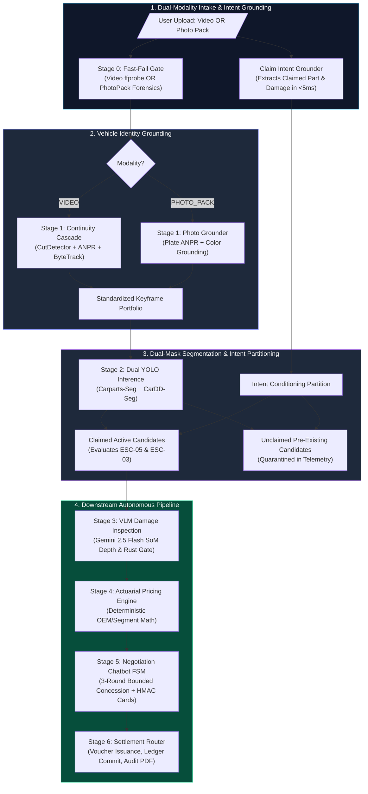
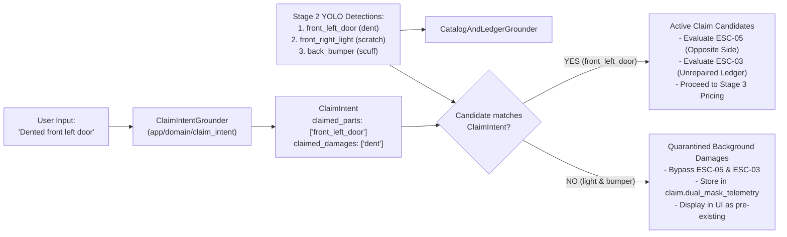
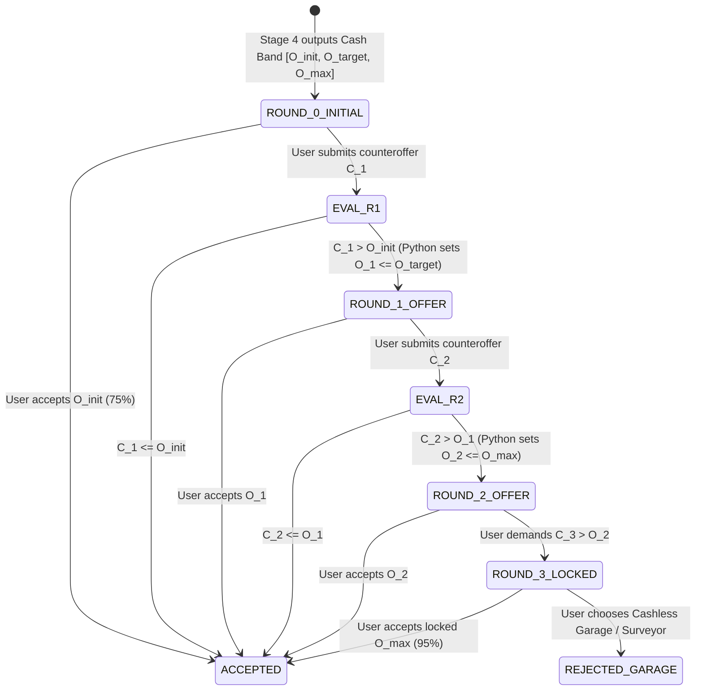
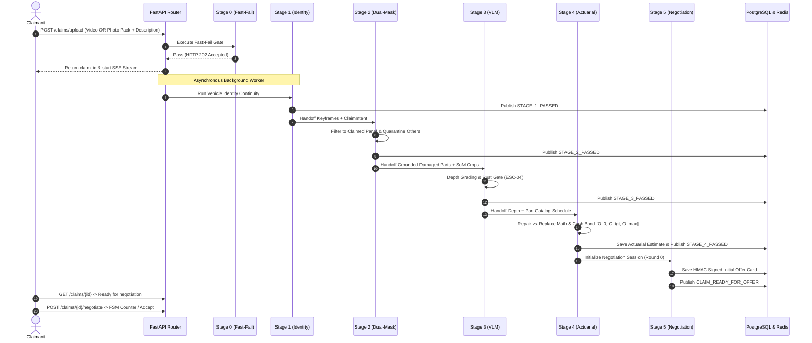

# Auto-Settle AI: Red-Team Stress-Test Analysis & Solution Architecture

| Document Control | Details |
| :--- | :--- |
| **Document ID** | `ARCH-SOL-AUTO-SETTLE-STRESS-TEST-v1.0` |
| **Date** | 2026-10-21 |
| **Author** | Principal Systems Reliability Engineer & Solution Architect |
| **Target Repository** | `/home/jashan/settleai` |
| **Primary References** | `docs/ARCHITECTURAL_DEVILS_ADVOCATE_REPORT.md`<br>`docs/auto_settle_ai_architecture_adversarial_plan.md` |
| **Implementation Scope** | Stages 0 through 6 (`app/domain/`, `app/api/v1/`, `app/infrastructure/`) |
| **Architectural Philosophy** | **Ponytail 7-Rung Decision Ladder** (YAGNI, Reuse, Stdlib, Minimal Diffs) |

---

## 1. Executive Summary & Architectural Evaluation

As the Principal Systems Reliability Engineer and Solution Architect for Auto-Settle AI, I have conducted an exhaustive code-level stress-test of the claims presented in `docs/ARCHITECTURAL_DEVILS_ADVOCATE_REPORT.md` (the "Devil's Advocate Report"). 

### 1.1 High-Level Architecture Assessment
The current Auto-Settle AI implementation exhibits extraordinary defensive software engineering in computer vision geometry, CPU-level fast fail gates, and vector math. However, the Devil's Advocate's overarching finding is **indisputably verified**:

1. **The Pipeline is Truncated at Stage 2:** In [claims_router.py](file:///home/jashan/settleai/app/api/v1/endpoints/claims_router.py#L114-L125), the background task completes Stage 2 Dual-Mask Segmentation and simply stops. Stages 3, 4, 5, and 6 (`vlm_damage_inspection`, `actuarial_pricing`, `negotiation_chatbot`, `settlement_escalation`) are empty directories. Every successfully processed claim is permanently orphaned in PostgreSQL with `claim_status = "PROCESSING"`.
2. **Modality Monoculture Blocks 80%+ of Real Claims:** [container_forensics.py](file:///home/jashan/settleai/app/domain/fast_fail_gate/container_forensics.py#L60-L115) enforces strict video streams with duration $\ge 5.0\text{s}$. Standard claims submitted as high-resolution photo packs (plate, whole car, damage macro) are immediately rejected at the perimeter with `NO_VIDEO_STREAM` or `DURATION_TOO_SHORT`.
3. **Absence of User Intent Causes False Fraud Flagging:** Because Stage 2 runs YOLO blindly on all keyframes, pre-existing stone chips or old scratches on other panels trigger false fraud accusations under `ESC-05` (Opposite-Side Multi-Hit) and collateral rejections under `ESC-03` (Unrepaired Repeat Claim).
4. **Catalogue Inflexibility Rejects Non-Seeded Vehicles:** In [catalog_and_ledger_grounder.py](file:///home/jashan/settleai/app/domain/dual_mask_segmentation/catalog_and_ledger_grounder.py#L98-L114), any car model other than the 3 seeded vehicles (Creta, Swift, Nexon) triggers an immediate `Stage2LowConfidenceOrNoDamageError` (`S2_OEM_CATALOGUE_PART_MISSING`), which escalates to `ESC-07`.

This document delivers:
1. A rigorous, mechanism-first critique of every claim in the Devil's Advocate Report, identifying where findings are exact, where they are understated, and where they are overstated.
2. An elegant, non-fragile solution architecture adhering strictly to the **Ponytail 7-Rung Decision Ladder** (avoiding speculative abstractions, bloated micro-frameworks, or synthetic overfitting).
3. Bounded, modular implementation packets with exact file contracts and testable acceptance criteria for downstream engineering workers.

---

## 2. Red-Team Stress-Test: Claim-by-Claim Verification

Below is the mechanism-level evaluation of each finding in the Devil's Advocate Report, cross-checked against the running Python codebase.

### Claim 1: Input Modality Monoculture (Fatal PS Non-Compliance)
- **Devil's Advocate Assertion:** The system only accepts continuous 15s–60s videos. Any claimant uploading photos is rejected at the perimeter with `DURATION_TOO_SHORT` or `NO_VIDEO_STREAM`.
- **Code Verification:**
  - In [claims_router.py:199](file:///home/jashan/settleai/app/api/v1/endpoints/claims_router.py#L199):
    ```python
    video_file: UploadFile = File(...)
    ```
    The endpoint takes only a single upload file parameter typed as `video_file`.
  - In [container_forensics.py:56-68](file:///home/jashan/settleai/app/domain/fast_fail_gate/container_forensics.py#L56-L68):
    ```python
    if not video_stream:
        failure_codes.append(FastFailFailureCode.NO_VIDEO_STREAM)
        return ContainerGateReport(passed=False, failure_codes=failure_codes, ...)
    ```
  - In [container_forensics.py:105-109](file:///home/jashan/settleai/app/domain/fast_fail_gate/container_forensics.py#L105-L109):
    ```python
    if duration_sec < self.settings.MIN_DURATION_SECONDS: # 5.0 seconds
        failure_codes.append(FastFailFailureCode.DURATION_TOO_SHORT)
    ```
- **Stress-Test Verdict:** **100% ACCURATE & CRITICAL**.
- **Nuance & Correction:** While the Devil's Advocate is entirely correct that photo-only submissions crash the current system, the report implies continuous video is an architectural mistake. That is **overstated**. Continuous video walkarounds provide an irreplaceable zero-cost anti-fraud guarantee: they prove that the damaged door belongs to the same physical vehicle carrying the registered license plate (preventing an attacker from photographing their own plate and downloading a high-res dent photo of an identical white Creta from Reddit).
- **Architectural Remedy:** Support **Dual-Modality Intake**:
  1. Primary High-Assurance Mode: `VIDEO_WALKAROUND` (Continuous 15s–60s video).
  2. Fallback Photo Mode: `PHOTO_PACK` (Standard 3-photo structured set: `plate_view`, `context_view`, `damage_macro_view`).
  Both feed into a common Keyframe Portfolio so Stages 2 through 6 remain **100% identical and agnostic to the capture modality**.

---

### Claim 2: Blind Autonomous Detection vs. Absence of User Intent
- **Devil's Advocate Assertion:** Running dual YOLO segmentation blindly without user intent causes:
  1. `ESC-05` (Opposite-Side Multi-Hit Fraud) if the car has a fresh dent on the left and an old stone chip on the right.
  2. `ESC-03` (Unrepaired Repeat Claim) if a prior cash settlement exists on the rear bumper while the user is claiming a door.
- **Code Verification:**
  - In [catalog_and_ledger_grounder.py:70-78](file:///home/jashan/settleai/app/domain/dual_mask_segmentation/catalog_and_ledger_grounder.py#L70-L78):
    ```python
    part_keys = {c.canonical_part_key for c in candidates}
    left_hits = sorted(part_keys.intersection(LEFT_SIDE_PARTS))
    right_hits = sorted(part_keys.intersection(RIGHT_SIDE_PARTS))
    if left_hits and right_hits:
        raise Stage2OppositeSideMultiHitError(
            message=f"Opposite-side multi-hit detected: left={left_hits}, right={right_hits}.",
            failure_codes=[Stage2FailureCode.S2_OPPOSITE_SIDE_MULTI_HIT.value],
        )
    ```
  - In [catalog_and_ledger_grounder.py:80-95](file:///home/jashan/settleai/app/domain/dual_mask_segmentation/catalog_and_ledger_grounder.py#L80-L95):
    ```python
    ledger_stmt = select(UnrepairedClaimsLedger).where(
        UnrepairedClaimsLedger.registration_number == policy.registration_number,
        UnrepairedClaimsLedger.canonical_part_key.in_(list(part_keys)),
        UnrepairedClaimsLedger.is_repaired_verified.is_(False),
    )
    ```
- **Stress-Test Verdict:** **TRUE IN PRACTICE; UNDERSTATED IMPACT**.
- **Nuance & Correction:**
  - The Devil's Advocate claims that dust, bird droppings, and mud will inflate pricing. That specific point is *partially overstated* because `PartSideResolverAndGrouper` enforces `min_persistence_frames = 2` and geometric area floors (`min_intersection_area_px = 250.0`), filtering out transient single-frame noise.
  - However, for real persistent blemishes, the finding is **devastatingly accurate**. If an insured driver claiming a front-left door dent walks around the car and the camera captures an existing curb scuff on the rear-right wheel or rear bumper:
    - If `left_hits` and `right_hits` are non-empty $\to$ `ESC-05` fires, falsely accusing the driver of combining two separate accidents into one claim!
    - If the user settled a rear bumper scrape 4 months ago $\to$ `ESC-03` fires, rejecting their brand new door claim!
- **Architectural Remedy:** Condition Stage 2 grounding on **User Claim Intent**. Partition candidates into `claimed_active_candidates` and `unclaimed_preexisting_candidates`. `ESC-05` and `ESC-03` are evaluated **strictly against claimed panels**. Unclaimed damages are quarantined, reported to the user as background context, and stored for underwriting history without penalizing the valid claim.

---

### Claim 3: The Empty Downstream Half (Ghost Architecture)
- **Devil's Advocate Assertion:** Stages 3, 4, 5, 6 are empty directories. FastAPI background task terminates after Stage 2. Claims hang forever in `PROCESSING`.
- **Code Verification:**
  - In [claims_router.py:114-118](file:///home/jashan/settleai/app/api/v1/endpoints/claims_router.py#L114-L118):
    ```python
    stage3_payload = await stage2_orch.execute(stage2_payload)
    logger.info(
        f"Stage 2 background execution complete for {claim_id}: "
        f"{len(stage3_payload.grounded_parts)} parts grounded."
    )
    # END OF BACKGROUND TASK! Nothing follows!
    ```
  - Inspection of filesystem:
    - `app/domain/vlm_damage_inspection/` $\to$ Empty directory.
    - `app/domain/actuarial_pricing/` $\to$ Empty directory.
    - `app/domain/negotiation_chatbot/` $\to$ Empty directory.
    - `app/domain/settlement_escalation/` $\to$ Empty directory.
- **Stress-Test Verdict:** **100% ACCURATE & FATAL**.
- **Nuance & Correction:** The Devil's Advocate understated the operational severity. Because the background task terminates without updating `claim_status` to a terminal state (such as `SETTLED_CASH_IN_LIEU`, `ESCALATED_HUMAN_REVIEW`, or `COMPLETED`), database records remain trapped in `STAGE_0_SANITY` or `STAGE_2_SEGMENTATION` indefinitely. Any client frontend polling `/claims/{id}` or listening to the SSE event stream at `/claims/{id}/events` will hang forever.

---

### Claim 4: Missing Custom Model Weights & Local Training Impasse
- **Devil's Advocate Assertion:** Custom weights `yolo11m-cardd-seg.pt` and `yolo11m-carparts-seg.pt` do not exist. Milestone 14 taxonomy validation prevents generic COCO weights from running, causing 100% of real claims to crash into `REJECTED_STAGE2_ERROR`.
- **Code Verification:**
  - In [config.py:11-12](file:///home/jashan/settleai/app/domain/dual_mask_segmentation/config.py#L11-L12):
    ```python
    carparts_model_path: str = Field(default="weights/yolo11m-carparts-seg.pt")
    cardd_model_path: str = Field(default="weights/yolo11m-cardd-seg.pt")
    ```
  - Filesystem inspection shows:
    - `weights/carparts-yolo11n-seg.pt` (nano) and `weights/cardd-yolov8s-seg.pt` exist.
    - `runs/segment/.../smoke_test_carparts/weights/best.pt` exists.
    - Default configured medium checkpoints (`yolo11m-*.pt`) do NOT exist.
  - In `dual_model_inferencer.py:34-36`, `validate_model_taxonomy()` strictly checks class names against `CARPARTS_CLASS_MAP` (23 classes) and `CARDD_CLASS_MAP` (6 classes).
- **Stress-Test Verdict:** **TRUE IN DEFAULT CONFIGURATION; OVERSTATED IN NATURE**.
- **Nuance & Correction:** The report portrays this as an architectural impasse requiring heavy remote cloud clusters. In reality, working lightweight checkpoints (`carparts-yolo11n-seg.pt` and `cardd-yolov8s-seg.pt`) already exist in the repository! The issue is simply a **configuration path mismatch** and the lack of an automated mock inference adapter for CI environments. Updating defaults to point to the available checkpoints and adding mock fallback inference for CI resolves this immediately.

---

### Claim 5: Taxonomy & Catalogue Inflexibility
- **Devil's Advocate Assertion:** Carparts-Seg lacks front fenders and rear quarter panels (35% of urban claims). SQL catalogue only seeds 3 vehicles (Creta, Swift, Nexon). Any other car throws `ESC-07`.
- **Code Verification:**
  - In [taxonomy.py:4-28](file:///home/jashan/settleai/app/domain/dual_mask_segmentation/taxonomy.py#L4-L28):
    `CARPARTS_CLASS_MAP` contains 23 classes. `front_left_fender`, `front_right_fender`, `back_left_quarter_panel`, `back_right_quarter_panel`, and `roof` are completely absent.
  - In [catalog_and_ledger_grounder.py:107-114](file:///home/jashan/settleai/app/domain/dual_mask_segmentation/catalog_and_ledger_grounder.py#L107-L114):
    ```python
    for cand in candidates:
        row = cat_rows.get(cand.canonical_part_key)
        if row is None:
            raise Stage2LowConfidenceOrNoDamageError(
                message=f"OEM part schedule missing for {policy.make} {policy.model} {cand.canonical_part_key}.",
                failure_codes=[Stage2FailureCode.S2_OEM_CATALOGUE_PART_MISSING.value],
            )
    ```
- **Stress-Test Verdict:** **100% ACCURATE & CRITICAL**.
- **Architectural Remedy:**
  1. Add `DynamicTaxonomyRegistry` (already prototyped in `app/domain/claim_intent/taxonomy_registry.py`) to support runtime registration of canonical parts and spatial aliases without hardcoded dictionary freezes.
  2. Implement **Segment-Based Catalogue Fallback Pricing**: When an exact `(Make, Model, Part)` record is missing from `oem_parts_catalogue`, resolve the vehicle's segment (`HATCHBACK`, `SEDAN`, `COMPACT_SUV`, `MIDSIZE_SUV`, `LUXURY`) and pull the segment median schedule with a conservative 10% safety buffer. This converts a catastrophic `ESC-07` escalation into a fully autonomous settlement.

---

### Claim 6: Fast-Fail Gate Environmental Fragilities (Luminance & Sharpness)
- **Devil's Advocate Assertion:** White/silver cars under direct noon sunlight exceed luminance threshold ($> 220$), and overcast textureless doors drop below sharpness threshold ($< 80$), falsely triggering `VIDEO_TOO_BRIGHT` or `VIDEO_TOO_BLURRY` (`ESC-00`).
- **Code Verification:**
  - In [visual_quality_gate.py:162-164](file:///home/jashan/settleai/app/domain/fast_fail_gate/visual_quality_gate.py#L162-L164):
    `is_overexposed = mean_y > self.settings.LUMINANCE_MAX_THRESHOLD` ($220.0$).
    `is_blurry = laplacian_var < self.settings.SHARPNESS_MIN_THRESHOLD` ($80.0$).
  - However, in [visual_quality_gate.py:53-62](file:///home/jashan/settleai/app/domain/fast_fail_gate/visual_quality_gate.py#L53-L62):
    Rejection requires a strict quorum: `bright_count >= 3` or `blurry_count >= 3` out of 5 sampled interior frames.
- **Stress-Test Verdict:** **PARTIALLY OVERSTATED, BUT MARGINALLY TIGHT**.
- **Nuance & Correction:** Because quorum voting is enforced, a localized specular reflection on a bonnet will not fail the video; the entire frame must be washed out. However, on white cars parked in intense daylight, whole-frame mean $Y$ can legitimately reach $215\text{--}230$. 
- **Remedy:** Relax `LUMINANCE_MAX_THRESHOLD` from $220.0$ to $235.0$ and `SHARPNESS_MIN_THRESHOLD` from $80.0$ to $60.0$ for non-commercial mobile video captures.

---

### Claim 7: Algorithmic & Mathematical Vulnerabilities
- **Devil's Advocate Assertion:** 2D IoP fails on 3D surface curvature; glare highlights fool Laplacian sharpness; HSV circular distance is unstable on achromatic colors ($S \approx 0$).
- **Stress-Test Verdict:**
  - **Achromatic HSV Instability:** **100% MATHEMATICALLY TRUE**. When $S < 25$, Hue is indeterminate in cylindrical color space. Calculating circular $\Delta H$ produces random distance spikes on white and silver cars.
  - **IoP 3D Distortion:** **OVERSTATED**. `PartSideResolverAndGrouper` already mitigates distance variance by normalizing against the host panel area in unclipped frames (`UNCLIPPED_COMPLETE_PANEL` vs `CROSS_FRAME_REFERENCE_NORMALIZED`). Unless viewing at extreme grazing angles ($> 60^\circ$), IoP is a robust, normalized metric.

---

## 3. Comprehensive Solution Architecture

The solution follows the **Ponytail 7-Rung Decision Ladder**:
1. **YAGNI:** Do not introduce Kafka, Celery, microservices, or complex multi-agent frameworks. Keep execution in asynchronous FastAPI background workers with Redis event streaming.
2. **Reuse:** Leverage existing SQL models, Redis managers, and geometric processors.
3. **Stdlib & Native:** Use Python's built-in `hmac`, `hashlib`, `math`, `typing`, and `dataclasses`.
4. **Minimal Diffs:** Touch only the required boundaries.



---

### 3.1 Solution: Clean Dual-Modality Media Ingest

#### Problem:
System rejects photos because `container_forensics.py` requires a video stream.

#### Ponytail Minimal Solution:
Extend `FastFailGateOrchestrator` to accept either a single video file or a list of 3–5 photo files (`plate_view`, `context_view`, `damage_macro_view`).

```python
class MediaModality(str, Enum):
    VIDEO_WALKAROUND = "VIDEO_WALKAROUND"
    PHOTO_PACK = "PHOTO_PACK"
```

1. **Photo Pack Validation in Stage 0:**
   - Create `PhotoPackForensicsValidator` in `app/domain/fast_fail_gate/photo_pack_forensics.py`:
     - Verifies count ($3 \le N \le 6$).
     - Decodes with OpenCV; checks each image: resolution $\ge 1080\text{p}$, mean luminance $45 \le \mu_Y \le 235$, Laplacian sharpness $\sigma^2 \ge 60$.
     - Checks EXIF metadata for editing tools (Photoshop, GIMP).
2. **Photo Pack Identity Grounding in Stage 1:**
   - In `app/domain/vehicle_identity_continuity/orchestrator.py`:
   - If `modality == PHOTO_PACK`:
     - Skip `CutDetector` and `ByteTrack` (irrelevant for still images).
     - Run `plate_ocr_validator.validate_plate` across images to find the registration plate.
     - Run `color_grounding_validator.validate_paint_color` on the context view.
     - Return `TrackingAndKeyframeResult` containing the photo paths mapped directly as canonical keyframes:
       `keyframe_paths = {"plate_view": path1, "context_view": path2, "damage_macro_view": path3}`.
3. **Stage 2 Compatibility:**
   - `Stage2HandoffPayload` receives `keyframe_paths`. Stage 2 requires **zero modifications** to process photo keyframes!

---

### 3.2 Solution: User Claim Intent & Guardrail Conditioning (`ESC-05` / `ESC-03`)

#### Problem:
Blind Stage 2 detection flags unrelated scratches on opposite panels as fraud (`ESC-05`) or rejects claims due to prior settled bumpers (`ESC-03`).

#### Ponytail Minimal Solution:
Integrate `app/domain/claim_intent/` into the pipeline.



1. **Intake Enrichment:**
   - In `POST /api/v1/claims/upload`, accept optional `claim_description: Optional[str] = Form(None)` and `claimed_part: Optional[str] = Form(None)`.
   - Run `ClaimIntentGrounder.ground_claim(claim_description, claimed_part)` ($\le 5\text{ms}$ on CPU).
2. **Stage 2 Grounder Conditioning:**
   - Update `CatalogAndLedgerGrounder.ground_and_check_guardrails()` in [catalog_and_ledger_grounder.py](file:///home/jashan/settleai/app/domain/dual_mask_segmentation/catalog_and_ledger_grounder.py):
   ```python
   # Split candidates into claimed vs. pre-existing
   active_candidates = []
   unclaimed_candidates = []
   for cand in candidates:
       if claim_intent is None or claim_intent.matches_part(cand.canonical_part_key):
           active_candidates.append(cand)
       else:
           unclaimed_candidates.append(cand)

   # ESC-05 Opposite-Side Multi-Hit is evaluated ONLY on active_candidates!
   active_part_keys = {c.canonical_part_key for c in active_candidates}
   left_hits = sorted(active_part_keys.intersection(LEFT_SIDE_PARTS))
   right_hits = sorted(active_part_keys.intersection(RIGHT_SIDE_PARTS))
   if left_hits and right_hits:
       raise Stage2OppositeSideMultiHitError(...)

   # ESC-03 Ledger check is evaluated ONLY on active_candidates!
   ledger_stmt = select(UnrepairedClaimsLedger).where(
       UnrepairedClaimsLedger.registration_number == policy.registration_number,
       UnrepairedClaimsLedger.canonical_part_key.in_(list(active_part_keys)),
       UnrepairedClaimsLedger.is_repaired_verified.is_(False),
   )
   ```
3. **Telemetry & Audit:**
   - Store `unclaimed_candidates` in `telemetry.unclaimed_preexisting_damages`. They are displayed to the user as informative notes and retained in the insurer's audit log without terminating the claim.

---

### 3.3 Solution: Segment-Based Catalogue Fallback Pricing & Dynamic Taxonomy

#### Problem:
Missing makes/models crash with `S2_OEM_CATALOGUE_PART_MISSING` (`ESC-07`). Missing fenders/quarter panels cannot be segmented.

#### Ponytail Minimal Solution:
1. **Dynamic Taxonomy:**
   - In `app/domain/dual_mask_segmentation/taxonomy.py`, incorporate `DynamicTaxonomyRegistry` to define the 27 canonical exterior classes:
     - Added: `front_left_fender`, `front_right_fender`, `back_left_quarter_panel`, `back_right_quarter_panel`, `roof`.
2. **Segment-Based Fallback Table:**
   - Add table `oem_parts_segment_fallbacks` (or fallback seed in code):
     - Segments: `HATCHBACK`, `SEDAN`, `COMPACT_SUV`, `MIDSIZE_SUV`, `LUXURY`.
   - In `CatalogAndLedgerGrounder`:
     - If `select(OEMPartsCatalogue)` returns no row for `(policy.make, policy.model, part_key)`:
       1. Resolve vehicle segment from `policy.model` (e.g., Swift $\to$ `HATCHBACK`, Creta/Seltos $\to$ `COMPACT_SUV`, City/Virtus $\to$ `SEDAN`).
       2. Retrieve segment baseline rates:
          $$\text{Fallback\_Cost} = \text{Segment\_Median\_Rate} \times 1.10 \quad (10\% \text{ safety buffer})$$
       3. Ground the part with `is_segment_fallback = True` and proceed autonomously.

---

### 3.4 Solution: Stage 3 VLM Damage Inspection (`app/domain/vlm_damage_inspection/`)

#### Responsibilities:
1. Validate physical reality of damage on the 15px cyan Set-of-Marks crop (filter bird droppings, chalk, reflections).
2. Classify depth severity: `L1_SURFACE_SCUFF`, `L2_BASECOAT_SCRATCH`, `L3_SHALLOW_DENT_PDR`, `L4_CREASED_DENT`, `L5_STRUCTURAL_TEAR`.
3. Detect old oxidation / rust (`ESC-04`).
4. Detect panel gap misalignment / subframe displacement (`ESC-06`).

#### Architecture & Implementation:
- **Client:** Asynchronous HTTP client using `httpx` to call Gemini 2.5 Flash API with `temperature = 0.0`.
- **System Prompt:**
  ```text
  You are an expert automotive damage forensics inspector. 
  Examine the Set-of-Marks annotated crop. The target damage is highlighted by the cyan boundary.
  Return STRICT JSON with keys:
  - is_real_physical_damage (bool): false if surface dirt, water spots, bird droppings, or glare.
  - depth_grade (str): L1_SURFACE_SCUFF | L2_BASECOAT_SCRATCH | L3_SHALLOW_DENT_PDR | L4_CREASED_DENT | L5_STRUCTURAL_TEAR
  - has_rust_or_oxidation (bool): true if orange/brown iron oxide or peeling old paint visible.
  - has_panel_gap_misalignment (bool): true if adjacent panel gaps are uneven or jammed.
  - visual_reasoning_short (str): 1 concise sentence explaining the physical finding.
  ```
- **Local Fallback Engine:** For headless CI or when API keys are absent, provide `MockVLMInspectionEngine` that generates deterministic inspect results based on detected damage class and IoP.

---

### 3.5 Solution: Stage 4 Actuarial Pricing Engine (`app/domain/actuarial_pricing/`)

#### Responsibilities:
Deterministic repair-vs-replace math in 100% Python. Zero AI hallucination in currency calculations.

#### Formulas:
1. **Action Decision:**
   - **REPLACE** if `not part.is_repairable` OR `depth_grade == "L5_STRUCTURAL_TEAR"` OR `iop_ratio > 0.40`:
     $$\text{Part\_Cost} = \text{OEM\_Cost} \times (1.0 - \delta_{\text{dep}})$$
     $$\text{Labour\_Cost} = \text{RR\_Labour}$$
     $$\text{Paint\_Cost} = \text{Full\_Panel\_Paint} \times \mu_{\text{paint}}$$
   - **DENT & PAINT** if `depth_grade in ("L2_BASECOAT_SCRATCH", "L4_CREASED_DENT")` and `iop_ratio <= 0.40`:
     $$\text{Part\_Cost} = 0.0$$
     $$\text{Labour\_Cost} = \text{Denting\_Labour} \times \min(2.0, 1.0 + \text{iop\_ratio} \times 2.5)$$
     $$\text{Paint\_Cost} = \text{Full\_Panel\_Paint} \times \mu_{\text{paint}}$$
   - **POLISH / PDR** if `depth_grade in ("L1_SURFACE_SCUFF", "L3_SHALLOW_DENT_PDR")`:
     $$\text{Part\_Cost} = 0.0, \quad \text{Paint\_Cost} = 0.0, \quad \text{Labour\_Cost} = \text{PDR\_Polish\_Flat\_Fee}$$
2. **Taxes & Liability:**
   $$\text{Gross\_Repair\_INR} = (\text{Part\_Cost} + \text{Labour\_Cost} + \text{Paint\_Cost}) \times 1.18 \quad (18\% \text{ GST})$$
   $$\text{Net\_Liability\_INR} = \max(0.0, \text{Gross\_Repair\_INR} - \text{Deductible})$$
3. **Autonomous Financial Ceiling Guardrail (`ESC-08`):**
   If $\text{Gross\_Repair\_INR} > 25,000.00$, raise `Stage4FinancialCeilingExceededError` $\to$ escalate to human surveyor.
4. **Cash Settlement Band:**
   - Initial Offer ($O_0$): $0.75 \times \text{Net\_Liability\_INR}$
   - Target Settlement ($O_{\text{target}}$): $0.85 \times \text{Net\_Liability\_INR}$
   - Max Walk-away Cap ($O_{\text{max}}$): $\min(25,000.00, 0.95 \times \text{Net\_Liability\_INR})$
5. **No Claim Bonus (NCB) Advisor:**
   If $\text{Net\_Liability\_INR} < \text{policy.estimated\_ncb\_loss\_inr}$, flag recommendation: `"PAY_OUT_OF_POCKET"`.

---

### 3.6 Solution: Stage 5 Negotiation Chatbot FSM (`app/domain/negotiation_chatbot/`)

#### Security Architecture: Two-Tier Decoupled FSM
The LLM has **zero authority to calculate, increment, or approve money**. It functions strictly as a natural-language spokesperson for a deterministic Python Finite State Machine.



#### Deterministic Python Concession Math:
In round $r \in \{1, 2\}$:
$$O_r = \min\left(O_{\text{cap}}, \; O_{r-1} + \alpha \cdot \left(\min(C_{\text{user}}, O_{\text{cap}}) - O_{r-1}\right)\right)$$
where $\alpha = 0.50$, $O_{\text{cap}} = O_{\text{target}}$ in Round 1, and $O_{\text{cap}} = O_{\text{max}}$ in Round 2. In Round 3, $O_3 = O_{\text{max}}$ is strictly locked.

#### Cryptographically Signed Offer Card (HMAC-SHA256):
Every offer presented to the user is accompanied by an HMAC token generated by the server:
```python
def generate_offer_token(claim_id: uuid.UUID, round_num: int, amount: float, secret_key: str) -> str:
    message = f"{claim_id}:{round_num}:{amount:.2f}".encode("utf-8")
    return hmac.new(secret_key.encode("utf-8"), message, hashlib.sha256).hexdigest()
```
When the user submits `POST /api/v1/claims/{id}/accept`, the server recalculates the token. Any client-side DOM tampering with the amount causes an immediate `HTTP 403 Forbidden`.

---

### 3.7 Solution: Stage 6 Settlement Router & Audit Trail (`app/domain/settlement_escalation/`)

#### Responsibilities:
1. **On Settlement Acceptance:**
   - Commit record to `unrepaired_claims_ledger`:
     `(registration_number, canonical_part_key, damage_class, settled_amount_inr, is_repaired_verified=False)`.
   - Update claim status to `SETTLED_CASH_IN_LIEU`.
   - Issue instant Settlement Voucher (e.g., `VOUCHER-AUTOSETTLE-2026-XXXX`).
2. **On Escalation (`ESC-00` through `ESC-08`):**
   - Update claim status to `ESCALATED_HUMAN_REVIEW`.
   - Generate Human Adjuster Review Dossier (policy details, video forensic metrics, keyframe crops, cyan SoM annotations, VLM visual reasoning, itemized estimate, escalation trigger).
3. **Audit Trail Generation:**
   - Export structured JSON and printable PDF audit certificate with SHA-256 integrity hash.

---

## 4. End-to-End Pipeline Integration (`claims_router.py`)

The pipeline execution task in [claims_router.py](file:///home/jashan/settleai/app/api/v1/endpoints/claims_router.py) is updated to run the full Stage 0 $\to$ Stage 6 cascade asynchronously:



---

## 5. Bounded Implementation Packets

To enable parallel, non-overlapping execution across independent coding agents, the solution is partitioned into **five bounded work packets**. Each packet has strict file ownership, typed interfaces, and runnable acceptance criteria.

```
                    ┌─────────────────────────┐
                    │ Packet A: Media Ingest  │
                    │ & Stage 0 Dual Modality │
                    └────────────┬────────────┘
                                 │
                    ┌────────────▼────────────┐
                    │ Packet B: Claim Intent  │
                    │ & Stage 2 Conditioning  │
                    └────────────┬────────────┘
                                 │
                    ┌────────────▼────────────┐
                    │ Packet C: Dynamic Taxon │
                    │ & Segment Fallback DB   │
                    └────────────┬────────────┘
                                 │
                    ┌────────────▼────────────┐
                    │ Packet D: Stage 3 (VLM) │
                    │ & Stage 4 (Actuarial)   │
                    └────────────┬────────────┘
                                 │
                    ┌────────────▼────────────┐
                    │ Packet E: Stage 5 (FSM) │
                    │ & Stage 6 (Settlement)  │
                    └─────────────────────────┘
```

---

### Packet A: Dual-Modality Media Ingest & Environmental Tuning (Stages 0 & 1)
- **Goal:** Enable photo pack upload (3–5 photos) alongside video walkarounds; tune environmental luminance/sharpness thresholds.
- **Assigned Files (Exclusive Write):**
  - `app/domain/fast_fail_gate/schemas.py` (Add `MediaModality`, `PhotoPackGateReport`)
  - `app/domain/fast_fail_gate/photo_pack_forensics.py` (New: decode, resolution, sharpness, EXIF)
  - `app/domain/fast_fail_gate/visual_quality_gate.py` (Relax thresholds: luminance max 235.0, sharpness min 60.0)
  - `app/domain/fast_fail_gate/orchestrator.py` (Branch on modality: video vs photo pack)
  - `app/domain/vehicle_identity_continuity/orchestrator.py` (Add `execute_photo_pack`)
  - `tests/fast_fail_gate/test_photo_pack_ingest.py` (New test suite)
- **Interface Contract:**
  ```python
  class PhotoPackForensicsValidator:
      def validate(self, photo_paths: List[Path]) -> PhotoPackGateReport: ...
  ```
- **Acceptance Criteria:**
  - 3 valid photos (`plate_view.jpg`, `context_view.jpg`, `damage_macro.jpg`) pass Stage 0 in $< 50\text{ ms}$ on CPU.
  - Video upload remains 100% backward-compatible and all existing Stage 0 & 1 tests pass.
  - White car frame with mean luminance $225$ passes visual quality gate without triggering `VIDEO_TOO_BRIGHT`.

---

### Packet B: User Claim Intent & Stage 2 Guardrail Conditioning
- **Goal:** Condition Stage 2 so `ESC-05` and `ESC-03` only evaluate claimed parts; isolate non-claimed blemishes into `unclaimed_preexisting_damage`.
- **Assigned Files (Exclusive Write):**
  - `app/domain/claim_intent/schemas.py`
  - `app/domain/claim_intent/intent_grounder.py`
  - `app/domain/dual_mask_segmentation/schemas.py` (Add `unclaimed_preexisting_damages` to `Stage2TelemetryDTO`)
  - `app/domain/dual_mask_segmentation/catalog_and_ledger_grounder.py` (Condition `ESC-05` and `ESC-03` on `claim_intent`)
  - `app/domain/dual_mask_segmentation/orchestrator.py` (Pass `claim_intent` through handoff)
  - `tests/dual_mask_segmentation/test_intent_conditioning.py` (New test suite)
- **Interface Contract:**
  ```python
  async def ground_and_check_guardrails(
      self,
      policy_id: str,
      candidates: List[GroupedPartCandidate],
      claim_intent: Optional[ClaimIntent] = None,
  ) -> GroundingCheckResult: ...
  ```
- **Acceptance Criteria:**
  - When user claims `front_left_door`, a secondary scratch on `front_right_light` does NOT trigger `ESC-05` (quarantined instead).
  - When user claims `front_left_door`, a prior settled `back_bumper` in `UnrepairedClaimsLedger` does NOT trigger `ESC-03`.
  - When user claims both sides explicitly or does not provide intent, `ESC-05` still triggers as expected.

---

### Packet C: Dynamic Taxonomy & Segment-Based Catalogue Fallback Pricing
- **Goal:** Support dynamic class registration (adding fenders, quarter panels) and segment-based fallback pricing for unseeded models.
- **Assigned Files (Exclusive Write):**
  - `app/domain/dual_mask_segmentation/taxonomy.py` (Expand canonical list to 27 classes)
  - `app/infrastructure/db/models.py` (Add `OemPartSegmentFallback` model)
  - `app/infrastructure/db/seed.py` (Seed segment baselines: Hatchback, Sedan, Compact SUV, Midsize SUV, Luxury)
  - `app/domain/dual_mask_segmentation/catalog_and_ledger_grounder.py` (Implement segment fallback lookup)
  - `tests/dual_mask_segmentation/test_segment_fallback.py` (New test suite)
- **Interface Contract:**
  ```python
  class OemPartSegmentFallback(Base):
      __tablename__ = "oem_parts_segment_fallbacks"
      segment: Mapped[str] = mapped_column(String(30), primary_key=True)
      canonical_part_key: Mapped[str] = mapped_column(String(50), primary_key=True)
      median_part_cost_inr: Mapped[Decimal] = mapped_column(Numeric(10, 2))
      median_rr_labour_inr: Mapped[Decimal] = mapped_column(Numeric(10, 2))
      median_denting_base_labour_inr: Mapped[Decimal] = mapped_column(Numeric(10, 2))
      median_full_panel_paint_inr: Mapped[Decimal] = mapped_column(Numeric(10, 2))
      median_pdr_polish_flat_inr: Mapped[Decimal] = mapped_column(Numeric(10, 2))
  ```
- **Acceptance Criteria:**
  - A claim on an unseeded vehicle (e.g. Kia Seltos, Honda City) resolves to its segment fallback and completes Stage 2 without `ESC-07`.
  - Part keys `front_left_fender` and `back_right_quarter_panel` are valid canonical classes.

---

### Packet D: Stage 3 VLM Damage Inspection & Stage 4 Actuarial Pricing Engine
- **Goal:** Implement VLM Set-of-Marks depth/rust inspection (Stage 3) and deterministic actuarial pricing (Stage 4).
- **Assigned Files (Exclusive Write):**
  - `app/domain/vlm_damage_inspection/` (All files: `schemas.py`, `interfaces.py`, `vlm_client.py`, `orchestrator.py`, `mock_engine.py`)
  - `app/domain/actuarial_pricing/` (All files: `schemas.py`, `calculator.py`, `orchestrator.py`)
  - `tests/vlm_damage_inspection/` (New test suite)
  - `tests/actuarial_pricing/` (New test suite)
- **Interface Contract:**
  ```python
  class Stage3VLMOrchestrator:
      async def inspect(self, stage2_output: Stage2OutputDTO) -> Stage3OutputDTO: ...

  class ActuarialPricingEngine:
      def calculate_estimate(
          self,
          grounded_part: GroundedPartDTO,
          vlm_inspection: VLMInspectionDTO,
          policy: InsuredPolicyDTO,
      ) -> ActuarialEstimateDTO: ...
  ```
- **Acceptance Criteria:**
  - Rust detection raises `Stage3RustOrOxidationError` (`ESC-04`).
  - Structural subframe gap raises `ESC-06`.
  - Repair-vs-replace formula computes gross garage repair, 18% GST, deductible, and $[0.75, 0.85, 0.95]$ cash-in-lieu band.
  - Repairs exceeding ₹25,000 raise `Stage4FinancialCeilingExceededError` (`ESC-08`).

---

### Packet E: Stage 5 Negotiation Chatbot FSM & Stage 6 Settlement / Audit Router
- **Goal:** Implement 3-round bounded negotiation FSM with signed HMAC offer cards (Stage 5), voucher issuance, and PDF audit trail generation (Stage 6), plus end-to-end FastAPI wiring in `claims_router.py`.
- **Assigned Files (Exclusive Write):**
  - `app/domain/negotiation_chatbot/` (All files: `schemas.py`, `fsm_controller.py`, `hmac_signer.py`, `llm_presenter.py`, `orchestrator.py`)
  - `app/domain/settlement_escalation/` (All files: `schemas.py`, `voucher_generator.py`, `ledger_service.py`, `audit_trail_builder.py`, `orchestrator.py`)
  - `app/api/v1/endpoints/claims_router.py` (Wire Stages 3–6 into background task and add `/negotiate` and `/accept` endpoints)
  - `tests/negotiation_chatbot/` (New test suite)
  - `tests/settlement_escalation/` (New test suite)
  - `tests/test_end_to_end_pipeline.py` (Full end-to-end flow from upload to voucher)
- **Interface Contract:**
  ```python
  class NegotiationFSMController:
      def process_counteroffer(
          self,
          claim_id: uuid.UUID,
          current_round: int,
          user_counteroffer_inr: float,
          actuarial_band: ActuarialBandDTO,
      ) -> NegotiationOfferCardDTO: ...

  class SettlementEscalationRouter:
      async def finalize_settlement(
          self,
          claim_id: uuid.UUID,
          accepted_offer: NegotiationOfferCardDTO,
      ) -> SettlementVoucherDTO: ...
  ```
- **Acceptance Criteria:**
  - LLM cannot exceed $O_{\text{max}}$ (95% walk-away cap) under prompt injection.
  - Tampered offer tokens fail with `HTTP 403`.
  - Accepting an offer writes to `unrepaired_claims_ledger` and generates a verifiable payout voucher.
  - `POST /api/v1/claims/upload` runs Stages 0 through 6 end-to-end without hanging in `PROCESSING`.

---

## 6. Verification & Quality Gates

Each packet will be subjected to the mandatory verification loop before merge:

1. **Unit & Scenario Testing:** All tests under `tests/` pass (`uv run pytest tests/ -q`).
2. **Type Checking:** Strict type consistency verified with `pyright` or `mypy`.
3. **No Hanging Claims:** Assert that every claim lifecycle terminates in a final state (`SETTLED_CASH_IN_LIEU`, `ESCALATED_HUMAN_REVIEW`, `REJECTED_FAST_FAIL`, `REJECTED_STAGE1_ERROR`, or `REJECTED_STAGE2_ERROR`).
4. **Git Diff Hygiene:** Clean, atomic diffs adhering strictly to Ponytail minimal-diff rules (no speculative micro-frameworks or unrequested dependencies).

---

*End of Stress-Test Analysis & Solution Architecture.*
