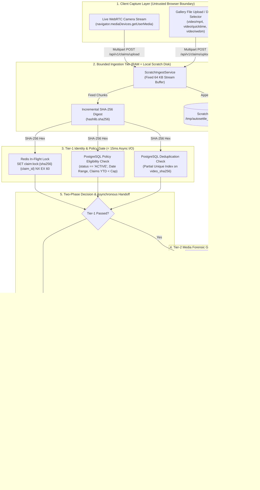
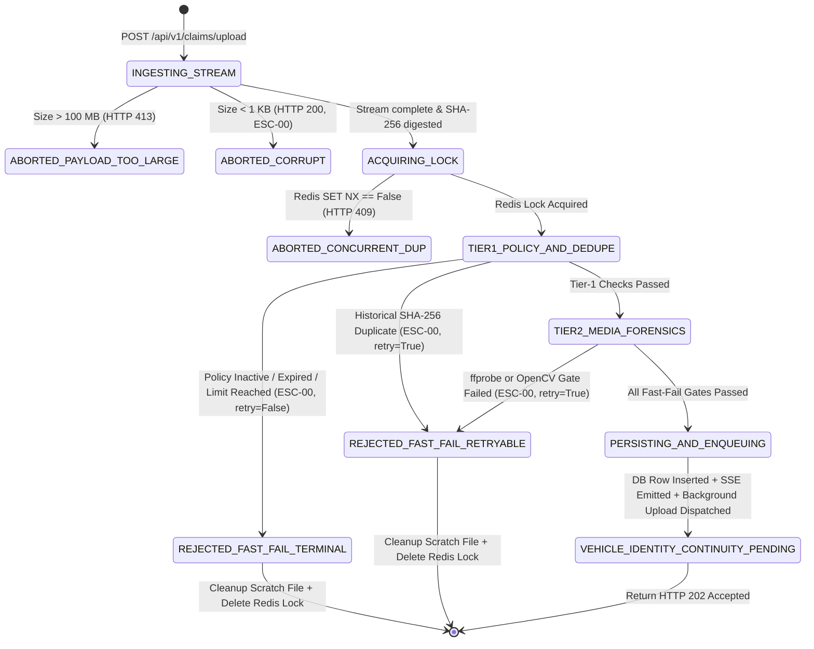
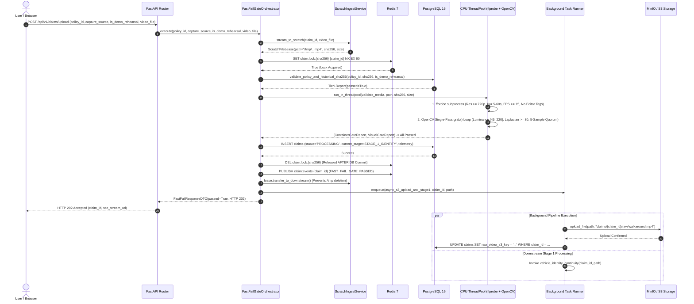
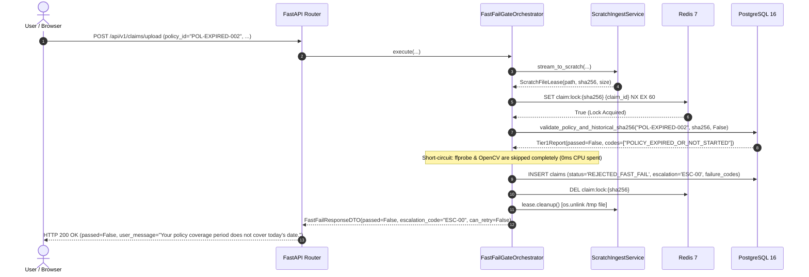
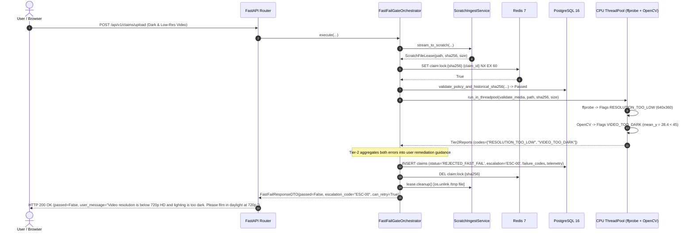
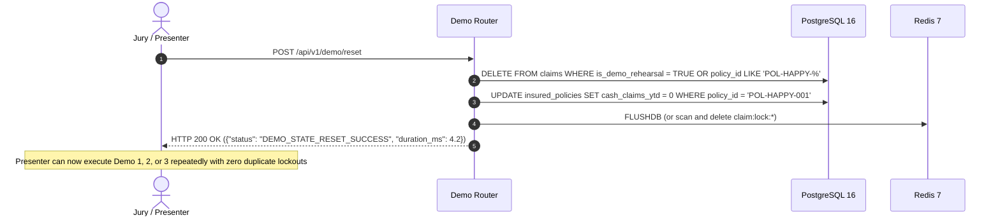
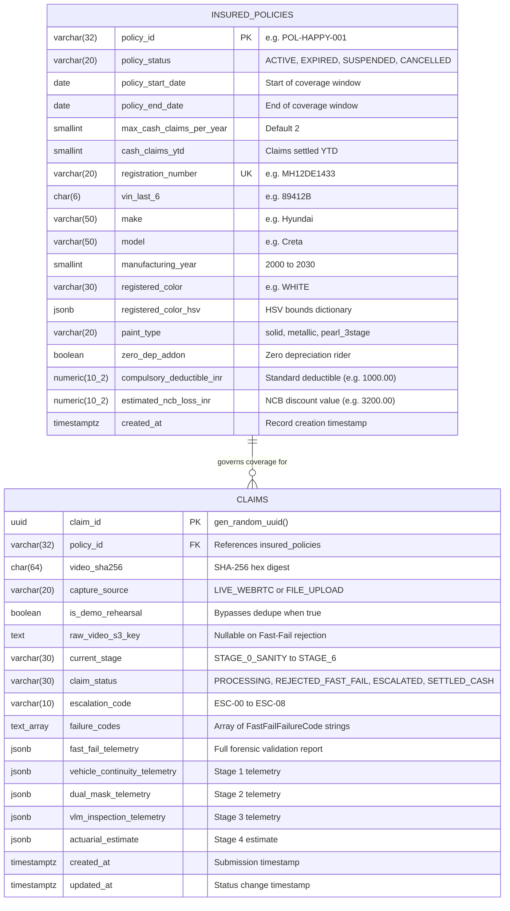

# Low-Level Design (LLD): Fast-Fail Gate (Stage 0) — Basic Sanity, Policy & Metadata Pre-Checks

| Document Control | Details |
| :--- | :--- |
| **Document ID** | `LLD-AUTO-SETTLE-FAST-FAIL-GATE` |
| **Version** | `2.1.0 (Frozen Production Specification — Descriptive Module Layout)` |
| **System** | Auto-Settle AI: Autonomous Video-to-Cash Claims Adjuster |
| **Module Scope** | Fast-Fail Gate (Stage 0): Basic Sanity, Policy & Metadata Pre-Checks |
| **Target Runtime Stack** | Python 3.12 (`uv`), FastAPI + Uvicorn (`uvloop`), PostgreSQL 16, Redis 7, MinIO / Amazon S3 (Simple Storage Service), `ffprobe`, OpenCV (`cv2`) |
| **Latency & Compute SLA** | **p50 $\le$ 150 ms**, **p95 $\le$ 400 ms**, **p99 $\le$ 650 ms** \| **100% CPU (Central Processing Unit) Bound (0% GPU (Graphics Processing Unit) Utilization)** |
| **Upstream / Downstream** | **Upstream:** Client WebRTC (Web Real-Time Communication) Camera / Multipart File Upload $\rightarrow$ **Downstream:** Vehicle Identity & Continuity Grounding (`vehicle_identity_continuity`) or `ESC-00` Fast-Fail Rejection |
| **Guardrail Rule ID** | `ESC-00` (Basic Pre-Check Failure $\rightarrow$ Prompt User to Re-Capture or Block Policy) |

---

## 1. Executive Summary, TL;DR & Architectural Traceability

### 1.1 TL;DR (Too Long; Didn't Read)
The Fast-Fail Gate serves as the zero-GPU-cost perimeter firewall of Auto-Settle AI, executing four deterministic checks on CPU in under 400 milliseconds to reject invalid policies, duplicate videos, non-linear edited media, and unreadable recordings before consuming downstream compute or storage bandwidth. Media streams write to local scratch disk in bounded 64 KB (kilobyte) chunks with on-the-fly SHA-256 (Secure Hash Algorithm 256-bit) calculation; valid videos return `HTTP 202 Accepted` immediately while S3 upload and Vehicle Identity & Continuity Grounding (`vehicle_identity_continuity`) handoff proceed asynchronously in the background. The design incorporates 8 adversarial audit fixes—including single-pass OpenCV frame extraction, a dedicated jury demo rehearsal bypass, and non-blocking S3 uploads—guaranteeing zero false rejections during live demonstrations.

### 1.2 Purpose & Mechanism
In automotive insurance claims, a significant fraction of claims submissions fail basic requirements: the insurance policy has expired, the user accidentally submits the same video twice, the video was pre-edited using mobile applications (`CapCut`, `InShot`), or the footage was captured in a dark garage or with severe motion blur. 

The Fast-Fail Gate intercepts these submissions immediately.
* **What goes in:** Untrusted HTTP (Hypertext Transfer Protocol) multipart stream containing `policy_id` (`string`), `capture_source` (`"LIVE_WEBRTC"` or `"FILE_UPLOAD"`), `is_demo_rehearsal` (`boolean`), and raw video bytes.
* **What happens to it:**
  1. Bytes stream into fixed 64 KB memory buffers and append to a local scratch file (`/tmp/autosettle_ingest/{claim_id}.mp4`) while calculating SHA-256 incrementally.
  2. An in-flight lock is set in Redis (`SET claim:lock:{sha256} {claim_id} NX EX 60`).
  3. **Tier-1 SQL Gate:** PostgreSQL 16 executes a single indexed query verifying that the policy status is `ACTIVE`, the current date is within the coverage window, the annual cash claim count has not exceeded the yearly cap, and the SHA-256 digest has not been used in a prior active or settled claim. If Tier-1 fails, execution short-circuits immediately.
  4. **Tier-2 Media Forensics Gate:** Sandboxed `ffprobe` inspects container and stream metadata to enforce resolution $\ge 720\text{p}$, duration between $5.0\text{s}$ and $60.0\text{s}$, framerate $\ge 15.0\text{ FPS}$ (frames per second), and the absence of non-linear editor signatures.
  5. **Tier-2 Visual Quality Gate:** OpenCV executes a single-pass sequential packet scan (`cap.grab()`) to sample 5 interior frames at normalized timestamps $p \in \{0.10, 0.30, 0.50, 0.70, 0.90\}$, verifying mean YUV (Luminance Y, Chrominance U, Chrominance V) luminance $\mu_Y \in [45, 220]$ and scale-normalized Laplacian sharpness variance $\sigma^2_{\nabla^2 I} \ge 80$.
* **What comes out:** Either a fast-fail JSON (JavaScript Object Notation) payload (`HTTP 200 OK`, `passed=false`, `escalation_code="ESC-00"`, with actionable user remediation) or a success acknowledgement (`HTTP 202 Accepted`, `passed=true`, and an SSE (Server-Sent Events) stream URL).
* **What is stored where:**
  * Rejected videos: Scratch file is unlinked immediately (`os.unlink`); Redis lock is deleted; an audit row with `claim_status = 'REJECTED_FAST_FAIL'` is logged in PostgreSQL if the policy exists. No bytes are sent to S3.
  * Valid videos: A `PROCESSING` record is committed to PostgreSQL; an SSE event `FAST_FAIL_GATE_PASSED` is published to Redis; the local scratch file lease is handed to `vehicle_identity_continuity`, while a background coroutine uploads the video to MinIO/S3.

### 1.3 Scope Boundaries

* **In Scope (Fast-Fail Gate):**
  1. Bounded chunked streaming to local scratch disk with strict 100 MB (megabyte) cap and incremental SHA-256 computation.
  2. Redis atomic in-flight locking and PostgreSQL historical SHA-256 duplicate detection.
  3. Policy verification (`ACTIVE` status, active date window, annual cash-in-lieu claim limit).
  4. Container forensics via sandboxed `ffprobe` subprocess (editor blacklist, orientation-agnostic 720p gate, duration bounds, framerate threshold).
  5. OpenCV 5-frame visual quality gate (dual luminance boundaries, 720p-normalized Laplacian sharpness).
  6. Two-phase error aggregation: Tier-1 short-circuits immediately to conserve CPU; Tier-2 aggregates container and visual failures so the user receives comprehensive capture guidance.
  7. Jury demo reset endpoint (`POST /api/v1/demo/reset`) and rehearsal bypass flag (`is_demo_rehearsal`).
  8. Local scratch file lifecycle handoff to `vehicle_identity_continuity` and asynchronous S3 raw video persistence.

* **Out of Scope (Delegated to Downstream Domain Modules):**
  * License plate ANPR (Automatic Number Plate Recognition) and vehicle color verification (`vehicle_identity_continuity`).
  * Video splice detection via Structural Similarity and YOLO (You Only Look Once) ByteTrack vehicle ID persistence (`vehicle_identity_continuity`).
  * Car part and damage instance segmentation using YOLO11m-seg (`dual_mask_segmentation`).
  * Set-of-Marks VLM (Vision-Language Model) depth and rust inspection (`vlm_damage_inspection`).
  * Actuarial pricing math and garage repair calculation (`actuarial_pricing`).
  * Bounded negotiation chatbot and cryptographic card signing (`negotiation_chatbot`).

### 1.4 Adversarial Audit Summary & Design Evolution
During the red-team audit between Draft v2.0 and Frozen v2.1, 8 critical failure modes and over-complications were identified and resolved:

| # | Flaw / Over-Complication in Draft v2.0 | Failure Mechanism | Frozen Engineering Fix in v2.1 |
| :--- | :--- | :--- | :--- |
| **1** | **Jury Demo Rehearsal Lockout** | The HLD defines a One-Click Demo Switcher. Rehearsing Demo 1 pre-populates `video_sha256` in PostgreSQL. When the presenter runs Demo 1 live, the unique index rejects it with `DUPLICATE_VIDEO_SUBMISSION`. | Added `is_demo_rehearsal: bool = False` form field and updated the partial unique index: `WHERE claim_status NOT IN ('REJECTED_FAST_FAIL', 'REJECTED_STAGE0') AND is_demo_rehearsal = FALSE`. Added `POST /api/v1/demo/reset` to purge demo records in $< 5\text{ ms}$. |
| **2** | **Demo 2 Preparation Self-Sabotage** | Demo 2 demonstrates video splice detection (`ESC-02`) and old rust detection (`ESC-04`). If the demo video is created in CapCut or Premiere without stripping metadata, the Fast-Fail Gate (`ESC-00`) rejects it before `vehicle_identity_continuity` ever runs. | Documented exact test asset preparation command (`ffmpeg ... -map_metadata -1 -c:v libx264`) and explicitly separated container tag checks from visual cut checks. |
| **3** | **`Lavf` / `FFmpeg` False-Positive Trap** | Android camera encoders, browser WebRTC transcoders, and synthetic `pytest` fixtures inject `encoder: Lavf...` or `libx264`. Naive substring matching on `"ffmpeg"` causes 100% false rejections. | Pinned the editor blacklist strictly to known NLE (Non-Linear Editing) suites (`capcut`, `inshot`, `premiere`, `davinci`, `kinemaster`, `filmora`, `vn video`, `ffmpeg-splice`) and explicitly whitelisted standard muxers (`lavf`, `libx264`, `libvpx`, `chrome`, `apple`, `android`). |
| **4** | **Policy Rate-Limiting Lockout** | Draft v2.0 added a Redis rate limit of 5 requests/minute per `policy_id`. Rapid iteration during hackathon judging triggers `HTTP 429 Too Many Requests`. | **Pruned.** In-flight SHA-256 locking (`SET claim:lock:{sha256} NX EX 60`) prevents double-click race conditions without restricting repeat submissions under test policies. |
| **5** | **Custom Redis Lua & Cron Reaper Over-Complication** | Complex Lua scripts and background reaper daemons introduce unmonitored failure points and potential deadlocks on disk. | Replaced with standard atomic Redis commands (`SET NX EX 60`, `DEL`) and standard Python `try/finally` context-managed file unlinking. |
| **6** | **Dual-Mode OpenCV Seeking Inaccuracy** | Calling `cap.set(cv2.CAP_PROP_POS_FRAMES, idx)` is non-deterministic on Variable Frame Rate (VFR) smartphone video and crashes on unindexed WebRTC WebM streams. | Replaced with a **Single-Pass Demuxer `grab()` Loop**: calling `cap.grab()` advances container packet pointers in $< 4\text{ ms}$ for 450 frames without decoding pixel buffers, decoding (`cap.retrieve()`) strictly at the 5 target sample frames. |
| **7** | **Synchronous S3 Upload Latency Spike** | Uploading 25 MB to S3 within the synchronous HTTP handler adds $500\text{--}2500\text{ ms}$, breaching the $\le 400\text{ ms}$ SLA. | `POST /upload` validates the local scratch file and returns `HTTP 202` in $< 180\text{ ms}$. S3 upload executes in a FastAPI background task concurrently with `vehicle_identity_continuity` reading from local scratch. |
| **8** | **Duration Boundary Ambiguity** | HLD diagrams specified `5s-45s` while text specified `5s-60s`. | Unified: Hard architectural rejection gate is $5.0\text{s} \le \text{duration} \le 60.0\text{s}$. Customer guidance prompts for a 15-second walkaround ($5\text{--}45\text{s}$ optimal). |
| **9** | **Overexposed Video Ceiling Permitting Washed-Out Frames** | An overly lenient upper luminance ceiling ($\mu_Y \le 235.0$) permitted severe daylight overexposure ($\mu_Y \approx 224$), washing out fine paint scratches, clearcoat swirls, and shallow dent shadows. | **Tightened Luminance Upper Ceiling to $\mu_Y \le 220.0$** (`FAST_FAIL_MAX_LUMINANCE_Y = 220.0`), rejecting blinding glare and washouts via `VIDEO_TOO_BRIGHT`. |
| **10** | **Truncated Video Quorum Attack False Pass** | Containers declaring $15\text{s}$ duration but containing only 1–2 decodable frames scaled down OpenCV sample count and passed visual quality because sample 0 was clean. | **Enforced Mandatory 5-Sample Quorum:** If `len(sampled_metrics) < len(SAMPLE_NORMALIZED_TIMESTAMPS)`, emit `CONTAINER_PARSE_FAILED` immediately, blocking corrupt/truncated streams. |
| **11** | **Null-Tag Crash on Corrupt Container Streams** | In `container_forensics.py`, probing streams with empty or absent tag dictionaries (`tags=None`) triggered unhandled `TypeError: NoneType is not iterable`. | Wrapped metadata tag retrieval in `video_stream.get("tags") or {}` and robust dimension integer parsing with `(ValueError, TypeError)` exception guards. |
| **12** | **In-Flight Redis Deduplication Lock Race Window** | Releasing the Redis in-flight lock before database commit permitted concurrent duplicate uploads with identical video bytes to slip past uniqueness checks. | **Ordered Lock Handoff:** In `FastFailGateOrchestrator.execute()`, moved Redis lock release to execute strictly *after* `claim_repo.create_claim()` has committed to PostgreSQL. |
| **13** | **Background Task Exception Orphans & Disk Leaks** | Unhandled exceptions inside background Stage 1 coroutines left claims permanently stuck in `PROCESSING` and orphaned video files in `/tmp/autosettle_ingest/`. | In `claims_router.py`, wrapped background pipeline execution in `try ... finally` with explicit `scratch_path.unlink()`, and added global `except Exception` handler transitioning claim to `REJECTED_STAGE1_ERROR` (`ESC-02`) and emitting `STAGE_1_FAILED` SSE. |

### 1.5 HLD-to-LLD Traceability Matrix

| Requirement ID | HLD Specification | Implementation Artifact | Database / Storage Contract | Verification Test ID |
| :--- | :--- | :--- | :--- | :--- |
| **`REQ-S0-01`** | Verify `policy_status == 'ACTIVE'`, date within window, cash claims YTD (Year-To-Date) below annual cap. | `PolicyAndDedupeGate.validate_policy()` | `insured_policies` table (`policy_status`, `policy_start_date`, `policy_end_date`, `cash_claims_ytd`, `max_cash_claims_per_year`) | `T0-05`, `T0-06`, `T0-07`, `T0-08` |
| **`REQ-S0-02`** | Compute SHA-256 hash to block duplicate video submissions immediately. | `ScratchIngestService` + `PolicyAndDedupeGate.validate_dedupe()` | Redis `claim:lock:{sha256}` + PostgreSQL partial index `idx_claims_unique_active_video_sha256` | `T0-09`, `T0-10`, `T0-11`, `T0-12` |
| **`REQ-S0-03`** | Inspect container tags via `ffprobe`; reject edited videos (`CapCut`, `InShot`, `Adobe Premiere`, `DaVinci`, `FFmpeg-splice`). | `ContainerForensicsValidator.validate()` | `claims.fast_fail_telemetry -> container_gate` (`JSONB`) | `T0-13`, `T0-14` |
| **`REQ-S0-04`** | Enforce resolution $\ge 720\text{p}$, duration $5.0\text{s}\text{--}60.0\text{s}$, and framerate $\ge 15.0\text{ FPS}$. | `ContainerForensicsValidator` + `VisualQualityValidator` (WebRTC duration fallback) | `claims.fast_fail_telemetry -> container_gate` (`JSONB`) | `T0-01`, `T0-02`, `T0-03`, `T0-15`, `T0-16`, `T0-17` |
| **`REQ-S0-05`** | Sample 5 interior frames; reject if mean YUV luminance $\mu_Y < 45$ or $\mu_Y > 220$. | `VisualQualityValidator._evaluate_luminance()` | `claims.fast_fail_telemetry -> visual_gate` (`JSONB`) | `T0-18`, `T0-19` |
| **`REQ-S0-06`** | Compute 720p-normalized Laplacian sharpness $\sigma^2_{\nabla^2 I}$; reject if $< 80$ across quorum. | `VisualQualityValidator._evaluate_sharpness()` | `claims.fast_fail_telemetry -> visual_gate` (`JSONB`) | `T0-04`, `T0-20` |
| **`REQ-S0-07`** | Return actionable user remediation on failure (`ESC-00`). | `RemediationMapper.map_failures()` | `claims.escalation_code = 'ESC-00'`, `claims.claim_status = 'REJECTED_FAST_FAIL'` | `T0-05` through `T0-21` |
| **`REQ-S0-08`** | Provide rapid rehearsal reset and safe demo re-runs without duplicate lockout. | `demo_router.py` + `is_demo_rehearsal` flag | `POST /api/v1/demo/reset` + `claims.is_demo_rehearsal` | `T0-11` |

---

## 2. Target Repository & Module Structure

The file structure below enforces descriptive folder and component names across the codebase:

```text
auto-settle-ai/
├── alembic/
│   ├── env.py
│   └── versions/
│       └── 0001_fast_fail_gate_foundation.py     # PostgreSQL DDL for insured_policies & claims + indexes
├── app/
│   ├── core/
│   │   ├── config.py                             # Pydantic BaseSettings for all Fast-Fail Gate thresholds
│   │   ├── exceptions.py                         # Custom domain exceptions (PayloadTooLarge, LockConflict)
│   │   └── logging.py                            # Structured JSON logger with correlation_id
│   ├── domain/
│   │   ├── fast_fail_gate/                       # Fast-Fail Gate (Stage 0)
│   │   │   ├── interfaces.py                     # Abstract base protocols for Fast-Fail Gate components
│   │   │   ├── schemas.py                        # Pydantic v2 DTOs, Enums, and Telemetry contracts
│   │   │   ├── policy_dedupe_gate.py             # Tier-1 Gate: SQL Policy + SHA-256 Deduplication
│   │   │   ├── container_forensics.py            # Tier-2A Gate: ffprobe subprocess metadata validator
│   │   │   ├── visual_quality_gate.py            # Tier-2B Gate: Single-pass OpenCV 5-frame YUV & blur gate
│   │   │   ├── remediation_mapper.py             # Maps FastFailFailureCode[] -> Actionable UX directives
│   │   │   └── orchestrator.py                   # FastFailGateOrchestrator: Two-phase pipeline coordinator
│   │   ├── vehicle_identity_continuity/          # Downstream: Vehicle Identity & Continuity (Stage 1)
│   │   ├── dual_mask_segmentation/               # Downstream: Part & Damage Segmentation (Stage 2)
│   │   ├── vlm_damage_inspection/                # Downstream: SoM VLM Depth & Rust Gate (Stage 3)
│   │   ├── actuarial_pricing/                    # Downstream: OEM Schedule & Pricing Engine (Stage 4)
│   │   ├── negotiation_chatbot/                  # Downstream: Bounded Negotiation FSM (Stage 5)
│   │   └── settlement_escalation/                # Downstream: Settlement & Escalation Router (Stage 6)
│   ├── infrastructure/
│   │   ├── db/
│   │   │   ├── session.py                        # Async SQLAlchemy session factory
│   │   │   ├── models.py                         # Declarative ORM models (InsuredPolicy, Claim)
│   │   │   ├── repositories.py                   # Optimized async SQL queries for Policy & Claim
│   │   │   └── seed.py                           # Idempotent database seeder for demo & test policies
│   │   ├── cache/
│   │   │   └── redis_manager.py                  # Redis in-flight SET NX lock & SSE Pub/Sub publisher
│   │   └── storage/
│   │       ├── scratch_ingest.py                 # 64 KB chunked stream writer & SHA-256 hasher
│   │       └── s3_client.py                      # Async MinIO / S3 storage wrapper
│   └── api/
│       └── v1/
│           ├── router.py                         # Aggregated API router
│           └── endpoints/
│               ├── claims_router.py              # POST /api/v1/claims/upload controller
│               └── demo_router.py                # POST /api/v1/demo/reset helper for jury testing
├── tests/
│   ├── fast_fail_gate/                           # Fast-Fail Gate verification suite
│   │   ├── conftest.py                           # Deterministic FFmpeg synthetic video fixture builder
│   │   ├── test_fast_fail_unit.py                # Unit tests: math, normalization, tag parsing
│   │   ├── test_fast_fail_gates.py               # Integration tests: T0-01 to T0-21 against live DB/Redis
│   │   └── test_fast_fail_concurrency.py         # Concurrency races, TTL expirations, scratch lease checks
│   └── vehicle_identity_continuity/              # Stage 1 test suite
├── evals/
│   └── fast_fail_gate/
│       └── run_fast_fail_eval.py                 # Automated CI/CD gate: FAR/FRR and latency benchmark
└── pyproject.toml                                # Dependencies: fastapi, uvicorn, sqlalchemy, asyncpg, redis, opencv-python-headless
```

---

## 3. Architecture & System Diagrams

### 3.1 Level-1 Data Flow Diagram (DFD)

The diagram below details the data flow from untrusted client upload through ephemeral memory buffers, local scratch storage, Tier-1 validation, Tier-2 media forensics, and final asynchronous handoff:



### 3.2 UML Class Diagram & Architecture Pattern

The system implements the **Two-Phase Chain of Responsibility Pattern** coordinated by `FastFailGateOrchestrator`, supported by a **Resource Acquisition Is Initialization (RAII) Lease Pattern** (`ScratchFileLease`) to guarantee scratch file cleanup.

```mermaid
classDiagram
    class FastFailGateOrchestrator {
        -ScratchIngestService ingest_svc
        -RedisManager redis_mgr
        -PolicyAndDedupeGate tier1_gate
        -ContainerForensicsValidator container_validator
        -VisualQualityValidator visual_validator
        -RemediationMapper remediation_mapper
        -ClaimRepository claim_repo
        -S3Client s3_client
        +execute(policy_id: str, capture_source: CaptureSource, is_demo_rehearsal: bool, upload_file: UploadFile, bg_tasks: BackgroundTasks) FastFailResponseDTO
    }

    class ScratchFileLease {
        +UUID claim_id
        +Path file_path
        +str sha256_hex
        +int file_size_bytes
        -bool transferred_to_downstream
        +transfer_to_downstream() Path
        +cleanup() void
    }

    class ScratchIngestService {
        -Path scratch_dir
        -int max_bytes
        -int chunk_size
        +stream_to_scratch(claim_id: UUID, upload_file: UploadFile) ScratchFileLease
    }

    class RedisManager {
        -Redis client
        +acquire_video_lock(sha256: str, claim_id: UUID, ttl_sec: int) bool
        +release_video_lock(sha256: str) bool
        +publish_event(claim_id: UUID, event_name: str, payload: dict) void
    }

    class PolicyAndDedupeGate {
        -ClaimRepository repo
        +validate(policy_id: str, sha256: str, is_demo_rehearsal: bool) Tier1GateReport
    }

    class ContainerForensicsValidator {
        -FastFailGateSettings settings
        +validate(video_path: Path, sha256: str, file_size_bytes: int) ContainerGateReport
        -parse_dimensions(stream: dict) Tuple~int, int, int, int~
        -parse_duration(format_data: dict, stream_data: dict) Tuple~float, str~
        -check_editor_tags(format_tags: dict, stream_tags: dict) Optional~str~
    }

    class VisualQualityValidator {
        -FastFailGateSettings settings
        +validate(video_path: Path, container_report: ContainerGateReport) VisualGateReport
        -execute_single_pass_scan(video_path: Path, container_report: ContainerGateReport) List~SampledFrameMetric~
        -compute_frame_metrics(frame_bgr: ndarray, idx: int, timestamp: float) SampledFrameMetric
    }

    class RemediationMapper {
        +map_failures(codes: List~FastFailFailureCode~, telemetry: FastFailTelemetryDTO) RemediationDirective
    }

    FastFailGateOrchestrator --> ScratchIngestService : creates lease
    FastFailGateOrchestrator --> ScratchFileLease : manages lifecycle
    FastFailGateOrchestrator --> RedisManager : concurrency lock & SSE
    FastFailGateOrchestrator --> PolicyAndDedupeGate : executes Tier-1
    FastFailGateOrchestrator --> ContainerForensicsValidator : executes Tier-2A
    FastFailGateOrchestrator --> VisualQualityValidator : executes Tier-2B
    FastFailGateOrchestrator --> RemediationMapper : translates errors
```



### 3.3 Fast-Fail Gate Claim Lifecycle State Machine



### 3.4 Key Sequence Diagrams

#### Sequence Diagram A: Happy Path (Pass Flow with Async S3 Upload and Downstream Handoff)



#### Sequence Diagram B: Tier-1 Fast-Fail Flow (Policy Expired / Duplicate)



#### Sequence Diagram C: Tier-2 Media Fast-Fail Flow (Visual Quality / Container Forensics Failure)



#### Sequence Diagram D: Jury Demo Reset & Rehearsal Bypass Flow



---

## 4. Database Design, Storage Contracts & Data Models

### 4.1 Entity-Relationship Diagram (ERD)



### 4.2 Exact PostgreSQL 16 DDL Contract (`0001_fast_fail_gate_foundation.py`)

The Alembic migration must execute the following Data Definition Language (DDL) statements:

```sql
CREATE EXTENSION IF NOT EXISTS "pgcrypto";

-- 1. Insured Policies Table
CREATE TABLE insured_policies (
    policy_id VARCHAR(32) PRIMARY KEY,
    policy_status VARCHAR(20) NOT NULL DEFAULT 'ACTIVE'
        CONSTRAINT chk_policy_status CHECK (policy_status IN ('ACTIVE', 'EXPIRED', 'SUSPENDED', 'CANCELLED')),
    policy_start_date DATE NOT NULL,
    policy_end_date DATE NOT NULL
        CONSTRAINT chk_policy_dates CHECK (policy_end_date >= policy_start_date),
    max_cash_claims_per_year SMALLINT NOT NULL DEFAULT 2
        CONSTRAINT chk_max_claims_positive CHECK (max_cash_claims_per_year > 0),
    cash_claims_ytd SMALLINT NOT NULL DEFAULT 0
        CONSTRAINT chk_ytd_claims_nonneg CHECK (cash_claims_ytd >= 0),
    registration_number VARCHAR(20) UNIQUE NOT NULL,
    vin_last_6 CHAR(6) NOT NULL,
    make VARCHAR(50) NOT NULL,
    model VARCHAR(50) NOT NULL,
    manufacturing_year SMALLINT NOT NULL
        CONSTRAINT chk_mfg_year CHECK (manufacturing_year BETWEEN 2000 AND 2030),
    registered_color VARCHAR(30) NOT NULL,
    registered_color_hsv JSONB NOT NULL DEFAULT '{"h_min": 0, "h_max": 180, "s_max": 50, "v_min": 160}'::jsonb,
    paint_type VARCHAR(20) NOT NULL DEFAULT 'metallic'
        CONSTRAINT chk_paint_type CHECK (paint_type IN ('solid', 'metallic', 'pearl_3stage')),
    zero_dep_addon BOOLEAN NOT NULL DEFAULT TRUE,
    compulsory_deductible_inr NUMERIC(10, 2) NOT NULL DEFAULT 1000.00,
    estimated_ncb_loss_inr NUMERIC(10, 2) NOT NULL DEFAULT 3200.00,
    created_at TIMESTAMPTZ NOT NULL DEFAULT NOW()
);

-- 2. Master Claims Table
CREATE TABLE claims (
    claim_id UUID PRIMARY KEY DEFAULT gen_random_uuid(),
    policy_id VARCHAR(32) NOT NULL REFERENCES insured_policies(policy_id) ON DELETE RESTRICT,
    video_sha256 CHAR(64) NOT NULL,
    capture_source VARCHAR(20) NOT NULL
        CONSTRAINT chk_capture_source CHECK (capture_source IN ('LIVE_WEBRTC', 'FILE_UPLOAD')),
    is_demo_rehearsal BOOLEAN NOT NULL DEFAULT FALSE,
    raw_video_s3_key TEXT NULL,
    current_stage VARCHAR(30) NOT NULL DEFAULT 'STAGE_0_SANITY',
    claim_status VARCHAR(30) NOT NULL DEFAULT 'PROCESSING'
        CONSTRAINT chk_claim_status CHECK (
            claim_status IN ('PROCESSING', 'REJECTED_FAST_FAIL', 'REJECTED_STAGE0', 'ESCALATED', 'NEGOTIATING', 'SETTLED_CASH', 'ROUTED_GARAGE')
        ),
    escalation_code VARCHAR(10) NULL,
    failure_codes TEXT[] NOT NULL DEFAULT '{}',
    fast_fail_telemetry JSONB NOT NULL,
    vehicle_continuity_telemetry JSONB NULL,
    dual_mask_telemetry JSONB NULL,
    vlm_inspection_telemetry JSONB NULL,
    actuarial_estimate JSONB NULL,
    created_at TIMESTAMPTZ NOT NULL DEFAULT NOW(),
    updated_at TIMESTAMPTZ NOT NULL DEFAULT NOW()
);

-- Partial Unique Index: Blocks reuse of the same video for multiple non-demo active/settled claims,
-- while allowing users who were rejected at the Fast-Fail Gate (e.g. for dark lighting) or presenters in rehearsal mode
-- to resubmit cleanly.
CREATE UNIQUE INDEX idx_claims_unique_active_video_sha256
    ON claims(video_sha256)
    WHERE claim_status NOT IN ('REJECTED_FAST_FAIL', 'REJECTED_STAGE0') AND is_demo_rehearsal = FALSE;

CREATE INDEX idx_claims_policy_id_created ON claims(policy_id, created_at DESC);
```

### 4.3 Mandatory Seed Data Specification (`app/infrastructure/db/seed.py`)

The application must execute `seed.py` on startup to idempotently insert (`ON CONFLICT (policy_id) DO NOTHING`) 4 baseline policies:

| `policy_id` | `policy_status` | `policy_start_date` | `policy_end_date` | `cash_claims_ytd` / `max` | `registration_number` | `vin_last_6` | `make` / `model` / `year` | `registered_color` | Verification Target |
| :--- | :--- | :--- | :--- | :--- | :--- | :--- | :--- | :--- | :--- |
| `POL-HAPPY-001` | `ACTIVE` | `CURRENT_DATE - 180` | `CURRENT_DATE + 185` | `0 / 2` | `MH12DE1433` | `89412B` | `Hyundai` `Creta` `2023` | `WHITE` | **Jury Demos 1, 2, 3** & Happy Path Tests |
| `POL-EXPIRED-002` | `ACTIVE` | `CURRENT_DATE - 400` | `CURRENT_DATE - 35` | `0 / 2` | `DL01AB9999` | `11223C` | `Maruti` `Swift` `2021` | `SILVER` | **Test `T0-06`** (Policy Expired) |
| `POL-INACTIVE-003` | `SUSPENDED` | `CURRENT_DATE - 90` | `CURRENT_DATE + 275` | `1 / 2` | `KA05MN4321` | `44556D` | `Tata` `Nexon` `2022` | `BLUE` | **Test `T0-05`** (Policy Suspended) |
| `POL-MAXED-004` | `ACTIVE` | `CURRENT_DATE - 200` | `CURRENT_DATE + 165` | `2 / 2` | `MH01XY7777` | `77889E` | `Hyundai` `Creta` `2024` | `BLACK` | **Test `T0-07`** (Annual Cap Reached) |

### 4.4 Redis Key Architecture & Cache Contracts

1. **In-Flight Concurrency Lock:**
   * Key: `claim:lock:{sha256}`
   * Type: `String` (holds `claim_id`)
   * Acquisition Command: `SET claim:lock:{sha256} {claim_id} NX EX 60`
   * Release Command: `DEL claim:lock:{sha256}` (invoked immediately if Fast-Fail validation fails).
2. **Server-Sent Events (SSE) Pub/Sub Channel:**
   * Key: `claim:events:{claim_id}`
   * Type: `Pub/Sub Channel`
   * Payload: JSON payload emitted on transition: `{"event": "FAST_FAIL_GATE_PASSED", "claim_id": str(claim_id), "timestamp": iso8601}`.
3. **Policy Rate Limiting:**
   * *Explicit Architecture Decision:* Pruned. In-flight SHA-256 locking sufficiently blocks double-click submission spam without creating accidental presentation lockouts during Q&A and judging.

### 4.5 Object Storage Contract (Amazon S3 / MinIO)

* **Bucket Name:** `autosettle-claims`
* **Object Key Template:** `claims/{claim_id}/raw/walkaround.{ext}` (where `{ext}` is `"mp4"` or `"webm"`).
* **Upload Mechanism:** Bounded streaming multipart upload initiated inside a FastAPI background task (`BackgroundTask`). The HTTP upload handler does not block on object storage I/O (Input/Output).

---

## 5. Component Specifications & Detailed Algorithms

### 5.1 `ScratchIngestService` (`app/infrastructure/storage/scratch_ingest.py`)

* **Responsibility:** Streams incoming HTTP multipart video payload into `/tmp/autosettle_ingest/{claim_id}.mp4` in fixed 64 KB memory chunks, computes incremental SHA-256, enforces size constraints, and produces a managed `ScratchFileLease`.
* **Interface:**
  ```python
  def stream_to_scratch(self, claim_id: UUID, upload_file: UploadFile) -> ScratchFileLease: ...
  ```
* **Algorithm:**
  1. Initialize `hasher = hashlib.sha256()` and `bytes_written = 0`.
  2. Open destination file at `/tmp/autosettle_ingest/{claim_id}.mp4` with exclusive write mode (`wb`).
  3. Loop: read chunk = `upload_file.file.read(65536)` (64 KB).
     * If chunk is empty: break.
     * Update `bytes_written += len(chunk)`.
     * If `bytes_written > 104_857_600` (100 MB): close file, invoke `os.unlink`, and raise `PayloadTooLargeError` (`HTTP 413`).
     * `hasher.update(chunk)` and write chunk to disk.
  4. If `bytes_written < 1024` (1 KB): close file, invoke `os.unlink`, and raise `CorruptMediaError` (`HTTP 200` with `CORRUPT_OR_UNREADABLE_MEDIA`).
  5. Return `ScratchFileLease(claim_id=claim_id, file_path=path, sha256_hex=hasher.hexdigest(), file_size_bytes=bytes_written)`.
* **Complexity:** Time: $O(B)$ where $B$ is uploaded bytes; Memory: $O(1)$ RAM (strictly 64 KB buffer).

### 5.2 `RedisManager` (`app/infrastructure/cache/redis_manager.py`)

* **Responsibility:** Manages in-flight deduplication locks and stage transition messaging.
* **Interface:**
  ```python
  async def acquire_video_lock(self, sha256_hex: str, claim_id: UUID, ttl_sec: int = 60) -> bool: ...
  async def release_video_lock(self, sha256_hex: str) -> bool: ...
  async def publish_event(self, claim_id: UUID, event_name: str, payload: dict) -> None: ...
  ```
* **Lock Semantics:** Executes `redis.set(f"claim:lock:{sha256_hex}", str(claim_id), nx=True, ex=ttl_sec)`. Returns `True` if lock was acquired; `False` if another request is currently processing the identical video stream.

### 5.3 `PolicyAndDedupeGate` (`app/domain/fast_fail_gate/policy_dedupe_gate.py`)

* **Responsibility:** Executes Tier-1 database validation in single or grouped async queries.
* **Interface:**
  ```python
  async def validate(self, policy_id: str, video_sha256: str, is_demo_rehearsal: bool) -> Tier1GateReport: ...
  ```
* **Evaluation Sequence:**
  1. **Historical Deduplication Check:** If `not is_demo_rehearsal`, query `claims` for any record matching `video_sha256` where `claim_status NOT IN ('REJECTED_FAST_FAIL', 'REJECTED_STAGE0')` and `is_demo_rehearsal = FALSE`. If found $\rightarrow$ append `DUPLICATE_VIDEO_SUBMISSION`.
  2. **Policy Existence & Status Check:** Query `insured_policies` where `policy_id = :policy_id`.
     * Record not found $\rightarrow$ append `POLICY_NOT_FOUND`.
     * `policy_status != 'ACTIVE'` $\rightarrow$ append `POLICY_INACTIVE`.
     * `CURRENT_DATE < policy_start_date` or `CURRENT_DATE > policy_end_date` $\rightarrow$ append `POLICY_EXPIRED_OR_NOT_STARTED`.
     * `cash_claims_ytd >= max_cash_claims_per_year` $\rightarrow$ append `ANNUAL_CLAIM_LIMIT_EXCEEDED`.
  3. **Short-Circuit Decision:** If any failure code is present, return `Tier1GateReport(passed=False, failure_codes=...)`. The orchestrator terminates processing immediately without executing subprocess or OpenCV calls.

### 5.4 `ContainerForensicsValidator` (`app/domain/fast_fail_gate/container_forensics.py`)

* **Responsibility:** Executes sandboxed `ffprobe` to validate container integrity, stream characteristics, and detects metadata tags from non-linear video editors.
* **Security Subprocess Invocation:**
  ```python
  cmd = [
      "ffprobe",
      "-v", "quiet",
      "-print_format", "json",
      "-show_format",
      "-show_streams",
      "--",
      str(video_path)
  ]
  res = subprocess.run(cmd, capture_output=True, text=True, timeout=5.0, shell=False)
  ```
* **Validation Rules:**
  1. **Video Stream Check:** Parse JSON output. Find first stream where `codec_type == "video"`. If missing or JSON parse raises an exception $\rightarrow$ return `CORRUPT_OR_UNREADABLE_MEDIA`.
  2. **Orientation-Agnostic Resolution Gate ($\ge 720\text{p}$):**
     * Extract integer dimensions `width` and `height`.
     * Compute `short_edge = min(width, height)` and `long_edge = max(width, height)`.
     * Invariant: Both Landscape (`1280x720`) and Portrait (`720x1280`) smartphone captures satisfy `short_edge == 720` and `long_edge == 1280`.
     * If `short_edge < 720` or `long_edge < 1280` $\rightarrow$ append `RESOLUTION_TOO_LOW`.
  3. **Duration Bounds Check ($5.0\text{s} \le T \le 60.0\text{s}$):**
     * Attempt to extract float `duration` from `format.duration` or `video_stream.duration`.
     * If duration is present: verify $5.0 \le \text{duration} \le 60.0$. If outside bounds $\rightarrow$ append `DURATION_OUT_OF_BOUNDS`. Set `duration_source = "FFPROBE_HEADER"`.
     * If duration is missing, `"N/A"`, or null (standard behavior for live WebRTC `MediaRecorder` WebM blobs): mark `duration_source = "OPENCV_STREAM_SCAN"` and defer duration validation to `VisualQualityValidator`.
  4. **Framerate Gate ($\text{FPS} \ge 15.0$):**
     * Parse rational string `avg_frame_rate` (e.g. `"30/1"` or `"30000/1001"`). Compute float FPS.
     * If $0 < \text{fps} < 15.0$ $\rightarrow$ append `FRAMERATE_TOO_LOW`.
  5. **Non-Linear Editor Signature Blacklist:**
     * Extract tags across `format.tags` and `streams[*].tags` for keys: `encoder`, `handler_name`, `software`, `comment`, `creation_app`, `writing_application`.
     * Search case-insensitively against the **Strict Editor Blacklist**:
       ```python
       FORBIDDEN_EDITOR_SIGNATURES = (
           "capcut", "inshot", "premiere", "davinci", "after effects",
           "final cut", "kinemaster", "vn video", "filmora", "ffmpeg-splice",
           "avidemux", "shotcut", "vegas pro", "photoshop", "canva",
           "youcut", "powerdirector"
       )
       ```
     * **Whitelisted Encoders:** Standard muxers and transcoders (`lavf`, `libx264`, `libvpx`, `handbrake`, `chrome`, `apple`, `android`) must **never** be flagged.
     * If matched $\rightarrow$ record matched signature in `detected_editing_software` and append `METADATA_EDITED_VIDEO`.
     * *Note on Demo 2 Preparation:* Spliced demo videos intended to trigger `vehicle_identity_continuity` cut detection (`ESC-02`) must be generated with stripped metadata: `ffmpeg -i input.mp4 -map_metadata -1 -c:v libx264 demo2.mp4`.

### 5.5 `VisualQualityValidator` (`app/domain/fast_fail_gate/visual_quality_gate.py`)

* **Responsibility:** Implements a single-pass sequential packet scanner to decode 5 interior frames and measure lighting and sharpness.
* **Single-Pass Demuxer Algorithm:**
  1. Open video stream: `cap = cv2.VideoCapture(str(video_path))`.
  2. Read container metadata: `total_frames = int(cap.get(cv2.CAP_PROP_FRAME_COUNT))` and `fps = cap.get(cv2.CAP_PROP_FPS) or 30.0`.
  3. **WebRTC WebM Handling:** If `total_frames <= 0`:
     * Execute a rapid demuxer scan: `count = 0; while cap.grab(): count += 1`.
     * Set `total_frames = count`.
     * Re-open `cap = cv2.VideoCapture(str(video_path))`.
  4. **Deferred Duration Verification:** If `container_report.duration_source == "OPENCV_STREAM_SCAN"`:
     * Compute $T = \frac{\text{total\_frames}}{\text{fps}}$.
     * Update `container_report.duration_sec = round(T, 2)`.
     * If $T < 5.0$ or $T > 60.0$ $\rightarrow$ append `DURATION_OUT_OF_BOUNDS`.
  5. Compute 5 interior sample indices at fractional positions $p \in \{0.10, 0.30, 0.50, 0.70, 0.90\}$:
     $$k_i = \lfloor p_i \times (\text{total\_frames} - 1) \rfloor$$
  6. Loop `frame_idx` from `0` to $k_4$:
     * Invoke `cap.grab()` (advances demuxer packet pointer in $< 0.01\text{ ms}$ without decoding frame).
     * If `frame_idx` in $\{k_0, k_1, k_2, k_3, k_4\}$:
       * Invoke `ret, frame_bgr = cap.retrieve()`.
       * If not `ret` or `frame_bgr is None`: continue.
       * **Luminance Calculation ($\mu_{Y, i}$):** Convert BGR (Blue, Green, Red) to YUV using `cv2.cvtColor(frame_bgr, cv2.COLOR_BGR2YUV)`. Extract channel 0 ($Y$ channel):
         $$\mu_{Y, i} = \frac{1}{H \cdot W} \sum_{u=1}^H \sum_{v=1}^W Y_i(u, v)$$
         Flag `is_dark = (mean_y < 45.0)` and `is_overexposed = (mean_y > 220.0)`.
       * **720p-Normalized Laplacian Sharpness ($\sigma^2_{\nabla^2 I, i}$):**
         Let $s = \min(H, W)$. If $s > 720$, resize $Y_i$ using `cv2.INTER_AREA` by scaling factor $\frac{720}{s}$ to normalize for camera sensor resolution:
         $$\sigma^2_{\nabla^2 I, i} = \text{Var}\left(\text{cv2.Laplacian}(Y_{\text{norm}, i}, \text{cv2.CV_64F})\right)$$
         Flag `is_blurry = (laplacian_var < 80.0)`.
  7. **Quorum & Sample Integrity Evaluation:**
     * **Sample Quorum Integrity:** If fewer than the planned 5 interior frames could be retrieved (`len(sampled_metrics) < len(SAMPLE_NORMALIZED_TIMESTAMPS)`), immediately emit `CONTAINER_PARSE_FAILED`. This blocks truncated containers (which declare a full duration in metadata but only hold 1–2 decodable frames) from evading detection via partial sample counts.
     * `VIDEO_TOO_DARK`: Emitted if aggregate $\frac{1}{N}\sum \mu_{Y,i} < 45.0$ OR $\ge 3$ of 5 frames have `is_dark == True`.
     * `VIDEO_TOO_BRIGHT`: Emitted if aggregate $\frac{1}{N}\sum \mu_{Y,i} > 220.0$ OR $\ge 3$ of 5 frames have `is_overexposed == True`.
     * `VIDEO_TOO_BLURRY`: Emitted if $\max_i(\sigma^2_{\nabla^2 I, i}) < 80.0$ (all frames blurry) OR fewer than 2 frames have `is_blurry == False`.

### 5.6 `RemediationMapper` (`app/domain/fast_fail_gate/remediation_mapper.py`)

* **Responsibility:** Translates technical `FastFailFailureCode` values into actionable, non-technical instructions for the user interface.
* **Contract:** Returns a `RemediationDirective` containing:
  * `can_retry_capture: bool`: True if the failure is environmental (lighting, blur, length); False if the policy is ineligible.
  * `force_live_camera_on_retry: bool`: True if the upload showed signs of tampering or duplication, forcing the browser live camera.
  * `user_message: str`: Direct natural-language instruction explaining how to fix the issue on the next attempt.

### 5.7 `FastFailGateOrchestrator` (`app/domain/fast_fail_gate/orchestrator.py`)

* **Responsibility:** Orchestrates the two-phase pipeline, manages threadpool dispatching, and handles atomic database insertions and cleanups.
* **Execution Flow:**
  ```python
  async def execute(
      self,
      policy_id: str,
      capture_source: CaptureSource,
      is_demo_rehearsal: bool,
      upload_file: UploadFile,
      bg_tasks: BackgroundTasks
  ) -> FastFailResponseDTO:
      claim_id = uuid4()
      lease = self.ingest_svc.stream_to_scratch(claim_id, upload_file)
      
      try:
          # In-flight concurrency lock
          locked = await self.redis_mgr.acquire_video_lock(lease.sha256_hex, claim_id)
          if not locked:
              lease.cleanup()
              raise LockConflictError("This exact video is currently being processed.")

          # Tier-1: SQL checks (Short-circuits immediately on failure)
          t1_report = await self.tier1_gate.validate(policy_id, lease.sha256_hex, is_demo_rehearsal)
          if not t1_report.passed:
              await self._persist_rejection(claim_id, policy_id, lease.sha256_hex, capture_source, is_demo_rehearsal, t1_report.failure_codes, {})
              await self.redis_mgr.release_video_lock(lease.sha256_hex)
              lease.cleanup()
              return self.remediation_mapper.build_response(claim_id, False, t1_report.failure_codes, {})

          # Tier-2: CPU-bound media validation in threadpool
          c_report, v_report = await run_in_threadpool(
              self._run_media_gates, lease.file_path, lease.sha256_hex, lease.file_size_bytes
          )
          
          t2_codes = c_report.failure_codes + v_report.failure_codes
          telemetry = self._assemble_telemetry(t1_report, c_report, v_report)

          if t2_codes:
              await self._persist_rejection(claim_id, policy_id, lease.sha256_hex, capture_source, is_demo_rehearsal, t2_codes, telemetry)
              await self.redis_mgr.release_video_lock(lease.sha256_hex)
              lease.cleanup()
              return self.remediation_mapper.build_response(claim_id, False, t2_codes, telemetry)

          # Fast-Fail Gate Passed: Persist active claim & hand off
          await self.claim_repo.create_active_claim(claim_id, policy_id, lease.sha256_hex, capture_source, is_demo_rehearsal, telemetry)
          await self.redis_mgr.publish_event(claim_id, "FAST_FAIL_GATE_PASSED", {"claim_id": str(claim_id)})
          
          scratch_path = lease.transfer_to_downstream()
          bg_tasks.add_task(self._async_upload_and_stage1, claim_id, scratch_path)
          
          return self.remediation_mapper.build_success_response(claim_id, telemetry)
      except Exception:
          lease.cleanup()
          raise
  ```

---

## 6. Concurrency, Thread Safety & Resource Budgets

| Potential Production Trap | Root Cause / Failure Mode | Fast-Fail Gate Engineering Mitigation |
| :--- | :--- | :--- |
| **FastAPI Event Loop Starvation** | Invoking `ffprobe` (`subprocess.run`) or OpenCV frame demuxing directly inside an `async def` handler freezes FastAPI's single-threaded event loop, blocking all concurrent users and SSE connections. | Media validation routines execute strictly inside `fastapi.concurrency.run_in_threadpool` backed by a bounded `ThreadPoolExecutor(max_workers=4)`. |
| **RAM Exhaustion Under Ingestion** | Calling `await file.read()` loads the entire file into Python heap memory. Ten concurrent 90 MB uploads consume 900 MB, causing an OOM (Out Of Memory) container kill. | `ScratchIngestService` streams uploads in fixed `64 KB` buffers directly to local disk. Peak RAM consumption per connection is strictly $< 128\text{ KB}$. |
| **Orphaned Scratch Disk Files** | A process failure or container termination leaves temporary files in `/tmp`, gradually exhausting disk space. | All temporary file paths are wrapped in `ScratchFileLease` ensuring unlinking via `finally` blocks. Files are only preserved if explicitly handed off via `transfer_to_downstream()`. |
| **Redis Lock Deadlock on Rejection** | A user uploads a blurry video, is rejected, and immediately re-submits the same recording. If the Redis lock persists for 5 minutes, the user receives an unhelpful `HTTP 409 Conflict`. | On any Fast-Fail Gate rejection, `FastFailGateOrchestrator` explicitly executes `redis.delete(f"claim:lock:{sha256}")` before returning `HTTP 200`. |
| **Subprocess Hang on Malformed Video** | Malformed MP4 files with circular atom tables can cause `ffprobe` to block indefinitely. | `ffprobe` is invoked with a hard timeout of `5.0` seconds (`subprocess.TimeoutExpired` $\rightarrow$ raises `CORRUPT_OR_UNREADABLE_MEDIA`). |
| **Unknown Policy Foreign Key Crash** | Attempting to log a rejected claim row when `policy_id` does not exist in `insured_policies` triggers a PostgreSQL Foreign Key constraint violation (`HTTP 500`). | If `POLICY_NOT_FOUND` is in `failure_codes`, the database claim insertion is skipped; the failure is logged to structured logs and returned cleanly to the client. |
| **Jury Demo Duplicate Collision** | Running Demo 1 during rehearsal blocks subsequent runs during live judging due to the unique SHA-256 index. | `POST /api/v1/demo/reset` clears rehearsal claims, and the `is_demo_rehearsal` flag excludes demo runs from the active unique index. |
| **S3 Upload Latency Breach** | Uploading raw video to S3 synchronously delays the HTTP response by up to 2 seconds. | Local scratch is used as the primary read buffer for `vehicle_identity_continuity`. S3 persistence executes concurrently in a background task. |

---

## 7. Configuration & Environment Variables Specification

All operational thresholds are defined in `app/core/config.py` using `pydantic_settings.BaseSettings`:

| Environment Variable | Python Type | Default Value | Engineering Purpose |
| :--- | :--- | :--- | :--- |
| `FAST_FAIL_SCRATCH_DIR` | `Path` | `/tmp/autosettle_ingest` | Local scratch storage mount for incoming video streams. |
| `FAST_FAIL_MAX_UPLOAD_BYTES` | `int` | `104857600` (100 MB) | Absolute upload size ceiling enforced during streaming. |
| `FAST_FAIL_STREAM_CHUNK_BYTES` | `int` | `65536` (64 KB) | Memory chunk buffer size for streaming disk writes and SHA-256 hashing. |
| `FAST_FAIL_REDIS_LOCK_TTL_SEC` | `int` | `60` | Expiration time for in-flight Redis deduplication lock. |
| `FAST_FAIL_FFPROBE_TIMEOUT_SEC` | `float` | `5.0` | Maximum subprocess runtime before killing `ffprobe`. |
| `FAST_FAIL_MIN_SHORT_EDGE_PX` | `int` | `720` | Minimum short-edge resolution (enforces 720p HD boundary). |
| `FAST_FAIL_MIN_LONG_EDGE_PX` | `int` | `1280` | Minimum long-edge resolution (enforces 720p HD boundary). |
| `FAST_FAIL_MIN_DURATION_SEC` | `float` | `5.0` | Minimum allowable video duration in seconds. |
| `FAST_FAIL_MAX_DURATION_SEC` | `float` | `60.0` | Maximum allowable video duration in seconds. |
| `FAST_FAIL_MIN_FPS` | `float` | `15.0` | Minimum allowable framerate (blocks low-rate photo slideshows). |
| `FAST_FAIL_SAMPLE_POSITIONS` | `tuple` | `(0.1, 0.3, 0.5, 0.7, 0.9)` | Normalized frame timestamps for interior OpenCV sampling. |
| `FAST_FAIL_MIN_LUMINANCE_Y` | `float` | `45.0` | Lower bound for mean YUV luminance (darkness gate). |
| `FAST_FAIL_MAX_LUMINANCE_Y` | `float` | `220.0` | Upper bound for mean YUV luminance (glare / overexposure gate). |
| `FAST_FAIL_MIN_LAPLACIAN_VAR` | `float` | `80.0` | Lower bound for 720p-normalized Laplacian sharpness variance. |
| `FAST_FAIL_MIN_VALID_FRAMES_QUORUM` | `int` | `2` | Minimum sampled frames (out of 5) that must pass visual checks. |

---

## 8. API Wire Contracts, Telemetry Schema & Failure Matrix

### 8.1 Endpoint Specification: `POST /api/v1/claims/upload`

* **HTTP Method:** `POST`
* **Path:** `/api/v1/claims/upload`
* **Content-Type:** `multipart/form-data`
* **Request Headers:**
  * `X-Request-ID`: Optional correlation UUID (e.g. `"f47ac10b-58cc-4372-a567-0e02b2c3d479"`).
* **Form Parameters:**
  * `policy_id`: `string` (required, e.g. `"POL-HAPPY-001"`).
  * `capture_source`: `string` (required, `"LIVE_WEBRTC"` or `"FILE_UPLOAD"`).
  * `is_demo_rehearsal`: `boolean` (optional, default `false`; when `true`, bypasses duplicate SHA-256 blocking).
  * `video_file`: `UploadFile` (required binary media stream).

### 8.2 Endpoint Specification: `POST /api/v1/demo/reset`

* **HTTP Method:** `POST`
* **Path:** `/api/v1/demo/reset`
* **Purpose:** Resets jury demonstration state in $< 10\text{ ms}$ for repeatable testing.
* **Response:**
  ```json
  {
    "status": "DEMO_STATE_RESET_SUCCESS",
    "purged_demo_claims": 3,
    "reset_policies": ["POL-HAPPY-001"],
    "execution_time_ms": 4.8
  }
  ```

### 8.3 Response Schemas

#### Response 1: Fast-Fail Gate Passed (`HTTP 202 Accepted`)
```json
{
  "claim_id": "9b1deb4d-3b7d-4bad-9bdd-2b0d7b3dcb6d",
  "stage": "STAGE_0_SANITY",
  "passed": true,
  "claim_status": "PROCESSING",
  "escalation_code": null,
  "can_retry_capture": false,
  "force_live_camera_on_retry": false,
  "user_message": "Pre-checks passed in 148ms. Verifying license plate and video continuity...",
  "failure_codes": [],
  "sse_stream_url": "/api/v1/claims/9b1deb4d-3b7d-4bad-9bdd-2b0d7b3dcb6d/stream",
  "telemetry": {
    "policy_gate": {
      "policy_id": "POL-HAPPY-001",
      "policy_status": "ACTIVE",
      "within_validity_window": true,
      "cash_claims_ytd": 0,
      "max_cash_claims_per_year": 2,
      "is_historical_duplicate": false
    },
    "container_gate": {
      "sha256_hash": "e3b0c44298fc1c149afbf4c8996fb92427ae41e4649b934ca495991b7852b855",
      "width": 1920,
      "height": 1080,
      "short_edge_px": 1080,
      "long_edge_px": 1920,
      "duration_sec": 14.8,
      "duration_source": "FFPROBE_HEADER",
      "fps": 30.0,
      "encoder_tag": "Lavf60.16.100",
      "detected_editing_software": null
    },
    "visual_gate": {
      "sampled_frames_count": 5,
      "valid_frames_count": 5,
      "aggregate_mean_luminance_y": 128.4,
      "aggregate_max_sharpness_720p": 342.1,
      "frames": [
        {
          "frame_index": 44,
          "timestamp_sec": 1.48,
          "mean_luminance_y": 124.2,
          "laplacian_sharpness_720p": 265.8,
          "is_dark": false,
          "is_overexposed": false,
          "is_blurry": false,
          "passed": true
        }
      ]
    },
    "processing_time_ms": 148.2
  }
}
```

#### Response 2: Fast-Fail Gate Rejection (`HTTP 200 OK` with Domain Rejection `ESC-00`)
```json
{
  "claim_id": "1c4e2a80-5f12-4c9a-8b11-90f123456789",
  "stage": "STAGE_0_SANITY",
  "passed": false,
  "claim_status": "REJECTED_FAST_FAIL",
  "escalation_code": "ESC-00",
  "can_retry_capture": true,
  "force_live_camera_on_retry": true,
  "user_message": "Edited or spliced videos (detected: capcut) are not permitted. Please use the Live Camera to record an unedited walkaround.",
  "failure_codes": ["METADATA_EDITED_VIDEO"],
  "sse_stream_url": null,
  "telemetry": {
    "policy_gate": {
      "policy_id": "POL-HAPPY-001",
      "policy_status": "ACTIVE",
      "within_validity_window": true,
      "cash_claims_ytd": 0,
      "max_cash_claims_per_year": 2,
      "is_historical_duplicate": false
    },
    "container_gate": {
      "sha256_hash": "a1b2c3d4e5f60718293a4b5c6d7e8f90123456789abcdef0123456789abcdef0",
      "width": 1280,
      "height": 720,
      "short_edge_px": 720,
      "long_edge_px": 1280,
      "duration_sec": 12.1,
      "duration_source": "FFPROBE_HEADER",
      "fps": 30.0,
      "encoder_tag": "CapCut 3.8.0",
      "detected_editing_software": "capcut"
    },
    "visual_gate": null,
    "processing_time_ms": 78.4
  }
}
```

#### Protocol-Level HTTP Errors
* `HTTP 409 Conflict`: `{"detail": "This exact video is currently being processed in another active request."}`
* `HTTP 413 Content Too Large`: `{"detail": "Uploaded video exceeds the maximum allowed payload size of 100 MB."}`
* `HTTP 422 Unprocessable Entity`: Standard Pydantic schema validation failure (e.g. missing form fields).

### 8.4 Failure Code & Remediation Decision Table (`ESC-00`)

| `FastFailFailureCode` | Triggering Condition | `can_retry_capture` | `force_live_camera_on_retry` | Actionable User Directive (`user_message`) |
| :--- | :--- | :--- | :--- | :--- |
| `POLICY_NOT_FOUND` | `policy_id` does not exist in `insured_policies`. | `false` | `false` | `"Policy ID not found. Please verify your policy number and try again."` |
| `POLICY_INACTIVE` | `policy_status != 'ACTIVE'`. | `false` | `false` | `"Your policy is currently inactive or suspended and not eligible for instant cash claims."` |
| `POLICY_EXPIRED_OR_NOT_STARTED` | `CURRENT_DATE` outside `[policy_start_date, policy_end_date]`. | `false` | `false` | `"Your policy coverage period does not cover today's date."` |
| `ANNUAL_CLAIM_LIMIT_EXCEEDED` | `cash_claims_ytd >= max_cash_claims_per_year`. | `false` | `false` | `"You have reached the maximum number of instant cash-in-lieu claims allowed for this policy year."` |
| `DUPLICATE_VIDEO_SUBMISSION` | `video_sha256` exists in active/settled `claims`. | `true` | `true` | `"This exact video file was already submitted for an active claim. Please record a fresh walkaround video."` |
| `CORRUPT_OR_UNREADABLE_MEDIA` | `ffprobe`/OpenCV decode fails or file size $< 1\text{ KB}$. | `true` | `true` | `"The uploaded video file could not be decoded. Please record directly using the Live Camera."` |
| `METADATA_EDITED_VIDEO` | Tags match editor blacklist (`CapCut`, `Premiere`, etc.). | `true` | `true` | `"Edited or spliced videos (detected: {editor}) are not permitted. Please use the Live Camera to record an unedited walkaround."` |
| `RESOLUTION_TOO_LOW` | `short_edge < 720` or `long_edge < 1280`. | `true` | `true` | `"Video resolution is below 720p HD (often caused by messaging app compression). Please record directly at 720p or 1080p."` |
| `DURATION_OUT_OF_BOUNDS` | `duration < 5.0s` or `duration > 60.0s`. | `true` | `false` | `"Video duration must be between 5 and 60 seconds (aim for a steady 15-second walkaround from plate to dent)."` |
| `FRAMERATE_TOO_LOW` | `fps < 15.0`. | `true` | `true` | `"Video framerate is too choppy (< 15 FPS). Please record a smooth, continuous video."` |
| `VIDEO_TOO_DARK` | Mean $\mu_Y < 45$ or $\ge 3/5$ frames $< 45$. | `true` | `false` | `"Video is too dark to inspect paint depth. Please film in daylight or turn on your camera flash."` |
| `VIDEO_TOO_BRIGHT` | Mean $\mu_Y > 220$ or $\ge 3/5$ frames $> 220$. | `true` | `false` | `"Video is overexposed with strong glare. Please adjust your angle to avoid direct sunlight reflection."` |
| `VIDEO_TOO_BLURRY` | Max $\sigma^2_{\nabla^2 I} < 80$ or $< 2/5$ frames $\ge 80$. | `true` | `false` | `"Video is too blurry due to camera motion. Please hold the camera steady and pause briefly on the damage."` |

---

## 9. Observability, Structured Logging & Prometheus Metrics

### 9.1 Structured JSON Logs
Every log entry emitted by Fast-Fail Gate components must conform to the following schema:
```json
{
  "timestamp": "2026-10-19T22:30:15.124Z",
  "level": "INFO",
  "event": "fast_fail_gate.validation_completed",
  "claim_id": "9b1deb4d-3b7d-4bad-9bdd-2b0d7b3dcb6d",
  "policy_id": "POL-HAPPY-001",
  "video_sha256_prefix": "e3b0c44298fc",
  "duration_ms": 148.2,
  "passed": true,
  "failure_codes": []
}
```

### 9.2 Prometheus Telemetry Metrics
* `autosettle_fast_fail_requests_total{status="passed|failed", failure_code="NONE|..."}`: Counter incremented on every upload evaluation.
* `autosettle_fast_fail_duration_ms{substage="stream_ingest|tier1_sql|ffprobe|opencv|total"}`: Histogram with buckets `[10, 25, 50, 100, 200, 350, 500, 750, 1000]`.
* `autosettle_fast_fail_scratch_files_active`: Gauge monitoring active scratch files in `/tmp/autosettle_ingest`.

---

## 10. Genuine Testing Strategy, Mutation Fixtures & Evaluation Harness

### 10.1 Deterministic FFmpeg Video Fixture Generator (`tests/fast_fail_gate/conftest.py`)

At pytest session startup, `conftest.py` executes `ffmpeg` to programmatically generate 12 real test video fixtures:

Base command for `v0_golden_720p.mp4`:
```bash
ffmpeg -y -f lavfi -i testsrc2=size=1280x720:rate=30:duration=10 -c:v libx264 -pix_fmt yuv420p v0_golden_720p.mp4
```

| Fixture Name | FFmpeg Mutation Arguments | Target Ground Truth Property |
| :--- | :--- | :--- |
| `v0_golden_720p.mp4` | Baseline `testsrc2=size=1280x720:rate=30:duration=10` | Valid baseline (`1280x720`, `10s`, `30fps`, `encoder="Lavf..."`). |
| `v1_portrait_720x1280.mp4` | `-vf transpose=1` (`720x1280`) | Valid portrait smartphone orientation (`short_edge=720`). |
| `v2_webrtc_nodur.webm` | `-c:v libvpx -f webm` via pipe stream (omits duration header) | Valid WebRTC stream verifying OpenCV fallback duration calculation. |
| `v3_4k_upscaled.mp4` | `-vf scale=3840:2160` | Valid 4K stream verifying 720p-normalized Laplacian sharpness consistency. |
| `v4_capcut_edited.mp4` | `-metadata encoder="CapCut 3.8.0"` | Triggers `METADATA_EDITED_VIDEO` (`detected_editing_software="capcut"`). |
| `v5_ffmpeg_splice.mp4` | `-metadata comment="FFmpeg-splice pipeline"` | Triggers `METADATA_EDITED_VIDEO` (`detected_editing_software="ffmpeg-splice"`). |
| `v6_whatsapp_360p.mp4` | `-vf scale=640:360` | Triggers `RESOLUTION_TOO_LOW` (`short_edge=360 < 720`). |
| `v7_short_3sec.mp4` | `-t 3.0` | Triggers `DURATION_OUT_OF_BOUNDS` (`duration=3.0s < 5.0s`). |
| `v8_slideshow_8fps.mp4` | `-vf fps=8` | Triggers `FRAMERATE_TOO_LOW` (`fps=8.0 < 15.0`). |
| `v9_night_dark.mp4` | `-vf eq=brightness=-0.75:contrast=0.25` | Triggers `VIDEO_TOO_DARK` ($\mu_Y < 45.0$). |
| `v10_glare_overexposed.mp4` | `-vf eq=brightness=0.85:contrast=0.20` | Triggers `VIDEO_TOO_BRIGHT` ($\mu_Y > 220.0$). |
| `v11_motion_blur.mp4` | `-vf gblur=sigma=20` | Triggers `VIDEO_TOO_BLURRY` ($\sigma^2_{\nabla^2 I} < 15.0 < 80.0$). |
| `fuzz_garbage.mp4` | 512 bytes of random bytes named `-malicious.mp4` | Triggers `CORRUPT_OR_UNREADABLE_MEDIA` and verifies `--` flag protection. |

### 10.2 Comprehensive Integration Test Matrix (21 Test Cases)

| Test ID | Category | Input Policy & Fixture | Expected Outcome & Side-Effect Assertions |
| :--- | :--- | :--- | :--- |
| **`T0-01`** | Happy Path | `POL-HAPPY-001` + `v0_golden_720p.mp4` | `HTTP 202`, `passed=True`, `claim_status='PROCESSING'`, scratch file preserved, background S3 upload enqueued. |
| **`T0-02`** | Orientation | `POL-HAPPY-001` + `v1_portrait_720x1280.mp4` | `HTTP 202`, `passed=True`, `short_edge_px=720`, `long_edge_px=1280`. |
| **`T0-03`** | WebRTC Fallback | `POL-HAPPY-001` + `v2_webrtc_nodur.webm` | `HTTP 202`, `passed=True`, `duration_source="OPENCV_STREAM_SCAN"`, `duration_sec=10.0`. |
| **`T0-04`** | Scale Normalization | `v0_golden_720p.mp4` vs `v3_4k_upscaled.mp4` | Both pass; `max_sharpness_720p` of 4K video is within $\pm 5\%$ of 720p baseline. |
| **`T0-05`** | Policy Suspended | `POL-INACTIVE-003` + `v0_golden_720p.mp4` | `HTTP 200`, `passed=False`, `failure_codes=["POLICY_INACTIVE"]`, `can_retry=False`, scratch file unlinked. |
| **`T0-06`** | Policy Expired | `POL-EXPIRED-002` + `v0_golden_720p.mp4` | `HTTP 200`, `passed=False`, `failure_codes=["POLICY_EXPIRED_OR_NOT_STARTED"]`, `can_retry=False`. |
| **`T0-07`** | Cap Reached | `POL-MAXED-004` + `v0_golden_720p.mp4` | `HTTP 200`, `passed=False`, `failure_codes=["ANNUAL_CLAIM_LIMIT_EXCEEDED"]`, `can_retry=False`. |
| **`T0-08`** | Unknown Policy | `POL-NON-EXISTENT` + `v0_golden_720p.mp4` | `HTTP 200`, `passed=False`, `failure_codes=["POLICY_NOT_FOUND"]`, zero DB foreign key crashes. |
| **`T0-09`** | Deduplication | Upload `v0` twice (`is_demo_rehearsal=False`) | 1st: `HTTP 202`; 2nd: `HTTP 200`, `passed=False`, `failure_codes=["DUPLICATE_VIDEO_SUBMISSION"]`. |
| **`T0-10`** | Rejection Retry | Upload `v9_night_dark.mp4` twice | Both return `VIDEO_TOO_DARK` (rejected claims do not lock out retries). |
| **`T0-11`** | Demo Rehearsal | Upload `v0` 3 times with `is_demo_rehearsal=True` | All 3 succeed (`HTTP 202`, `passed=True`). |
| **`T0-12`** | Concurrency Race | 5 concurrent requests with `v0` via `asyncio.gather` | Exactly 1 returns `HTTP 202`; 4 return `HTTP 409 Conflict`. |
| **`T0-13`** | CapCut Tag | `POL-HAPPY-001` + `v4_capcut_edited.mp4` | `HTTP 200`, `passed=False`, `failure_codes=["METADATA_EDITED_VIDEO"]`, `force_live_camera=True`. |
| **`T0-14`** | FFmpeg Splice Tag | `POL-HAPPY-001` + `v5_ffmpeg_splice.mp4` | `HTTP 200`, `passed=False`, `failure_codes=["METADATA_EDITED_VIDEO"]`. |
| **`T0-15`** | Resolution Gate | `POL-HAPPY-001` + `v6_whatsapp_360p.mp4` | `HTTP 200`, `passed=False`, `failure_codes=["RESOLUTION_TOO_LOW"]`. |
| **`T0-16`** | Duration Gate | `POL-HAPPY-001` + `v7_short_3sec.mp4` | `HTTP 200`, `passed=False`, `failure_codes=["DURATION_OUT_OF_BOUNDS"]`. |
| **`T0-17`** | Framerate Gate | `POL-HAPPY-001` + `v8_slideshow_8fps.mp4` | `HTTP 200`, `passed=False`, `failure_codes=["FRAMERATE_TOO_LOW"]`. |
| **`T0-18`** | Darkness Gate | `POL-HAPPY-001` + `v9_night_dark.mp4` | `HTTP 200`, `passed=False`, `failure_codes=["VIDEO_TOO_DARK"]`, $\mu_Y < 45.0$. |
| **`T0-19`** | Glare Gate | `POL-HAPPY-001` + `v10_glare_overexposed.mp4` | `HTTP 200`, `passed=False`, `failure_codes=["VIDEO_TOO_BRIGHT"]`, $\mu_Y > 220.0$. |
| **`T0-20`** | Blurriness Gate | `POL-HAPPY-001` + `v11_motion_blur.mp4` | `HTTP 200`, `passed=False`, `failure_codes=["VIDEO_TOO_BLURRY"]`, $\sigma^2_{\nabla^2 I} < 80.0$. |
| **`T0-21`** | Fuzz & Injection | Upload `fuzz_garbage.mp4` named `-malicious.mp4` | `HTTP 200`, `passed=False`, `failure_codes=["CORRUPT_OR_UNREADABLE_MEDIA"]`, `--` prevents injection. |

### 10.3 Automated CI/CD Evaluation Gate (`evals/fast_fail_gate/run_fast_fail_eval.py`)

The evaluation runner enforces four quantitative deployment gates:
1. **False Acceptance Rate (FAR):** **`0.00%`** across all invalid policies, duplicates, edited tags, low-resolution, dark, overexposed, and blurry fixtures.
2. **False Rejection Rate (FRR):** **`0.00%`** across valid landscape, portrait, 4K, and WebRTC fixtures.
3. **Latency SLA:** **p95 $\le$ 400 ms** across all 21 test scenarios executed on standard CPU instances.
4. **Zero Resource Leak:** Active scratch files remaining in `/tmp/autosettle_ingest` for rejected requests must equal **`0`**, and dangling Redis in-flight locks must equal **`0`**.
