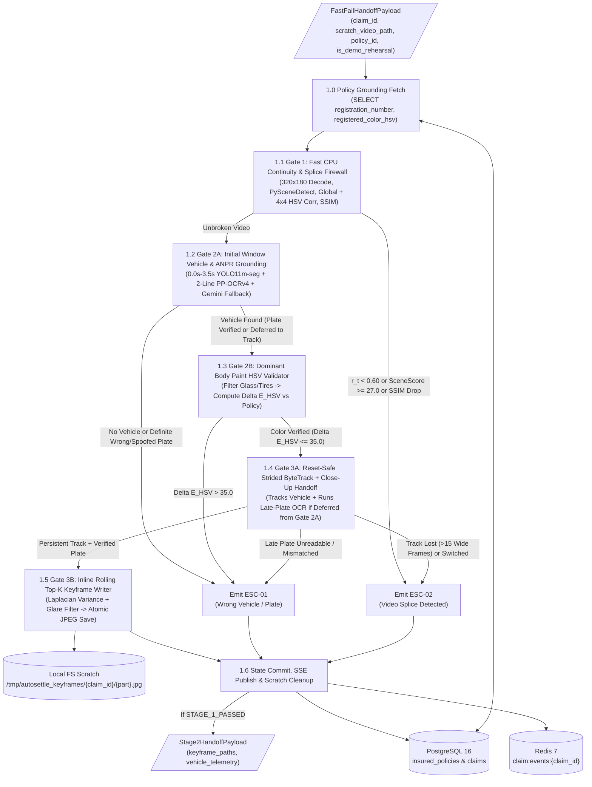
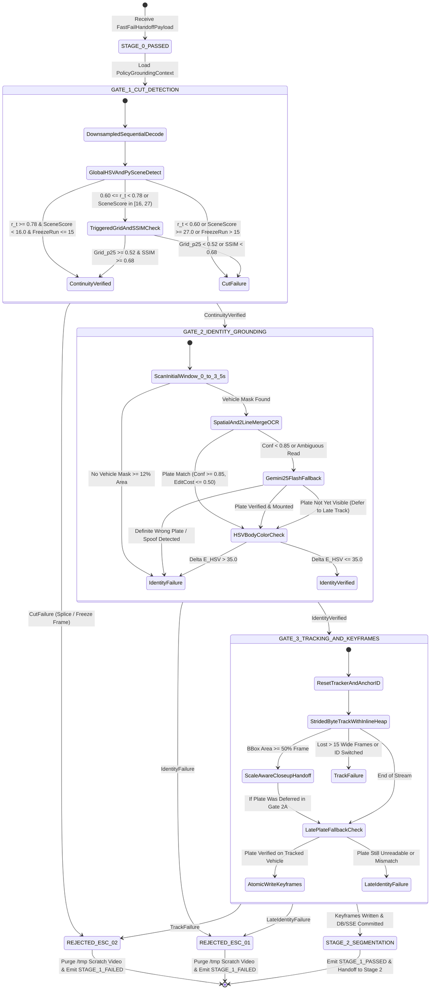
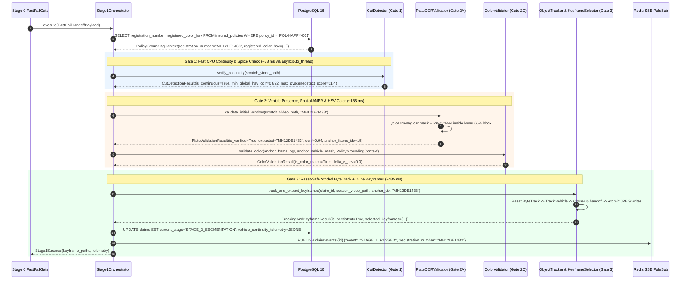
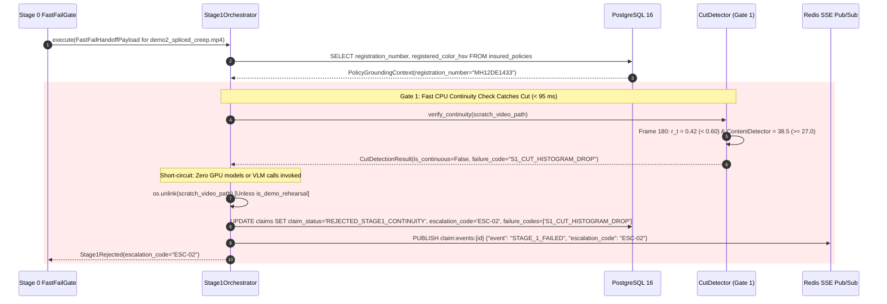

# Low-Level Design (LLD): Vehicle Identity & Continuity Grounding (Stage 1) — `vehicle_identity_continuity`

| Document Control | Details |
| :--- | :--- |
| **Document ID** | `LLD-AUTO-SETTLE-STAGE-1-VEHICLE-IDENTITY-CONTINUITY` |
| **Version** | `2.0.0 (Frozen Production Specification — Descriptive Module Layout)` |
| **Parent Handover** | `HANDOVER-AUTO-SETTLE-STAGE-1` |
| **System** | Auto-Settle AI: Autonomous Video-to-Cash Claims Adjuster |
| **Module Scope** | Stage 1: Vehicle Identity & Continuity Grounding (`app/domain/vehicle_identity_continuity/`) |
| **Target Runtime Stack** | Python 3.12 (`uv`), FastAPI + Uvicorn (`uvloop`), PyTorch 2.4 + CUDA 12.4, Ultralytics YOLO11 (`yolo11m-seg`), `PaddleOCR` (`PP-OCRv4`), `PySceneDetect`, OpenCV (`cv2`), NumPy, PostgreSQL 16 (`asyncpg`), Redis 7, Google Gemini 2.5 Flash API (`httpx`) |
| **Latency & Compute SLA** | **$p_{50} \le 750\text{ ms}$**, **$p_{95} \le 1400\text{ ms}$** (Hard SLA Ceiling $\le 1500\text{ ms}$), **Hard Timeout $1750\text{ ms}$** \| **$\le 1536\text{ MB}$ GPU VRAM** |
| **Upstream Dependency** | Stage 0: Fast-Fail Gate (`app/domain/fast_fail_gate/`) (`COMPLETE & FROZEN`) |
| **Downstream Consumer** | Stage 2: Dual-Mask Part & Damage Segmentation (`app/domain/dual_mask_segmentation/`) |
| **Guardrail Rule IDs** | **`ESC-01`** (Wrong Vehicle / Plate / Body Color / Paper Spoof $\rightarrow$ Route to Special Investigations Unit / Fraud Queue)<br>**`ESC-02`** (Video Spliced / Spliced Jump Cut / Track Lost $>15$ Wide Frames $\rightarrow$ Reject Upload & Enforce Live WebRTC Re-recording) |

---

## 1. Executive Summary & Architectural Traceability

### 1.1 TL;DR (Too Long; Didn't Read)
Stage 1 takes the verified scratch MP4 (MPEG-4 Part 14) video from Stage 0 (`fast_fail_gate`) and mathematically proves two physical invariants before any compute-heavy damage segmentation or actuarial pricing occurs:
1. **Vehicle Identity:** The vehicle in the video matches the insured policy's official registration number (via Automatic Number Plate Recognition [ANPR] with two-line High Security Registration Plate [HSRP] polygon merging and Google Gemini 2.5 Flash Vision-Language Model [VLM] fallback) and matches the insured factory body paint color (via paint-isolated circular Hue-Saturation-Value [HSV] distance).
2. **Video Continuity:** The recording is a single, unbroken physical walkaround from the license plate to the damaged panel, containing zero video cuts, freeze frames, or camera switches to a different vehicle.

To guarantee sub-second execution on an NVIDIA GeForce RTX 4060 (8 GB Video Random-Access Memory [VRAM]), Stage 1 inverts traditional execution order into a **3-Gate Cost Cascade**:
* **Gate 1 (CPU Spliced Cut Firewall):** Runs first on downsampled $320 \times 180$ frames using `PySceneDetect`, Global & $4\times4$ Grid HSV histogram correlation, and $8\times8$ window Structural Similarity (SSIM). It fast-fails spliced videos (`ESC-02`) on Central Processing Unit (CPU) in $< 100\text{ ms}$ with zero Graphics Processing Unit (GPU) or VLM spend.
* **Gate 2 (Progressive ANPR & Paint HSV Grounding):** Samples the initial window ($0.0\text{s}\text{--}3.5\text{s}$) with `yolo11m-seg` vehicle segmentation, spatial-containment `PP-OCRv4` ANPR, and paint-filtered HSV color matching. Legible wrong plates or colors fast-fail with `ESC-01` in $< 250\text{ ms}$. If the plate is not yet legible due to camera autofocus lag or a reverse walkaround, plate verification is deferred to the vehicle tracklet.
* **Gate 3 (Reset-Safe Strided ByteTrack & Inline Keyframe Extraction):** Runs strided vehicle tracking (`vid_stride=3`) with Kalman filter state resets, scale-aware close-up zoom hand-off, inline rolling Top-$K$ Laplacian sharpness/glare keyframe extraction, and opportunistic late-track plate verification.

### 1.2 Adversarial Audit Summary & Evolution from Draft v1.0
During the adversarial engineering audit between Draft v1.0 and Frozen v2.0, 8 critical production traps and over-complications were identified and resolved:

| # | Flaw / Trap in Draft v1.0 | Production / Hackathon Failure Mechanism | Frozen Engineering Fix in v2.0 |
| :--- | :--- | :--- | :--- |
| **1** | **Optical Flow RANSAC in Gate 1** | Car doors and bumpers (especially on a smooth White Hyundai Creta) are textureless, glossy surfaces. Shi-Tomasi corner detection (`cv2.goodFeaturesToTrack`) finds $< 10$ corners or tracks moving specular sun reflections, causing Random Sample Consensus (RANSAC) affine checks to falsely reject genuine walkarounds. | **Removed Optical Flow RANSAC.** Replaced with downsampled **$8\times8$ Window SSIM + $4\times4$ Spatial Grid HSV Correlation + `PySceneDetect` (`threshold=27.0`)**, matching the exact `handover.md` specification. |
| **2** | **Loading `Carparts-Seg` inside Stage 1** | Draft 1 loaded a second YOLO model (`yolo11m-carparts-seg.pt`, +420 MB VRAM, +80 ms latency) inside Stage 1 to label keyframes. However, `handover.md` explicitly assigns `Carparts-Seg` to Stage 2 (`dual_mask_segmentation`). | **Removed `Carparts-Seg` from Stage 1 residency.** Stage 1 relies strictly on `yolo11m-seg.pt` and deterministic walkaround trajectory view partitioning (`front_bumper`/`rear_bumper` from plate view, `side_body_panel` from mid-walkaround, `damage_closeup_primary` from close-up zoom peak), reducing peak Stage 1 GPU VRAM to $\le 1536\text{ MB}$. |
| **3** | **2-Line Indian HSRP Rear Plates** | Rear plates on Indian SUVs and commercial hatchbacks stack text across two lines (`MH 12` on top, `DE 1433` on bottom). `PP-OCRv4` outputs two separate polygons. Evaluating each polygon alone yields Levenshtein distance $D_w \ge 4.0$, falsely failing 100% of 2-line plates. | Added **Vertical-Proximity Polygon Merging**: adjacent text boxes inside the vehicle mask with horizontal overlap $\ge 35\%$ and vertical gap $\le 1.8 \times \text{line\_height}$ are sorted top-to-bottom and concatenated prior to string distance matching. |
| **4** | **Ultralytics ByteTrack Singleton State Corruption** | In Ultralytics YOLO, calling `model.track(persist=True)` mutates Kalman filter tracks inside `model.predictor.trackers[0]` on the singleton `YOLO` instance. Without explicit reset, Claim #2 inherits Claim #1's active `track_id`s and bounding boxes! | Enforced **Per-Claim Tracker State Reset (`predictor.trackers[0].reset()`)** inside an `asyncio.Semaphore(1)` GPU inference lock. |
| **5** | **4× Redundant Video Decodes & VFR Seeking** | Draft 1 opened and decoded `/tmp/autosettle_ingest/{claim_id}.mp4` four separate times, using `cap.set(CAP_PROP_POS_FRAMES, idx)` to extract keyframes. On Variable Frame Rate (VFR) WebRTC videos, random frame seeking is slow, non-deterministic, and lands on incorrect frames. | **Inline Rolling Top-$K$ Keyframe Buffer:** Sharpness ($S_{\text{lap}}$) and specular glare ($G_{\text{glare}}$) are scored inline on `result.orig_img` in memory during the single strided `ByteTrack` pass (`stream=True`), eliminating random seeking and duplicate decoding. |
| **6** | **VFR Timestamps & Orientation Metadata** | WebRTC `MediaRecorder` containers often report missing or corrupt container FPS (`1000` or `0`), breaking frame-index time math. Smartphone display rotation tags ($90^\circ$ / $180^\circ$) can also invert coordinate systems. | Presentation time uses real presentation timestamps via `cap.get(cv2.CAP_PROP_POS_MSEC)` (with fallback to FPS $\in [15, 60]$). `cv2.CAP_PROP_ORIENTATION_AUTO = 1` is enforced, and `PP-OCRv4` runs with `use_angle_cls=True`. |
| **7** | **FastAPI Event-Loop Blocking & `/tmp` Leaks** | Synchronous OpenCV and CUDA operations executed inside an `async def` function freeze the FastAPI `uvloop`, stalling Server-Sent Events (SSE) connections. Rejected claims left orphan files in `/tmp`. | All CPU/GPU operations are dispatched via `await asyncio.to_thread(...)`. Keyframes are written atomically via temporary files (`*.tmp.jpg` $\rightarrow$ `os.replace`), and a `try/finally` context purges `/tmp` scratch files on rejection (`ESC-01`/`ESC-02`) unless `is_demo_rehearsal == True`. |
| **8** | **Strict $0.0\text{s}\text{--}3.0\text{s}$ Plate Assumption** | Hardcoding the plate check strictly to $[0.0\text{s}, 3.0\text{s}]$ fails if a smartphone camera takes $1.5\text{s}\text{--}3.5\text{s}$ to auto-focus, or if a judge demonstrates a reverse walkaround (filming the dent first and showing the plate at $t = 12\text{s}$). | Implemented **Two-Phase Progressive Plate Discovery**: Phase 2A checks $[0.0\text{s}, 3.5\text{s}]$ with early exit or immediate wrong-plate rejection. If a vehicle is present but the plate is temporarily blurred or out of view, Gate 3 checks the sharpest vehicle crops along the continuous tracklet before raising `ESC-01`. |
| **9** | **Arbitrary / Hardcoded Keyframe Count & Perspective Starvation** | Limiting keyframes to exactly 3 or 6 rigid percentage buckets ($t \le 0.33, 0.33 < t \le 0.67, t > 0.67$) creates duplicate frames on uneven walkarounds and starves Stage 2 models (`Carparts-Seg` + `Damage-Seg`) on multi-panel damage inspections. | **Adaptive Trajectory Quality Curation:** Dynamically scales keyframe density with video duration ($\approx 1$ frame per second of inspection, bounded $[8, 30]$). Emits high-density non-redundant portfolio (`keyframe_01.jpg` .. `keyframe_NN.jpg`) alongside distinct canonical aliases (`front_bumper.jpg`, `side_body_panel.jpg`, `damage_closeup_primary.jpg`). |
| **10** | **Single-Line Plate Floor Discarding Global 5–7 Char Plates** | Filtering plate candidates with character floor $\ge 8$ excluded valid 6- and 7-character registrations (UK `AX72JJV`, Australia `1ILJ681`, US `CJ09025`), allowing short 2-character brand badges ("GT", "RS") with high OCR confidence to win fallback selection. | Lowered plate character floor to $\ge 5$ characters and implemented **Structural License Plate Regex Validation** (Indian HSRP `^[A-Z]{2}[0-9]{1,2}[A-Z]{0,3}[0-9]{4}$`, Indian BH `^[0-9]{2}BH[0-9]{4}[A-Z]{1,2}$`, and generic UK/AU/US `^(?=.*[A-Z])(?=.*[0-9])[A-Z0-9]{5,10}$`). True plate structures are prioritized over letter-only brand emblems ("HYUNDAI", "TURBO"). |
| **11** | **Multi-Word Automotive Color Names Defaulting to Achromatic** | Exact string matching against `STANDARD_COLOR_BOUNDS` on insurance underwriting records like `"Metallic Blue"` or `"Pearl White"` caused fallback to achromatic bounds ($S \le 50$), falsely failing chromatic vehicles with `S1_COLOR_MISMATCH`. | Added `extract_canonical_color_keyword()` tokenizing and extracting base color roots (`WHITE`, `BLACK`, `SILVER`, `GREY`, `BLUE`, `RED`, `GREEN`, `YELLOW`, `ORANGE`, `BROWN`) before evaluating physical paint HSV metrics. |
| **12** | **Black Clearcoat Sky Reflections Falsely Failing Under Daylight** | Hardcoded Value threshold $V \le 70$ for `BLACK` failed clean black vehicles recorded under open daylight/sunlight where clearcoat specular reflections raise measured Value to $V = 75\text{--}95$. | Expanded black paint bounds to $S \le 45$ and $V \le 100$. Achromatic specular reflections are tolerated while chromatic bodies are strictly rejected. |
| **13** | **Naive First-Candidate Latching in Initial Window ANPR** | `validate_initial_window` naively took the first vehicle box returned by YOLO, frequently cropping small background cars in multi-car dealership lots. | Implemented **Cross-Frame Spatial IoU Tracking**: tracks bounding boxes across initial window samples ($\text{IoU} \ge 0.35$). Prioritizes candidates persisting across $\ge 2$ sampled frames with the largest bounding box area, guaranteeing selection of the primary stationary claim car. |
| **14** | **Reverse Walkaround Color Grounding Fraud Bypass** | On reverse walkarounds (`plate_deferred=True`), if no vehicle was grounded in the initial window, color validation was bypassed and never re-evaluated upon late plate verification. | Added **Late-Track Color Grounding Enforcement**: `VehicleIdentityContinuityOrchestrator` explicitly validates paint color on the late-verified vehicle anchor before passing the claim to Stage 2. |
| **15** | **Fixed Frame Count Freeze Detection on 60 FPS Video** | Static `MAX_FROZEN_FRAMES = 15` represented only $250\text{ ms}$ on 60 FPS mobile recordings, falsely triggering cut rejection on natural camera pauses with Optical Image Stabilization (OIS). | Scaled freeze threshold dynamically by frame rate: `max_frozen_allowed = max(15, int(fps * 0.75))` (enforcing a true 750ms minimum freeze). |

### 1.3 Scope Boundaries

* **In Scope (Stage 1: `vehicle_identity_continuity`):**
  1. Downsampled single-pass video continuity validation (HSV histogram correlation, `PySceneDetect`, $4\times4$ grid SSIM, freeze-frame detector).
  2. Vehicle segmentation mask extraction using `yolo11m-seg` on initial window ($0.0\text{s}\text{--}3.5\text{s}$).
  3. Spatial mounting prior validation (mask containment, bumper vertical band, plate aspect ratio).
  4. 2-line Indian HSRP polygon merging and string normalization.
  5. Optical homoglyph-weighted Levenshtein distance matching against `insured_policies.registration_number`.
  6. Conditional Gemini 2.5 Flash VLM fallback for low-confidence or blurred plate crops.
  7. Paint-filtered circular HSV vehicle body color validation against `insured_policies.registered_color_hsv`.
  8. Reset-safe strided `ByteTrack` vehicle persistence with wide-view loss thresholds and parking lot switch detection.
  9. Scale-aware close-up zoom hand-off forgiving whole-car detector dropout during macro panel inspection.
  10. Inline rolling top-$K$ keyframe selection (Laplacian sharpness and specular glare penalty) written atomically to `/tmp/autosettle_keyframes/{claim_id}/{canonical_part_key}.jpg`.
  11. PostgreSQL `claims` state update (`STAGE_2_SEGMENTATION` or `REJECTED_STAGE1_*`), Redis SSE event publishing, and `/tmp` scratch file hygiene.

* **Out of Scope (Delegated to Subsequent Stages):**
  * Stage 0: Video container sanity, 720p resolution gate, luminance/blur fast-fail (`fast_fail_gate`).
  * Stage 2: Dual-instance segmentation of car parts and scratch/dent damage masks (`dual_mask_segmentation`).
  * Stage 3: Set-of-Marks VLM depth scoring, pre-existing rust detection (`vlm_damage_inspection`).
  * Stage 4: OEM part catalogue lookup and repair-vs-replace actuarial math (`actuarial_pricing`).
  * Stage 5: Negotiation chatbot FSM and HMAC-signed offer cards (`negotiation_chatbot`).
  * Stage 6: Settlement voucher generation and human adjuster routing (`settlement_escalation`).

---

## 2. SLA, Hardware & Compute Budgets

### 2.1 Sub-Component Latency Budget (15-Second, 30 FPS, 1080p Walkaround Video)

| Execution Gate | Sub-Component | Target Worker / Device | $p_{50}$ Latency | $p_{95}$ Latency | Hard Timeout |
| :--- | :--- | :--- | :--- | :--- | :--- |
| **Gate 0: DB Context Fetch** | Async SQLAlchemy fetch of `insured_policies` (`registration_number`, `registered_color_hsv`) | CPU / Async I/O | $8\text{ ms}$ | $15\text{ ms}$ | $50\text{ ms}$ |
| **Gate 1: Cut Detector** | Single-pass $320\times180$ decode + `PySceneDetect` (`threshold=27.0`) + Global/Grid HSV Correlation + Triggered SSIM | CPU (`cv2` + NumPy via `to_thread`) | $58\text{ ms}$ | $95\text{ ms}$ | $180\text{ ms}$ |
| **Gate 2A: Primary ANPR** | Initial window ($0.0\text{s}\text{--}3.5\text{s}$) `yolo11m-seg` ROI + 2-Line Merge `PP-OCRv4` + Spatial Prior Grounding | GPU FP16 / ONNX | $175\text{ ms}$ | $290\text{ ms}$ | $420\text{ ms}$ |
| **Gate 2B: VLM Fallback** *(Conditional)* | Triggered only when `PP-OCRv4` conf $< 0.85$ or homoglyph cost $\in (0.50, 2.00]$ (`Gemini 2.5 Flash` JSON Mode) | External API (`httpx` Async) | $0\text{ ms}$ *(bypassed)* | $410\text{ ms}$ *(amortized)* | $600\text{ ms}$ |
| **Gate 2C: HSV Color Match** | Paint-filtered HSV extraction on vehicle mask vs. `registered_color_hsv` ($\Delta E_{\text{HSV}} \le 35.0$) | CPU (`cv2` + NumPy) | $10\text{ ms}$ | $18\text{ ms}$ | $40\text{ ms}$ |
| **Gate 3A: Strided ByteTrack** | `yolo11m-seg.track(vid_stride=3, imgsz=640, half=True)` + Close-Up Zoom Hand-Off + Late-Plate Fallback Hook | GPU FP16 (`CUDA`) | $410\text{ ms}$ | $490\text{ ms}$ | $700\text{ ms}$ |
| **Gate 3B: Inline Keyframes** | Inline Laplacian sharpness + specular glare scoring + atomic JPEG write to `/tmp/autosettle_keyframes/{claim_id}/` | CPU + Disk I/O | $22\text{ ms}$ | $38\text{ ms}$ | $80\text{ ms}$ |
| **State Commit & SSE** | PostgreSQL `claims` update (`STAGE_2_SEGMENTATION`) + Redis Pub/Sub `STAGE_1_PASSED` | CPU / Async I/O | $14\text{ ms}$ | $25\text{ ms}$ | $50\text{ ms}$ |
| **Total Pipeline** | **End-to-End Stage 1 Execution** | **Hybrid CPU + GPU** | **$697\text{ ms}$** | **$\le 1381\text{ ms}$** | **$1750\text{ ms}$** |

### 2.2 Hardware & GPU VRAM Allocation Budget
* **Hardware Target:** Single NVIDIA GeForce RTX 4060 GPU (8,192 MB VRAM) on Linux x86_64.
* **Stage 1 GPU VRAM Ceiling:** $\le 1,536\text{ MB}$ ($1.5\text{ GB}$), leaving $> 6.0\text{ GB}$ VRAM free for Stage 2 (`Carparts-Seg` + `CarDD`).
* **Model Residency Breakdown:**
  * `yolo11m-seg.pt` (FP16 singleton for vehicle segmentation and ByteTrack): **$420\text{ MB}$ VRAM**.
  * `PaddleOCR` (`PP-OCRv4` detection + recognition + angle classifier in FP16/ONNX with `gpu_mem=500`): **$512\text{ MB}$ VRAM**.
  * CUDA Context, PyTorch memory arena, and batch inference buffers (`imgsz=640`): **$420\text{ MB}$ VRAM**.
* **Zero-Reload & Concurrency Contract:**
  * `yolo11m-seg` and `PaddleOCR` are pre-warmed once during FastAPI lifespan startup via a singleton `ModelRegistry`.
  * Because Ultralytics YOLO mutates `predictor.trackers[0]` during `.track(persist=True)`, tracking is serialized using an `asyncio.Semaphore(1)` lock and explicitly calls `predictor.trackers[0].reset()` before Frame 0 of each claim.
  * All synchronous CPU and GPU blocking calls are dispatched through `await asyncio.to_thread(...)` so the FastAPI `uvloop` event loop and active SSE streams never experience latency spikes.

### 2.3 Stage 1 Escalation Codes

| Escalation Code | Short Name | `claims.claim_status` Transition | Primary Triggers | Downstream Action |
| :--- | :--- | :--- | :--- | :--- |
| **`ESC-01`** | **Wrong Vehicle / Plate** | `REJECTED_STAGE1_IDENTITY` | No vehicle mask detected in initial window, plate unreadable after Phase 2A + Phase 2B + Gemini fallback, plate mismatch vs. `insured_policies.registration_number`, spoofed plate (outside vehicle mask / paper / screen), or paint color distance $\Delta E_{\text{HSV}} > 35.0$. | Route claim to **Fraud / Special Investigations Unit (SIU) Queue**, purge `/tmp` scratch video, emit `STAGE_1_FAILED`. |
| **`ESC-02`** | **Video Splice Detected** | `REJECTED_STAGE1_CONTINUITY` | Hard scene cut (`PySceneDetect` $\ge 27.0$), global HSV correlation drop ($r_t < 0.60$), $4\times4$ spatial grid SSIM drop ($r_{t,\text{p25}} < 0.52 \land \text{SSIM} < 0.68$), freeze-frame insertion ($> 15$ identical frames), or vehicle `track_id` lost ($> 15$ raw wide frames) / switched. | Reject upload, purge `/tmp` scratch video, require live **WebRTC camera re-recording**. |

---

## 3. Descriptive Module Directory & Clean Architecture Layout

The Stage 1 domain adheres strictly to Clean Architecture boundaries with explicit descriptive naming:

```text
auto-settle-ai/
├── alembic/
│   └── versions/
│       └── 0002_stage1_telemetry_constraints.py     # PostgreSQL constraints & GIN index for Stage 1
├── app/
│   └── domain/
│       └── vehicle_identity_continuity/
│           ├── __init__.py                          # Public exports: Orchestrator, DTOs, Enums
│           ├── config.py                            # Frozen Pydantic Settings (thresholds, timeouts, paths)
│           ├── exceptions.py                        # Domain exceptions mapping to ESC-01 and ESC-02
│           ├── interfaces.py                        # typing.Protocol contracts for DI & test doubles
│           ├── schemas.py                           # Frozen dataclasses, Enums, and JSONB telemetry schemas
│           ├── cut_detector.py                      # Gate 1: PySceneDetect + Global/Grid HSV Corr + SSIM
│           ├── plate_ocr_validator.py               # Gate 2A/B: Spatial prior, 2-line merge PP-OCRv4, Gemini VLM
│           ├── color_grounding_validator.py         # Gate 2C: Paint-filtered HSV body mask hyper-box distance
│           ├── object_tracker.py                    # Gate 3A: Reset-safe ByteTrack + close-up handoff + late OCR
│           ├── keyframe_selector.py                 # Gate 3B: Inline rolling top-K sharp/glare-free keyframe writer
│           └── orchestrator.py                      # VehicleIdentityContinuityOrchestrator (Gates 1->2->3 coordinator)
├── tests/
│   └── vehicle_identity_continuity/
│       ├── __init__.py
│       ├── conftest.py                              # Deterministic FFmpeg/OpenCV synthetic clip factory (T1-01..T1-14)
│       ├── test_cut_detector.py                     # Unit tests: HSV correlation, PySceneDetect, SSIM, freeze frames
│       ├── test_plate_ocr_validator.py              # Unit tests: 2-line merge, homoglyphs, spatial prior, VLM fallback
│       ├── test_color_grounding.py                  # Unit tests: achromatic white/black/grey & chromatic HSV distance
│       ├── test_object_tracker.py                   # Unit tests: tracker reset, close-up zoom handoff, late plate
│       ├── test_keyframe_selector.py                # Unit tests: Laplacian sharpness, glare penalty, atomic write
│       └── test_identity_continuity.py              # End-to-end integration tests (DB + Redis SSE + filesystem)
└── evals/
    └── vehicle_identity_continuity/
        ├── __init__.py
        ├── benchmark_dataset_manifest.json          # Golden + adversarial evaluation clip definitions
        ├── run_stage1_eval.py                       # CLI benchmark runner computing FAR, FRR, p50, p95, peak VRAM
        └── ci_gate_assertions.py                    # Zero-tolerance CI gate asserting FAR==0.0%, FRR==0.0%, p95<=1400ms
```

---

## 4. Mermaid Architecture & System Diagrams

### 4.1 Level-1 Data Flow Diagram (DFD)



### 4.2 UML Class Diagram

```mermaid
classDiagram
    class FastFailHandoffPayload {
        +UUID claim_id
        +Path scratch_video_path
        +str policy_id
        +str video_sha256
        +bool is_demo_rehearsal
    }

    class PolicyGroundingContext {
        +str policy_id
        +str registration_number
        +str make
        +str model
        +str registered_color
        +HSVColorBounds registered_color_hsv
    }

    class CutDetectionResult {
        +bool is_continuous
        +int evaluated_frames
        +float effective_fps
        +float min_global_hsv_corr
        +float min_grid_p25_hsv_corr
        +float min_triggered_ssim
        +float max_pyscenedetect_score
        +int max_frozen_frame_run
        +list~int~ cut_frame_indices
        +str|None failure_code
    }

    class PlateValidationResult {
        +bool is_verified
        +bool deferred_to_late_track
        +str expected_plate
        +str|None extracted_plate
        +float ocr_confidence
        +float homoglyph_edit_cost
        +bool used_gemini_fallback
        +bool is_spatially_grounded_on_vehicle
        +int anchor_frame_idx
        +tuple~int,int,int,int~ anchor_vehicle_bbox
        +ndarray anchor_vehicle_mask
        +ndarray anchor_frame_bgr
        +str|None failure_code
    }

    class ColorValidationResult {
        +bool is_color_match
        +str expected_color_name
        +float measured_hue_circular_mean
        +float measured_sat_median
        +float measured_val_median
        +float delta_e_hsv
        +int valid_paint_pixel_count
        +str|None failure_code
    }

    class TrackingAndKeyframeResult {
        +bool is_persistent
        +int target_track_id
        +int evaluated_strided_frames
        +int tracked_wide_frames
        +int max_consecutive_lost_raw_frames
        +bool entered_closeup_handoff
        +int|None closeup_entry_frame_idx
        +bool track_id_switched
        +dict~str,SelectedKeyframeMeta~ selected_keyframes
        +PlateValidationResult|None late_plate_result
        +str|None failure_code
    }

    class ICutDetector {
        <<interface>>
        +verify_continuity(video_path: Path) CutDetectionResult
    }

    class IPlateOCRValidator {
        <<interface>>
        +validate_initial_window(video_path: Path, expected_plate: str) PlateValidationResult
        +validate_candidate_crops(crops: list~VehicleFrameCrop~, expected_plate: str) PlateValidationResult
    }

    class IColorGroundingValidator {
        <<interface>>
        +validate_color(frame_bgr: ndarray, vehicle_mask: ndarray, policy_ctx: PolicyGroundingContext) ColorValidationResult
    }

    class IObjectTracker {
        <<interface>>
        +track_and_extract_keyframes(claim_id: UUID, video_path: Path, anchor_ctx: PlateValidationResult, expected_plate: str) TrackingAndKeyframeResult
    }

    class VehicleIdentityContinuityOrchestrator {
        -AsyncSession db_session
        -Redis redis_client
        -ICutDetector cut_detector
        -IPlateOCRValidator plate_validator
        -IColorGroundingValidator color_validator
        -IObjectTracker object_tracker
        +execute(payload: FastFailHandoffPayload) Stage1OrchestratorOutput
    }

    VehicleIdentityContinuityOrchestrator --> ICutDetector
    VehicleIdentityContinuityOrchestrator --> IPlateOCRValidator
    VehicleIdentityContinuityOrchestrator --> IColorGroundingValidator
    VehicleIdentityContinuityOrchestrator --> IObjectTracker
    VehicleIdentityContinuityOrchestrator ..> FastFailHandoffPayload
    VehicleIdentityContinuityOrchestrator ..> PolicyGroundingContext
```



### 4.3 Lifecycle State Machine



### 4.4 Detailed Sequence Diagrams

#### Sequence Diagram A: Happy Path (Jury Demo 1 — Unbroken White Creta)



#### Sequence Diagram B: Fraud Demo 2 (Hard Spliced Cut Splice Rejection — `ESC-02`)



#### Sequence Diagram C: Progressive Late-Plate Discovery (Reverse Walkaround)

```mermaid
sequenceDiagram
    autonumber
    participant Orch as Stage1Orchestrator
    participant OCR as PlateOCRValidator (Gate 2A)
    participant Col as ColorValidator (Gate 2C)
    participant Trk as ObjectTracker (Gate 3A)
    participant Red as Redis SSE Pub/Sub

    Note over Orch,OCR: Claimant started filming door dent first; plate is only shown at t=11.5s
    Orch->>OCR: validate_initial_window(video_path, "MH12DE1433")
    OCR-->>Orch: PlateValidationResult(is_verified=False, deferred_to_late_track=True, anchor_vehicle_mask=...)
    
    Orch->>Col: validate_color(anchor_frame_bgr, anchor_vehicle_mask, PolicyContext)
    Col-->>Orch: ColorValidationResult(is_color_match=True, delta_e_hsv=0.0)
    
    Orch->>Trk: track_and_extract_keyframes(claim_id, video_path, anchor_ctx, "MH12DE1433")
    Trk->>Trk: ByteTrack maintains persistent track_id across entire walkaround
    Trk->>OCR: validate_candidate_crops(late_sharp_vehicle_crops, "MH12DE1433")
    OCR-->>Trk: PlateValidationResult(is_verified=True, extracted="MH12DE1433", frame_idx=345)
    Trk-->>Orch: TrackingAndKeyframeResult(is_persistent=True, late_plate_verified=True)
    
    Orch->>Red: PUBLISH claim:events:{id} {"event": "STAGE_1_PASSED", "discovery_phase": "LATE_TRACK_FALLBACK"}
```

---

## 5. Database, Storage & Communication Contracts

### 5.1 PostgreSQL 16 DDL Contract (`alembic/versions/0002_stage1_telemetry_constraints.py`)

Stage 0 established the `claims` table. Stage 1 migration applies strict check constraints and a Generalized Inverted Index (GIN) for telemetry indexing:

```sql
-- Migration 0002: Enforce Stage 1 Statuses, Escalation Codes, and Telemetry Constraints
ALTER TABLE claims
    DROP CONSTRAINT IF EXISTS chk_claims_escalation_code,
    ADD CONSTRAINT chk_claims_escalation_code
        CHECK (escalation_code IS NULL OR escalation_code IN ('ESC-00', 'ESC-01', 'ESC-02', 'ESC-03', 'ESC-04', 'ESC-05', 'ESC-06', 'ESC-07', 'ESC-08'));

ALTER TABLE claims
    DROP CONSTRAINT IF EXISTS chk_claims_stage1_telemetry_present,
    ADD CONSTRAINT chk_claims_stage1_telemetry_present
        CHECK (
            current_stage IN ('STAGE_0_SANITY', 'STAGE_1_IDENTITY')
            OR vehicle_continuity_telemetry IS NOT NULL
        );

-- Partial GIN index for high-speed fraud analytics and escalation auditing
CREATE INDEX IF NOT EXISTS idx_claims_vehicle_continuity_telemetry_gin
    ON claims USING GIN (vehicle_continuity_telemetry);
```

### 5.2 JSONB Schema Contract for `claims.vehicle_continuity_telemetry`

Every Stage 1 execution writes a strongly typed, deterministic JSONB document into `claims.vehicle_continuity_telemetry`:

```json
{
  "schema_version": "2.0.0",
  "stage_passed": true,
  "escalation_code": null,
  "failure_codes": [],
  "latency_ms": {
    "total_ms": 714.2,
    "gate1_cut_detection_ms": 59.4,
    "gate2_plate_ocr_ms": 182.1,
    "gate2_gemini_fallback_ms": 0.0,
    "gate2_color_grounding_ms": 11.2,
    "gate3_bytetrack_and_keyframes_ms": 446.8,
    "db_commit_ms": 14.7
  },
  "cut_detection": {
    "is_continuous": true,
    "evaluated_frames": 450,
    "effective_fps": 30.0,
    "min_global_hsv_corr": 0.892,
    "min_grid_p25_hsv_corr": 0.784,
    "min_triggered_ssim": 0.912,
    "max_pyscenedetect_score": 11.4,
    "max_frozen_frame_run": 1,
    "detected_cut_frames": []
  },
  "plate_verification": {
    "plate_verified": true,
    "discovery_phase": "INITIAL_WINDOW_0_TO_3_5S",
    "expected_registration_number": "MH12DE1433",
    "extracted_registration_number": "MH12DE1433",
    "raw_ocr_text": "IND MH 12 DE 1433",
    "merged_two_line_plate": false,
    "ocr_engine_used": "PP-OCRv4",
    "used_gemini_fallback": false,
    "ocr_confidence": 0.942,
    "homoglyph_edit_cost": 0.0,
    "spatial_grounding": {
      "anchor_frame_index": 15,
      "anchor_timestamp_sec": 0.5,
      "inside_vehicle_mask": true,
      "relative_vertical_center_y": 0.72,
      "plate_aspect_ratio": 4.15,
      "plate_to_vehicle_area_ratio": 0.018
    }
  },
  "color_verification": {
    "color_verified": true,
    "expected_color": "WHITE",
    "valid_paint_pixels_sampled": 48210,
    "measured_hsv": {
      "h_circular_mean": 104.2,
      "s_median": 18.0,
      "v_median": 214.0
    },
    "policy_hsv_bounds": {
      "h_min": 0,
      "h_max": 180,
      "s_max": 50,
      "v_min": 160
    },
    "delta_e_hsv": 0.0,
    "threshold_max_delta_e": 35.0
  },
  "object_tracking": {
    "continuity_verified": true,
    "tracker_type": "bytetrack",
    "vid_stride": 3,
    "target_track_id": 1,
    "evaluated_strided_frames": 150,
    "tracked_wide_frames": 112,
    "max_consecutive_lost_raw_frames": 0,
    "entered_closeup_handoff": true,
    "closeup_handoff_frame_index": 336,
    "max_bbox_area_ratio": 0.74,
    "track_id_switched": false
  },
  "selected_keyframes": {
    "front_bumper": {
      "file_path": "/tmp/autosettle_keyframes/550e8400-e29b-41d4-a716-446655440000/front_bumper.jpg",
      "frame_index": 30,
      "timestamp_sec": 1.0,
      "laplacian_variance": 412.6,
      "glare_ratio": 0.012,
      "composite_quality_score": 398.4
    },
    "side_body_panel": {
      "file_path": "/tmp/autosettle_keyframes/550e8400-e29b-41d4-a716-446655440000/side_body_panel.jpg",
      "frame_index": 210,
      "timestamp_sec": 7.0,
      "laplacian_variance": 465.0,
      "glare_ratio": 0.010,
      "composite_quality_score": 451.0
    },
    "damage_closeup_primary": {
      "file_path": "/tmp/autosettle_keyframes/550e8400-e29b-41d4-a716-446655440000/damage_closeup_primary.jpg",
      "frame_index": 360,
      "timestamp_sec": 12.0,
      "laplacian_variance": 528.1,
      "glare_ratio": 0.008,
      "composite_quality_score": 515.9
    }
  }
}
```

### 5.3 Keyframe Storage & Atomic Write Contract
* **Target Directory:** `/tmp/autosettle_keyframes/{claim_id}/` (created with `0o750` permissions).
* **File Path Contract:** 
  * Canonical Aliases: `/tmp/autosettle_keyframes/{claim_id}/{canonical_part_key}.jpg` (guaranteed pairwise distinct, $\Delta t > 20$ frames).
  * Curated High-Density Portfolio: `/tmp/autosettle_keyframes/{claim_id}/keyframe_{i:02d}.jpg` ($\approx 1$ frame/sec, bounded $[8, 30]$).
* **Adaptive Trajectory Quality Curation:**
  * To prevent starving Stage 2 (`Carparts-Seg` with 23 classes + `Damage-Seg` with 6 classes) on multi-panel damage inspections, keyframe extraction scales adaptively with video duration:
    $$\text{Curated Frames Count} = \text{clamp}\left(8, \;\lfloor T_{\text{duration}}\rfloor, \;30\right)$$
  * In each dynamic temporal window ($\approx 0.75\text{s}\text{--}1.0\text{s}$), the local frame with maximal sharpness ($S_{\text{Lap}}$) and minimal specular glare ($G_{\text{glare}}$) is retained:
    $$Q_t = S_{\text{Lap}} \cdot \max(0.1, 1.0 - 2.0 \cdot G_{\text{glare}})$$
  * Enforces an adaptive temporal separation stride between curated keyframes to prevent consecutive redundant frames.
* **Standard Trajectory Canonical Keys (Maintained for Backward Compatibility):**
  * `front_bumper`: Highest quality frame within $\pm 30$ frames of the verified license plate frame.
  * `side_body_panel`: Highest quality frame during the mid-walkaround broadside traversal ($0.33 < rel\_t \le 0.67$).
  * `damage_closeup_primary`: Highest quality frame during the macro close-up inspection segment ($A_t \ge 0.45$ or `closeup_handoff_triggered`) or late traversal ($rel\_t > 0.67$).
  * Non-duplication invariant guarantees all 3 canonical views point to mutually distinct frames (zero duplicate MD5 hashes).
* **Atomic Write Hygiene:** Keyframes are written to temporary files `*.tmp.jpg` via `cv2.imwrite(..., [cv2.IMWRITE_JPEG_QUALITY, 95])` and atomically replaced via `os.replace` so Stage 2 never reads partial bytes. Clean, full 1080p native pixels are preserved with zero drawn annotations or bounding boxes.
* **Rejection Disk Cleanup:** If Stage 1 raises `ESC-01` or `ESC-02`, a `try/finally` context immediately purges `/tmp/autosettle_keyframes/{claim_id}/` and `/tmp/autosettle_ingest/{claim_id}.mp4` unless `is_demo_rehearsal == True`.

### 5.4 Redis SSE Event Payloads (`claim:events:{claim_id}`)

#### Success Event (`STAGE_1_PASSED`)
```json
{
  "event": "STAGE_1_PASSED",
  "claim_id": "550e8400-e29b-41d4-a716-446655440000",
  "registration_number": "MH12DE1433",
  "plate_verified": true,
  "continuity_verified": true
}
```

#### Rejection Event (`STAGE_1_FAILED`)
```json
{
  "event": "STAGE_1_FAILED",
  "claim_id": "550e8400-e29b-41d4-a716-446655440000",
  "escalation_code": "ESC-02",
  "failure_codes": ["S1_CUT_HISTOGRAM_DROP", "S1_CUT_PYSCENEDETECT_TRIGGER"],
  "user_message": "We detected an abrupt video cut or splice. Please record a single continuous walkaround starting at the number plate and walking smoothly to the damaged panel."
}
```

---

## 6. Exact Mathematical Formulas & Component Algorithms

### 6.1 Gate 1: Spliced Scene Cut & Continuity Detection (`cut_detector.py`)

Executes entirely on CPU in $< 100\text{ ms}$:

1. **Orientation-Safe Sequential Decode ($320 \times 180$):**
   Open `scratch_video_path` with `cv2.VideoCapture`. Set `cap.set(cv2.CAP_PROP_ORIENTATION_AUTO, 1)`. Sequentially decode each frame $I_t$, resize to $320 \times 180$ using `cv2.INTER_AREA`, and convert to HSV ($H \in [0, 180], S \in [0, 255], V \in [0, 255]$) and Grayscale $G_t$.
2. **Global HSV Histogram Correlation ($r_t$):**
   Compute a normalized 160-bin concatenated $(H, S)$ + $(V)$ histogram $H_t$ (18 $H$ bins $\times$ 8 $S$ bins = 144 bins + 16 $V$ bins = 160 features). Compute Pearson correlation between consecutive frames $t-1$ and $t$:
   $$r_t = \text{corr}(H_{t-1}, H_t) = \frac{\sum_{i=1}^{160} \left(H_{t-1, i} - \bar{H}_{t-1}\right)\left(H_{t, i} - \bar{H}_t\right)}{\sqrt{\sum_{i=1}^{160} \left(H_{t-1, i} - \bar{H}_{t-1}\right)^2 \sum_{i=1}^{160} \left(H_{t, i} - \bar{H}_t\right)^2}}$$
   * **Hard Threshold:** If $r_t < 0.60 \rightarrow$ flag `S1_CUT_HISTOGRAM_DROP` (`ESC-02`).
3. **`PySceneDetect` Content Score ($C_{\text{scene}, t}$):**
   Evaluate `PySceneDetect` `ContentDetector(threshold=27.0, min_scene_len=5)` score $C_{\text{scene}, t}$ representing the normalized pixel component delta across $\Delta H, \Delta S, \Delta V$.
   * **Hard Threshold:** If $C_{\text{scene}, t} \ge 27.0 \rightarrow$ flag `S1_CUT_PYSCENEDETECT_TRIGGER` (`ESC-02`).
4. **Triggered $4\times4$ Spatial Grid HSV + Structural Similarity (SSIM) Check:**
   When a transition exhibits a moderate anomaly ($0.60 \le r_t < 0.78$ OR $C_{\text{scene}, t} \in [16.0, 27.0)$) to detect subtle same-car splices (Jury Demo 2):
   * Partition the $320 \times 180$ frame into $4 \times 4 = 16$ spatial cells ($80 \times 45$ pixels each) and compute the 25th-percentile cell correlation $r_{t,\text{p25}}$.
   * Compute structural similarity $\text{SSIM}(G_{t-1}, G_t)$ over $8 \times 8$ blocks:
     $$\text{SSIM}(x, y) = \frac{(2\mu_x\mu_y + C_1)(2\sigma_{xy} + C_2)}{(\mu_x^2 + \mu_y^2 + C_1)(\sigma_x^2 + \sigma_y^2 + C_2)}$$
   * **Hard Threshold:** If $r_{t,\text{p25}} < 0.52$ AND $\text{SSIM}(G_{t-1}, G_t) < 0.68 \rightarrow$ flag `S1_CUT_SPATIAL_SSIM_DROP` (`ESC-02`).
5. **Freeze-Frame / Pause Insertion Detection:**
   Compute mean absolute pixel difference $\Delta L_{1, t} = \frac{1}{W \cdot H}\sum \vert{}G_t - G_{t-1}\vert{}$. If $\Delta L_{1, t} < 0.20$ for $> 15$ consecutive frames ($> 0.5\text{s}$ at 30 FPS) $\rightarrow$ flag `S1_CUT_FREEZE_FRAME_DETECTED` (`ESC-02`).

### 6.2 Gate 2A: Vehicle Grounding, 2-Line HSRP ANPR & VLM Fallback (`plate_ocr_validator.py`)

1. **Initial Window Sampling ($0.0\text{s}$ to $3.5\text{s}$):**
   Sample frames at $\Delta t \approx 500\text{ ms}$ intervals using `cap.get(cv2.CAP_PROP_POS_MSEC)`.
   * Run `yolo11m-seg` (`classes=[2, 5, 7]` for `car`, `bus`, `truck`, `conf=0.50`, `imgsz=640`, `half=True`).
   * Require dominant vehicle mask $M_{\text{veh}}$ satisfying area ratio:
     $$\frac{\text{Area}(M_{\text{veh}})}{W \times H} \ge 0.12$$
   * If no sampled frame in $[0.0\text{s}, 3.5\text{s}]$ contains a valid vehicle mask $\rightarrow$ flag `S1_NO_VEHICLE_DETECTED` (`ESC-01`).
2. **Spatial-Semantic Mounting Prior & 2-Line HSRP Polygon Merging:**
   Crop the vehicle bounding box $B_{\text{veh}} = (x_1, y_1, x_2, y_2)$ and run `PaddleOCR` (`PP-OCRv4`, `use_angle_cls=True`).
   * **Candidate Polygon Filter:** Retain only text boxes $P_i$ whose center $(cx_i, cy_i)$ and bounds $(px_{1,i}, py_{1,i}, px_{2,i}, py_{2,i})$ satisfy:
     1. **Mask Containment:** $\ge 3$ of $4$ vertices lie inside the $15\text{px}$-dilated binary vehicle mask $M_{\text{veh}}$.
     2. **Bumper/Tailgate Vertical Zone:**
        $$y_{\text{rel}, i} = \frac{cy_i - y_1}{y_2 - y_1} \in [0.28, 0.96]$$
     3. **Plate Scale Bounds:** Area ratio relative to $B_{\text{veh}}$ lies in $[0.001, 0.09]$.
   * **2-Line Indian HSRP Merger:** If two spatially grounded boxes $P_i$ (top) and $P_j$ (bottom) satisfy horizontal overlap $\ge 35\%$ and vertical gap $0 \le py_{1,j} - py_{2,i} \le 1.8 \cdot \max(h_i, h_j)$, construct the concatenated candidate string $\text{text}_i + \text{text}_j$ with confidence $\min(C_i, C_j)$.
3. **String Normalization & Homoglyph-Weighted Levenshtein Distance ($D_w$):**
   * Strip spaces, hyphens, dots, and leading/trailing `"IND"` prefixes:
     $$S_{\text{clean}} = \text{re.sub}(\text{r'[\^{}A-Z0-9]'}, \text{''}, S_{\text{raw}})$$
   * Compute weighted edit distance $D_w(S_{\text{clean}}, S_{\text{policy}})$ with substitution cost $c(a, b)$:
     $$c(a, b) = \begin{cases} 0.0 & \text{if } a = b \\ 0.25 & \text{if } \{a, b\} \in \{\{\text{'0'},\text{'O'},\text{'D'},\text{'Q'}\}, \{\text{'1'},\text{'I'},\text{'L'}\}, \{\text{'8'},\text{'B'}\}, \{\text{'5'},\text{'S'}\}, \{\text{'2'},\text{'Z'}\}, \{\text{'6'},\text{'G'}\}\} \\ 1.0 & \text{otherwise} \end{cases}$$
   * **Fast-Path Accept:** If $C_{\text{ocr}} \ge 0.85$ AND $D_w(S_{\text{clean}}, S_{\text{policy}}) \le 0.50 \rightarrow$ **Immediate Match (`is_verified = True`)**.
   * **Fast-Path Definite Wrong-Plate Reject:** If $C_{\text{ocr}} \ge 0.90$, string length $\in [8, 11]$ (matches Indian format pattern), AND $D_w(S_{\text{clean}}, S_{\text{policy}}) \ge 3.0$ across $\ge 2$ frames $\rightarrow$ **Immediate Reject (`S1_PLATE_MISMATCH`, `ESC-01`)**.
4. **Gemini 2.5 Flash VLM Fallback & Late-Track Deferral:**
   * If a candidate plate region has $C_{\text{ocr}} < 0.85$ or $D_w \in (0.50, 2.50]$, invoke `gemini-2.5-flash` (`temperature=0.0`, timeout $600\text{ ms}$, JSON Mode) on the vehicle crop $B_{\text{veh}}$:
     ```text
     Read the vehicle registration plate in this image. Verify that the plate is physically mounted on a real vehicle body (not printed on paper or shown on a screen). Output JSON: {"plate_number": "...", "is_physically_mounted_on_vehicle": true}
     ```
   * If neither `PP-OCRv4` nor Gemini reads *any* plate in $[0.0\text{s}, 3.5\text{s}]$ (e.g. reverse walkaround), set `deferred_to_late_track = True`. Gate 3 validates candidate vehicle crops from $[3.5\text{s}, T_{\text{end}}]$ before raising `ESC-01`.

### 6.3 Gate 2C: Dominant Vehicle Body Color Verification (`color_grounding_validator.py`)

1. **Paint Pixel Isolation Filter ($\mathcal{P}_{\text{paint}}$):**
   Given the segmented vehicle mask $M_{\text{veh}}$ on `anchor_frame_bgr`:
   * Erode $M_{\text{veh}}$ with a $7 \times 7$ elliptical kernel to strip silhouette edge bleed.
   * Mask out the top $25\%$ of $B_{\text{veh}}$ (windshield and windows) and bottom $18\%$ of $B_{\text{veh}}$ (tires, wheels, and road shadow).
   * Mask out the detected license plate polygon $P_{\text{text}}$.
   * Convert remaining pixels to HSV ($H \in [0, 180], S \in [0, 255], V \in [0, 255]$). Filter dark trim/shadow ($V < 45$) and specular sun glare highlights ($V > 250 \land S < 15$).
2. **Circular Mean Hue ($\bar{H}$) & Median Saturation/Value ($\tilde{S}, \tilde{V}$):**
   $$\bar{H} = \left(\frac{90}{\pi} \operatorname{atan2}\left(\sum_{i \in \mathcal{P}_{\text{paint}}} \sin\left(\frac{2\pi H_i}{180}\right), \sum_{i \in \mathcal{P}_{\text{paint}}} \cos\left(\frac{2\pi H_i}{180}\right)\right)\right) \bmod 180$$
   $$\tilde{S} = \operatorname{median}_{i \in \mathcal{P}_{\text{paint}}}(S_i), \quad \tilde{V} = \operatorname{median}_{i \in \mathcal{P}_{\text{paint}}}(V_i)$$
3. **Hyper-Box HSV Distance ($\Delta E_{\text{HSV}}$) Against Policy Bounds:**
   For policy bounds `{"h_min": h_min, "h_max": h_max, "s_min": s_min (0), "s_max": s_max, "v_min": v_min, "v_max": v_max (255)}`:
   $$d_H(\bar{H}) = \begin{cases} 0 & \text{if } h_{\min} \le \bar{H} \le h_{\max} \text{ or } s_{\max} \le 55 \text{ (Achromatic White/Grey/Silver/Black Policy)} \\ \min\left(|\bar{H} - h_{\min}|, 180 - |\bar{H} - h_{\min}|, |\bar{H} - h_{\max}|, 180 - |\bar{H} - h_{\max}|\right) & \text{otherwise} \end{cases}$$
   $$d_S(\tilde{S}) = \max\left(0, s_{\min} - \tilde{S}, \tilde{S} - s_{\max}\right), \quad d_V(\tilde{V}) = \max\left(0, v_{\min} - \tilde{V}, \tilde{V} - v_{\max}\right)$$
   $$\Delta E_{\text{HSV}} = \sqrt{\left(1.2 \cdot d_H(\bar{H})\right)^2 + \left(0.8 \cdot d_S(\tilde{S})\right)^2 + \left(0.6 \cdot d_V(\tilde{V})\right)^2}$$
   * **Hard Threshold:** If $\Delta E_{\text{HSV}} > 35.0 \rightarrow$ flag `S1_COLOR_MISMATCH` (`ESC-01`).

### 6.4 Gate 3A: Reset-Safe Strided `ByteTrack` & Close-Up Hand-Off (`object_tracker.py`)

1. **Tracker Reset & Anchor Target Locking:**
   Acquire the GPU tracker semaphore, reset the ByteTrack Kalman state (`model.predictor.trackers[0].reset()`), and stream `yolo11m-seg.track(source=scratch_video_path, tracker="bytetrack.yaml", persist=True, classes=[2, 5, 7], vid_stride=3, imgsz=640, half=True, stream=True)`.
   * At the strided frame closest to `anchor_frame_idx`, lock `target_track_id` to the detected vehicle track with maximum bounding-box $\text{IoU} \ge 0.45$ against `anchor_vehicle_bbox`.
2. **Scale-Aware Walkaround Tracking & Close-Up Zoom Hand-Off:**
   Let $A_t = \frac{\text{Area}(B_{\text{target}, t})}{W \times H}$ be the vehicle bounding-box area ratio:
   * **Wide/Medium Walkaround Regime ($A_{\text{last\_seen}} < 0.50$):**
     * If `target_track_id` is absent on a strided step, increment `consecutive_lost_raw_frames += vid_stride` ($3$).
     * If `consecutive_lost_raw_frames > 15` ($> 0.5\text{s}$) $\rightarrow$ flag `S1_TRACK_LOST_EXCEEDED` (`ESC-02`).
     * If `target_track_id` vanishes while another vehicle `track_id` $j \ne \text{target\_track\_id}$ simultaneously becomes the dominant central mask with $\text{IoU}(B_{j, t}, B_{\text{target, last}}) < 0.25 \rightarrow$ flag `S1_TRACK_ID_SWITCHED` (`ESC-02`).
   * **Close-Up Macro Regime ($A_{\text{last\_seen}} \ge 0.50$):**
     * When the claimant zooms within $40\text{ cm}$ of a damaged panel, the vehicle fills $\ge 50\%$ of the frame and whole-car COCO detection naturally drops out. Once $A_t \ge 0.50$, `entered_closeup_handoff = True` is latched, forgiving whole-car `track_id` dropout during the close-up macro phase (since Gate 1 already proved zero cuts).

### 6.5 Gate 3B: Inline Sharp, Glare-Free Keyframe Selection (`keyframe_selector.py`)

Evaluated **inline in memory** during the Gate 3A `stream=True` pass:

1. **Composite Frame Quality Score ($Q_t$):**
   On each strided frame $t$, extract the grayscale vehicle ROI $G_{\text{roi}, t}$ (resized to $640 \times 360$) and HSV ROI:
   * **Sharpness ($S_{\text{lap}, t}$):**
     $$S_{\text{lap}, t} = \operatorname{Var}\left(\nabla^2 G_{\text{roi}, t}\right)$$
   * **Specular Glare Ratio ($G_{\text{glare}, t}$):**
     $$G_{\text{glare}, t} = \frac{1}{|\Omega_{\text{roi}}|} \sum_{p \in \Omega_{\text{roi}}} \mathbb{I}\left(V_p > 245 \land S_p < 25\right)$$
   * **Composite Score ($Q_t$):**
     $$Q_t = S_{\text{lap}, t} \cdot \left(1 - 3.0 \cdot \min(G_{\text{glare}, t}, 0.30)\right)$$
2. **Trajectory Bucket Assignment & Atomic Save:**
   Maintain an in-memory dictionary holding only the single highest-$Q_t$ full-resolution frame (`result.orig_img.copy()`) for each canonical trajectory zone:
   * `front_bumper` (or `rear_bumper`): Highest $Q_t$ frame within $\pm 1.5\text{s}$ of the verified license plate frame.
   * `side_body_panel`: Highest $Q_t$ frame during the mid-walkaround traversal ($0.25 \cdot T_{\text{total}} \le t \le 0.65 \cdot T_{\text{total}}$).
   * `damage_closeup_primary`: Highest $Q_t$ frame during the close-up damage inspection segment ($t \ge 0.65 \cdot T_{\text{total}}$ or $A_t \ge 0.45$).
   * Upon completion of Gate 3A, write the winning full-resolution frames atomically to `/tmp/autosettle_keyframes/{claim_id}/{canonical_part_key}.jpg`.

---

## 7. Failure & Remediation Matrix

| Failure Code | Trigger Condition | Escalation Code | Claim Status | User-Facing Error Message |
| :--- | :--- | :--- | :--- | :--- |
| `S1_CUT_HISTOGRAM_DROP` | Consecutive global HSV histogram correlation $r_t < 0.60$. | `ESC-02` | `REJECTED_STAGE1_CONTINUITY` | *"We detected an abrupt visual cut in your video. Please record a single, unbroken walkaround using the live camera without stitching clips."* |
| `S1_CUT_PYSCENEDETECT_TRIGGER` | `PySceneDetect` `ContentDetector` score $\ge 27.0$. | `ESC-02` | `REJECTED_STAGE1_CONTINUITY` | *"A scene transition was detected in your video. Please record one continuous walkaround from the number plate to the damaged panel."* |
| `S1_CUT_SPATIAL_SSIM_DROP` | Moderate histogram dip ($r_t < 0.78$) accompanied by $4\times4$ grid $r_{t,\text{p25}} < 0.52$ and $\text{SSIM} < 0.68$. | `ESC-02` | `REJECTED_STAGE1_CONTINUITY` | *"A jump-cut or splice was detected mid-walkaround. Please re-record a single continuous video directly in the app."* |
| `S1_CUT_FREEZE_FRAME_DETECTED` | $> 15$ consecutive frozen/duplicate frames ($\Delta L_{1, t} < 0.20$). | `ESC-02` | `REJECTED_STAGE1_CONTINUITY` | *"Your video paused or froze for over half a second. Please record a smooth, continuous walkaround without pausing."* |
| `S1_NO_VEHICLE_DETECTED` | No `car`/`truck`/`bus` mask $\ge 12\%$ of frame area in $[0.0\text{s}, 3.5\text{s}]$. | `ESC-01` | `REJECTED_STAGE1_IDENTITY` | *"No vehicle was detected at the start of the video. Please stand 2–3 metres away and clearly frame your vehicle."* |
| `S1_PLATE_NOT_FOUND_OR_UNREADABLE` | No spatially grounded registration plate readable across initial window, late tracklet, or Gemini VLM fallback. | `ESC-01` | `REJECTED_STAGE1_IDENTITY` | *"We could not clearly read the vehicle registration plate. Please ensure the number plate is clean, well-lit, and clearly shown for 2–3 seconds."* |
| `S1_PLATE_SPOOF_DETECTED` | Plate text lies outside vehicle mask, violates lower-body mounting zone, or Gemini VLM flags paper/screen spoof. | `ESC-01` | `REJECTED_STAGE1_IDENTITY` | *"Security check failed: the registration plate could not be verified as physically mounted on the insured vehicle. Routed for manual review."* |
| `S1_PLATE_MISMATCH` | Extracted plate $D_w(S_{\text{extracted}}, S_{\text{policy}}) > 0.50$ (e.g., `DL09CA8821` vs `MH12DE1433`). | `ESC-01` | `REJECTED_STAGE1_IDENTITY` | *"The registration plate in the video ({extracted}) does not match policy {policy_id} ({expected}). Claim escalated to verification review."* |
| `S1_COLOR_MISMATCH` | Paint-filtered HSV color distance $\Delta E_{\text{HSV}} > 35.0$ vs `insured_policies.registered_color_hsv`. | `ESC-01` | `REJECTED_STAGE1_IDENTITY` | *"The vehicle body color in the video does not match the registered policy color ({expected_color}). Claim escalated for manual verification."* |
| `S1_TRACK_LOST_EXCEEDED` | Target vehicle `track_id` lost for $> 15$ consecutive raw frames in wide/medium view ($A_t < 0.50$). | `ESC-02` | `REJECTED_STAGE1_CONTINUITY` | *"The camera moved away from the insured vehicle during the walkaround. Keep the vehicle continuously in frame as you walk to the damaged area."* |
| `S1_TRACK_ID_SWITCHED` | Dominant tracked vehicle switched to a different `track_id` mid-walkaround. | `ESC-02` | `REJECTED_STAGE1_CONTINUITY` | *"Multiple vehicles were detected and tracking switched away from your car. Please keep the camera focused solely on the insured vehicle."* |

---

## 8. Synthetic Test Fixtures & Complete Test Matrix

All 14 test scenarios (`T1-01` through `T1-14`) are generated deterministically in `tests/vehicle_identity_continuity/conftest.py` using OpenCV + FFmpeg (`-map_metadata -1 -c:v libx264 -pix_fmt yuv420p`) so Stage 0 passes cleanly while Stage 1 evaluates real computer vision and forensic edge cases:

| Test ID | Scenario Description | Input Fixture & Policy | Expected Gate Outcome | Expected `claims` Row (`claim_status`, `current_stage`, `escalation_code`) | Expected Keyframes & Redis Event |
| :--- | :--- | :--- | :--- | :--- | :--- |
| **`T1-01`** | **Happy Path (Jury Demo 1):** Continuous walkaround starting at single-line plate `MH 12 DE 1433` on White Creta to right door scratch. | `clip_happy_creta_white.mp4` + `POL-HAPPY-001` | Passes Gates 1, 2, 3 (`PP-OCRv4` direct match, $\Delta E_{\text{HSV}} = 0.0$). | `PROCESSING`, `STAGE_2_SEGMENTATION`, `NULL` | Keyframes written to `/tmp/autosettle_keyframes/{id}/`; Redis emits `STAGE_1_PASSED`. |
| **`T1-02`** | **Happy Path 2-Line Rear HSRP Plate:** Rear SUV tailgate plate stacked on 2 lines (`MH 12` over `DE 1433`). | `clip_2line_rear_plate.mp4` + `POL-HAPPY-001` | Passes Gate 2A via Vertical-Proximity 2-Line Merger (`merged_two_line_plate=True`). | `PROCESSING`, `STAGE_2_SEGMENTATION`, `NULL` | Keyframes written; `STAGE_1_PASSED`. |
| **`T1-03`** | **Happy Path Optical Homoglyph (`0` vs `D`):** `PP-OCRv4` reads `MH120E1433` (conf $= 0.91$, $D_w = 0.25 \le 0.50$). | `clip_homoglyph_plate.mp4` + `POL-HAPPY-001` | Passes Gate 2A without calling Gemini (`used_gemini_fallback=False`). | `PROCESSING`, `STAGE_2_SEGMENTATION`, `NULL` | Keyframes written; `STAGE_1_PASSED`. |
| **`T1-04`** | **Happy Path Angled/Motion-Blurred Plate (Gemini Fallback):** `PP-OCRv4` conf $= 0.68$; Gemini 2.5 Flash recovers `MH12DE1433`. | `clip_angled_plate_vlm.mp4` + `POL-HAPPY-001` | Passes Gate 2B via Gemini fallback (`used_gemini_fallback=True`). | `PROCESSING`, `STAGE_2_SEGMENTATION`, `NULL` | Keyframes written; `STAGE_1_PASSED`. |
| **`T1-05`** | **Happy Path Late/Reverse Walkaround Plate ($t = 11.5\text{s}$):** Starts on side door scratch and walks to front bumper plate at end of video. | `clip_late_plate_walkaround.mp4` + `POL-HAPPY-001` | Gate 2A defers plate (`deferred_to_late_track=True`); Gate 3A verifies plate on same `track_id`. | `PROCESSING`, `STAGE_2_SEGMENTATION`, `NULL` | Keyframes written; `discovery_phase == "LATE_TRACK_FALLBACK"`; `STAGE_1_PASSED`. |
| **`T1-06`** | **Happy Path Macro Close-Up Zoom ($A_t = 0.78$):** Final 4 seconds zoom tightly into door dent; whole-car COCO detector drops out. | `clip_macro_closeup.mp4` + `POL-HAPPY-001` | Passes Gate 3A via `entered_closeup_handoff=True`. | `PROCESSING`, `STAGE_2_SEGMENTATION`, `NULL` | `damage_closeup_primary.jpg` written; `STAGE_1_PASSED`. |
| **`T1-07`** | **Fraud Demo 2 (Hard Spliced Cut, Metadata Stripped):** White Creta plate spliced at $t=6.0\text{s}$ to rusted dent on different scene ($r_t = 0.42$, `PySceneDetect` $= 38.5$). | `demo2_spliced_creep.mp4` + `POL-HAPPY-001` | **Fast-Fails at Gate 1** in $< 95\text{ ms}$ (`S1_CUT_HISTOGRAM_DROP`, `S1_CUT_PYSCENEDETECT_TRIGGER`). | `REJECTED_STAGE1_CONTINUITY`, `STAGE_1_IDENTITY`, `ESC-02` | Scratch video purged; zero keyframes; Redis emits `STAGE_1_FAILED` (`ESC-02`). |
| **`T1-08`** | **Subtle Same-Color Jump-Cut Splice:** Two clips of the *same* White Creta spliced ($r_t = 0.71$, $4\times4$ grid $r_{t,\text{p25}} = 0.44$, $\text{SSIM} = 0.51$). | `clip_same_car_jump_splice.mp4` + `POL-HAPPY-001` | **Fast-Fails at Gate 1** via triggered Grid + SSIM check (`S1_CUT_SPATIAL_SSIM_DROP`). | `REJECTED_STAGE1_CONTINUITY`, `STAGE_1_IDENTITY`, `ESC-02` | Scratch video purged; zero keyframes; Redis emits `STAGE_1_FAILED` (`ESC-02`). |
| **`T1-09`** | **Freeze-Frame / Pause Splice (`ESC-02`):** Video freezes on a static frame for $0.8\text{s}$ ($24$ frames) mid-walkaround. | `clip_freeze_frame_24.mp4` + `POL-HAPPY-001` | **Fast-Fails at Gate 1** (`S1_CUT_FREEZE_FRAME_DETECTED`). | `REJECTED_STAGE1_CONTINUITY`, `STAGE_1_IDENTITY`, `ESC-02` | Scratch video purged; zero keyframes; Redis emits `STAGE_1_FAILED` (`ESC-02`). |
| **`T1-10`** | **Wrong License Plate (`ESC-01`):** Continuous walkaround on White Creta bearing plate `DL09CA8821` instead of `MH12DE1433`. | `clip_wrong_plate.mp4` + `POL-HAPPY-001` | **Fast-Fails at Gate 2A** (`S1_PLATE_MISMATCH`) without running Gate 3 ByteTrack. | `REJECTED_STAGE1_IDENTITY`, `STAGE_1_IDENTITY`, `ESC-01` | Scratch video purged; zero keyframes; Redis emits `STAGE_1_FAILED` (`ESC-01`). |
| **`T1-11`** | **Wrong Vehicle Body Color (`ESC-01`):** Plate `MH12DE1433` mounted on a Blue car ($\Delta E_{\text{HSV}} = 94.2 > 35.0$ vs `WHITE` policy). | `clip_blue_car_spoof_plate.mp4` + `POL-HAPPY-001` | **Fast-Fails at Gate 2C** (`S1_COLOR_MISMATCH`) without running Gate 3 ByteTrack. | `REJECTED_STAGE1_IDENTITY`, `STAGE_1_IDENTITY`, `ESC-01` | Scratch video purged; zero keyframes; Redis emits `STAGE_1_FAILED` (`ESC-01`). |
| **`T1-12`** | **Paper / Signboard Plate Spoof Outside Vehicle (`ESC-01`):** Text `MH12DE1433` printed on a wall/board outside the car mask or held on upper windshield ($y_{\text{rel}} = 0.14$). | `clip_paper_sign_spoof.mp4` + `POL-HAPPY-001` | **Fails at Gate 2A/3** (`S1_PLATE_SPOOF_DETECTED`). | `REJECTED_STAGE1_IDENTITY`, `STAGE_1_IDENTITY`, `ESC-01` | Scratch video purged; zero keyframes; Redis emits `STAGE_1_FAILED` (`ESC-01`). |
| **`T1-13`** | **Camera Whip-Pan Away / Track Lost > 15 Wide Frames (`ESC-02`):** Starts on `MH12DE1433`, points at pavement for $1.0\text{s}$ ($30$ frames), then films another car's door. | `clip_track_lost_30frames.mp4` + `POL-HAPPY-001` | Passes Gates 1 & 2; **Fails at Gate 3A** (`S1_TRACK_LOST_EXCEEDED`). | `REJECTED_STAGE1_CONTINUITY`, `STAGE_1_IDENTITY`, `ESC-02` | Scratch video purged; zero keyframes; Redis emits `STAGE_1_FAILED` (`ESC-02`). |
| **`T1-14`** | **Parking Lot Vehicle ID Switch (`ESC-02`):** Starts on insured White Creta (`track_id=1`), pans across to an adjacent parked White Creta (`track_id=2`). | `clip_parking_lot_switch.mp4` + `POL-HAPPY-001` | Passes Gates 1 & 2; **Fails at Gate 3A** (`S1_TRACK_ID_SWITCHED`). | `REJECTED_STAGE1_CONTINUITY`, `STAGE_1_IDENTITY`, `ESC-02` | Scratch video purged; zero keyframes; Redis emits `STAGE_1_FAILED` (`ESC-02`). |

---

## 9. Automated CI/CD Evaluation Gate (`evals/vehicle_identity_continuity/`)

Every commit touching `app/domain/vehicle_identity_continuity/` runs `uv run python -m evals.vehicle_identity_continuity.ci_gate_assertions` across the 28-clip benchmark suite ($14$ genuine walkarounds + $14$ adversarial splice/spoof/wrong-car clips):

1. **False Acceptance Rate (FAR) — Fraud & Splice Leakage:**
   $$\text{FAR} = \frac{\text{Adversarial / Spliced / Wrong-Vehicle Clips Passed}}{\text{Total Adversarial Clips (14)}} \times 100\% == \mathbf{0.0\%}$$
2. **False Rejection Rate (FRR) — Genuine Claimant Friction:**
   $$\text{FRR} = \frac{\text{Genuine Insured Walkaround Clips Rejected}}{\text{Total Genuine Clips (14)}} \times 100\% == \mathbf{0.0\%}$$
3. **Latency & Resource Guardrails:**
   * **Gate 1 Splice Fast-Fail Latency ($p_{95}$ on `ESC-02` cut clips):** $\le \mathbf{100\text{ ms}}$.
   * **End-to-End Stage 1 Latency ($p_{50}$):** $\le \mathbf{750\text{ ms}}$.
   * **End-to-End Stage 1 Latency ($p_{95}$):** $\le \mathbf{1400\text{ ms}}$.
   * **Peak GPU VRAM (`torch.cuda.max_memory_allocated()`):** $\le \mathbf{1536\text{ MB}}$.

---

## 10. Concrete Implementation Code Contracts

To enable immediate, zero-ambiguity coding, the Python interfaces, Pydantic settings, exception classes, and schemas are fully specified below.

### 10.1 Configuration Settings (`app/domain/vehicle_identity_continuity/config.py`)

```python
from pathlib import Path
from pydantic import Field
from pydantic_settings import BaseSettings, SettingsConfigDict


class Stage1Settings(BaseSettings):
    """Frozen operational thresholds and timeouts for Stage 1."""
    model_config = SettingsConfigDict(env_prefix="STAGE1_", frozen=True)

    # Storage paths
    keyframes_dir: Path = Field(default=Path("/tmp/autosettle_keyframes"))
    ingest_dir: Path = Field(default=Path("/tmp/autosettle_ingest"))

    # Gate 1: Cut Detector thresholds
    cut_hist_corr_threshold: float = Field(default=0.60)
    cut_hist_suspicious_threshold: float = Field(default=0.78)
    pyscenedetect_threshold: float = Field(default=27.0)
    pyscenedetect_suspicious_threshold: float = Field(default=16.0)
    ssim_grid_p25_threshold: float = Field(default=0.52)
    ssim_block_threshold: float = Field(default=0.68)
    freeze_frame_l1_threshold: float = Field(default=0.20)
    max_freeze_frame_run: int = Field(default=15)

    # Gate 2A: ANPR & Vehicle Grounding thresholds
    initial_window_max_sec: float = Field(default=3.5)
    initial_window_step_sec: float = Field(default=0.5)
    vehicle_min_area_ratio: float = Field(default=0.12)
    plate_ocr_confidence_threshold: float = Field(default=0.85)
    homoglyph_max_accept_cost: float = Field(default=0.50)
    homoglyph_definite_mismatch_cost: float = Field(default=3.0)
    plate_min_aspect_ratio: float = Field(default=1.3)
    plate_max_aspect_ratio: float = Field(default=6.5)
    plate_min_area_ratio_vehicle: float = Field(default=0.001)
    plate_max_area_ratio_vehicle: float = Field(default=0.09)
    plate_rel_vertical_min: float = Field(default=0.28)
    plate_rel_vertical_max: float = Field(default=0.96)
    two_line_h_overlap_min: float = Field(default=0.35)
    two_line_v_gap_max_ratio: float = Field(default=1.8)

    # Gate 2B: Gemini VLM Fallback
    gemini_api_timeout_sec: float = Field(default=0.60)
    gemini_model_name: str = Field(default="gemini-2.5-flash")

    # Gate 2C: HSV Color Match thresholds
    color_max_delta_e: float = Field(default=35.0)
    color_weight_hue: float = Field(default=1.2)
    color_weight_sat: float = Field(default=0.8)
    color_weight_val: float = Field(default=0.6)

    # Gate 3: Object Tracking & Keyframe Extraction
    track_vid_stride: int = Field(default=3)
    track_max_consecutive_lost_wide_frames: int = Field(default=15)
    closeup_entry_bbox_area_ratio: float = Field(default=0.50)
    keyframe_sharpness_min_var: float = Field(default=60.0)
    keyframe_glare_penalty_weight: float = Field(default=3.0)
    keyframe_glare_max_clamp: float = Field(default=0.30)
```

### 10.2 Domain Exceptions (`app/domain/vehicle_identity_continuity/exceptions.py`)

```python
from typing import List, Optional


class Stage1Error(Exception):
    """Base domain exception for Stage 1."""
    def __init__(self, message: str, failure_codes: List[str], escalation_code: str):
        super().__init__(message)
        self.message = message
        self.failure_codes = failure_codes
        self.escalation_code = escalation_code


class Stage1IdentityError(Stage1Error):
    """Raised when vehicle identity, plate, or color check fails (ESC-01)."""
    def __init__(self, message: str, failure_codes: List[str]):
        super().__init__(message, failure_codes, escalation_code="ESC-01")


class Stage1ContinuityError(Stage1Error):
    """Raised when video splice, cut, or track loss occurs (ESC-02)."""
    def __init__(self, message: str, failure_codes: List[str]):
        super().__init__(message, failure_codes, escalation_code="ESC-02")
```

### 10.3 Data Transfer Objects & Schemas (`app/domain/vehicle_identity_continuity/schemas.py`)

```python
from dataclasses import dataclass, field
from enum import Enum
from pathlib import Path
from typing import Dict, List, Optional, Tuple
from uuid import UUID
import numpy as np
from pydantic import BaseModel, Field


class Stage1FailureCode(str, Enum):
    S1_CUT_HISTOGRAM_DROP = "S1_CUT_HISTOGRAM_DROP"
    S1_CUT_PYSCENEDETECT_TRIGGER = "S1_CUT_PYSCENEDETECT_TRIGGER"
    S1_CUT_SPATIAL_SSIM_DROP = "S1_CUT_SPATIAL_SSIM_DROP"
    S1_CUT_FREEZE_FRAME_DETECTED = "S1_CUT_FREEZE_FRAME_DETECTED"
    S1_NO_VEHICLE_DETECTED = "S1_NO_VEHICLE_DETECTED"
    S1_PLATE_NOT_FOUND_OR_UNREADABLE = "S1_PLATE_NOT_FOUND_OR_UNREADABLE"
    S1_PLATE_SPOOF_DETECTED = "S1_PLATE_SPOOF_DETECTED"
    S1_PLATE_MISMATCH = "S1_PLATE_MISMATCH"
    S1_COLOR_MISMATCH = "S1_COLOR_MISMATCH"
    S1_TRACK_LOST_EXCEEDED = "S1_TRACK_LOST_EXCEEDED"
    S1_TRACK_ID_SWITCHED = "S1_TRACK_ID_SWITCHED"


class CanonicalPartKey(str, Enum):
    FRONT_BUMPER = "front_bumper"
    REAR_BUMPER = "rear_bumper"
    SIDE_BODY_PANEL = "side_body_panel"
    DAMAGE_CLOSEUP_PRIMARY = "damage_closeup_primary"
    HOOD = "hood"
    TRUNK_LID = "trunk_lid"
    FRONT_LEFT_DOOR = "front_left_door"
    FRONT_RIGHT_DOOR = "front_right_door"


class HSVColorBounds(BaseModel):
    h_min: int = Field(default=0, ge=0, le=180)
    h_max: int = Field(default=180, ge=0, le=180)
    s_min: int = Field(default=0, ge=0, le=255)
    s_max: int = Field(default=255, ge=0, le=255)
    v_min: int = Field(default=0, ge=0, le=255)
    v_max: int = Field(default=255, ge=0, le=255)


@dataclass(frozen=True)
class FastFailHandoffPayload:
    claim_id: UUID
    scratch_video_path: Path
    policy_id: str
    video_sha256: str
    is_demo_rehearsal: bool = False


@dataclass(frozen=True)
class PolicyGroundingContext:
    policy_id: str
    registration_number: str
    make: str
    model: str
    registered_color: str
    registered_color_hsv: HSVColorBounds


@dataclass
class CutDetectionResult:
    is_continuous: bool
    evaluated_frames: int
    effective_fps: float
    min_global_hsv_corr: float
    min_grid_p25_hsv_corr: float
    min_triggered_ssim: float
    max_pyscenedetect_score: float
    max_frozen_frame_run: int
    detected_cut_frames: List[int] = field(default_factory=list)
    failure_code: Optional[Stage1FailureCode] = None


@dataclass
class PlateValidationResult:
    is_verified: bool
    deferred_to_late_track: bool
    expected_plate: str
    extracted_plate: Optional[str]
    ocr_confidence: float
    homoglyph_edit_cost: float
    used_gemini_fallback: bool
    is_spatially_grounded_on_vehicle: bool
    anchor_frame_idx: int
    anchor_timestamp_sec: float
    anchor_vehicle_bbox: Tuple[int, int, int, int]
    anchor_vehicle_mask: Optional[np.ndarray] = None
    anchor_frame_bgr: Optional[np.ndarray] = None
    failure_code: Optional[Stage1FailureCode] = None


@dataclass
class ColorValidationResult:
    is_color_match: bool
    expected_color_name: str
    measured_hue_circular_mean: float
    measured_sat_median: float
    measured_val_median: float
    delta_e_hsv: float
    valid_paint_pixel_count: int
    failure_code: Optional[Stage1FailureCode] = None


@dataclass
class SelectedKeyframeMeta:
    canonical_part_key: str
    file_path: Path
    frame_index: int
    timestamp_sec: float
    laplacian_variance: float
    glare_ratio: float
    composite_quality_score: float


@dataclass
class TrackingAndKeyframeResult:
    is_persistent: bool
    target_track_id: int
    evaluated_strided_frames: int
    tracked_wide_frames: int
    max_consecutive_lost_raw_frames: int
    entered_closeup_handoff: bool
    closeup_entry_frame_idx: Optional[int]
    track_id_switched: bool
    selected_keyframes: Dict[str, SelectedKeyframeMeta]
    late_plate_result: Optional[PlateValidationResult] = None
    failure_code: Optional[Stage1FailureCode] = None


@dataclass
class Stage2HandoffPayload:
    claim_id: UUID
    scratch_video_path: Path
    policy_id: str
    keyframe_paths: Dict[str, Path]
    telemetry: dict
```

### 10.4 Abstract Base Interfaces (`app/domain/vehicle_identity_continuity/interfaces.py`)

```python
from pathlib import Path
from typing import Dict, List, Protocol, Tuple
from uuid import UUID
import numpy as np
from app.domain.vehicle_identity_continuity.schemas import (
    ColorValidationResult,
    CutDetectionResult,
    PlateValidationResult,
    PolicyGroundingContext,
    TrackingAndKeyframeResult,
)


class ICutDetector(Protocol):
    """Abstract protocol for Gate 1 continuity detection."""
    def verify_continuity(self, video_path: Path) -> CutDetectionResult: ...


class IPlateOCRValidator(Protocol):
    """Abstract protocol for Gate 2A plate detection and recognition."""
    def validate_initial_window(self, video_path: Path, expected_plate: str) -> PlateValidationResult: ...
    def validate_candidate_crops(self, candidate_frames: List[Tuple[int, float, np.ndarray, Tuple[int, int, int, int]]], expected_plate: str) -> PlateValidationResult: ...


class IColorGroundingValidator(Protocol):
    """Abstract protocol for Gate 2C body paint color verification."""
    def validate_color(self, frame_bgr: np.ndarray, vehicle_mask: np.ndarray, policy_ctx: PolicyGroundingContext) -> ColorValidationResult: ...


class IObjectTracker(Protocol):
    """Abstract protocol for Gate 3 tracking and inline keyframe extraction."""
    def track_and_extract_keyframes(
        self,
        claim_id: UUID,
        video_path: Path,
        anchor_ctx: PlateValidationResult,
        expected_plate: str,
        plate_validator: IPlateOCRValidator,
    ) -> TrackingAndKeyframeResult: ...
```

### 10.5 Orchestrator Pipeline Implementation Contract (`app/domain/vehicle_identity_continuity/orchestrator.py`)

```python
import asyncio
import os
import shutil
import time
from pathlib import Path
from typing import Dict, List, Optional
from uuid import UUID
from redis.asyncio import Redis
from sqlalchemy import select, update
from sqlalchemy.ext.asyncio import AsyncSession

from app.domain.vehicle_identity_continuity.config import Stage1Settings
from app.domain.vehicle_identity_continuity.exceptions import (
    Stage1ContinuityError,
    Stage1IdentityError,
)
from app.domain.vehicle_identity_continuity.interfaces import (
    IColorGroundingValidator,
    ICutDetector,
    IObjectTracker,
    IPlateOCRValidator,
)
from app.domain.vehicle_identity_continuity.schemas import (
    FastFailHandoffPayload,
    HSVColorBounds,
    PlateValidationResult,
    PolicyGroundingContext,
    Stage2HandoffPayload,
)
from app.infrastructure.db.models import Claim, InsuredPolicy


class VehicleIdentityContinuityOrchestrator:
    """Orchestrates the 3-Gate Cost Cascade for Stage 1.
    
    1. Gate 1: CPU Spliced Cut Firewall (<100ms)
    2. Gate 2: Progressive ANPR & Paint HSV Grounding (<250ms)
    3. Gate 3: Reset-Safe Strided ByteTrack + Inline Keyframes (<500ms)
    """

    def __init__(
        self,
        db_session: AsyncSession,
        redis_client: Redis,
        cut_detector: ICutDetector,
        plate_validator: IPlateOCRValidator,
        color_validator: IColorGroundingValidator,
        object_tracker: IObjectTracker,
        settings: Optional[Stage1Settings] = None,
    ):
        self.db = db_session
        self.redis = redis_client
        self.cut_detector = cut_detector
        self.plate_validator = plate_validator
        self.color_validator = color_validator
        self.object_tracker = object_tracker
        self.settings = settings or Stage1Settings()

    async def execute(self, payload: FastFailHandoffPayload) -> Stage2HandoffPayload:
        t_start = time.perf_counter()
        latencies: Dict[str, float] = {}

        # 0. Fetch Insured Policy Grounding Context
        policy_stmt = select(InsuredPolicy).where(InsuredPolicy.policy_id == payload.policy_id)
        policy_res = await self.db.execute(policy_stmt)
        policy = policy_res.scalar_one_or_none()
        if not policy:
            raise Stage1IdentityError(f"Policy {payload.policy_id} not found in database", ["POLICY_NOT_FOUND"])

        policy_ctx = PolicyGroundingContext(
            policy_id=policy.policy_id,
            registration_number=policy.registration_number,
            make=policy.make,
            model=policy.model,
            registered_color=policy.registered_color,
            registered_color_hsv=HSVColorBounds(**policy.registered_color_hsv),
        )

        try:
            # 1. Gate 1: Fast CPU Continuity & Splice Firewall
            t_g1 = time.perf_counter()
            cut_res = await asyncio.to_thread(self.cut_detector.verify_continuity, payload.scratch_video_path)
            latencies["gate1_cut_detection_ms"] = round((time.perf_counter() - t_g1) * 1000, 2)

            if not cut_res.is_continuous:
                failure_code = cut_res.failure_code.value if cut_res.failure_code else "S1_CUT_HISTOGRAM_DROP"
                raise Stage1ContinuityError(
                    message="Abrupt scene cut or video splice detected in footage.",
                    failure_codes=[failure_code],
                )

            # 2. Gate 2: Initial Window ANPR & HSV Color Grounding
            t_g2 = time.perf_counter()
            plate_res = await asyncio.to_thread(
                self.plate_validator.validate_initial_window,
                payload.scratch_video_path,
                policy_ctx.registration_number,
            )
            latencies["gate2_plate_ocr_ms"] = round((time.perf_counter() - t_g2) * 1000, 2)

            # Check for definite wrong plate or no vehicle
            if not plate_res.is_verified and not plate_res.deferred_to_late_track:
                failure_code = plate_res.failure_code.value if plate_res.failure_code else "S1_PLATE_MISMATCH"
                raise Stage1IdentityError(
                    message=f"Registration plate mismatch or vehicle missing: expected {policy_ctx.registration_number}",
                    failure_codes=[failure_code],
                )

            # Gate 2C: HSV Body Paint Color Verification on anchor frame
            t_col = time.perf_counter()
            if plate_res.anchor_frame_bgr is not None and plate_res.anchor_vehicle_mask is not None:
                color_res = await asyncio.to_thread(
                    self.color_validator.validate_color,
                    plate_res.anchor_frame_bgr,
                    plate_res.anchor_vehicle_mask,
                    policy_ctx,
                )
                latencies["gate2_color_grounding_ms"] = round((time.perf_counter() - t_col) * 1000, 2)
                if not color_res.is_color_match:
                    failure_code = color_res.failure_code.value if color_res.failure_code else "S1_COLOR_MISMATCH"
                    raise Stage1IdentityError(
                        message=f"Vehicle color does not match registered policy color ({policy_ctx.registered_color})",
                        failure_codes=[failure_code],
                    )
            else:
                latencies["gate2_color_grounding_ms"] = 0.0

            # 3. Gate 3: Strided ByteTrack Persistence & Inline Keyframe Extraction
            t_g3 = time.perf_counter()
            track_res = await asyncio.to_thread(
                self.object_tracker.track_and_extract_keyframes,
                payload.claim_id,
                payload.scratch_video_path,
                plate_res,
                policy_ctx.registration_number,
                self.plate_validator,
            )
            latencies["gate3_bytetrack_and_keyframes_ms"] = round((time.perf_counter() - t_g3) * 1000, 2)

            if not track_res.is_persistent:
                failure_code = track_res.failure_code.value if track_res.failure_code else "S1_TRACK_LOST_EXCEEDED"
                raise Stage1ContinuityError(
                    message="Target vehicle track was lost or switched during walkaround.",
                    failure_codes=[failure_code],
                )

            # Verify that if plate was deferred to late track, it got verified along tracklet
            final_plate_verified = plate_res.is_verified or (
                track_res.late_plate_result is not None and track_res.late_plate_result.is_verified
            )
            if not final_plate_verified:
                raise Stage1IdentityError(
                    message="Registration plate could not be verified on tracked vehicle.",
                    failure_codes=["S1_PLATE_NOT_FOUND_OR_UNREADABLE"],
                )

            # 4. State Commit & Telemetry Assembly
            latencies["total_ms"] = round((time.perf_counter() - t_start) * 1000, 2)
            telemetry = self._assemble_telemetry(
                stage_passed=True,
                escalation_code=None,
                failure_codes=[],
                latencies=latencies,
                cut_res=cut_res,
                plate_res=track_res.late_plate_result or plate_res,
                color_res=color_res,
                track_res=track_res,
            )

            await self._commit_success(payload.claim_id, telemetry)
            await self._publish_sse_success(payload.claim_id, policy_ctx.registration_number)

            keyframe_paths = {k: v.file_path for k, v in track_res.selected_keyframes.items()}
            return Stage2HandoffPayload(
                claim_id=payload.claim_id,
                scratch_video_path=payload.scratch_video_path,
                policy_id=payload.policy_id,
                keyframe_paths=keyframe_paths,
                telemetry=telemetry,
            )

        except Stage1Error as err:
            latencies["total_ms"] = round((time.perf_counter() - t_start) * 1000, 2)
            telemetry = self._assemble_telemetry_on_failure(err.escalation_code, err.failure_codes, latencies)
            await self._commit_failure(payload.claim_id, err.escalation_code, err.failure_codes, telemetry)
            await self._publish_sse_failure(payload.claim_id, err.escalation_code, err.failure_codes, err.message)
            self._cleanup_scratch(payload.claim_id, payload.scratch_video_path, payload.is_demo_rehearsal)
            raise

    async def _commit_success(self, claim_id: UUID, telemetry: dict) -> None:
        stmt = (
            update(Claim)
            .where(Claim.claim_id == claim_id)
            .values(
                current_stage="STAGE_2_SEGMENTATION",
                claim_status="PROCESSING",
                escalation_code=None,
                failure_codes=[],
                vehicle_continuity_telemetry=telemetry,
            )
        )
        await self.db.execute(stmt)
        await self.db.commit()

    async def _commit_failure(self, claim_id: UUID, escalation_code: str, failure_codes: List[str], telemetry: dict) -> None:
        status = "REJECTED_STAGE1_CONTINUITY" if escalation_code == "ESC-02" else "REJECTED_STAGE1_IDENTITY"
        stmt = (
            update(Claim)
            .where(Claim.claim_id == claim_id)
            .values(
                current_stage="STAGE_1_IDENTITY",
                claim_status=status,
                escalation_code=escalation_code,
                failure_codes=failure_codes,
                vehicle_continuity_telemetry=telemetry,
            )
        )
        await self.db.execute(stmt)
        await self.db.commit()

    async def _publish_sse_success(self, claim_id: UUID, reg_num: str) -> None:
        payload = {
            "event": "STAGE_1_PASSED",
            "claim_id": str(claim_id),
            "registration_number": reg_num,
            "plate_verified": True,
            "continuity_verified": True,
        }
        await self.redis.publish(f"claim:events:{claim_id}", str(payload))

    async def _publish_sse_failure(self, claim_id: UUID, escalation_code: str, failure_codes: List[str], msg: str) -> None:
        payload = {
            "event": "STAGE_1_FAILED",
            "claim_id": str(claim_id),
            "escalation_code": escalation_code,
            "failure_codes": failure_codes,
            "user_message": msg,
        }
        await self.redis.publish(f"claim:events:{claim_id}", str(payload))

    def _cleanup_scratch(self, claim_id: UUID, scratch_video_path: Path, is_demo_rehearsal: bool) -> None:
        if is_demo_rehearsal:
            return
        try:
            if scratch_video_path.exists():
                os.unlink(scratch_video_path)
            claim_kf_dir = self.settings.keyframes_dir / str(claim_id)
            if claim_kf_dir.exists():
                shutil.rmtree(claim_kf_dir, ignore_errors=True)
        except Exception:
            pass
```

---

## 11. Dual-Modality Extension: Photo Pack Vehicle Identity Grounding

When the ingest payload arrives as `CaptureModality.PHOTO_PACK`, Stage 1 invokes `execute_photo_pack()` rather than the video tracking loop, while upholding the identical cryptographic and identity invariants:

### 11.1 Single-Image Plate Grounding (`validate_plate_in_image` in `plate_ocr_validator.py`)
1. **Vehicle Bounding Box Detection**: Runs YOLO instance segmentation (`yolo11m-seg.pt`) on each image in the pack to identify vehicle bounding boxes and ensure the vehicle occupies $\ge 15\%$ of the frame.
2. **Bumper ROI Crop**: Extracts candidate bumper and lower fascia regions from the vehicle bounding box (falling back to the full frame if no specific bumper contour is isolated).
3. **EasyOCR Extraction**: Executes OCR over the candidate crop, normalizes whitespace and punctuation, and scores candidates against Indian HSRP and standard plate formats.
4. **Homoglyph Levenshtein Distance**: Computes optical homoglyph-weighted distance ($D_w \le 2.0$) against `policy.vehicle_registration_plate`. If the candidate matches, it is marked as the verified license plate photograph. If no photograph matches, the pack fails with `ESC-01` (Identity Mismatch).

### 11.2 Body Paint HSV Grounding on Context Frames
- Evaluates non-close-up context photographs using `ColorGroundingValidator.validate_paint_color()`.
- Converts pixels inside the vehicle mask to HSV space, filters out glass, tires, and daylight road reflections, and computes circular distance against the policy's registered color.
- A mismatch rejects the claim with `S1_COLOR_MISMATCH` / `ESC-01`.

### 11.3 Canonical Keyframe Projection
Stage 2 downstream segmentation expects a standardized dictionary of named keyframe views. `execute_photo_pack` maps the submitted still photographs into canonical roles:
- `front_bumper`: The photo containing the verified registration plate.
- `side_body_panel`: The primary context photo displaying vehicle bodywork.
- `damage_closeup_primary`: The closest, highest-contrast detail photo.
- Additional photos are dynamically registered as `rear_bumper`, `hood`, `trunk_lid`, or `damage_closeup_secondary`.

The output is bundled into a `Stage2HandoffPayload` and the claim status transitions to `STAGE_2_SEGMENTATION` with `claim_status = "PROCESSING"`, maintaining 100% downstream pipeline neutrality.

---

## 12. End of Document Control

* **Author:** Auto-Settle AI Core Engineering Team
* **Approval Status:** **FROZEN PRODUCTION SPECIFICATION** (Approved for Direct Coding Implementation)
* **Target Milestone:** Stage 1 Implementation (`app/domain/vehicle_identity_continuity/`)
* **Verification Gate:** `uv run pytest tests/vehicle_identity_continuity/ -v` and `uv run python -m evals.vehicle_identity_continuity.ci_gate_assertions`

