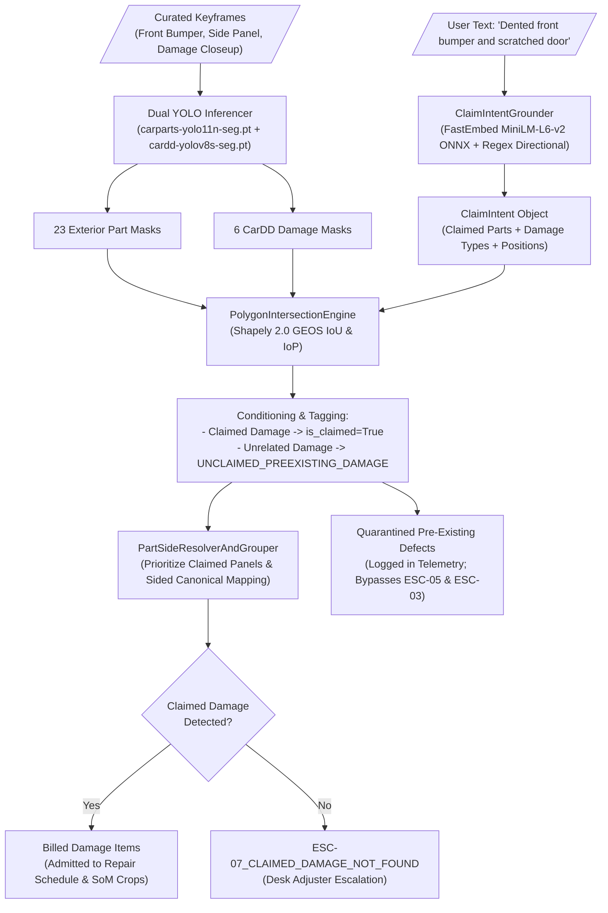

# Low-Level Design (LLD): Conditioned Dual-Mask Part & Damage Segmentation (Stage 2) — `dual_mask_segmentation`

| Document Control | Details |
| :--- | :--- |
| **Document ID** | `LLD-AUTO-SETTLE-STAGE-2-DUAL-MASK-SEGMENTATION` |
| **Version** | `2.1.0 (Intent-Conditioned Architecture & Pretrained Model Integration)` |
| **Parent Architecture** | `docs/STRESS_TEST_AND_SOLUTION_ARCHITECTURE.md`, `docs/ARCHITECTURAL_DEVILS_ADVOCATE_REPORT.md` |
| **System** | Auto-Settle AI: Autonomous Video-to-Cash Claims Adjuster |
| **Module Scope** | Stage 2: Dual-Mask Part & Damage Segmentation (`app/domain/dual_mask_segmentation/`) & Claim Intent Grounding (`app/domain/claim_intent/`) |
| **Target Runtime Stack** | Python 3.12 (`uv`), FastAPI, PyTorch 2.6.0+cu124, Ultralytics YOLO (`weights/carparts-yolo11n-seg.pt` + `weights/cardd-yolov8s-seg.pt`), FastEmbed ONNX Runtime (`all-MiniLM-L6-v2`), `Shapely` 2.0 (GEOS C-Library), OpenCV (`cv2`), NumPy, PostgreSQL 16 (`asyncpg`), Redis 7 |
| **Hardware & Compute SLA** | **$p_{50} \le 180\text{ ms}$**, **$p_{95} \le 350\text{ ms}$** \| **Peak VRAM $\le 1.2\text{ GB} / 8.0\text{ GB}$** on NVIDIA GeForce RTX 4060 Laptop GPU |
| **Upstream Dependency** | Stage 1: Vehicle Identity & Continuity Grounding (`app/domain/vehicle_identity_continuity/`) |
| **Downstream Consumer** | Stage 3: Set-of-Marks VLM Damage Inspection (`app/domain/vlm_damage_inspection/`) [Deferred to future sprints] |
| **Guardrail Rule IDs** | **`ESC-03`** (Unrepaired Repeat Claim on Same Part in `unrepaired_claims_ledger`) **`ESC-05`** (Opposite-Side Multi-Hit Damage in Single Claim) **`ESC-06`** (Safety-Critical Part or Structural Hazard [`front_glass`, `wheel`, `tire_flat`, `glass_shatter`]) **`ESC-07_CLAIMED_DAMAGE_NOT_FOUND`** (Claimed damage component missing from computer vision detections) **`UNCLAIMED_PREEXISTING_DAMAGE`** (Background defect quarantined to telemetry without billing or false fraud escalation) |

---

## 1. Executive Summary & Architectural Mechanism

Stage 2 receives curated keyframes (from walkaround video ByteTrack curation or 3–6 photo pack intake) alongside the user's natural language claim description. Rather than performing unconditioned, "blind" object detection that admits pre-existing wear-and-tear or unrelated damage across the entire vehicle, Stage 2 operates as an **Intent-Conditioned Damage Quarantine Engine**:

---

## 2. Dynamic Taxonomy & System-1 Intent Grounding (`app/domain/claim_intent/`)

### 2.1 Dynamic Taxonomy Registry (`taxonomy_registry.py`)
To prevent brittleness caused by rigid, hardcoded class enums, the `DynamicTaxonomyRegistry` provides thread-safe runtime class management:
- **`DynamicPartClass`**: Represents vehicle components (`name`, `category`, `synonyms`, `confidence_threshold`, `is_safety_critical`, `symmetry_group`).
- **`DynamicDamageClass`**: Represents damage types (`name`, `severity_weight`, `synonyms`, `requires_replacement`).
- **Pre-seeded Taxonomies**:
  - **Parts (23 classes)**: Pre-seeded from `carparts-seg`: `back_bumper`, `back_door`, `back_glass`, `back_left_door`, `back_left_light`, `back_light`, `back_right_door`, `back_right_light`, `front_bumper`, `front_door`, `front_glass`, `front_left_door`, `front_left_light`, `front_light`, `front_right_door`, `front_right_light`, `hood`, `left_mirror`, `right_mirror`, `tailgate`, `trunk`, `wheel`. (Class `object` is filtered out).
  - **Damages (6 classes)**: Pre-seeded from `CarDD`: `dent`, `scratch`, `crack`, `puncture`, `glass_shatter`, `lamp_broken`.

### 2.2 Local FastEmbed ONNX Grounder (`intent_grounder.py`)
- Employs `FastEmbed` with `sentence-transformers/all-MiniLM-L6-v2` running locally via ONNX Runtime on CPU ($p50 \approx 2.09\text{ms}$).
- Extracts clause-level semantics and directional modifiers (`FRONT`, `REAR`, `LEFT`, `RIGHT`, `DRIVER_SIDE`, `PASSENGER_SIDE`).
- **Sentence-Level Modifier Inheritance**: Multi-clause conjunctions (e.g. *"cracked rear right tail light and dented bumper"*) propagate inherited positions (`REAR`) to subsequent modifiers lacking explicit directional tags, correctly mapping `"bumper"` to `"back_bumper"`.
- **Fuzzy Part Matching (`is_part_matching`)**: Solves mismatches between user generic tokens (`"door"`) and YOLO sided annotations (`"front_left_door"`), while enforcing strict physical side exclusivity (preventing `"left"` from matching `"right"`).

---

## 3. Sourced YOLO Models & GPU Runtime Execution

### 3.1 Model Checkpoint Sourcing
Stage 2 utilizes two verified instance segmentation models:
1. **Part Segmenter**: `weights/carparts-yolo11n-seg.pt` (YOLO11-nano architecture, 23 classes, input size $640 \times 640$, batch size 8).
2. **Damage Segmenter**: `weights/cardd-yolov8s-seg.pt` (YOLOv8-small architecture, 6 classes, input size $640 \times 640$, batch size 8).

### 3.2 GPU Memory & Latency Profile
- **Device**: NVIDIA GeForce RTX 4060 Laptop GPU (8GB VRAM) via PyTorch 2.6.0+cu124 on WSL2.
- **Inference Latency**: Dual segmentation runs in $\approx 150\text{ ms}$ ($p50$) and $\le 225\text{ ms}$ ($p95$).
- **VRAM Allocation**: Dual inference consumes $< 1.2\text{ GB}$ peak VRAM, well within the 8GB ceiling.

---

## 4. Polygon Intersection & Damage Quarantine Engine

### 4.1 Geometric Intersection via Shapely 2.0 C-GEOS (`polygon_intersection_engine.py`)
- Transforms YOLO polygon coordinates into self-healed 2D polygons using `shapely.geometry.Polygon(pts).buffer(0)`.
- Calculates:
  - **Intersection Area**: $\text{Area}(D \cap P)$ in pixels and normalized $mm^2$.
  - **Intersection over Part ($\text{IoP}$)**: $\frac{\text{Area}(D \cap P)}{\text{Area}(P)}$.
  - **Intersection over Damage ($\text{IoD}$)**: $\frac{\text{Area}(D \cap P)}{\text{Area}(D)}$.

### 4.2 Intent Conditioning & Quarantine Rule
When a `ClaimIntent` is present:
1. An intersection is tagged `is_claimed=True` and `claim_status="CLAIMED"` if:
   - The detected part matches any claimed part in `claim_intent.pairs` via `is_part_matching()`.
   - The detected damage type matches the claimed damage type.
2. Otherwise, the intersection is tagged `is_claimed=False` and `claim_status="UNCLAIMED_PREEXISTING_DAMAGE"`.

### 4.3 Part-Side Resolver & Candidate Prioritization (`part_side_resolver_and_grouper.py`)
- When multiple keyframes capture the same physical component, candidate damage groups are sorted to place `is_claimed=True` items first.
- Sided canonical mapping prioritizes the user's claimed orientation (e.g. `driver side` $\to$ `front_left_door`).

### 4.4 Missing Claimed Damage Escalation (`orchestrator.py`)
- If the user explicitly declared intent to claim damage on a part (e.g. *"broken windshield"*), but the computer vision pipeline detects no matching damage polygon on that component across any keyframe:
  - The pipeline raises `Stage2ClaimedDamageNotFoundError`.
  - The claim transitions to `claim_status = "ESCALATED"` with `escalation_code = "ESC-07_CLAIMED_DAMAGE_NOT_FOUND"`.
  - The case is routed directly to a human desk adjuster with an audit dossier detailing the declared intent vs. computer vision negative findings.

---

## 5. Visual Artifacts & Downstream Handoff

### 5.1 Set-of-Marks (SoM) Crop Generation (`som_crop_renderer.py`)
- Extracts a high-resolution contextual crop centered on the damage polygon with a 15% bounding buffer.
- Overlays a non-occluding high-contrast contour (neon green/magenta) outlining the damage boundary without filling the interior, allowing downstream VLMs (Gemini 2.5 Flash) or human adjusters to inspect metal grain and paint texture.
- Generates normalized SVG polygon path strings for interactive UI overlays on the Next.js frontend.

### 5.2 Database Telemetry & Storage
- **`Claim` Table**:
  - `claim_status`: Transitions to `STAGE_2_SEGMENTATION` or `ESCALATED`.
  - `escalation_code`: Widened to `VARCHAR(64)` to hold descriptive codes like `ESC-07_CLAIMED_DAMAGE_NOT_FOUND`.
  - `damage_telemetry`: Stores JSON-serialized list of billed items and quarantined pre-existing items.
- **Redis SSE**: Emits `STAGE_2_PASSED` or `STAGE_2_ESCALATED` to the frontend client.
