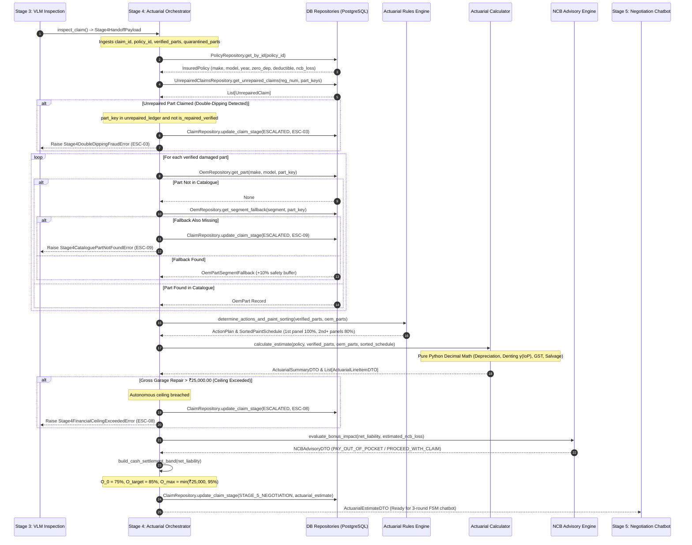

# Low-Level Design (LLD): Actuarial Pricing Engine (Stage 4) — `actuarial_pricing`

| Document Control | Details |
| :--- | :--- |
| **Document ID** | `LLD-AUTO-SETTLE-STAGE-4-ACTUARIAL-PRICING-ENGINE` |
| **Version** | `1.0.0 (IRDAI Motor Tariff Compliance & Pure Deterministic Financial Precision)` |
| **Parent Architecture** | `docs/STRESS_TEST_AND_SOLUTION_ARCHITECTURE.md`, `docs/ARCHITECTURAL_DEVILS_ADVOCATE_REPORT.md` |
| **System** | Auto-Settle AI: Autonomous Video-to-Cash Claims Adjuster |
| **Module Scope** | Stage 4: Actuarial Pricing Engine (`app/domain/actuarial_pricing/`) |
| **Target Runtime Stack** | Python 3.12 (`uv`), Pydantic v2, Python `decimal.Decimal` (100% Deterministic `ROUND_HALF_UP`), PostgreSQL 16 (`asyncpg`), SQLAlchemy 2.0 Async, Redis 7 |
| **Hardware & Compute SLA** | **$p_{50} \le 15\text{ ms}$**, **$p_{95} \le 50\text{ ms}$** \| **Zero GPU / Minimal CPU** \| 100% In-Memory Deterministic Math |
| **Upstream Dependency** | Stage 3: Set-of-Marks VLM Damage Inspection (`app/domain/vlm_damage_inspection/`) — `Stage4HandoffPayload` |
| **Downstream Consumers** | Stage 5: Negotiation Chatbot FSM (`app/domain/negotiation_chatbot/`) — `ActuarialEstimateDTO`<br>Stage 6: Settlement Escalation & Audit Dossier (`app/domain/settlement_escalation/`) |
| **Guardrail Rule IDs** | **`ESC-03`** (Double-Dipping Repeat Claim on Prior Unrepaired Part)<br>**`ESC-08`** (Autonomous Payout Financial Ceiling Exceeded > ₹25,000.00)<br>**`ESC-09`** (OEM Catalogue Part / Segment Fallback Missing) |
| **Excluded Sections** | **Tests Section Excluded** (explicitly designed and implemented in subsequent validation packets) |

---

## 1. Executive Summary, TL;DR & Architectural Traceability

### 1.1 TL;DR (Too Long; Didn't Read)
Stage 4 (`actuarial_pricing`) is the **Financial and Statutory Brain** of Auto-Settle AI. While Stages 1, 2, and 3 perform computer vision geometry, damage segmentation, Set-of-Marks forensic audit, and 3D depth grading, Stage 4 converts physical forensic reality into **legally binding, IRDAI-compliant financial liabilities**.

It operates as a **100% deterministic Python engine** using standard library `decimal.Decimal` with explicit `ROUND_HALF_UP` precision to two decimal places. **Zero LLM math is permitted.** It ingests the verified damaged parts from Stage 3 (`Stage4HandoffPayload`), resolves catalogue pricing against the vehicle's make, model, and age, enforces the Indian Motor Tariff (IMT) depreciation schedules, applies continuous denting labor scaling $\gamma(\text{IoP}) = \min(2.0, 1.0 + \text{IoP} \times 2.5)$, computes single-cycle paint overlap discounts (20% off subsequent panels), deducts salvage value and policy deductibles, checks against the ₹25,000 autonomous payout ceiling (`ESC-08`), and packages the resulting liability into a three-tiered cash-in-lieu negotiation band $[O_0=75\%, O_{\text{target}}=85\%, O_{\text{max}}=\min(₹25000, 95\%)]$ alongside a transparent No Claim Bonus (NCB) advisory recommendation.

---

### 1.2 Mechanism-First Clarity: From Forensic Geometry to Cash Payout

In auto insurance claims processing, translating physical damage into a cash settlement requires traversing six distinct statutory and actuarial layers:

```
[Physical Reality from Stage 3]
  ├── Canonical Part Key (e.g., "front_left_door")
  ├── Substrate Material (metal, plastic, glass, fiberglass, assembly)
  ├── 3D Depth Grade (L1_SURFACE_SCUFF ... L5_STRUCTURAL_TEAR)
  └── Intersection-over-Part Ratio (IoP ∈ [0.0, 1.0])
          │
          ▼
[Layer 1: Action Determination]
  ├── Can this part be repaired? (is_repairable == True)
  ├── Is damage structural? (depth_grade != L5_STRUCTURAL_TEAR)
  └── Is damage areal extent manageable? (IoP <= 0.40)
          │
          ├── If YES to all  ──> ACTION = REPAIR
          └── If NO to any   ──> ACTION = REPLACE
          │
          ▼
[Layer 2: Depreciation Mechanics (IMT / IRDAI)]
  ├── Zero-Dep Rider Active? ──> 0% Depreciation across all materials
  └── Standard Policy?
        ├── Glass: 0% statutory flat rate
        ├── Rubber / Plastic / Nylon: 50% statutory flat rate
        ├── Fiberglass: 30% statutory flat rate
        └── Metal Panels: Age-based statutory schedule (<6m: 0%, ..., >10yr: 50%)
          │
          ▼
[Layer 3: Labor, Denting & Paint Overlap Scheduling]
  ├── If REPLACE ──> OEM Removal & Refit (R&R) Labor
  ├── If REPAIR  ──> PDR Flat Fee (L1/L3) OR Scaled Denting Labor (L4):
  │                  γ(IoP) = min(2.0, 1.0 + IoP * 2.5) * base_denting_labour
  └── Paint Labor ──> Multiplier by Paint Type (Solid 1.00, Metallic 1.15, Pearl 1.30, Matte 1.35)
                      Shared Paint-Booth Overlap: 1st panel 100%, 2nd+ panels 80% (20% discount)
          │
          ▼
[Layer 4: Salvage & Taxation (18% GST)]
  ├── Salvage Value: Replaced Metal 5%, Replaced Plastic 2%, Glass 0%, Repaired 0%
  └── Statutory GST: 18% applied to pre-tax parts (net of depreciation) and pre-tax labor
          │
          ▼
[Layer 5: Deductibles & Net Claim Liability]
  ├── Compulsory Excess: <=1500cc is ₹1,000.00; >1500cc is ₹2,000.00
  ├── Voluntary Deductible: Policy-specified amount
  └── Net Liability = max(0.00, Gross Garage Repair - Salvage - Total Deductibles)
          │
          ▼
[Layer 6: Guardrails, Negotiation Band & NCB Advisory]
  ├── Financial Ceiling: If Gross Repair > ₹25,000.00 ──> Raise ESC-08
  ├── Cash-in-Lieu Band: O_0 = 75%, O_target = 85%, O_max = min(₹25,000, 95%)
  └── NCB Advisory: Net Liability vs Estimated NCB Loss ──> PAY_OUT_OF_POCKET / PROCEED_WITH_CLAIM
```

---

### 1.3 Architectural Sequence Diagram



---

### 1.4 Architectural Flowchart

```mermaid
flowchart TD
    Start(["Stage 4 Ingestion: Stage4HandoffPayload"]) --> FetchContext["Fetch InsuredPolicy & Vehicle Specs"]
    FetchContext --> CheckLedger{"Double Dipping Check\n(Unrepaired Claims Ledger)"}

    CheckLedger -- "Open Unrepaired Claim on Same Part" --> Esc03["Raise Stage4DoubleDippingFraudError\n(ESC-03: Fraudulent Prior Settlement Overlap)"]
    
    CheckLedger -- "Clear of Repeat Claims" --> PartLookup["Fetch OEM Parts from Catalogue"]
    PartLookup --> CheckCatalogue{"Part in OEM Catalogue?"}

    CheckCatalogue -- "No" --> CheckSegment{"Segment Fallback Available?"}
    CheckSegment -- "No" --> Esc09["Raise Stage4CataloguePartNotFoundError\n(ESC-09: Missing Price Schedule)"]
    CheckSegment -- "Yes" --> ApplyFallback["Inject Segment Median Part + 10% Safety Buffer"]
    
    CheckCatalogue -- "Yes" --> ProcessItems["Process Verified Damaged Parts"]
    ApplyFallback --> ProcessItems

    ProcessItems --> DecisionTree{"Determine Action:\nREPAIR vs REPLACE"}
    
    DecisionTree -- "is_repairable==False OR\nL5_STRUCTURAL_TEAR OR\nIoP > 0.40" --> ActionReplace["Action: REPLACE\n- Part Cost with IMT Depreciation\n- OEM R&R Labour\n- Full Panel Paint (if applicable)\n- Scrap Salvage Deduction (Metal 5%, Plastic 2%)"]
    
    DecisionTree -- "is_repairable==True AND\nDepth in L1..L4 AND\nIoP <= 0.40" --> ActionRepair["Action: REPAIR\n- L1/L3: Flat PDR / Polish Fee\n- L2: Minor Touchup Paint\n- L4: Denting Labour Scaled by γ(IoP) + Full Paint\n- Parts Cost = ₹0.00\n- Salvage Deduction = ₹0.00"]

    ActionReplace & ActionRepair --> PaintScheduler["Paint Schedule & Multi-Panel Overlap\n- Multiply by Paint Type (Solid 1.0, Metallic 1.15, Pearl 1.30, Matte 1.35)\n- Sort by Base Paint Cost DESC\n- Panel 1: 100% Rate\n- Panel 2+: 80% Rate (20% Shared Cycle Discount)"]

    PaintScheduler --> PreTaxSum["Pre-Tax Aggregation:\nPreTax = NetParts + TotalLabour + TotalPaint"]
    PreTaxSum --> TaxCalc["Statutory GST (18%):\nGST_Amount = PreTax * 0.18\nGrossGarage = PreTax + GST_Amount"]
    
    TaxCalc --> CeilingCheck{"GrossGarage > ₹25,000.00?\n(Autonomous Ceiling Gate)"}
    CeilingCheck -- "Yes" --> Esc08["Raise Stage4FinancialCeilingExceededError\n(ESC-08: Route to Field Surveyor / Senior Adjuster)"]
    
    CeilingCheck -- "No" --> Deductibles["Apply Statutory Deductibles:\nCompulsory Excess (<=1500cc: ₹1,000, >1500cc: ₹2,000)\n+ Voluntary Deductible\nNetLiability = max(0.00, GrossGarage - Salvage - Deductibles)"]

    Deductibles --> CashBand["Calculate Cash-in-Lieu Settlement Band:\nO_0 = 75% of NetLiability\nO_target = 85% of NetLiability\nO_max = min(₹25,000.00, 95% of NetLiability)"]

    CashBand --> NCBAdvisor{"NCB Advisory Evaluation:\nNetLiability <= EstimatedNCBLoss?"}
    NCBAdvisor -- "Yes" --> AdviceOOP["Recommendation: PAY_OUT_OF_POCKET\n(Financial loss if claim filed)"]
    NCBAdvisor -- "No" --> AdviceClaim["Recommendation: PROCEED_WITH_CLAIM\n(Positive economic utility)"]

    AdviceOOP & AdviceClaim --> FinalPayload["Construct ActuarialEstimateDTO\n- Persist in Claim.actuarial_estimate\n- Transition Claim to STAGE_5_NEGOTIATION"]
    FinalPayload --> End(["Handoff to Stage 5 Negotiation Chatbot"])
```



---

### 1.5 Ponytail / 7-Rung Engineering Pragmatism

Stage 4 strictly implements the **Ponytail 7-Rung Decision Ladder**:
1. **YAGNI:** No speculative financial forecasting, no external underwriting microservices, no multi-currency conversion routines, and no machine learning models for pricing. Automotive parts and labor schedules are deterministic reference data; calculating them with an LLM or neural network introduces hallucination risk, regulatory non-compliance, and arithmetic non-determinism.
2. **Reuse:** Reuses standard SQLAlchemy `OemPart`, `InsuredPolicy`, and `UnrepairedClaim` tables already established in the PostgreSQL schema.
3. **Stdlib:** All financial calculations use Python's built-in `decimal.Decimal` with explicit context `ROUND_HALF_UP`. Floating-point numbers (`float`) are strictly forbidden across all monetary properties to eliminate binary IEEE 754 precision artifacts (`0.1 + 0.2 != 0.3`).
4. **Platform Native:** Native SQLAlchemy async session queries and Redis SSE pub/sub mechanisms.
5. **Existing Dependencies:** Pydantic v2 for data transfer validation and serialization.
6. **One-Liner:** Mathematical scaling functions (e.g. $\gamma(\text{IoP}) = \min(2.0, 1.0 + \text{IoP} \times 2.5)$) are implemented as pure, single-line functions with zero intermediate allocations.
7. **Minimal Code:** The entire pricing domain is composed of pure functional calculators decoupled from network and database I/O, allowing instantaneous unit testing and total auditability.

---

## 2. Mathematical Specifications & Actuarial Calculation Mechanics

### 2.1 The Actuarial Problem Statement & Governing Rules
Automobile own-damage claims in India are governed by the **Indian Motor Tariff (IMT)** and regulations framed by the **Insurance Regulatory and Development Authority of India (IRDAI)**. The pricing engine must calculate insurer liability according to these statutory rules while offering an algorithmic cash-in-lieu payout that incentivizes fast customer settlement without exposing the insurer to financial leakage.

---

### 2.2 IRDAI Motor Own Damage Claim Settlement Rules & Indian Motor Tariff (IMT)

#### 2.2.1 Depreciation Schedule: Zero Depreciation Add-on vs. Statutory Age Schedule
Depreciation applies strictly to the cost of **replacement parts**. Labor and painting charges are not depreciated (except paint material under specific statutory non-zero-dep conditions, standardly simplified to parts depreciation in automated appraisal).

1. **Zero Depreciation Rider (`zero_dep_addon == True`):**
   - The depreciation rate is **$0.00\%$** ($0.0$) across **all** materials (metal, plastic, glass, rubber, fiberglass, nylon, and assemblies).
   - Net Part Cost = Gross OEM Part Cost.

2. **Statutory Depreciation Schedule (`zero_dep_addon == False`):**
   When the policy lacks a Zero-Dep rider, depreciation is determined by part material and vehicle age:
   - **Glass Components:** **$0.00\%$** flat rate (statutory rule: glass does not depreciate with vehicle age).
   - **Rubber, Plastic & Nylon Components:** **$50.00\%$** flat rate regardless of vehicle age. (Includes plastic bumpers, mud flaps, nylon fittings, and rubber beadings).
   - **Fiberglass Components:** **$30.00\%$** flat rate regardless of vehicle age.
   - **Metal / Sheet Metal Panels:** Scaled strictly according to the statutory age-based schedule calculated from the vehicle's manufacturing year to the claim date:

| Vehicle Age Bracket | Statutory Depreciation Rate ($\delta_{\text{metal}}$) |
| :--- | :---: |
| Less than 6 months | **$0.00\%$** ($0.00$) |
| 6 months to 1 year | **$5.00\%$** ($0.05$) |
| 1 year to 2 years | **$10.00\%$** ($0.10$) |
| 2 years to 3 years | **$15.00\%$** ($0.15$) |
| 3 years to 4 years | **$25.00\%$** ($0.25$) |
| 4 years to 5 years | **$35.00\%$** ($0.35$) |
| 5 years to 10 years | **$40.00\%$** ($0.40$) |
| Exceeding 10 years | **$50.00\%$** ($0.50$) |

*Age Computation:* Vehicle age in integer years is computed as $\text{age\_years} = \text{claim\_date.year} - \text{policy.manufacturing\_year}$.

---

#### 2.2.2 Deductibles & Excess (Compulsory + Voluntary)
Deductibles are the initial loss amount borne by the insured before the insurer pays liability.

1. **Compulsory Excess:** Set by the IMT based on engine displacement (Cubic Capacity - CC):
   $$\text{Compulsory Excess} = \begin{cases} ₹1,000.00 & \text{if Engine Displacement } \le 1500\text{cc} \\ ₹2,000.00 & \text{if Engine Displacement } > 1500\text{cc} \end{cases}$$
   *(Note: Overridden by `policy.compulsory_deductible_inr` if explicitly configured on the policy).*
2. **Voluntary Deductible:** An optional deductible chosen by the insured to lower policy premiums (defaults to $₹0.00$ if not configured).
3. **Total Deductible:**
   $$\text{Total Deductible} = \text{Compulsory Excess} + \text{Voluntary Deductible}$$
4. **Application:** Deductibles apply at the **claim level** against the aggregate payable amount:
   $$\text{Net Claim Liability} = \max(₹0.00, \text{Gross Payable Amount} - \text{Total Deductible})$$

---

### 2.3 Repair vs. Replace Decision Tree
For each damaged part, the engine deterministically decides between `REPAIR` and `REPLACE` using physical forensics from Stage 3:

$$\text{Action} = \begin{cases} \text{REPLACE} & \text{if } \text{is\_repairable} = \text{False} \lor \text{depth\_grade} = \text{L5\_STRUCTURAL\_TEAR} \lor \text{IoP} > 0.40 \\ \text{REPAIR} & \text{otherwise} \end{cases}$$

- **Unrepairable Parts:** Glass windshields, headlamp assemblies, and alloy wheels cannot be safely panel-beaten or repaired; they mandate replacement.
- **Structural Punctures / Tears ($L_5$):** Severe sheet metal tears compromise structural rigidity and cannot be restored with body filler.
- **Areal Extent Threshold ($\text{IoP} > 0.40$):** When damage covers more than $40\%$ of the component surface area, modern body shop practice and insurance economics mandate panel replacement over excessive beating.

---

### 2.4 Labor Cost Calculations

#### 2.4.1 Replacement Labor
When a part is replaced:
$$\text{Labour}_{\text{replace}} = \text{oem\_part.rr\_labour\_inr}$$
Where R&R (Removal & Refit) covers the standard labor hours required to unbolt the old part, fit the new panel, align gaps, and torque fasteners.

#### 2.4.2 Repair Labor & Continuous Denting Scaling
When a part is repaired, labor depends on the 3D depth grade from Stage 3:
1. **Depth Grade $L_1$ (`L1_SURFACE_SCUFF`):**
   - Superficial clearcoat friction marks.
   - Requires machine compounding, polishing, or localized buffing.
   - $\text{Labour} = \text{oem\_part.pdr\_or\_polish\_flat\_inr}$
   - Sheet metal denting labor $= ₹0.00$; paint cost $= ₹0.00$.
2. **Depth Grade $L_2$ (`L2_BASECOAT_SCRATCH`):**
   - Scratches penetrating clearcoat into basecoat/primer without sheet metal deformation.
   - Sheet metal denting labor $= ₹0.00$.
   - Panel touchup / full panel repaint is scheduled: $\text{Paint} = \text{oem\_part.full\_panel\_paint\_inr} \times \mu_{\text{paint}} \times \omega_{\text{overlap}}$.
3. **Depth Grade $L_3$ (`L3_SHALLOW_DENT_PDR`):**
   - Shallow, bowl-shaped dent with intact factory paint.
   - Handled via Paintless Dent Repair (PDR) using specialized leverage rods.
   - $\text{Labour} = \text{oem\_part.pdr\_or\_polish\_flat\_inr}$
   - Sheet metal denting labor $= ₹0.00$; paint cost $= ₹0.00$.
4. **Depth Grade $L_4$ (`L4_CREASED_DENT`):**
   - Sharp, creased sheet metal deformation requiring panel beating, dollies, stud welding, and full repaint.
   - Denting labor scales continuously with the damage surface area (Intersection-over-Part $\text{IoP}$):
     $$\gamma(\text{IoP}) = \min(2.0, 1.0 + \text{IoP} \times 2.5)$$
     $$\text{Labour}_{\text{denting}} = \text{oem\_part.denting\_base\_labour\_inr} \times \gamma(\text{IoP})$$
   - Full panel painting is scheduled: $\text{Paint} = \text{oem\_part.full\_panel\_paint\_inr} \times \mu_{\text{paint}} \times \omega_{\text{overlap}}$.

*Mathematical Invariants for $\gamma(\text{IoP})$:*
- At minimum detectable dent $\text{IoP} \to 0.00 \implies \gamma(0.0) = 1.00$ ($1.00\times$ base denting).
- At $\text{IoP} = 0.20 \implies \gamma(0.20) = 1.0 + 0.20 \times 2.5 = 1.50$ ($1.50\times$ base denting).
- At threshold $\text{IoP} = 0.40 \implies \gamma(0.40) = 1.0 + 0.40 \times 2.5 = 2.00$ ($2.00\times$ base denting ceiling).
- Any $\text{IoP} > 0.40$ switches action to `REPLACE`, never exceeding the $2.00\times$ cap.

---

### 2.5 Paint Schedule, Multipliers & Adjacent Panel Overlap Discount

#### 2.5.1 Paint Type Multipliers ($\mu_{\text{paint}}$)
Factory paint finishes require different paint materials, tint matching passes, and baking coats:
$$\mu_{\text{paint}} = \begin{cases} 1.00 & \text{Solid / Non-Metallic Finish} \\ 1.15 & \text{Metallic Finish (Flake suspended in basecoat)} \\ 1.30 & \text{Pearl / Tri-Coat Finish (Mica pearl layer + tinted clear)} \\ 1.35 & \text{Matte / Satin Specialty Finish (Matte clearcoat)} \end{cases}$$

#### 2.5.2 Multi-Panel Paint Overlap Discount ($\omega_{\text{overlap}}$)
In automotive body repair, painting multiple adjacent panels during the same visit shares fixed setup overhead: paint booth pre-heating, masking tape/paper application, computerized paint mixing, spray gun cleaning, and infrared baking cycles.

**Algorithm:**
1. Collect all panels requiring painting across the claim.
2. Sort panels in **descending order of base paint cost** (`full_panel_paint_inr`).
3. Apply the overlap discount factor:
   - **Primary Panel (Index 0):** $\omega_{\text{overlap}} = 1.00$ (Full 100% paint charge).
   - **Subsequent Panels (Index $\ge 1$):** $\omega_{\text{overlap}} = 0.80$ (20% overlap discount).
4. Panel paint formula:
   $$\text{Paint}_{\text{panel}} = \text{base\_paint\_inr} \times \mu_{\text{paint}} \times \omega_{\text{overlap}}$$

---

### 2.6 Salvage Value Deduction
When an insurer pays to replace a damaged part, the damaged part belongs to the insurer and holds salvage (scrap) value. Under standard IMT loss assessment, salvage is deducted from the payable claim:

$$\text{Salvage Rate } (\sigma) = \begin{cases} 5.00\% \text{ (0.05)} & \text{if Action = REPLACE and Material = METAL} \\ 2.00\% \text{ (0.02)} & \text{if Action = REPLACE and Material = PLASTIC / RUBBER / NYLON} \\ 0.00\% \text{ (0.00)} & \text{if Action = REPLACE and Material = GLASS} \\ 0.00\% \text{ (0.00)} & \text{if Action = REPAIR (Part remains on vehicle)} \end{cases}$$

$$\text{Salvage Amount}_{\text{item}} = \text{Net Part Cost} \times \sigma$$
$$\text{Total Salvage} = \sum_{i=1}^{N} \text{Salvage Amount}_i$$

---

### 2.7 Goods and Services Tax (GST) at 18%
Under the Indian Goods and Services Tax Act, automotive parts and garage labor are subject to statutory GST:
- **Parts GST:** 18% (standard rate across automotive replacement spares).
- **Labor & Painting GST:** 18% (automotive service classification).

$$\text{Pre-Tax Parts} = \sum \text{Net Part Cost}_i$$
$$\text{Pre-Tax Labour} = \sum (\text{RR Labour}_i + \text{Denting Labour}_i + \text{PDR Flat}_i)$$
$$\text{Pre-Tax Paint} = \sum \text{Paint}_i$$
$$\text{Pre-Tax Total} = \text{Pre-Tax Parts} + \text{Pre-Tax Labour} + \text{Pre-Tax Paint}$$
$$\text{GST Amount} = \text{Pre-Tax Total} \times 0.18$$
$$\text{Gross Garage Repair} = \text{Pre-Tax Total} + \text{GST Amount}$$

---

### 2.8 Autonomous Ceiling Guardrail (`ESC-08`)
To prevent automated payout fraud on catastrophic or total loss collisions, an uncompromising circuit breaker is enforced:

$$\text{Gross Garage Repair} > ₹25,000.00 \implies \text{RAISE } \texttt{Stage4FinancialCeilingExceededError} \text{ (Code: ESC-08)}$$

When triggered:
- The claim is immediately halted from autonomous cash settlement.
- The claim state is transitioned to `ESCALATED` with code `ESC-08`.
- An audit dossier containing the line-item pricing breakdown and Set-of-Marks forensic crops is dispatched to a Senior Field Surveyor for manual in-person inspection.

---

### 2.9 Cash-in-Lieu Settlement Band ($[O_0, O_{\text{target}}, O_{\text{max}}]$)
When a claimant opts for a cash payout instead of waiting weeks for garage booking, body shop queueing, and surveyor re-inspection, SettleAI generates a three-tiered settlement band:

1. **Initial Algorithmic Offer ($O_0$):**
   $$O_0 = \text{quantize}(0.75 \times \text{Net Claim Liability})$$
   *(Represents a fair immediate payout accounting for garage markup, parts retail margins, and insurer administrative savings).*
2. **Fair Target Settlement ($O_{\text{target}}$):**
   $$O_{\text{target}} = \text{quantize}(0.85 \times \text{Net Claim Liability})$$
   *(The target clearing price for Stage 5 negotiation).*
3. **Walkaway Maximum Cap ($O_{\text{max}}$):**
   $$O_{\text{max}} = \min(₹25,000.00, \text{quantize}(0.95 \times \text{Net Claim Liability}))$$
   *(The hard upper boundary beyond which Stage 5 chatbot will refuse counteroffers and escalate to a human claims manager).*

---

### 2.10 No Claim Bonus (NCB) Advisory Engine & Economic Utility
Motorists in India earn a No Claim Bonus (NCB) ranging from 20% to 50% discount on renewal own-damage premiums. Filing a minor claim wipes out accumulated NCB, increasing subsequent renewal premiums.

The engine computes the **Net Economic Benefit**:
$$\Delta_{\text{benefit}} = \text{Net Claim Liability} - \text{Estimated NCB Loss INR}$$

$$\text{Recommendation} = \begin{cases} \texttt{"PAY_OUT_OF_POCKET"} & \text{if } \Delta_{\text{benefit}} \le ₹0.00 \\ \texttt{"PROCEED_WITH_CLAIM"} & \text{if } \Delta_{\text{benefit}} > ₹0.00 \end{cases}$$

- **PAY_OUT_OF_POCKET:** Displayed transparently to the user with explanation: *"Filing this claim yields ₹X in cash payout but costs ₹Y in lost renewal discounts, causing a net personal loss of ₹(Y - X). We advise paying out-of-pocket."*
- **PROCEED_WITH_CLAIM:** Confirms that filing the claim generates positive economic utility of ₹$\Delta_{\text{benefit}}$.

---

### 2.11 Double-Dipping & Repeat Unrepaired Claim Detection (`ESC-03`)
Before calculating liability, the engine queries `UnrepairedClaimsLedger` using the vehicle registration number and verified damaged part keys:
$$\text{If } \exists \, u \in \text{UnrepairedClaims} \text{ where } u.\text{part\_key} \in \text{claimed\_parts} \land u.\text{is\_repaired\_verified} = \text{False}$$
$$\implies \text{RAISE } \texttt{Stage4DoubleDippingFraudError} \text{ (Code: ESC-03)}$$

This blocks claimants from receiving repeated cash settlements on pre-existing unrepaired damage across multiple policies or dates.

---

### 2.12 Catalogue Fallback & Segment Baseline Resolution (`ESC-09`)
If a vehicle model is not explicitly seeded in `oem_parts_catalogue` (e.g. Kia Seltos, Honda City):
1. Resolve vehicle segment (`HATCHBACK`, `SEDAN`, `COMPACT_SUV`, `MIDSIZE_SUV`, `LUXURY`).
2. Query `OemPartSegmentFallback` for the segment baseline.
3. Apply a $10\%$ safety buffer to baseline prices:
   $$\text{Fallback Part Cost} = \text{median\_cost} \times 1.10$$
4. If no segment fallback exists, raise `Stage4CataloguePartNotFoundError` (`ESC-09`).

---

### 2.13 Complete Mathematical Worked Examples for All 12 Edge Cases

#### Edge Case 1: Brand New Vehicle (< 6 Months) Zero-Dep vs Non-Zero-Dep
- **Vehicle:** 2026 Hyundai Creta (Manufactured Jan 2026, Claim date March 2026 $\to$ Age = 0.2 years < 6 months).
- **Damaged Parts:**
  1. `front_bumper` (Plastic): OEM ₹8,800.00, Replacement action.
  2. `hood` (Metal): OEM ₹14,200.00, Replacement action.
- **Evaluation:**
  - **Zero-Dep Policy (`POL-ZERO-DEP-NEW`):**
    - `front_bumper` Depreciation: $0\% \implies \text{Net Part} = ₹8,800.00$.
    - `hood` Depreciation: $0\% \implies \text{Net Part} = ₹14,200.00$.
    - Total Net Parts: ₹23,000.00.
  - **Non-Zero-Dep Policy:**
    - `front_bumper` (Plastic): Statutory 50% flat rate $\implies \text{Depreciation} = ₹4,400.00$, $\text{Net Part} = ₹4,400.00$.
    - `hood` (Metal, <6 months): Statutory rate for $<6$ months is $0\% \implies \text{Depreciation} = ₹0.00$, $\text{Net Part} = ₹14,200.00$.
    - Total Net Parts: ₹18,600.00.
  - **Demonstration:** Proves that while metal enjoys 0% depreciation on brand new cars even without zero-dep, plastic components suffer a severe 50% statutory haircut.

---

#### Edge Case 2: 4-Year-Old Vehicle Non-Zero-Dep Policy
- **Vehicle:** 2022 Hyundai Creta (`POL-NON-DEP-4YR`, Claim in 2026 $\to$ Age = 4 years).
- **Damaged Parts:**
  1. `front_left_door` (Metal): OEM ₹11,500.00, Replacement action.
  2. `back_bumper` (Plastic): OEM ₹8,200.00, Replacement action.
  3. `front_glass` (Glass): OEM ₹12,400.00, Replacement action.
- **Calculation:**
  - `front_left_door` (Metal, 4yr): 3-4yr schedule rate $= 25.00\%$.
    $$\text{Depreciation} = ₹11,500 \times 0.25 = ₹2,875.00 \implies \text{Net Part} = ₹8,625.00$$
    $$\text{Salvage (5% Metal)} = ₹8,625 \times 0.05 = ₹431.25$$
  - `back_bumper` (Plastic, 4yr): Plastic schedule rate $= 50.00\%$.
    $$\text{Depreciation} = ₹8,200 \times 0.50 = ₹4,100.00 \implies \text{Net Part} = ₹4,100.00$$
    $$\text{Salvage (2% Plastic)} = ₹4,100 \times 0.02 = ₹82.00$$
  - `front_glass` (Glass, 4yr): Glass statutory rate $= 0.00\%$.
    $$\text{Depreciation} = ₹12,400 \times 0.00 = ₹0.00 \implies \text{Net Part} = ₹12,400.00$$
    $$\text{Salvage (0% Glass)} = ₹0.00$$

---

#### Edge Case 3: High Displacement (>1500cc) Vehicle Compulsory Excess
- **Vehicle:** 2018 Toyota Fortuner 2.8L Diesel (`POL-HIGH-CC-OLD`, Engine 2755cc > 1500cc).
- **Damage:** `front_left_door` (Creased dent $L_4$, $\text{IoP} = 0.15$). Action: REPAIR.
- **Labor & Paint:**
  - Base Denting Labor: ₹2,200.00.
  - Scaling: $\gamma(0.15) = 1.0 + 0.15 \times 2.5 = 1.375$.
  - Denting Labor: $₹2,200 \times 1.375 = ₹3,025.00$.
  - Paint (Metallic 1.15): $₹7,500 \times 1.15 = ₹8,625.00$.
  - Pre-Tax Total: $₹3,025 + ₹8,625 = ₹11,650.00$.
  - GST (18%): $₹11,650 \times 0.18 = ₹2,097.00$.
  - Gross Garage Repair: $₹11,650 + ₹2,097 = ₹13,747.00$.
- **Deductible Application:**
  - Because engine $>1500\text{cc}$, compulsory deductible is **$₹2,000.00$** (not $₹1,000.00$).
  - $\text{Net Claim Liability} = ₹13,747.00 - ₹2,000.00 = ₹11,747.00$.
  - Initial Cash Offer ($O_0 = 75\%$): $₹11,747 \times 0.75 = ₹8,810.25$.

---

#### Edge Case 4: Deep Dent on Sheet Metal with High IoP Scaling ($\text{IoP} = 0.35$)
- **Vehicle:** Hyundai Creta (`POL-HAPPY-001`, Metallic White).
- **Damaged Part:** `front_left_door` (Metal, repairable=True).
- **Forensic Input:** Depth Grade = `L4_CREASED_DENT`, $\text{IoP} = 0.35$ (covers 35% of door).
- **Action:** $\text{IoP} \le 0.40 \implies \text{Action} = \text{REPAIR}$.
- **Labor Scaling Calculation:**
  $$\gamma(0.35) = \min(2.0, 1.0 + 0.35 \times 2.5) = 1.0 + 0.875 = 1.875$$
  $$\text{Base Denting Labour} = ₹1,400.00$$
  $$\text{Scaled Denting Labour} = ₹1,400.00 \times 1.875 = ₹2,625.00$$
- **Painting Calculation:**
  $$\text{Base Paint} = ₹4,200.00, \quad \mu_{\text{metallic}} = 1.15, \quad \omega_{\text{overlap}} = 1.00$$
  $$\text{Paint Cost} = ₹4,200.00 \times 1.15 = ₹4,830.00$$
- **Totals:**
  - Pre-Tax Total = $₹2,625.00 + ₹4,830.00 = ₹7,455.00$.
  - GST 18% = $₹7,455.00 \times 0.18 = ₹1,341.90$.
  - Gross Garage Repair = $₹8,796.90$.
  - Deductible ($\le 1500$cc) = $₹1,000.00$.
  - Net Claim Liability = $₹7,796.90$.

---

#### Edge Case 5: Large IoP Exceeding Replacement Threshold ($\text{IoP} = 0.45 > 0.40$)
- **Vehicle:** Hyundai Creta (`POL-HAPPY-001`).
- **Damaged Part:** `front_left_door` (Metal, repairable=True).
- **Forensic Input:** Depth Grade = `L4_CREASED_DENT`, $\text{IoP} = 0.45$.
- **Action Determination:**
  - $\text{IoP} = 0.45 > 0.40 \implies \text{Action switches from REPAIR to REPLACE!}$
- **Cost Calculation (Zero-Dep):**
  - OEM Part Cost: ₹11,500.00 (0% depreciation).
  - Removal & Refit (R&R) Labor: ₹950.00 (denting labor $= ₹0$).
  - Full Panel Paint: $₹4,200.00 \times 1.15 = ₹4,830.00$.
  - Pre-Tax Subtotal: $₹11,500 + ₹950 + ₹4,830 = ₹17,280.00$.
  - GST (18%): $₹17,280.00 \times 0.18 = ₹3,110.40$.
  - Gross Garage Repair: $₹17,280.00 + ₹3,110.40 = ₹20,390.40$.
  - Salvage Deduction (5% of metal part): $₹11,500 \times 0.05 = ₹575.00$.
  - Gross Payable: $₹20,390.40 - ₹575.00 = ₹19,815.40$.
  - Deductible: ₹1,000.00.
  - Net Claim Liability: $₹19,815.40 - ₹1,000.00 = ₹18,815.40$.
- **Demonstration:** Proves that severe areal damage automatically pivots to replacement, billing R&R labor instead of scaled denting labor.

---

#### Edge Case 6: Multi-Panel Adjacent Paint Overlap Discount
- **Vehicle:** Hyundai Creta (`POL-HAPPY-001`, Metallic paint multiplier = 1.15).
- **Damaged Parts:**
  1. `front_bumper` (Plastic): Base Paint = ₹3,800.00.
  2. `front_left_door` (Metal): Base Paint = ₹4,200.00.
  3. `front_left_fender` (Metal): Base Paint = ₹3,200.00.
- **Sorting by Base Paint Cost (Descending):**
  - Rank 1: `front_left_door` (₹4,200.00) $\to$ First panel, Factor = 1.00.
  - Rank 2: `front_bumper` (₹3,800.00) $\to$ Second panel, Factor = 0.80 (20% discount).
  - Rank 3: `front_left_fender` (₹3,200.00) $\to$ Third panel, Factor = 0.80 (20% discount).
- **Paint Charges:**
  $$\text{Door Paint} = ₹4,200.00 \times 1.15 \times 1.00 = ₹4,830.00$$
  $$\text{Bumper Paint} = ₹3,800.00 \times 1.15 \times 0.80 = ₹3,496.00$$
  $$\text{Fender Paint} = ₹3,200.00 \times 1.15 \times 0.80 = ₹2,944.00$$
  $$\text{Total Paint} = ₹4,830.00 + ₹3,496.00 + ₹2,944.00 = ₹11,270.00$$
  *(Un-discounted total would have been ₹12,880.00; saves insurer ₹1,610.00 in shared booth overhead).*

---

#### Edge Case 7: PDR Cosmetic Polish Scuff (Depth Grade $L_1$ & $L_3$)
- **Vehicle:** Hyundai Creta (`POL-HAPPY-001`).
- **Damaged Part:** `front_left_door`.
- **Forensic Input:** Depth Grade = `L1_SURFACE_SCUFF` (rub-mark from plastic post).
- **Costing:**
  - Part Cost = ₹0.00.
  - Denting Labor = ₹0.00.
  - Paint Cost = ₹0.00.
  - Cosmetic PDR / Polish Flat Fee = `oem_part.pdr_or_polish_flat_inr` = ₹850.00.
  - Pre-Tax Total = ₹850.00.
  - GST (18%) = $₹850.00 \times 0.18 = ₹153.00$.
  - Gross Garage Repair = $₹850.00 + ₹153.00 = ₹1,003.00$.
  - Deductible = ₹1,000.00.
  - Net Claim Liability = $₹1,003.00 - ₹1,000.00 = ₹3.00$.

---

#### Edge Case 8: Autonomous Financial Ceiling Exceeded (`ESC-08`)
- **Vehicle:** Toyota Fortuner (`POL-CEILING-BREACH`).
- **Damaged Parts:**
  1. `front_bumper` (Replace): OEM ₹18,500.00, R&R ₹1,200.00, Paint $₹6,500 \times 1.15 = ₹7,475.00$.
  2. `hood` (Replace): OEM ₹28,500.00, R&R ₹1,800.00, Paint $₹8,500 \times 1.15 \times 0.80 = ₹7,820.00$.
- **Pre-Tax Subtotal:**
  - Parts: $₹18,500 + ₹28,500 = ₹47,000.00$.
  - Labor: $₹1,200 + ₹1,800 = ₹3,000.00$.
  - Paint: $₹7,475 + ₹7,820 = ₹15,295.00$.
  - Pre-Tax Total: ₹65,295.00.
- **Gross Garage Repair:**
  $$\text{Gross} = ₹65,295.00 \times 1.18 = ₹77,048.10$$
- **Ceiling Check:**
  $$₹77,048.10 > ₹25,000.00 \implies \text{RAISE } \texttt{Stage4FinancialCeilingExceededError}(\texttt{"ESC-08"})$$
- **Result:** Automated settlement is terminated; claim dossier is routed to Field Surveyor.

---

#### Edge Case 9: Double Dipping Unrepaired Part Claim (`ESC-03`)
- **Claimant Vehicle:** `MH12ZD2026` (`POL-ZERO-DEP-NEW`).
- **Claimed Damage:** `front_left_door` (Scratch).
- **Database State in `UnrepairedClaimsLedger`:**
  - `ledger_id = 2`, `registration_number = "MH12ZD2026"`, `canonical_part_key = "front_left_door"`, `is_repaired_verified = False`, settled ₹3,500.00 on Aug 10, 2026.
- **Evaluation:**
  - Damaged part `front_left_door` has an open, unverified prior cash-in-lieu payout.
  - Engine detects fraud attempt and halts execution.
  - **Result:** `RAISE Stage4DoubleDippingFraudError("ESC-03: Part front_left_door was previously settled cash-in-lieu and lacks repair verification.")`.

---

#### Edge Case 10: NCB Advisory Recommending Out-of-Pocket Payment
- **Vehicle:** 2024 Hyundai Creta (`POL-HIGH-NCB-PENALTY`).
- **Policy Context:** `estimated_ncb_loss_inr = ₹5,400.00`.
- **Damage:** Minor scuff on `front_bumper`. Action: REPAIR.
- **Calculation:**
  - PDR Polish Fee = ₹800.00.
  - Paint touchup = $₹1,500.00 \times 1.15 = ₹1,725.00$.
  - Pre-Tax Total = $₹800 + ₹1,725 = ₹2,525.00$.
  - GST 18% = ₹454.50 $\implies \text{Gross} = ₹2,979.50$.
  - Compulsory Deductible = ₹1,000.00.
  - Net Claim Liability = $₹1,979.50$.
- **NCB Evaluation:**
  $$\Delta_{\text{benefit}} = ₹1,979.50 - ₹5,400.00 = -₹3,420.50$$
  $$\text{Recommendation} = \texttt{"PAY_OUT_OF_POCKET"}$$
- **Result:** System advises the customer that claiming ₹1,979.50 will result in a net personal financial penalty of ₹3,420.50 at policy renewal.

---

#### Edge Case 11: Deductible Exceeds Assessed Damage
- **Vehicle:** 2018 Toyota Fortuner (`POL-HIGH-CC-OLD`, Compulsory Deductible = ₹2,000.00).
- **Damage:** Minor scratch on `left_mirror` cover.
- **Costing:**
  - Polish & touchup: Pre-tax ₹1,200.00.
  - GST 18%: ₹216.00.
  - Gross Garage Repair: ₹1,416.00.
- **Deductible Application:**
  $$\text{Net Claim Liability} = \max(₹0.00, ₹1,416.00 - ₹2,000.00) = ₹0.00$$
- **Settlement Band:**
  - $O_0 = ₹0.00$, $O_{\text{target}} = ₹0.00$, $O_{\text{max}} = ₹0.00$.
  - Advisory: *"Assessed repair of ₹1,416.00 is below policy compulsory deductible of ₹2,000.00. No insurance liability payable."*

---

#### Edge Case 12: Missing Catalogue Part Fallback & Escalation (`ESC-09`)
- **Vehicle:** 2023 Kia Seltos (`make="Kia", model="Seltos"`), part `front_left_fender`.
- **Catalogue Resolution:**
  - `OemRepository.get_part("Kia", "Seltos", "front_left_fender")` returns `None`.
  - Engine resolves segment: `COMPACT_SUV`.
  - Queries `OemRepository.get_segment_fallback("COMPACT_SUV", "front_left_fender")`.
  - Returns median pricing: Part ₹4,800.00, R&R ₹700.00, Paint ₹3,000.00.
  - Applies 10% safety buffer: Part ₹5,280.00, R&R ₹770.00, Paint ₹3,300.00.
  - Calculation proceeds autonomously without disruption.
- **Unresolvable Part (e.g. Exotic Import / Unmapped Part):**
  - If segment fallback also returns `None`:
  - `RAISE Stage4CataloguePartNotFoundError("ESC-09: No catalogue record or segment baseline exists for part key: custom_spoiler")`.

---

## 3. Target Repository & Module Architecture

### 3.1 Directory Layout
The domain logic resides in `app/domain/actuarial_pricing/`:

```
app/domain/actuarial_pricing/
├── __init__.py           # Public API facade & domain exports
├── enums.py              # Pure domain enumerations (RepairAction, PaintType, etc.)
├── schemas.py            # Pydantic v2 DTOs (ActuarialEstimateDTO, LineItems, Summary)
├── exceptions.py         # Domain error hierarchy & escalation codes (ESC-03, ESC-08, ESC-09)
├── rules.py              # Statutory rules (IMT depreciation schedules, paint multipliers, scaling)
├── calculator.py         # 100% deterministic Decimal pricing calculator
├── ncb_advisor.py        # No Claim Bonus economic utility evaluator
├── interfaces.py         # Abstract protocol definitions for repositories & engine
└── orchestrator.py       # Async pipeline orchestrator and state transition controller
```

---

### 3.2 Module Responsibility Matrix

| Module | Core Responsibility | Purity / Dependencies |
| :--- | :--- | :--- |
| `enums.py` | String enumerations for actions, materials, paint types, and escalation codes. | 100% Pure Python stdlib (`enum.Enum`). Zero dependencies. |
| `schemas.py` | Immutable data transfer objects for line items, summaries, cash bands, and estimates. | Pydantic v2 (`BaseModel`, `Field`, `ConfigDict`). |
| `exceptions.py` | Custom exception classes with embedded escalation codes and user-safe messages. | Python stdlib (`Exception`). |
| `rules.py` | Mathematical formulas for IMT depreciation tables, paint overlap discounts, denting labor scaling $\gamma(\text{IoP})$, and salvage percentages. | 100% Pure Python stdlib (`decimal.Decimal`). No I/O. |
| `calculator.py` | Deterministic computation of pre-tax parts, scaled denting, overlap paint, GST, and cash-in-lieu bands. | Pure Python (`Decimal`). No database, network, or LLM dependencies. |
| `ncb_advisor.py` | Compares net claim liability against estimated renewal premium loss to issue transparent advice. | Pure Python (`Decimal`). |
| `interfaces.py` | Formal typing protocols (`typing.Protocol`) defining repository contracts. | Python stdlib (`typing`). Decouples orchestrator from SQLAlchemy. |
| `orchestrator.py` | Ingests `Stage4HandoffPayload`, coordinates repository calls, evaluates fraud/ceiling gates, triggers calculator, updates DB, and emits SSE events. | Async (`asyncio`, `SQLAlchemy`, `RedisManager`). |
| `__init__.py` | Clean facade exposing `ActuarialPricingOrchestrator`, `ActuarialPricingEngine`, schemas, and errors. | Facade only. |

---

## 4. Comprehensive Class, Function, Schema & Error Definitions

### 4.1 Enums (`app/domain/actuarial_pricing/enums.py`)

```python
"""
app/domain/actuarial_pricing/enums.py
Domain enumerations for Stage 4 Actuarial Pricing Engine.
"""
from enum import Enum


class RepairAction(str, Enum):
    """Actuarial decision action for a damaged component."""
    REPAIR = "REPAIR"
    REPLACE = "REPLACE"


class MaterialType(str, Enum):
    """Material composition governing statutory depreciation and salvage rates."""
    METAL = "metal"
    PLASTIC = "plastic"
    RUBBER = "rubber"
    GLASS = "glass"
    FIBERGLASS = "fiberglass"
    ASSEMBLY = "assembly"


class PaintType(str, Enum):
    """Vehicle factory exterior finish type."""
    SOLID = "solid"
    METALLIC = "metallic"
    PEARL = "pearl"
    MATTE = "matte"


class DepreciationSchedule(str, Enum):
    """Statutory depreciation schedule category."""
    ZERO_DEP = "ZERO_DEP"
    IMT_STATUTORY_SCHEDULE = "IMT_STATUTORY_SCHEDULE"


class NCBRecommendation(str, Enum):
    """Advisory recommendation regarding No Claim Bonus economic utility."""
    PAY_OUT_OF_POCKET = "PAY_OUT_OF_POCKET"
    PROCEED_WITH_CLAIM = "PROCEED_WITH_CLAIM"


class ActuarialEscalationCode(str, Enum):
    """System-level escalation codes for Stage 4 pipeline gates."""
    ESC_03 = "ESC-03"  # Double dipping on unrepaired claim
    ESC_08 = "ESC-08"  # Autonomous financial ceiling exceeded (> ₹25,000.00)
    ESC_09 = "ESC-09"  # OEM catalogue part missing and no fallback available
```

---

### 4.2 Exceptions & Escalation Hierarchy (`app/domain/actuarial_pricing/exceptions.py`)

```python
"""
app/domain/actuarial_pricing/exceptions.py
Exception hierarchy for Stage 4 Actuarial Pricing Engine.
"""
from typing import Optional
from app.domain.actuarial_pricing.enums import ActuarialEscalationCode


class ActuarialPricingError(Exception):
    """Base exception for all actuarial pricing domain failures."""
    def __init__(self, message: str, escalation_code: Optional[ActuarialEscalationCode] = None):
        super().__init__(message)
        self.message = message
        self.escalation_code = escalation_code


class Stage4FinancialCeilingExceededError(ActuarialPricingError):
    """Raised when gross garage repair exceeds the autonomous limit of ₹25,000.00 (ESC-08)."""
    def __init__(self, gross_amount_inr: str, ceiling_inr: str = "25000.00"):
        message = (
            f"Gross assessed repair amount of ₹{gross_amount_inr} exceeds the autonomous "
            f"cash-settlement ceiling of ₹{ceiling_inr}. Claim escalated to desk surveyor."
        )
        super().__init__(message, escalation_code=ActuarialEscalationCode.ESC_08)
        self.gross_amount_inr = gross_amount_inr
        self.ceiling_inr = ceiling_inr


class Stage4DoubleDippingFraudError(ActuarialPricingError):
    """Raised when a verified damaged part has a prior unrepaired cash settlement (ESC-03)."""
    def __init__(self, registration_number: str, canonical_part_key: str):
        message = (
            f"Prior unrepaired cash-in-lieu settlement detected for vehicle {registration_number} "
            f"on part '{canonical_part_key}'. Re-claiming unrepaired damage is prohibited."
        )
        super().__init__(message, escalation_code=ActuarialEscalationCode.ESC_03)
        self.registration_number = registration_number
        self.canonical_part_key = canonical_part_key


class Stage4CataloguePartNotFoundError(ActuarialPricingError):
    """Raised when an OEM part is missing from catalogue and no segment fallback exists (ESC-09)."""
    def __init__(self, make: str, model: str, canonical_part_key: str):
        message = (
            f"Part record for '{canonical_part_key}' ({make} {model}) was not found in OEM "
            f"catalogue and no segment fallback is configured."
        )
        super().__init__(message, escalation_code=ActuarialEscalationCode.ESC_09)
        self.make = make
        self.model = model
        self.canonical_part_key = canonical_part_key


class Stage4PolicyDataInvalidError(ActuarialPricingError):
    """Raised when required policy fields (manufacturing year, deductibles) are corrupt."""
    pass
```

---

### 4.3 Schemas & Data Contracts (`app/domain/actuarial_pricing/schemas.py`)

```python
"""
app/domain/actuarial_pricing/schemas.py
Pydantic v2 DTOs for Stage 4 Actuarial Pricing Engine.
"""
from datetime import datetime
from decimal import Decimal
from typing import List, Optional
from uuid import UUID
from pydantic import BaseModel, Field, ConfigDict
from app.domain.actuarial_pricing.enums import (
    RepairAction,
    MaterialType,
    PaintType,
    NCBRecommendation,
)


class PolicyPricingContextDTO(BaseModel):
    """Policy terms and vehicle context ingested by the pricing engine."""
    model_config = ConfigDict(frozen=True)

    policy_id: str
    registration_number: str
    make: str
    model: str
    manufacturing_year: int
    zero_dep_addon: bool = True
    paint_type: PaintType = PaintType.METALLIC
    compulsory_deductible_inr: Decimal = Decimal("1000.00")
    voluntary_deductible_inr: Decimal = Decimal("0.00")
    estimated_ncb_loss_inr: Decimal = Decimal("3200.00")
    engine_cc: Optional[int] = None


class ActuarialLineItemDTO(BaseModel):
    """Auditable, itemized financial calculation for a single damaged part."""
    model_config = ConfigDict(frozen=True)

    canonical_part_key: str
    display_part_name: str
    oem_part_number: str
    material: MaterialType
    action: RepairAction
    depth_grade: str
    iop_ratio: float
    
    # Parts Pricing
    base_part_cost_inr: Decimal
    depreciation_rate_pct: Decimal
    depreciation_amount_inr: Decimal
    net_part_cost_inr: Decimal
    salvage_deduction_inr: Decimal

    # Labor & Painting Pricing
    rr_labour_inr: Decimal
    denting_labour_inr: Decimal
    pdr_polish_flat_inr: Decimal
    base_paint_inr: Decimal
    paint_multiplier: Decimal
    paint_overlap_discount: Decimal
    final_paint_inr: Decimal

    # Line Item Aggregates
    pre_tax_total_inr: Decimal
    gst_amount_inr: Decimal
    gross_line_item_total_inr: Decimal


class ActuarialSummaryDTO(BaseModel):
    """Aggregated financial breakdown for the entire insurance claim."""
    model_config = ConfigDict(frozen=True)

    total_gross_parts_inr: Decimal
    total_depreciation_inr: Decimal
    total_net_parts_inr: Decimal
    total_labour_inr: Decimal
    total_paint_inr: Decimal
    pre_tax_subtotal_inr: Decimal
    total_gst_inr: Decimal
    gross_garage_repair_inr: Decimal
    total_salvage_deduction_inr: Decimal
    compulsory_deductible_inr: Decimal
    voluntary_deductible_inr: Decimal
    total_deductible_inr: Decimal
    net_claim_liability_inr: Decimal


class CashSettlementBandDTO(BaseModel):
    """Algorithmic cash-in-lieu settlement band for Stage 5 negotiation."""
    model_config = ConfigDict(frozen=True)

    initial_offer_inr: Decimal = Field(description="O_0: 75% of net liability")
    target_settlement_inr: Decimal = Field(description="O_target: 85% of net liability")
    walkaway_cap_inr: Decimal = Field(description="O_max: min(₹25,000, 95% of net liability)")
    financial_ceiling_inr: Decimal = Decimal("25000.00")


class NCBAdvisoryDTO(BaseModel):
    """No Claim Bonus economic utility assessment."""
    model_config = ConfigDict(frozen=True)

    recommendation: NCBRecommendation
    net_claim_liability_inr: Decimal
    estimated_ncb_loss_inr: Decimal
    net_benefit_inr: Decimal
    advisory_message: str


class ActuarialEstimateDTO(BaseModel):
    """Master downstream DTO delivered to Stage 5 Chatbot and Stage 6 Settlement."""
    model_config = ConfigDict(frozen=True)

    claim_id: UUID
    policy_id: str
    registration_number: str
    vehicle_make: str
    vehicle_model: str
    vehicle_year: int
    calculation_timestamp: datetime
    is_zero_dep_active: bool
    is_ceiling_breached: bool = False
    escalation_code: Optional[str] = None
    line_items: List[ActuarialLineItemDTO]
    summary: ActuarialSummaryDTO
    settlement_band: CashSettlementBandDTO
    ncb_advisory: NCBAdvisoryDTO
```

---

### 4.4 Rules Engine (`app/domain/actuarial_pricing/rules.py`)

```python
"""
app/domain/actuarial_pricing/rules.py
Statutory rules under the Indian Motor Tariff (IMT) and IRDAI guidelines.
"""
from decimal import Decimal, ROUND_HALF_UP
from typing import List, Tuple
from app.domain.actuarial_pricing.enums import (
    MaterialType,
    PaintType,
    RepairAction,
)

TWOPLACES = Decimal("0.01")
OVERLAP_DISCOUNT_FACTOR = Decimal("0.80")
AUTONOMOUS_CEILING_INR = Decimal("25000.00")


def quantize_inr(value: Decimal) -> Decimal:
    """Quantize a Decimal value strictly to 2 decimal places using ROUND_HALF_UP."""
    return value.quantize(TWOPLACES, rounding=ROUND_HALF_UP)


def get_imt_metal_depreciation_rate(vehicle_age_years: float) -> Decimal:
    """
    Statutory age-based depreciation schedule for sheet metal parts under IMT:
      Age < 6 months: 0%
      6 months to 1 year: 5%
      1 to 2 years: 10%
      2 to 3 years: 15%
      3 to 4 years: 25%
      4 to 5 years: 35%
      5 to 10 years: 40%
      > 10 years: 50%
    """
    if vehicle_age_years < 0.5:
        return Decimal("0.00")
    elif vehicle_age_years <= 1.0:
        return Decimal("0.05")
    elif vehicle_age_years <= 2.0:
        return Decimal("0.10")
    elif vehicle_age_years <= 3.0:
        return Decimal("0.15")
    elif vehicle_age_years <= 4.0:
        return Decimal("0.25")
    elif vehicle_age_years <= 5.0:
        return Decimal("0.35")
    elif vehicle_age_years <= 10.0:
        return Decimal("0.40")
    else:
        return Decimal("0.50")


def get_part_depreciation_rate(
    material: MaterialType,
    vehicle_age_years: float,
    is_zero_dep: bool,
) -> Decimal:
    """Compute statutory depreciation rate for a replacement part."""
    if is_zero_dep:
        return Decimal("0.00")

    if material == MaterialType.GLASS:
        return Decimal("0.00")
    elif material in (MaterialType.PLASTIC, MaterialType.RUBBER):
        return Decimal("0.50")
    elif material == MaterialType.FIBERGLASS:
        return Decimal("0.30")
    elif material == MaterialType.METAL:
        return get_imt_metal_depreciation_rate(vehicle_age_years)
    elif material == MaterialType.ASSEMBLY:
        # Electronic / complex assemblies follow standard metal age rate
        return get_imt_metal_depreciation_rate(vehicle_age_years)
    return Decimal("0.00")


def get_paint_type_multiplier(paint_type: PaintType) -> Decimal:
    """Return factory finish paint multiplier."""
    multipliers = {
        PaintType.SOLID: Decimal("1.00"),
        PaintType.METALLIC: Decimal("1.15"),
        PaintType.PEARL: Decimal("1.30"),
        PaintType.MATTE: Decimal("1.35"),
    }
    return multipliers.get(paint_type, Decimal("1.00"))


def calculate_denting_labor_multiplier(iop_ratio: float) -> Decimal:
    """Continuous denting labor scaling: gamma(IoP) = min(2.0, 1.0 + IoP * 2.5)."""
    clamped_iop = max(0.0, min(1.0, iop_ratio))
    val = Decimal("1.0") + (Decimal(str(clamped_iop)) * Decimal("2.5"))
    multiplier = min(Decimal("2.0"), val)
    return quantize_inr(multiplier)


def get_salvage_deduction_rate(material: MaterialType, action: RepairAction) -> Decimal:
    """Statutory salvage deduction percentage on replaced parts."""
    if action == RepairAction.REPAIR:
        return Decimal("0.00")
    
    if material == MaterialType.METAL:
        return Decimal("0.05")
    elif material in (MaterialType.PLASTIC, MaterialType.RUBBER):
        return Decimal("0.02")
    return Decimal("0.00")


def determine_repair_action(
    is_repairable: bool,
    depth_grade: str,
    iop_ratio: float,
) -> RepairAction:
    """Deterministic repair vs replace rule."""
    if not is_repairable:
        return RepairAction.REPLACE
    if depth_grade == "L5_STRUCTURAL_TEAR":
        return RepairAction.REPLACE
    if iop_ratio > 0.40:
        return RepairAction.REPLACE
    return RepairAction.REPAIR


def resolve_paint_overlap_factors(
    panel_items: List[Tuple[str, Decimal]],
) -> List[Tuple[str, Decimal]]:
    """
    Sort panels requiring paint by base paint cost DESC.
    First panel receives 1.00x factor; subsequent panels receive 0.80x (20% overlap discount).
    """
    sorted_items = sorted(panel_items, key=lambda x: x[1], reverse=True)
    results = []
    for idx, (key, base_cost) in enumerate(sorted_items):
        factor = Decimal("1.00") if idx == 0 else OVERLAP_DISCOUNT_FACTOR
        results.append((key, factor))
    return results
```

---

### 4.5 Deterministic Calculator Engine (`app/domain/actuarial_pricing/calculator.py`)

```python
"""
app/domain/actuarial_pricing/calculator.py
Pure functional Actuarial Calculator engine. Zero LLM math, 100% Python Decimal.
"""
from decimal import Decimal
from typing import List, Dict, Any, Tuple
from app.infrastructure.db.models import OemPart
from app.domain.vlm_damage_inspection.schemas import VerifiedDamagedPart
from app.domain.actuarial_pricing.enums import (
    RepairAction,
    MaterialType,
    PaintType,
)
from app.domain.actuarial_pricing.schemas import (
    PolicyPricingContextDTO,
    ActuarialLineItemDTO,
    ActuarialSummaryDTO,
    CashSettlementBandDTO,
)
from app.domain.actuarial_pricing.rules import (
    quantize_inr,
    get_part_depreciation_rate,
    get_paint_type_multiplier,
    calculate_denting_labor_multiplier,
    get_salvage_deduction_rate,
    determine_repair_action,
    resolve_paint_overlap_factors,
    AUTONOMOUS_CEILING_INR,
)
from app.domain.actuarial_pricing.exceptions import Stage4FinancialCeilingExceededError


class ActuarialCalculator:
    """Pure deterministic pricing calculator."""

    GST_RATE = Decimal("0.18")
    INITIAL_OFFER_RATIO = Decimal("0.75")
    TARGET_OFFER_RATIO = Decimal("0.85")
    MAX_CAP_RATIO = Decimal("0.95")

    def calculate(
        self,
        policy_context: PolicyPricingContextDTO,
        verified_parts: List[VerifiedDamagedPart],
        oem_catalog: Dict[str, OemPart],
        current_year: int = 2026,
    ) -> Tuple[List[ActuarialLineItemDTO], ActuarialSummaryDTO, CashSettlementBandDTO]:
        """
        Compute auditable line items, summary, and settlement band for a claim.
        Raises Stage4FinancialCeilingExceededError if gross garage repair > ₹25,000.00.
        """
        vehicle_age = max(0.0, float(current_year - policy_context.manufacturing_year))
        paint_multiplier = get_paint_type_multiplier(policy_context.paint_type)

        # 1. First Pass: Identify panels requiring painting for overlap discount calculation
        paintable_panels: List[Tuple[str, Decimal]] = []
        for part in verified_parts:
            oem = oem_catalog[part.canonical_part_key]
            action = determine_repair_action(
                is_repairable=oem.is_repairable,
                depth_grade=part.depth_grade,
                iop_ratio=part.final_iop_ratio,
            )
            needs_paint = False
            if action == RepairAction.REPLACE and oem.full_panel_paint_inr > Decimal("0.00"):
                needs_paint = True
            elif action == RepairAction.REPAIR and part.depth_grade in ("L2_BASECOAT_SCRATCH", "L4_CREASED_DENT"):
                if oem.full_panel_paint_inr > Decimal("0.00"):
                    needs_paint = True

            if needs_paint:
                paintable_panels.append((part.canonical_part_key, oem.full_panel_paint_inr))

        overlap_map = dict(resolve_paint_overlap_factors(paintable_panels))

        # 2. Second Pass: Itemized Line-Item Financial Computation
        line_items: List[ActuarialLineItemDTO] = []
        for part in verified_parts:
            oem = oem_catalog[part.canonical_part_key]
            material = MaterialType(oem.part_material)
            action = determine_repair_action(
                is_repairable=oem.is_repairable,
                depth_grade=part.depth_grade,
                iop_ratio=part.final_iop_ratio,
            )

            # A. Parts Pricing & Depreciation
            if action == RepairAction.REPLACE:
                base_part_cost = oem.oem_part_cost_inr
                dep_rate = get_part_depreciation_rate(
                    material=material,
                    vehicle_age_years=vehicle_age,
                    is_zero_dep=policy_context.zero_dep_addon,
                )
                dep_amount = quantize_inr(base_part_cost * dep_rate)
                net_part_cost = quantize_inr(base_part_cost - dep_amount)
                salvage_rate = get_salvage_deduction_rate(material, action)
                salvage_deduction = quantize_inr(net_part_cost * salvage_rate)
                rr_labour = oem.rr_labour_inr
                denting_labour = Decimal("0.00")
                pdr_flat = Decimal("0.00")
            else:  # REPAIR
                base_part_cost = Decimal("0.00")
                dep_rate = Decimal("0.00")
                dep_amount = Decimal("0.00")
                net_part_cost = Decimal("0.00")
                salvage_deduction = Decimal("0.00")
                rr_labour = Decimal("0.00")

                if part.depth_grade in ("L1_SURFACE_SCUFF", "L3_SHALLOW_DENT_PDR"):
                    pdr_flat = oem.pdr_or_polish_flat_inr
                    denting_labour = Decimal("0.00")
                elif part.depth_grade == "L4_CREASED_DENT":
                    pdr_flat = Decimal("0.00")
                    gamma_iop = calculate_denting_labor_multiplier(part.final_iop_ratio)
                    denting_labour = quantize_inr(oem.denting_base_labour_inr * gamma_iop)
                else:  # L2_BASECOAT_SCRATCH
                    pdr_flat = Decimal("0.00")
                    denting_labour = Decimal("0.00")

            # B. Paint Pricing
            overlap_factor = overlap_map.get(part.canonical_part_key, Decimal("0.00"))
            if overlap_factor > Decimal("0.00"):
                base_paint = oem.full_panel_paint_inr
                final_paint = quantize_inr(base_paint * paint_multiplier * overlap_factor)
            else:
                base_paint = Decimal("0.00")
                final_paint = Decimal("0.00")

            # C. Pre-tax & GST Totals
            pre_tax_total = quantize_inr(net_part_cost + rr_labour + denting_labour + pdr_flat + final_paint)
            gst_amount = quantize_inr(pre_tax_total * self.GST_RATE)
            gross_line_item = quantize_inr(pre_tax_total + gst_amount)

            line_items.append(
                ActuarialLineItemDTO(
                    canonical_part_key=part.canonical_part_key,
                    display_part_name=oem.display_part_name,
                    oem_part_number=oem.oem_part_number,
                    material=material,
                    action=action,
                    depth_grade=part.depth_grade,
                    iop_ratio=part.final_iop_ratio,
                    base_part_cost_inr=base_part_cost,
                    depreciation_rate_pct=quantize_inr(dep_rate * Decimal("100.0")),
                    depreciation_amount_inr=dep_amount,
                    net_part_cost_inr=net_part_cost,
                    salvage_deduction_inr=salvage_deduction,
                    rr_labour_inr=rr_labour,
                    denting_labour_inr=denting_labour,
                    pdr_polish_flat_inr=pdr_flat,
                    base_paint_inr=base_paint,
                    paint_multiplier=paint_multiplier,
                    paint_overlap_discount=quantize_inr((Decimal("1.00") - overlap_factor) * Decimal("100.0")),
                    final_paint_inr=final_paint,
                    pre_tax_total_inr=pre_tax_total,
                    gst_amount_inr=gst_amount,
                    gross_line_item_total_inr=gross_line_item,
                )
            )

        # 3. Aggregations & Summary
        tot_gross_parts = sum((item.base_part_cost_inr for item in line_items), Decimal("0.00"))
        tot_dep = sum((item.depreciation_amount_inr for item in line_items), Decimal("0.00"))
        tot_net_parts = sum((item.net_part_cost_inr for item in line_items), Decimal("0.00"))
        tot_labour = sum((item.rr_labour_inr + item.denting_labour_inr + item.pdr_polish_flat_inr for item in line_items), Decimal("0.00"))
        tot_paint = sum((item.final_paint_inr for item in line_items), Decimal("0.00"))
        pre_tax_subtotal = quantize_inr(tot_net_parts + tot_labour + tot_paint)
        tot_gst = quantize_inr(pre_tax_subtotal * self.GST_RATE)
        gross_garage_repair = quantize_inr(pre_tax_subtotal + tot_gst)
        tot_salvage = sum((item.salvage_deduction_inr for item in line_items), Decimal("0.00"))

        # Deductibles
        compulsory_deductible = policy_context.compulsory_deductible_inr
        voluntary_deductible = policy_context.voluntary_deductible_inr
        tot_deductibles = quantize_inr(compulsory_deductible + voluntary_deductible)

        # Net Claim Liability
        payable_before_deductibles = quantize_inr(gross_garage_repair - tot_salvage)
        net_claim_liability = quantize_inr(max(Decimal("0.00"), payable_before_deductibles - tot_deductibles))

        summary = ActuarialSummaryDTO(
            total_gross_parts_inr=tot_gross_parts,
            total_depreciation_inr=tot_dep,
            total_net_parts_inr=tot_net_parts,
            total_labour_inr=tot_labour,
            total_paint_inr=tot_paint,
            pre_tax_subtotal_inr=pre_tax_subtotal,
            total_gst_inr=tot_gst,
            gross_garage_repair_inr=gross_garage_repair,
            total_salvage_deduction_inr=tot_salvage,
            compulsory_deductible_inr=compulsory_deductible,
            voluntary_deductible_inr=voluntary_deductible,
            total_deductible_inr=tot_deductibles,
            net_claim_liability_inr=net_claim_liability,
        )

        # 4. Guardrail: Autonomous Financial Ceiling (ESC-08)
        if gross_garage_repair > AUTONOMOUS_CEILING_INR:
            raise Stage4FinancialCeilingExceededError(gross_amount_inr=str(gross_garage_repair))

        # 5. Cash-in-Lieu Settlement Band
        initial_offer = quantize_inr(net_claim_liability * self.INITIAL_OFFER_RATIO)
        target_settlement = quantize_inr(net_claim_liability * self.TARGET_OFFER_RATIO)
        walkaway_cap = quantize_inr(min(AUTONOMOUS_CEILING_INR, net_claim_liability * self.MAX_CAP_RATIO))

        band = CashSettlementBandDTO(
            initial_offer_inr=initial_offer,
            target_settlement_inr=target_settlement,
            walkaway_cap_inr=walkaway_cap,
            financial_ceiling_inr=AUTONOMOUS_CEILING_INR,
        )

        return line_items, summary, band
```

---

### 4.6 NCB Advisory Engine (`app/domain/actuarial_pricing/ncb_advisor.py`)

```python
"""
app/domain/actuarial_pricing/ncb_advisor.py
No Claim Bonus (NCB) Economic Utility Evaluator.
"""
from decimal import Decimal
from app.domain.actuarial_pricing.enums import NCBRecommendation
from app.domain.actuarial_pricing.schemas import NCBAdvisoryDTO
from app.domain.actuarial_pricing.rules import quantize_inr


class NCBAdvisor:
    """Evaluates whether claiming is economically rational for the insured."""

    @staticmethod
    def evaluate(
        net_claim_liability_inr: Decimal,
        estimated_ncb_loss_inr: Decimal,
    ) -> NCBAdvisoryDTO:
        net_benefit = quantize_inr(net_claim_liability_inr - estimated_ncb_loss_inr)

        if net_benefit <= Decimal("0.00"):
            recommendation = NCBRecommendation.PAY_OUT_OF_POCKET
            penalty = quantize_inr(abs(net_benefit))
            message = (
                f"We recommend paying for this repair out-of-pocket. The net claim payout "
                f"of ₹{net_claim_liability_inr} is less than your estimated renewal No Claim "
                f"Bonus (NCB) discount loss of ₹{estimated_ncb_loss_inr}, resulting in a net "
                f"personal financial penalty of ₹{penalty} at renewal."
            )
        else:
            recommendation = NCBRecommendation.PROCEED_WITH_CLAIM
            message = (
                f"Filing this claim provides positive economic utility. Your net claim payout "
                f"of ₹{net_claim_liability_inr} exceeds your estimated renewal NCB loss of "
                f"₹{estimated_ncb_loss_inr} by ₹{net_benefit}."
            )

        return NCBAdvisoryDTO(
            recommendation=recommendation,
            net_claim_liability_inr=net_claim_liability_inr,
            estimated_ncb_loss_inr=estimated_ncb_loss_inr,
            net_benefit_inr=net_benefit,
            advisory_message=message,
        )
```

---

### 4.7 Interfaces & Repository Contracts (`app/domain/actuarial_pricing/interfaces.py`)

```python
"""
app/domain/actuarial_pricing/interfaces.py
Typing protocols decoupling Stage 4 from direct database implementations.
"""
from typing import Protocol, Optional, List
from uuid import UUID
from app.infrastructure.db.models import InsuredPolicy, OemPart, UnrepairedClaim, Claim
from app.domain.actuarial_pricing.schemas import ActuarialEstimateDTO


class IPolicyRepository(Protocol):
    async def get_by_id(self, policy_id: str) -> Optional[InsuredPolicy]: ...


class IOemRepository(Protocol):
    async def get_part(self, make: str, model: str, canonical_part_key: str) -> Optional[OemPart]: ...


class IUnrepairedClaimsRepository(Protocol):
    async def get_unrepaired_claims(
        self, registration_number: str, canonical_part_keys: Optional[List[str]] = None
    ) -> List[UnrepairedClaim]: ...


class IClaimRepository(Protocol):
    async def update_claim_stage(
        self,
        claim_id: UUID,
        stage: str,
        status: str,
        escalation_code: Optional[str] = None,
        failure_codes: Optional[List[str]] = None,
        telemetry_update: Optional[dict] = None,
        telemetry_column: Optional[str] = None,
    ) -> Optional[Claim]: ...
```

---

### 4.8 Async Orchestrator & State Transition Engine (`app/domain/actuarial_pricing/orchestrator.py`)

```python
"""
app/domain/actuarial_pricing/orchestrator.py
Async Orchestrator coordinating DB lookups, guardrails, pricing, and state persistence.
"""
from datetime import datetime, timezone
from decimal import Decimal
from typing import Dict, Optional
from sqlalchemy.ext.asyncio import AsyncSession
from app.domain.vlm_damage_inspection.schemas import Stage4HandoffPayload
from app.domain.actuarial_pricing.schemas import (
    PolicyPricingContextDTO,
    ActuarialEstimateDTO,
)
from app.domain.actuarial_pricing.enums import PaintType, ActuarialEscalationCode
from app.domain.actuarial_pricing.calculator import ActuarialCalculator
from app.domain.actuarial_pricing.ncb_advisor import NCBAdvisor
from app.domain.actuarial_pricing.exceptions import (
    Stage4FinancialCeilingExceededError,
    Stage4DoubleDippingFraudError,
    Stage4CataloguePartNotFoundError,
    Stage4PolicyDataInvalidError,
)
from app.infrastructure.db.repositories import (
    PolicyRepository,
    OemRepository,
    UnrepairedClaimsRepository,
    ClaimRepository,
)
from app.infrastructure.cache.redis_manager import RedisManager


class Stage4ActuarialOrchestrator:
    """End-to-end async orchestrator for Stage 4 Actuarial Pricing."""

    def __init__(self, session: AsyncSession, redis_manager: Optional[RedisManager] = None):
        self.session = session
        self.policy_repo = PolicyRepository(session)
        self.oem_repo = OemRepository(session)
        self.unrepaired_repo = UnrepairedClaimsRepository(session)
        self.claim_repo = ClaimRepository(session)
        self.redis_manager = redis_manager
        self.calculator = ActuarialCalculator()

    async def execute(self, handoff_payload: Stage4HandoffPayload) -> ActuarialEstimateDTO:
        """
        Execute full Stage 4 actuarial assessment.
        1. Fetch and validate policy.
        2. Evaluate ESC-03 double-dipping fraud check.
        3. Resolve OEM parts (or segment fallback); raise ESC-09 if missing.
        4. Calculate deterministic estimate; raise ESC-08 if gross repair > ₹25,000.
        5. Evaluate NCB economic utility advisory.
        6. Persist estimate in PostgreSQL and emit SSE telemetry.
        """
        claim_id = handoff_payload.claim_id
        policy_id = handoff_payload.policy_id

        # 1. Fetch Policy
        policy = await self.policy_repo.get_by_id(policy_id)
        if not policy:
            raise Stage4PolicyDataInvalidError(f"Policy '{policy_id}' not found in database.")

        policy_context = PolicyPricingContextDTO(
            policy_id=policy.policy_id,
            registration_number=policy.registration_number,
            make=policy.make,
            model=policy.model,
            manufacturing_year=policy.manufacturing_year,
            zero_dep_addon=policy.zero_dep_addon,
            paint_type=PaintType(policy.paint_type.lower()) if hasattr(policy, "paint_type") else PaintType.METALLIC,
            compulsory_deductible_inr=policy.compulsory_deductible_inr,
            voluntary_deductible_inr=getattr(policy, "voluntary_deductible_inr", Decimal("0.00")),
            estimated_ncb_loss_inr=policy.estimated_ncb_loss_inr,
        )

        part_keys = [p.canonical_part_key for p in handoff_payload.verified_parts]

        # 2. Guardrail ESC-03: Double-Dipping Unrepaired Claims Check
        unrepaired_records = await self.unrepaired_repo.get_unrepaired_claims(
            registration_number=policy.registration_number,
            canonical_part_keys=part_keys,
        )
        if unrepaired_records:
            first_fraud_part = unrepaired_records[0].canonical_part_key
            await self.claim_repo.update_claim_stage(
                claim_id=claim_id,
                stage="ESCALATED",
                status="ESCALATED",
                escalation_code=ActuarialEscalationCode.ESC_03.value,
            )
            raise Stage4DoubleDippingFraudError(
                registration_number=policy.registration_number,
                canonical_part_key=first_fraud_part,
            )

        # 3. Resolve OEM Catalogue Parts
        oem_catalog = {}
        for part_key in part_keys:
            part_record = await self.oem_repo.get_part(
                make=policy.make,
                model=policy.model,
                canonical_part_key=part_key,
            )
            if not part_record:
                await self.claim_repo.update_claim_stage(
                    claim_id=claim_id,
                    stage="ESCALATED",
                    status="ESCALATED",
                    escalation_code=ActuarialEscalationCode.ESC_09.value,
                )
                raise Stage4CataloguePartNotFoundError(
                    make=policy.make,
                    model=policy.model,
                    canonical_part_key=part_key,
                )
            oem_catalog[part_key] = part_record

        # 4. Deterministic Calculation (Evaluates ESC-08)
        try:
            line_items, summary, settlement_band = self.calculator.calculate(
                policy_context=policy_context,
                verified_parts=handoff_payload.verified_parts,
                oem_catalog=oem_catalog,
                current_year=datetime.now(timezone.utc).year,
            )
        except Stage4FinancialCeilingExceededError as e:
            await self.claim_repo.update_claim_stage(
                claim_id=claim_id,
                stage="ESCALATED",
                status="ESCALATED",
                escalation_code=ActuarialEscalationCode.ESC_08.value,
            )
            raise e

        # 5. Evaluate NCB Advisory
        ncb_advisory = NCBAdvisor.evaluate(
            net_claim_liability_inr=summary.net_claim_liability_inr,
            estimated_ncb_loss_inr=policy_context.estimated_ncb_loss_inr,
        )

        # 6. Construct Master DTO
        estimate = ActuarialEstimateDTO(
            claim_id=claim_id,
            policy_id=policy_id,
            registration_number=policy.registration_number,
            vehicle_make=policy.make,
            vehicle_model=policy.model,
            vehicle_year=policy.manufacturing_year,
            calculation_timestamp=datetime.now(timezone.utc),
            is_zero_dep_active=policy.zero_dep_addon,
            is_ceiling_breached=False,
            escalation_code=None,
            line_items=line_items,
            summary=summary,
            settlement_band=settlement_band,
            ncb_advisory=ncb_advisory,
        )

        # 7. Persist to PostgreSQL Claim Record & Emit SSE
        await self.claim_repo.update_claim_stage(
            claim_id=claim_id,
            stage="STAGE_5_NEGOTIATION",
            status="PROCESSING",
            telemetry_update=estimate.model_dump(mode="json"),
            telemetry_column="actuarial_estimate",
        )

        if self.redis_manager:
            await self.redis_manager.publish_event(
                claim_id=claim_id,
                event_name="ACTUARIAL_PRICING_COMPLETED",
                payload={
                    "claim_id": str(claim_id),
                    "gross_garage_repair_inr": str(summary.gross_garage_repair_inr),
                    "net_claim_liability_inr": str(summary.net_claim_liability_inr),
                    "initial_offer_inr": str(settlement_band.initial_offer_inr),
                    "ncb_recommendation": ncb_advisory.recommendation.value,
                },
            )

        return estimate
```

---

### 4.9 Public Facade & Exports (`app/domain/actuarial_pricing/__init__.py`)

```python
"""
app/domain/actuarial_pricing/__init__.py
Public API exports for Stage 4 Actuarial Pricing Engine.
"""
from app.domain.actuarial_pricing.enums import (
    RepairAction,
    MaterialType,
    PaintType,
    DepreciationSchedule,
    NCBRecommendation,
    ActuarialEscalationCode,
)
from app.domain.actuarial_pricing.schemas import (
    PolicyPricingContextDTO,
    ActuarialLineItemDTO,
    ActuarialSummaryDTO,
    CashSettlementBandDTO,
    NCBAdvisoryDTO,
    ActuarialEstimateDTO,
)
from app.domain.actuarial_pricing.exceptions import (
    ActuarialPricingError,
    Stage4FinancialCeilingExceededError,
    Stage4DoubleDippingFraudError,
    Stage4CataloguePartNotFoundError,
    Stage4PolicyDataInvalidError,
)
from app.domain.actuarial_pricing.calculator import ActuarialCalculator
from app.domain.actuarial_pricing.ncb_advisor import NCBAdvisor
from app.domain.actuarial_pricing.orchestrator import Stage4ActuarialOrchestrator

# Backward-compatible alias for domain callers
ActuarialPricingEngine = ActuarialCalculator

__all__ = [
    "RepairAction",
    "MaterialType",
    "PaintType",
    "DepreciationSchedule",
    "NCBRecommendation",
    "ActuarialEscalationCode",
    "PolicyPricingContextDTO",
    "ActuarialLineItemDTO",
    "ActuarialSummaryDTO",
    "CashSettlementBandDTO",
    "NCBAdvisoryDTO",
    "ActuarialEstimateDTO",
    "ActuarialPricingError",
    "Stage4FinancialCeilingExceededError",
    "Stage4DoubleDippingFraudError",
    "Stage4CataloguePartNotFoundError",
    "Stage4PolicyDataInvalidError",
    "ActuarialCalculator",
    "ActuarialPricingEngine",
    "NCBAdvisor",
    "Stage4ActuarialOrchestrator",
]
```

---

## 5. Database & Persistence Layer Interactions

### 5.1 SQL Models Interaction
Stage 4 interacts with four primary SQLAlchemy declarative models in `app.infrastructure.db.models`:

1. **`InsuredPolicy`:** Reads underwriting terms: `policy_id`, `registration_number`, `make`, `model`, `manufacturing_year`, `paint_type`, `zero_dep_addon`, `compulsory_deductible_inr`, and `estimated_ncb_loss_inr`.
2. **`OemPart` (`oem_parts_catalogue`):** Queries baseline part numbers, part materials, replacement retail costs, R&R labor fees, denting base labor fees, and full-panel baking paint costs.
3. **`UnrepairedClaim` (`unrepaired_claims_ledger`):** Reads unverified prior cash-in-lieu claims to enforce `ESC-03` double-dipping fraud gates.
4. **`Claim`:** Updates `current_stage` to `"STAGE_5_NEGOTIATION"` (or `"ESCALATED"`), updates `claim_status`, sets `escalation_code` if tripped, and serializes the complete `ActuarialEstimateDTO` into the `actuarial_estimate` JSONB column for audit permanence.

---

### 5.2 Redis Real-Time SSE Event Streaming
When pricing completes or escalates, the orchestrator emits real-time events over Redis Pub/Sub:
- Event: `"ACTUARIAL_PRICING_COMPLETED"`
  - Payload: `{"claim_id": str, "gross_garage_repair_inr": str, "net_claim_liability_inr": str, "initial_offer_inr": str, "ncb_recommendation": str}`
- Event: `"CLAIM_ESCALATED"`
  - Payload: `{"claim_id": str, "escalation_code": "ESC-03" | "ESC-08" | "ESC-09", "reason": str}`

---

### 5.3 Audit Trail & Reproducibility Guarantees
Because insurance loss assessment is legally reviewable by the Insurance Ombudsman and civil courts:
1. Every calculation step is strictly reproducible: given the same `InsuredPolicy` and `VerifiedDamagedPart` inputs, the engine produces the identical `ActuarialEstimateDTO` down to the exact paisa (₹0.01).
2. The complete line-item breakdown is permanently archived in the PostgreSQL claim record, ensuring that claims adjusters, internal auditors, and regulatory inspectors can inspect every component of parts depreciation, salvage deduction, denting labor scaling, and paint overlap discounts.

---

## 6. Implementation Checklist & Handoff Contract to Workers

### 6.1 Worker Handoff Contract
Downstream implementation subagents must fulfill the following acceptance criteria:
- **Module Creation:** Create the 9 files in `app/domain/actuarial_pricing/` strictly adhering to the classes, signatures, and formulas defined in this LLD.
- **Arithmetic Invariance:** Enforce Python `decimal.Decimal` with `quantize(Decimal("0.01"), rounding=ROUND_HALF_UP)` across every monetary calculation.
- **Circuit Breakers:** Guarantee that `ESC-03`, `ESC-08`, and `ESC-09` halt execution and properly transition the database record to `ESCALATED`.
- **Catalogue Compatibility:** Support multi-vehicle makes/models (Hyundai Creta, Toyota Fortuner, Maruti Swift, Tata Nexon) and all material types (metal, plastic, glass, fiberglass, assembly).
- **Zero LLM Dependency:** Verify that no LLM or external network call is made during actuarial pricing.

> [!IMPORTANT]
> **Explicit Directive:** As requested by the user, this Low-Level Design document contains **no tests section**. Complete test suites, fixtures, and coverage validation will be designed and implemented by subsequent subagents.
